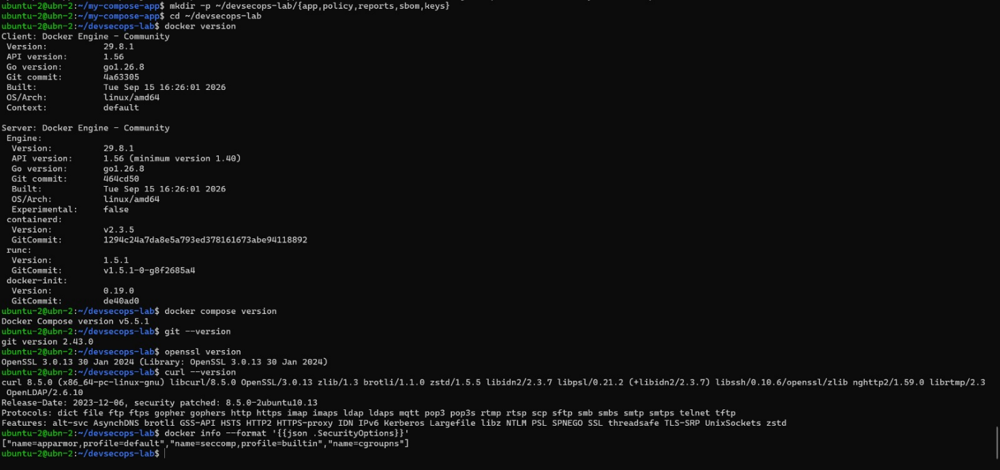
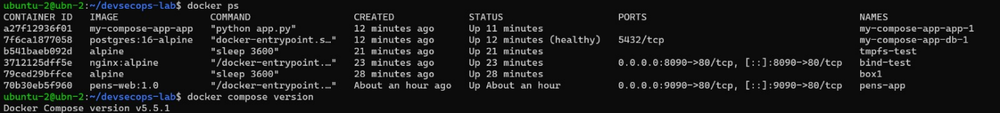
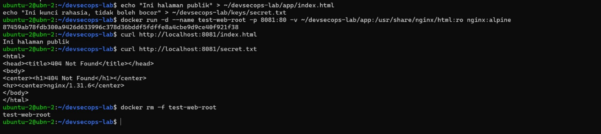
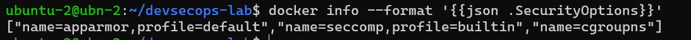



# BAB I: FONDASI TEORETIS DAN KERANGKA KERJA DEVSECOPS

## 1.1 Lingkungan Kerja (Environment)

Praktikum dilakukan pada Virtual Machine (VM) yang berjalan pada platform virtualisasi Proxmox VE. Lingkungan yang digunakan adalah sebagai berikut:

- Sistem Operasi: Ubuntu Linux 22.04 LTS

- Arsitektur: linux/amd64

- Hostname: ubn-2

- User: ubuntu-2

- IP Address: 10.252.108.103

Seluruh proses instalasi, konfigurasi, dan pengujian Docker dilakukan melalui terminal pada VM tersebut. Pengujian akses service container dilakukan melalui browser menggunakan IP address VM.

## 1.2 Langkah Kerja dan Hasil Implementasi

### 1.2.1 Menetapkan Baseline Laboratorium

Langkah awal dijalankan pada mesin host ubuntu-2@ubn-2 dengan membuat direktori kerja tunggal ~/devsecops-lab/ yang memiliki sub-direktori khusus terpisah sesuai peruntukannya. Kemudian lakukan pemeriksaan versi docker dilakukan untuk mencatat baseline environment.

## 1.3 Verifikasi dan Skenario Pengujian

### 1.3.1 Verifikasi Akses Docker Daemon & Kontainer Aktif

Pengujian dilakukan untuk memastikan akun praktikum (ubuntu-2) dapat berkomunikasi langsung dengan Docker daemon tanpa perlunya perantara hak akses eksternal, serta memverifikasi kesiapan plugin Compose:

### 1.3.2 Pengujian Skenario Isolasi Web Root

Skenario pengujian dikembangkan untuk membuktikan bahwa direktori reports, sbom, dan keys aman dari akses publik dan tidak terpapar saat aplikasi web mempublikasikan direktori app/.

### 1.3.3 Pemeriksaan Fitur Keamanan Host Kernel

Opsi keamanan yang aktif pada host Linux diperiksa menggunakan format JSON untuk mengetahui profil pembatasan sistem (Mandatory Access Control):

### 1.3.4 Threat Statement Praktikum Baseline

Aset utama yang dilindungi dalam lingkungan laboratorium ini mencakup kunci kriptografi dan berkas rahasia (~/devsecops-lab/keys/secret.txt), laporan hasil analisis kerentanan (reports/), kebijakan keamanan (policy/), serta dokumen *Software Bill of Materials* (sbom/). Aktor ancaman potensial meliputi penyerang eksternal yang melakukan pemindaian endpoint web secara proaktif maupun pengguna lokal berhak akses rendah (*unprivileged local user*) yang berada di dalam jaringan laboratorium. Jalur serangan (*attack vector*) dapat terjadi apabila pengembang melakukan kesalahan konfigurasi pemetaan volume (*volume bind mount misconfiguration*) dengan memetakan seluruh direktori induk ~/devsecops-lab/ sebagai *document root* web server, atau akibat ditemukannya celah pemutaran direktori (*Directory Traversal / Path Traversal*) pada aplikasi web. Dampak dari terwujudnya ancaman ini adalah kebocoran kredensial dan kunci rahasia secara publik (*Confidentiality Breach*), yang memberikan jalan bagi penyerang untuk melakukan eskalasi hak akses (*Privilege Escalation*), mengambil alih kendali infrastruktur kontainer, serta memalsukan laporan kepatuhan keamanan laboratorium.

## 1.4 Evaluasi dan Latihan Mandiri

**1. Mengapa DevSecOps tidak dapat direduksi menjadi penambahan scanner pada pipeline?**

DevSecOps merupakan transformasi holistik yang mencakup budaya, proses kerja, dan teknologi (*people, process, technology*), bukan sekadar otomatisasi pengujian perangkat lunak. Penambahan alat pemindai (seperti SAST, DAST, atau SCA) ke dalam pipeline CI/CD tanpa integrasi budaya dan kebijakan perbaikan (*remediation SLAs*) hanya akan menghasilkan kebisingan sinyal berupa *false positives* dan pemicu *alert fatigue* bagi tim pengembang.

DevSecOps menuntut pergeseran paradigma tanggung jawab keamanan ke tahap paling awal (*Shift-Left Security*), penyusunan kebijakan keamanan terstruktur sebagai kode (*Policy-as-Code*), manajemen risiko yang berkelanjutan, serta kolaborasi aktif antara tim pengembang, operasi, dan sekuritas. Scanner hanyalah instrumen deteksi pasif; tanpa adanya tindak lanjut remedi, tata kelola (*governance*), dan peningkatan kapasitas (*security awareness*) pengembang, keberadaan scanner tidak otomatis menjamin pipeline menjadi aman.

**2. Evidence apa yang membedakan klaim kontrol dari kontrol yang benar-benar terverifikasi?**

Klaim kontrol bersifat deklaratif dan konseptual (misalnya pernyataan "sistem kami telah mengisolasi direktori sensitif dan menggunakan konfigurasi kernel aman") tanpa menyertakan bukti empiris. Sebaliknya, kontrol yang benar-benar terverifikasi (*verified controls*) dibuktikan melalui artifak dan rekaman data objektif yang dapat diuji ulang (*reproducible*).

Bukti nyata (*verifiable evidence*) yang membedakan keduanya mencakup:

- Log Eksekusi Pengujian Nyata: Hasil tangkapan respon HTTP (seperti curl http://localhost:8081/secret.txt yang mengembalikan status 404 Not Found) yang membuktikan isolasi *web root* bekerja secara efektif.

- Rekaman Baseline & Konfigurasi Sistem: Data mentah keluaran sistem seperti docker info --format '{{json .SecurityOptions}}' yang membuktikan aktifnya profil *AppArmor*, *Seccomp*, dan *Cgroupns*.

- Artifak Audit Terstruktur: Dokumen *Software Bill of Materials* (SBOM), berkas laporan audit keamanan berbasis format standar (SARIF/JSON), serta rekaman pencatatan versi komponen yang presisi (Docker 29.8.1, Git 2.43.0, OpenSSL 3.0.13).

**3. Bagaimana shared responsibility memengaruhi ownership risiko dan tindak lanjut temuan?**

Model Tanggung Jawab Bersama (*Shared Responsibility Model*) mengeliminasi batas-batas *silo* tradisional di mana tim keamanan (*Security*) sering dikambinghitamkan sebagai satu-satunya pemilik risiko sistem. Model ini membagi kepemilikan risiko dan tanggung jawab remedi secara proporsional sesuai dengan domain kontrolnya:

- Ownership Risiko (Kepemilikan Risiko): Tim Pengembang (*Developers*) memiliki risiko atas kode aplikasi yang ditulis dan dependensi pustaka yang digunakan (*application layer risk*). Tim Operasi (*Ops/Platform*) bertanggung jawab atas keamanan infrastruktur, sistem operasi, dan konfigurasi runtime kontainer (*infrastructure layer risk*). Tim Keamanan (*Security*) mengelola risiko tingkat kebijakan, pemodelan ancaman, dan standar kepatuhan organisasi.

- Tindak Lanjut Temuan: Temuan kerentanan tidak lagi sekadar "dilemparkan" oleh tim sekuritas ke pengembang. Setiap temuan memiliki jalur perbaikan yang terdefinisi dengan SLA yang terukur. Tim pengembang bertanggung jawab memperbarui pustaka atau memperbaiki cacat logika kode, sementara tim sekuritas bertindak sebagai *enabler* yang menyediakan panduan remedi, alat pemindaian otomatis, dan verifikasi ulang hasil tindakan remedi.
