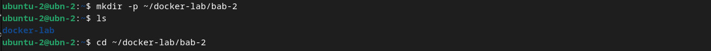
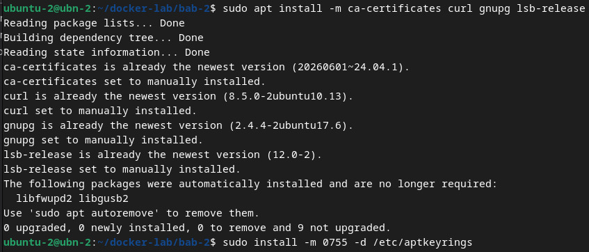
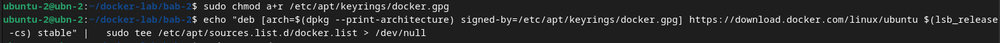
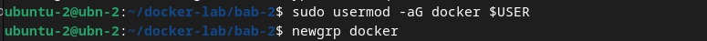
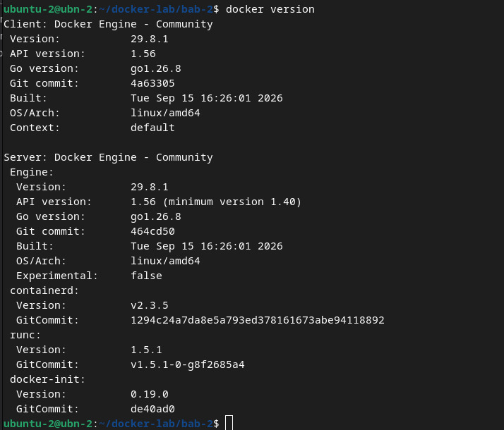
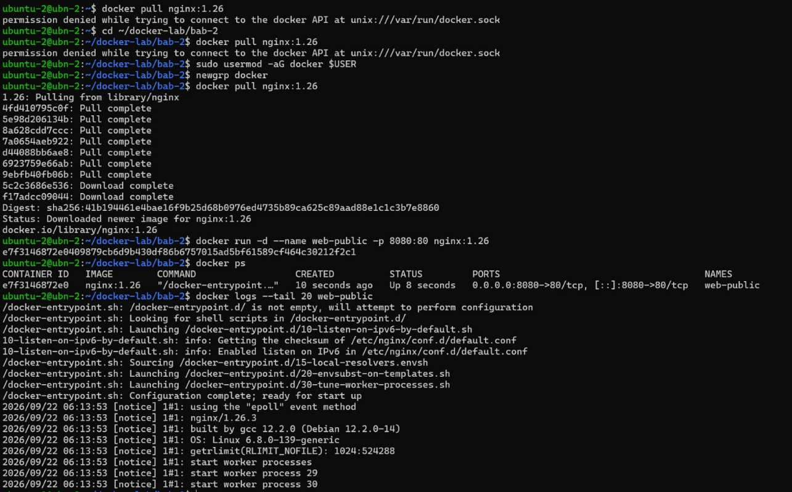
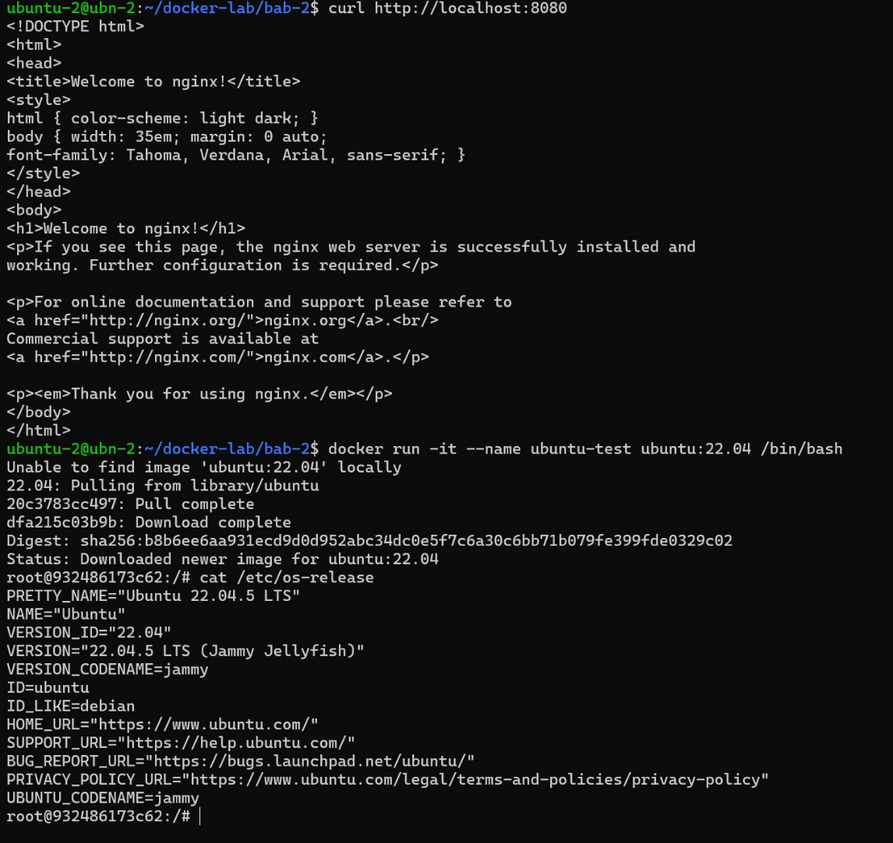
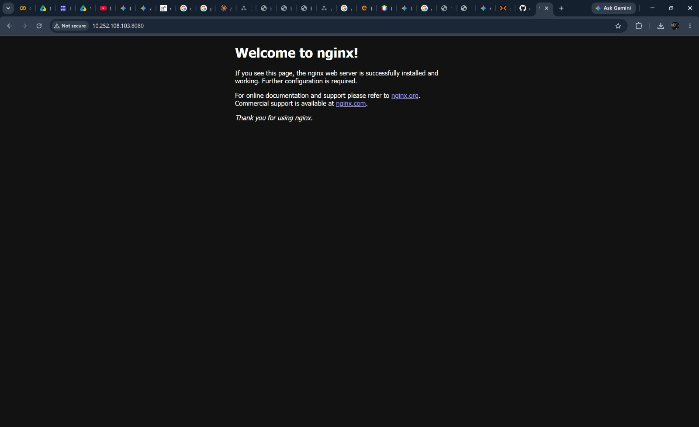
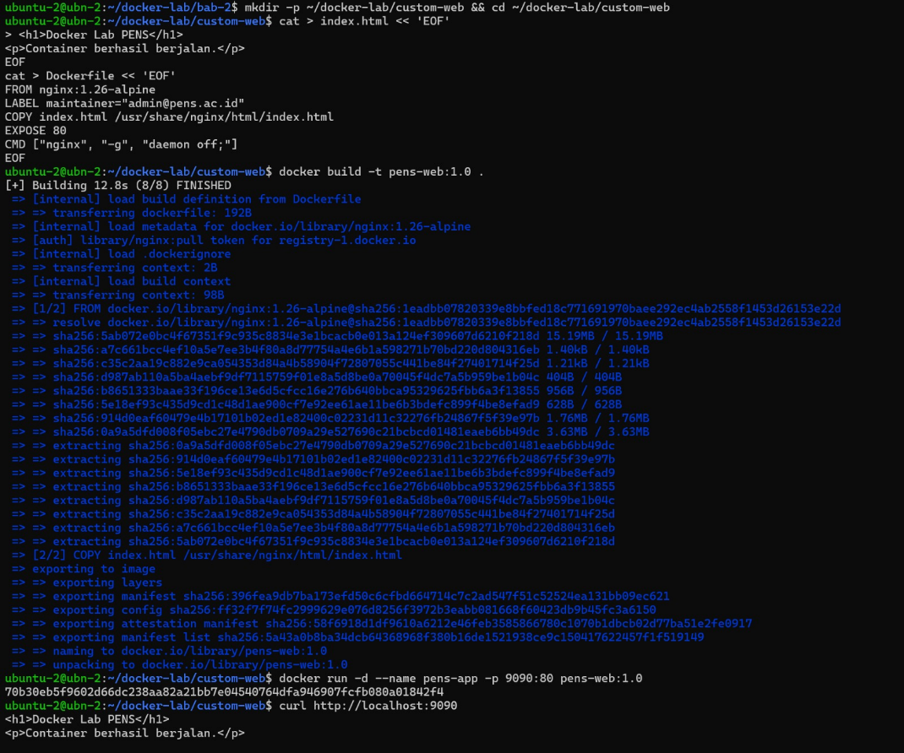
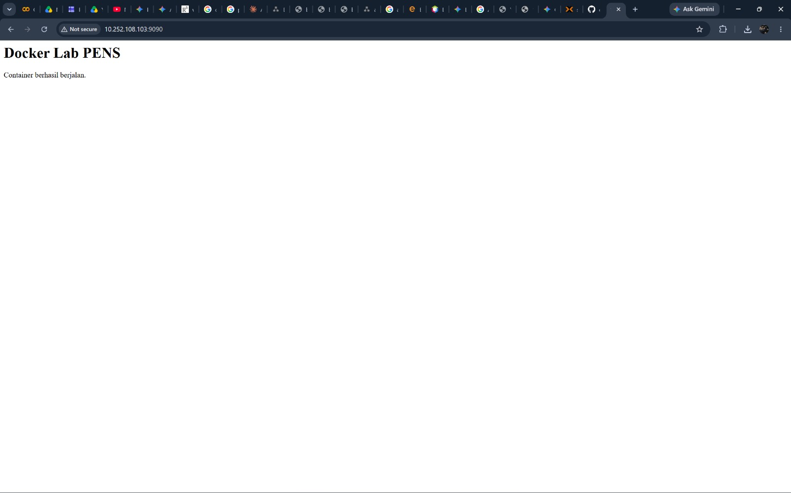



# BAB II: KONSEP CONTAINER DAN INSTALASI DOCKER

## 2.1 Lingkungan Kerja (Environment)

Praktikum dilakukan pada Virtual Machine (VM) yang berjalan pada platform virtualisasi Proxmox VE. Lingkungan yang digunakan adalah sebagai berikut:

- Sistem Operasi: Ubuntu Linux 22.04 LTS

- Arsitektur: linux/amd64

- Hostname: ubn-2

- User: ubuntu-2

- IP Address: 10.252.108.103

Seluruh proses instalasi, konfigurasi, dan pengujian Docker dilakukan melalui terminal pada VM tersebut. Pengujian akses service container dilakukan melalui browser menggunakan IP address VM.

## 2.2 Langkah Kerja dan Hasil Implementasi

### 2.2.1 Inisialisasi Direktori dan Workspace

Langkah awal praktikum dimulai dengan menyiapkan direktori kerja yang terisolasi untuk mengorganisir seluruh file konfigurasi dan dependensi praktikum Docker Bab 02. Perintah mkdir -p digunakan untuk membuat direktori secara bertingkat.

*Gambar 1.1 Pembuatan direktori kerja ~/docker-lab/bab-2 dan navigasi workspace.*

Direktori docker-lab/bab-2 berhasil dibuat di bawah direktori home user. Pengujian dengan perintah ls mengonfirmasi keberadaan direktori, dan perintah cd mengarahkan sesi terminal aktif ke dalam lokasi direktori tersebut.

### 2.2.2 Instalasi Paket Dependensi dan Direktori Keyrings

Sebelum menambahkan repository resmi Docker Engine, sistem perlu diperbarui dengan paket dependensi dasar yang dibutuhkan untuk komunikasi jaringan HTTPS, manajemen sertifikat, serta kunci enkripsi GPG.

*Gambar 1.2 Pengunduhan paket ca-certificates, curl, gnupg, lsb-release, dan pembuatan folder keyrings.*

Paket ca-certificates, curl, gnupg, dan lsb-release terverifikasi telah berada pada versi terbaru (newest version). Direktori /etc/apt/keyrings berhasil dibuat dengan izin akses 0755 untuk menyimpan kunci publik GPG.

### 2.2.3 Konfigurasi GPG Keyring dan Official Repository Docker

Untuk menjamin integritas dan autentisitas paket perangkat lunak Docker yang diunduh via APT, kunci GPG resmi Docker diunduh dan disimpan ke dalam direktori keyrings, kemudian entri repository ditambahkan ke dalam skema paket APT Ubuntu.

*Gambar 2.1 Pembaruan izin baca kunci GPG dan penambahan repositori resmi Docker ke APT sources.*

Berkas docker.gpg berhasil diatur dengan hak akses publik baca (a+r). Penambahan entri sumber daya APT pada /etc/apt/sources.list.d/docker.list memastikan sistem mendapatkan pembaharuan Docker Engine secara langsung dari repositori resmi.

### 2.2.4 Pengaturan Hak Akses User Non-Root

Secara default, Docker Daemon berjalan di bawah hak akses akun root. Agar pengguna biasa dapat menjalankan perintah Docker tanpa menyertakan instruksi sudo pada setiap eksekusi, user ditambahkan ke dalam Unix group docker.

*Gambar 2.2 Penambahan user aktif ke unix group docker dan penyegaran hak akses via newgrp.*

Akun pengguna ubuntu-2 berhasil dimasukkan ke dalam grup docker. Penggunaan perintah newgrp docker merefresh keanggotaan grup dalam sesi shell aktif tanpa memerlukan re-login sistem.

### 2.2.5 Verifikasi Instalasi dan Status Docker Engine

Guna memastikan bahwa Docker Daemon telah aktif dan dapat berkomunikasi dengan CLI client secara normal, dilakukan pengecekan arsitektur dan versi komponen Docker Engine.

*Gambar 2.3 Verifikasi versi Docker Engine (Client v29.8.1 & Server v29.8.1, containerd v2.3.5).*

Perintah docker version menampilkan informasi lengkap mengenai Client dan Server Docker Engine Community versi 29.8.1, API version 1.56, runtime runc v1.5.1, serta supervisor containerd v2.3.5 yang menandakan instalasi berhasil.

### 2.2.6 Deployment dan Monitoring Container Web Server (nginx)

Praktikum dilanjutkan dengan mengunduh (pull) image resmi Nginx versi 1.26 dari Docker Hub, kemudian menjalankan container dalam mode terisolasi di latar belakang (detached mode -d) serta memetakan port host 8080 ke port 80 milik container.

*Gambar 3.1 Pengunduhan image Nginx 1.26, eksekusi container web-public, dan pemeriksaan log proses.*

Image nginx:1.26 berhasil diunduh. Container dinamai web-public dan berstatus Up. Log internal mengonfirmasi bahwa worker processes Nginx telah berjalan.

### 2.2.7 Validasi Pengujian Web Server Via CLI dan Browser

Untuk memverifikasi konektivitas layanan web yang berjalan di dalam container, pengujian dilakukan melalui dua pendekatan: panggilan HTTP menggunakan command curl dan pengujian antarmuka melalui Web Browser.

*Gambar 3.2 Tampilan verifikasi halaman web Nginx "Welcome to nginx!" yang diakses via browser pada IP 10.252.108.103:8080.*

Hasil command curl http://localhost:8080 mengembalikan struktur dokumen HTML resmi Nginx. Pengujian lanjutan via Google Chrome pada alamat IP Host http://10.252.108.103:8080 menampilkan halaman pembuka Nginx.

### 2.2.8 Eksplorasi Container Interaktif

Docker memungkinkan pembentukan lingkungan sistem operasi terisolasi secara cepat. Command pada gambar 4.1 digunakan untuk masuk ke dalam sesi terminal interaktif container Ubuntu.

*Gambar 4.1 Pengujian respon curl localhost dan eksekusi container interaktif Ubuntu 22.04 LTS.*

Command tersebut berhasil berjalan dan terhubung dengan akun root@932486173c62:/#. Pengecekan file /etc/os-release mengonfirmasi bahwa distribusi yang berjalan di dalam container adalah Ubuntu 22.04.5 LTS.

### 2.2.9 Pembuatan Custom Image Menggunakan Dockerfile

Praktikum dilanjutkan dengan membangun Custom Docker Image berbasis nginx:1.26-alpine yang memuat halaman web kustom ciptaan sendiri melalui instruksi spesifik pada berkas Dockerfile.

*Gambar 4.2 Pembuatan Dockerfile, proses docker build pens-web:1.0, eksekusi pens-app port 9090, dan pengujian curl.*

Proses build image pens-web:1.0 berhasil. Container pens-app di-deploy pada port host 9090, dan output curl http://localhost:9090 menampilkan tag HTML kustom dengan benar.

### 2.2.10 Pengujian Custom Web Server Via Browser dan Verifikasi Skenario

Untuk membuktikan ketersediaan custom web application bagi pengguna luar, pengujian dilakukan dengan membuka antarmuka browser pada alamat IP Host http://10.252.108.103:9090.

*Gambar 5.1 Pengujian akses browser ke Custom Web Server pens-web:1.0 melalui IP Host 10.252.108.103:9090.*

### 2.2.11 Matriks Verifikasi Dan Skenario Pengujian

| Status       | Kriteria Pengujian Modul                                                | Bukti & Catatan Evaluasi                                                      |
|--------------|-------------------------------------------------------------------------|-------------------------------------------------------------------------------|
| \[✔\] PASSED | Docker Engine aktif dan docker version menampilkan Client serta Server. | Terverifikasi pada Gambar 2.3 (Client v29.8.1 & Server v29.8.1 aktif).        |
| \[✔\] PASSED | User non-root dapat menjalankan docker ps tanpa sudo.                   | Terverifikasi pada Gambar 2.2 & 3.1 (User ubuntu-2 menggunakan group docker). |
| \[✔\] PASSED | Container Nginx dapat diakses dari browser melalui port host.           | Terverifikasi pada Gambar 3.2 (Akses 10.252.108.103:8080 sukses).             |
| \[✔\] PASSED | Image pens-web:1.0 berhasil dibangun dan dijalankan.                    | Terverifikasi pada Gambar 4.2 & 5.1 (Akses 10.252.108.103:9090 sukses).       |
| \[✔\] PASSED | Mahasiswa dapat menjelaskan perbedaan EXPOSE dan -p.                    | Teranalisis lengkap pada Bagian 12 laporan ini.                               |

### 2.2.12 Perbedaan Expose dengan -p

**1. Instruksi EXPOSE (Metadata pada Dockerfile):**

Instruksi EXPOSE 80 di dalam Dockerfile berfungsi sebagai dokumentasi internal / deklarasi metadata yang menginformasikan port mana yang digunakan oleh aplikasi di dalam container. Instruksi ini TIDAK membuka port ke antarmuka jaringan host luar secara otomatis dan tidak mengonfigurasi firewall / routing host.

**2. Parameter -p / --publish (Docker CLI Runtime):**

Parameter -p 9090:80 pada saat perintah docker run berfungsi secara aktif melakukan Pemetaan Port (Port Binding). Docker Daemon secara langsung memodifikasi aturan iptables / IP forwarding pada sistem operasi host untuk meneruskan seluruh lalu lintas dari port fisik host (9090) ke port internal container (80).

### 2.2.13 Evaluasi dan Latihan Mandiri

**1. Mengapa penggunaan tag `latest` tidak dianjurkan untuk deployment yang harus reproducible?**

Tag latest bersifat mutable (dapat berubah seiring waktu). Tag ini hanyalah sebuah pointer dinamis yang menunjuk pada build versi paling akhir yang diunggah ke registry. Apabila digunakan dalam skenario reproducible deployment (misalnya di lingkungan staging atau production), instruksi docker pull image:latest di kemudian hari berisiko mengunduh versi image yang telah diperbarui oleh developer. Hal ini dapat menimbulkan ketidakcocokan dependensi (dependency mismatch), breaking changes, atau perilaku aplikasi yang inkonsisten antar lingkungan. Untuk menjamin sifat reproducible, deployment wajib menggunakan tag versi spesifik (misal nginx:1.26.3) atau mereferensikan SHA256 Image Digest (misal image@sha256:41b19446...) yang bersifat immutable.

**2. Jelaskan peran `containerd` dan `runc` dalam arsitektur Docker.**

- runc (Low-Level Container Runtime): Komponen tingkat paling bawah yang mengimplementasikan spesifikasi OCI (Open Container Initiative). Tugas utamanya adalah berinteraksi langsung dengan kernel Linux untuk membuat, mengonfigurasi, dan menjalankan container process memanfaatkan fitur namespaces (isolasi PID, jaringan, mount point) dan cgroups (pembatasan memori/CPU). Setelah container selesai diinisialisasi, proses runc langsung keluar (exit).

- containerd (High-Level Container Runtime Daemon): Bertindak sebagai pengelola siklus hidup container (container lifecycle manager) tingkat menengah. containerd mengendalikan eksekusi runc, mengelola penarikan/penyimpanan image dari registry, mengatur sistem penyimpanan layer (OverlayFS), mengelola attachment jaringan dasar, serta memantau kesehatan proses container.

**3. Apa konsekuensi keamanan dari memasukkan user ke group `docker`?**

Memasukkan pengguna biasa (non-root) ke dalam grup docker memberikan hak akses yang setara dengan akses root penuh tanpa kata sandi (passwordless root privilege escalation) pada sistem host. Hal ini terjadi karena Docker Daemon berjalan dengan privilese root dan berkomunikasi melalui socket Unix /var/run/docker.sock yang diizinkan untuk diakses oleh anggota grup docker. User dalam grup ini dapat dengan mudah melakukan mount direktori root host ke dalam container (misal: docker run -v /:/host-root -it ubuntu bash), yang memungkinkan pengguna membaca/memodifikasi file sensitif sistem host seperti /etc/shadow atau /etc/sudoers. Praktik DevSecOps merekomendasikan penggunaan Rootless Docker Mode atau pembatasan ketat pengguna grup ini.

**4. Bandingkan layer image `nginx:1.26-alpine` dan image custom yang Anda buat.**

Image base nginx:1.26-alpine berukuran sangat ringkas (~10 MB) dan terdiri dari layer OS minimalis Alpine Linux serta binaries Nginx. Saat membangun image custom pens-web:1.0 menggunakan Dockerfile, Docker menggunakan mekanisme Union File System (Overlay2). Image custom membagikan (sharing) seluruh layer read-only milik base image nginx:1.26-alpine tanpa menduplikasi data, dan hanya menambahkan 1 layer read-only baru yang berisi instruksi COPY index.html. Pendekatan layered storage ini sangat efisien dalam menghemat ruang penyimpanan disk dan mempercepat distribusi build.

**5. Kapan sebaiknya memilih Virtual Machine (VM) daripada container?**

Virtual Machine (VM) sebaiknya dipilih dibanding Container dalam kondisi: (1) Isolasi Keamanan Tingkat Tinggi (Strong Isolation): VM menggunakan hardware-level virtualization (Hypervisor) dengan Kernel OS terpisah, sehingga sangat cocok untuk lingkungan multi-tenant di mana antar entitas tidak boleh membagikan Kernel yang sama. (2) Kebutuhan OS / Kernel Berbeda: Ketika aplikasi membutuhkan Kernel atau OS yang berbeda dari host (misal menjalankan VM Windows pada Host Linux). (3) Aplikasi Legacy / Driver Khusus: Aplikasi terdahulu yang membutuhkan modul kernel spesifik, konfigurasi memori langsung, atau akses hardware device tertentu.
