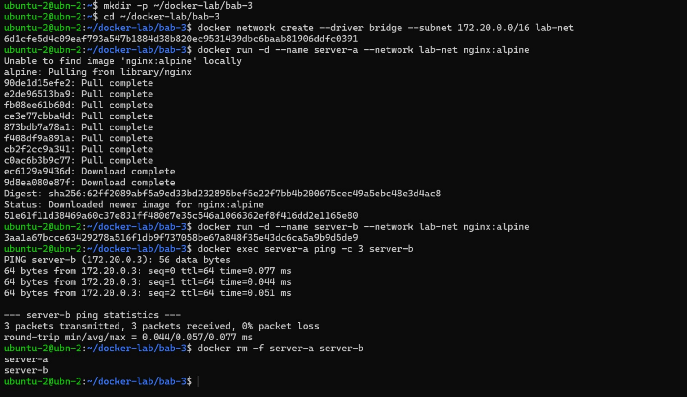
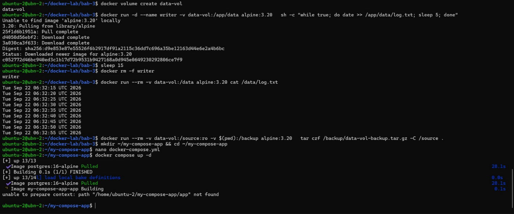
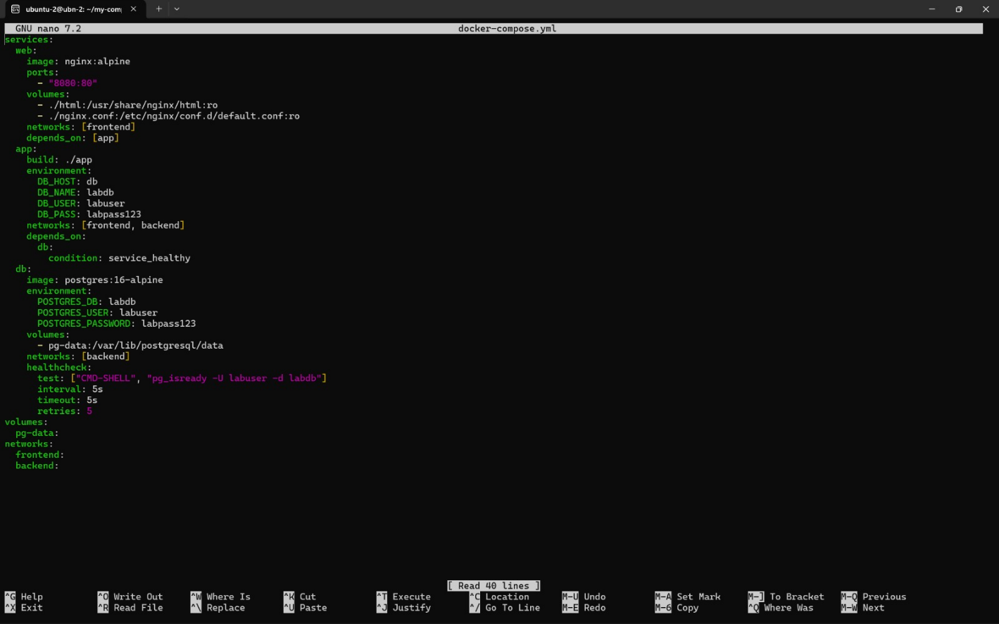
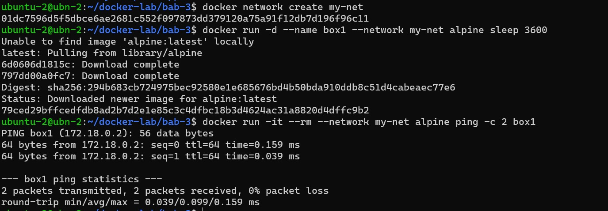
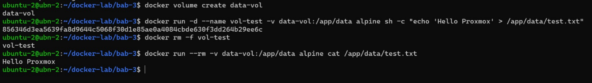
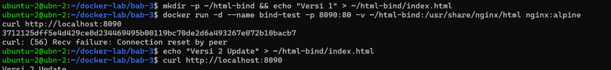
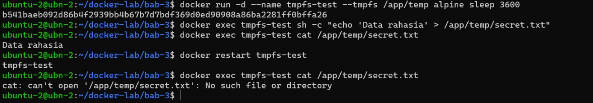
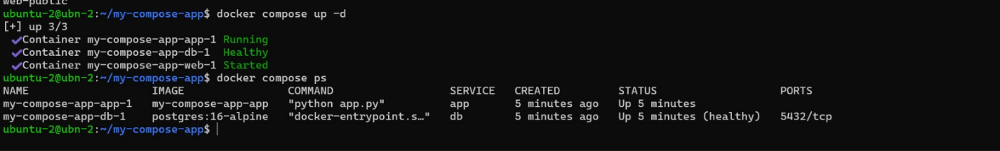



# BAB III: DOCKER NETWORK, VOLUME, BIND MOUNT, TMPFS DAN COMPOSE

## 3.1 Lingkungan Kerja

Praktikum dilakukan pada Virtual Machine (VM) yang berjalan pada platform virtualisasi Proxmox VE. Lingkungan yang digunakan adalah sebagai berikut:

- Sistem Operasi: Ubuntu Linux 22.04 LTS

- Arsitektur: linux/amd64

- Hostname: ubn-2

- User: ubuntu-2

- IP Address: 10.252.108.103

Seluruh proses instalasi, konfigurasi, dan pengujian Docker dilakukan melalui terminal pada VM tersebut. Pengujian akses service container dilakukan melalui browser menggunakan IP address VM.

## 3.2 Langkah Kerja dan Hasil Implementasi

### 3.2.1 User-Defined Bridge Network

Mengonfigurasi jaringan bridge terisolasi kustom dengan subnet 172.20.0.0/16 untuk menguji ketersediaan fitur *Embedded DNS Server* internal Docker (127.0.0.11) dalam melakukan penyelesaian nama hostname antar-container secara otomatis.

*Gambar 1.1 Pembuatan jaringan lab-net, deployment server-a & server-b, serta hasil ping sukses menggunakan hostname.*

Container server-a berhasil mengirim paket ICMP ping ke server-b (IP 172.20.0.3) menggunakan nama alias container secara langsung dengan 0% packet loss. Hal ini membuktikan bahwa jaringan bridge buatan user mengaktifkan automatic DNS discovery bawaan.

### 3.2.2 Volume Backup dan Restore

Pengujian daya tahan data menggunakan *Named Volume* dengan menuliskan catatan log waktu berkala, dilanjutkan dengan penghapusan container penulis dan pengarsipan backup berbasis tar.

*Gambar 1.2 Verifikasi integritas data log setelah penghapusan container writer dan kompresi file backup tar.gz.*

Data log berturut-turut yang dibuat oleh container writer tetap dapat dibaca secara utuh oleh container Alpine baru setelah container asal dihancurkan. Proses backup tar czf juga berhasil mengompresi isi volume ke host.

### 3.2.3 Compose multi-container Nginx-Flask-PostgreSQL

Penyusunan berkas deklaratif docker-compose.yml yang mengoordinasikan tiga microservices: Nginx Web Proxy (web), Python Backend API (app), dan PostgreSQL Database (db) dilengkapi pengujian healthcheck.

*Gambar 1.3 Editor Nano menampilkan manifes docker-compose.yml dengan environment, volumes, & healthcheck.*

## 3.3 Verifikasi dan Skenario Pengujian Mandiri

### 3.3.1 Service Discovery pada User-Defined Bridge (my-net)

*Gambar 3.1 Pengujian ping dari container ephemeral ke box1 (172.18.0.2) via nama alias pada jaringan my-net.*

Perintah pada Gambar 3.1 membuktikan bahwa container terpisah yang terhubung pada bridge network yang sama dapat saling menemukan IP melalui nama container tanpa bantuan konfigurasi DNS eksternal.

### 3.3.2 Persistensi Named Volume Setelah Container Removal

*Gambar 2.3 Pembacaan kembali teks Hello Proxmox dari data-vol setelah container vol-test dihapus.*

Data yang ditulis ke /app/data/test.txt berada di direktori khusus host (/var/lib/docker/volumes/). Saat container vol-test di-*remove* secara paksa, siklus hidup volume tetap aman dan datanya dapat diakses container baru.

### 3.3.3 Live Development Hot-Reloading via Bind Mount

*Gambar 3.3 Respon curl berubah seketika menjadi Versi 2 Update saat file index.html di host dimodifikasi.*

Bind Mount mengikat direktori host ~/html-bind secara langsung ke web root Nginx /usr/share/nginx/html. Perubahan kode di host langsung berdampak pada respon HTTP container tanpa perlu rebuild image.

### 3.3.4 Pengujian Storage Volatile / In-Memory (tmpfs)

*Gambar 3.4 File secret.txt terhapus setelah container tmpfs-test di-restart.*

Storage tmpfs dialokasikan pada RAM host. Ketika container di-restart, memori dibebaskan sehingga seluruh file di dalam mount point /app/temp terhapus permanen demi keamanan data sensitif.

### 3.3.5 Multi-Container Deployment & Healthcheck Verification

*Gambar 3.5 Output docker compose ps menunjukkan status Up dan Database berstatus (healthy).*

Eksekusi command pada Gambar 3.5 berhasil menjalankan ketiga layanan. Fitur Healthcheck secara konsisten memverifikasi kesiapan database PostgreSQL sebelum menerima traffic.

### 3.3.6 Matriks Verifikasi Dan Skenario Pengujian

| No  | Item Pengujian Verifikasi                                       | Status       | Bukti & Observasi Teknis                                                                   |
|-----|-----------------------------------------------------------------|--------------|--------------------------------------------------------------------------------------------|
| 1   | Container di user-defined bridge dapat saling resolve via nama. | \[✔\] PASSED | Gambar 3.1: Ping ke server-b dan box1 sukses 0% loss via Embedded DNS.                     |
| 2   | Data di named volume tetap ada setelah container dihapus.       | \[✔\] PASSED | Gambar 3.2: Data log & string 'Hello Proxmox' di data-vol dibaca utuh oleh container baru. |
| 3   | Bind mount menunjukkan perubahan file host tanpa rebuild.       | \[✔\] PASSED | Gambar 3.3: Output curl menampilkan 'Versi 2 Update' secara real-time dari host.           |
| 4   | tmpfs kehilangan data setelah container restart.                | \[✔\] PASSED | Gambar 3.4: File secret.txt hilang total dari RAM setelah perintah restart.                |
| 5   | Compose stack berjalan dan API health menampilkan status db.    | \[✔\] PASSED | Gambar 3.5: Seluruh container aktif dan database bernilai (healthy).                       |

### 3.3.7 Evaluasi dan Latihan Mandiri

**1. Keunggulan User-Defined Bridge**

*User-defined bridge* jauh lebih baik daripada *default bridge* untuk aplikasi *multi-container* karena menyediakan fitur *Automatic DNS Resolution*, sehingga container dapat saling berkomunikasi cukup menggunakan nama layanannya tanpa mengandalkan alamat IP yang dinamis. Selain itu, *user-defined bridge* memberikan isolasi jaringan yang lebih ketat karena hanya container dalam jaringan yang sama yang dapat terhubung, serta memungkinkan pengembang untuk menghubungkan atau melepas container dari jaringan secara langsung tanpa perlu melakukan *restart*.

**2. Risiko Keamanan Bind Mount**

Risiko utama dari *bind mount* adalah terpaparnya direktori dan berkas sensitif dari sistem host secara langsung ke dalam container. Jika container berhasil diretas atau dijalankan menggunakan akses *root*, penyerang dapat membaca, mengubah, atau menghapus berkas penting pada mesin host (seperti berkas konfigurasi sistem /etc atau kunci SSH). Hal ini dapat menyebabkan pembobolan batas isolasi (*container escape*) dan pengambilalihan kendali penuh atas server host.

**3. Perbedaan docker compose down dan docker compose down -v**

Perbedaan dasarnya terletak pada penanganan data *volume*. Perintah docker compose down hanya menghentikan serta menghapus container dan jaringan yang dibuat oleh Compose, tetapi tetap membiarkan *named volume* beserta datanya utuh di host. Sebaliknya, perintah docker compose down -v menghentikan dan menghapus container, jaringan, sekaligus menghapus seluruh named volume yang terdaftar pada file docker-compose.yml, sehingga seluruh data persisten (seperti basis data) akan terhapus secara permanen.

**4. Penggunaan depends_on dengan healthcheck**

Penggunaan depends_on yang dikombinasikan dengan healthcheck (condition: service_healthy) lebih tepat digunakan ketika suatu layanan membutuhkan layanan lain untuk benar-benar siap menerima transaksi data, bukan sekadar dalam status menyala. Sebagai contoh, aplikasi *backend* yang membutuhkan database; depends_on biasa hanya menunggu proses container database mulai berjalan, sedangkan kombinasi healthcheck memastikan database telah selesai melakukan inisialisasi dan siap menerima koneksi sebelum aplikasi *backend* mulai dinyalakan, sehingga terhindar dari error *connection refused*.

**5. Strategi Backup Volume Database Produksi**

Strategi *backup volume* database produksi dapat dilakukan dengan dua metode utama. Pertama, menggunakan skrip otomatis (*cron job*) yang menjalankan utilitas *dump* bawaan database (seperti pg_dump atau mysqldump) melalui perintah docker exec tanpa menghentikan layanan. Kedua, dengan metode *cold backup*, yaitu menghentikan sementara container database, lalu menjalankan *helper container* sementara yang melakukan *mount* pada *volume* database untuk mengarsipkan direktori data ke dalam file kompresi (.tar.gz). Seluruh berkas cadangan tersebut selanjutnya harus langsung dikirim dan disimpan ke lokasi penyimpanan terpisah seperti *Cloud Storage* (S3) untuk mengantisipasi kegagalan perangkat keras pada server utama.
