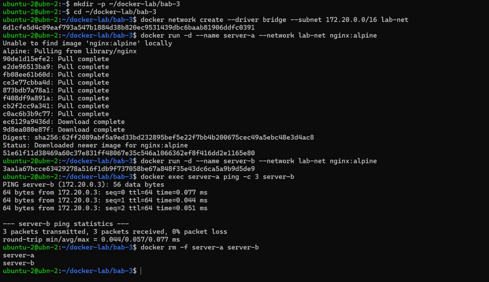
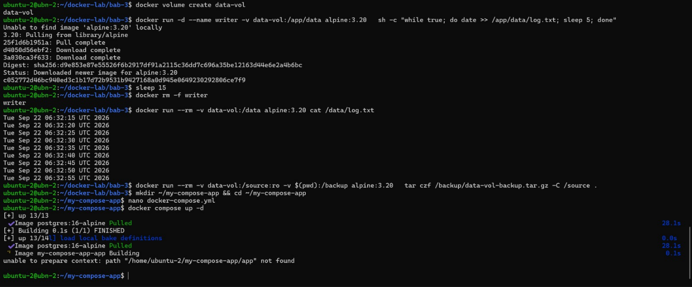
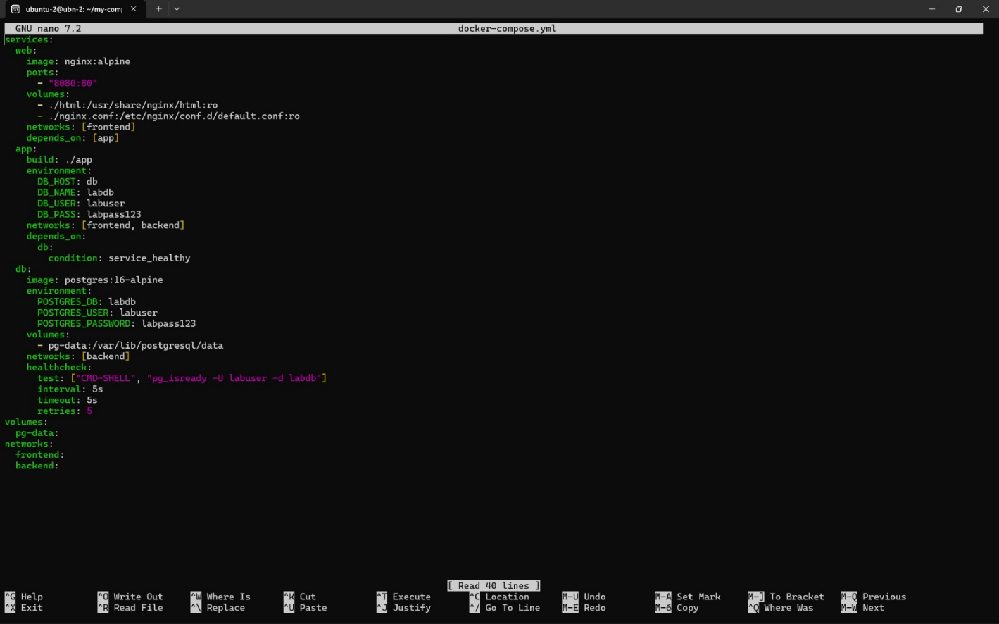
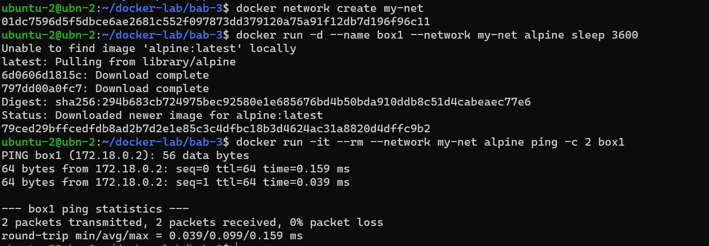
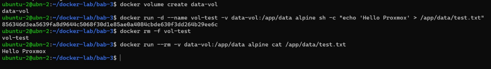
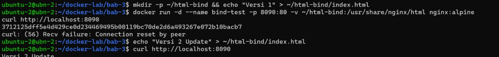
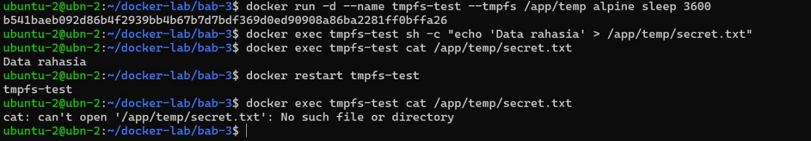
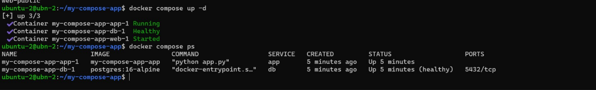

<p align="center"></p>

# BAB III: DOCKER NETWORK, VOLUME, BIND MOUNT, TMPFS DAN COMPOSE

## 3.1 Lingkungan Kerja

Praktikum dilakukan pada Virtual Machine (VM) yang berjalan pada platform virtualisasi Proxmox VE. Lingkungan yang digunakan adalah sebagai berikut:

- Sistem Operasi: Ubuntu Linux 22.04 LTS
- Arsitektur: linux/amd64
- Hostname: ubn-2
- User: ubuntu-2
- IP Address: 10.252.108.103

Seluruh proses instalasi, konfigurasi, dan pengujian Docker dilakukan melalui terminal pada VM tersebut. Pengujian akses service container dilakukan melalui browser menggunakan IP address VM.

## 3.2 Langkah Kerja dan Hasil Implementasi

### 3.2.1 User-Defined Bridge Network

Mengonfigurasi jaringan bridge terisolasi kustom dengan subnet 172.20.0.0/16 untuk menguji ketersediaan fitur *Embedded DNS Server* internal Docker (127.0.0.11) dalam melakukan penyelesaian nama hostname antar-container secara otomatis:

```bash
mkdir -p ~/docker-lab/bab-3
cd ~/docker-lab/bab-3
docker network create --driver bridge --subnet 172.20.0.0/16 lab-net
docker run -d --name server-a --network lab-net nginx:alpine
docker run -d --name server-b --network lab-net nginx:alpine
docker exec server-a ping -c 3 server-b
docker rm -f server-a server-b
```



*Gambar 1.1 Pembuatan jaringan lab-net, deployment server-a & server-b, serta hasil ping sukses menggunakan hostname.*

Container server-a berhasil mengirim paket ICMP ping ke server-b (IP 172.20.0.3) menggunakan nama alias container secara langsung dengan 0% packet loss. Hal ini membuktikan bahwa jaringan bridge buatan user mengaktifkan automatic DNS discovery bawaan.

### 3.2.2 Volume Backup dan Restore

Pengujian daya tahan data menggunakan *Named Volume* dengan menuliskan catatan log waktu berkala, dilanjutkan dengan penghapusan container penulis dan pengarsipan backup berbasis tar:

```bash
docker volume create data-vol
docker run -d --name writer -v data-vol:/app/data alpine:3.20 sh -c "while true; do date >> /app/data/log.txt; sleep 5; done"
sleep 15
docker rm -f writer
docker run --rm -v data-vol:/data alpine:3.20 cat /data/log.txt
docker run --rm -v data-vol:/source:ro -v $(pwd):/backup alpine:3.20 tar czf /backup/data-vol-backup.tar.gz -C /source .
```



*Gambar 1.2 Verifikasi integritas data log setelah penghapusan container writer dan kompresi file backup tar.gz.*

Data log berturut-turut yang dibuat oleh container writer tetap dapat dibaca secara utuh oleh container Alpine baru setelah container asal dihancurkan. Proses backup tar czf juga berhasil mengompresi isi volume ke host.

### 3.2.3 Compose multi-container Nginx-Flask-PostgreSQL

Penyusunan berkas deklaratif docker-compose.yml yang mengoordinasikan tiga microservices: Nginx Web Proxy (web), Python Backend API (app), dan PostgreSQL Database (db) dilengkapi pengujian healthcheck:

```bash
mkdir -p ~/my-compose-app && cd ~/my-compose-app
nano docker-compose.yml
```



*Gambar 1.3 Editor Nano menampilkan manifes docker-compose.yml dengan environment, volumes, & healthcheck.*

## 3.3 Verifikasi dan Skenario Pengujian Mandiri

### 3.3.1 Service Discovery pada User-Defined Bridge (my-net)

Pengujian service discovery otomatis menggunakan jaringan kustom `my-net` antar container Alpine:

```bash
docker network create my-net
docker run -d --name box1 --network my-net alpine sleep 3600
docker run -it --rm --network my-net alpine ping -c 2 box1
```



*Gambar 3.1 Pengujian ping dari container ephemeral ke box1 (172.18.0.2) via nama alias pada jaringan my-net.*

Perintah pada Gambar 3.1 membuktikan bahwa container terpisah yang terhubung pada bridge network yang sama dapat saling menemukan IP melalui nama container tanpa bantuan konfigurasi DNS eksternal.

### 3.3.2 Persistensi Named Volume Setelah Container Removal

Pengujian persistensi data pada Named Volume `data-vol` saat container dihapus dan diakses kembali oleh container baru:

```bash
docker volume create data-vol
docker run -d --name vol-test -v data-vol:/app/data alpine sh -c "echo 'Hello Proxmox' > /app/data/test.txt"
docker rm -f vol-test
docker run --rm -v data-vol:/app/data alpine cat /app/data/test.txt
```



*Gambar 2.3 Pembacaan kembali teks Hello Proxmox dari data-vol setelah container vol-test dihapus.*

Data yang ditulis ke `/app/data/test.txt` berada di direktori khusus host (`/var/lib/docker/volumes/`). Saat container vol-test di-*remove* secara paksa, siklus hidup volume tetap aman dan datanya dapat diakses container baru.

### 3.3.3 Live Development Hot-Reloading via Bind Mount

Pengujian mekanisme bind mount untuk hot-reloading kode / dokumen web tanpa perlu membuild ulang image:

```bash
mkdir -p ~/html-bind && echo "Versi 1" > ~/html-bind/index.html
docker run -d --name bind-test -p 8090:80 -v ~/html-bind:/usr/share/nginx/html nginx:alpine
curl http://localhost:8090
echo "Versi 2 Update" > ~/html-bind/index.html
curl http://localhost:8090
```



*Gambar 3.3 Respon curl berubah seketika menjadi Versi 2 Update saat file index.html di host dimodifikasi.*

Bind Mount mengikat direktori host `~/html-bind` secara langsung ke web root Nginx `/usr/share/nginx/html`. Perubahan kode di host langsung berdampak pada respon HTTP container tanpa perlu rebuild image.

### 3.3.4 Pengujian Storage Volatile / In-Memory (tmpfs)

Pengujian storage sementara dalam memori RAM (tmpfs) yang hilang otomatis saat container direstart:

```bash
docker run -d --name tmpfs-test --tmpfs /app/temp alpine sleep 3600
docker exec tmpfs-test sh -c "echo 'Data rahasia' > /app/temp/secret.txt"
docker exec tmpfs-test cat /app/temp/secret.txt
docker restart tmpfs-test
docker exec tmpfs-test cat /app/temp/secret.txt
```



*Gambar 3.4 File secret.txt terhapus setelah container tmpfs-test di-restart.*

Storage tmpfs dialokasikan pada RAM host. Ketika container di-restart, memori dibebaskan sehingga seluruh file di dalam mount point `/app/temp` terhapus permanen demi keamanan data sensitif.

### 3.3.5 Multi-Container Deployment & Healthcheck Verification

Deployment seluruh stack multi-container menggunakan Docker Compose dan verifikasi kondisi kesehatan kontainer:

```bash
docker compose up -d
docker compose ps
```



*Gambar 3.5 Output docker compose ps menunjukkan status Up dan Database berstatus (healthy).*

Eksekusi command pada Gambar 3.5 berhasil menjalankan ketiga layanan. Fitur Healthcheck secara konsisten memverifikasi kesiapan database PostgreSQL sebelum menerima traffic.

### 3.3.6 Matriks Verifikasi Dan Skenario Pengujian

| No  | Item Pengujian Verifikasi                                       | Status       | Bukti & Observasi Teknis                                                                   |
|-----|-----------------------------------------------------------------|--------------|--------------------------------------------------------------------------------------------|
| 1   | Container di user-defined bridge dapat saling resolve via nama. | \[✔\] PASSED | Gambar 3.1: Ping ke server-b dan box1 sukses 0% loss via Embedded DNS.                     |
| 2   | Data di named volume tetap ada setelah container dihapus.       | \[✔\] PASSED | Gambar 3.2: Data log & string 'Hello Proxmox' di data-vol dibaca utuh oleh container baru. |
| 3   | Bind mount menunjukkan perubahan file host tanpa rebuild.       | \[✔\] PASSED | Gambar 3.3: Output curl menampilkan 'Versi 2 Update' secara real-time dari host.           |
| 4   | tmpfs kehilangan data setelah container restart.                | \[✔\] PASSED | Gambar 3.4: File secret.txt hilang total dari RAM setelah perintah restart.                |
