<p align="center"></p>

# BAB IV: NGINX, APACHE, FLASH, DAN TLS DENGAN DOCKER COMPOSE

## 4. Topologi

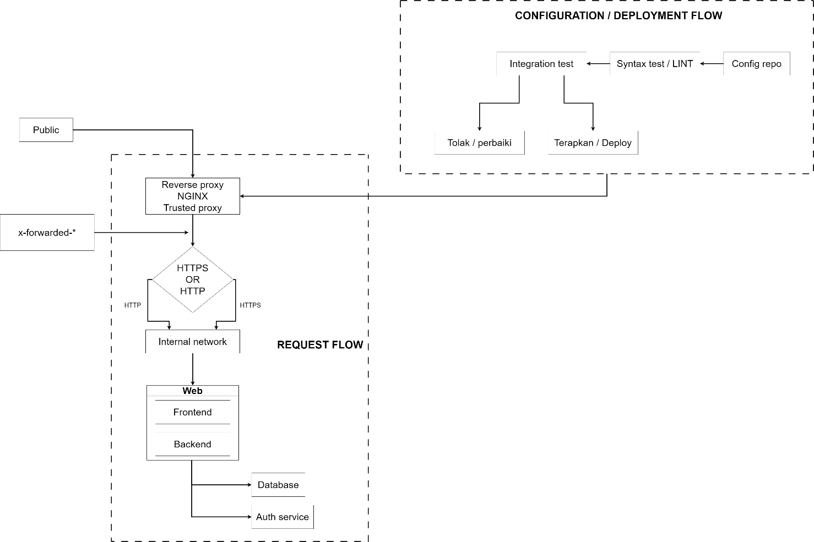

Memperlihatkan topologi web service yang dibagi menjadi dua alur, yaitu *request flow* dan *configuration/deployment flow*. Request flow menggambarkan perjalanan permintaan dari pengguna hingga layanan internal. Configuration/deployment flow menggambarkan bagaimana perubahan konfigurasi diuji sebelum diterapkan pada reverse proxy. Pemisahan ini menegaskan bahwa keamanan web layer ditentukan oleh rancangan jalur trafik sekaligus tata kelola perubahannya.

Pada request flow, trafik dari pengguna publik hanya masuk melalui satu titik, yaitu reverse proxy NGINX yang berperan sebagai *trusted proxy*. Rancangan ini sejalan dengan prinsip boundary aplikasi, yaitu hanya reverse proxy yang memiliki *published port*, sedangkan service lain tidak dipublikasikan ke host. Dengan begitu, seluruh trafik eksternal wajib melewati kebijakan yang diterapkan di lapisan depan, seperti terminasi TLS, routing, pembatasan ukuran request, pencatatan akses, dan penerapan header keamanan.

Header x-forwarded- digunakan untuk meneruskan informasi asli dari client, seperti alamat client, skema koneksi, dan host tujuan, agar tetap tersedia bagi backend. Header ini hanya dapat dipercaya apabila request benar-benar berasal dari proxy yang sah. Karena itu, backend harus dapat dijangkau hanya melalui proxy, dan trust terhadap header tersebut dibatasi oleh topologi network serta daftar proxy terpercaya. Jika tidak, penyerang dapat memalsukan header untuk memengaruhi audit log, pembuatan URL, atau keputusan keamanan.

Setelah diterima, koneksi dibedakan menjadi HTTPS dan HTTP. Pada tahap ini reverse proxy memusatkan pengelolaan sertifikat melalui terminasi TLS, sehingga kerahasiaan dan integritas data selama transit terjaga. Setelah melewati proxy, permintaan diteruskan ke *internal network*, yaitu network privat tempat seluruh service aplikasi berjalan tanpa terekspos langsung ke luar.

Di dalam network internal terdapat komponen web yang terdiri dari *frontend* dan *backend*. Frontend menyajikan antarmuka kepada pengguna, sedangkan backend memuat logika bisnis. Meskipun reverse proxy telah menerapkan kebijakan di lapisan depan, validasi input, autentikasi, otorisasi, dan pengelolaan sesi tetap harus diterapkan pada backend karena hanya service tersebut yang memiliki konteks bisnis. Backend selanjutnya terhubung ke *database* dan *auth service* yang berada pada lapisan terdalam. Kedua komponen ini tidak boleh diakses langsung dari luar, sehingga risiko kebocoran data dan penyalahgunaan layanan autentikasi berkurang.

Pada configuration/deployment flow, konfigurasi reverse proxy diperlakukan sebagai kode. Konfigurasi disimpan dan diberi versi pada *config repo*, lalu melewati *syntax test/lint* untuk memastikan sintaksnya valid. Tahap berikutnya adalah *integration test* yang menguji perilaku nyata melalui request positif maupun negatif, misalnya terhadap route tidak dikenal, body terlalu besar, dan hostname yang tidak cocok. Hasil pengujian menentukan keputusan: konfigurasi yang gagal ditolak untuk diperbaiki, sedangkan yang lulus diterapkan (*deploy*) ke reverse proxy. Mekanisme ini memastikan setiap perubahan pada virtual host, route, header, sertifikat, dan timeout dapat ditelusuri, diuji, dan dipertanggungjawabkan.

## 4.1 Direktori Kerja

Pada praktikum ini dibuat direktori kerja terstruktur untuk menyimpan seluruh konfigurasi dan file yang dibutuhkan dalam menjalankan aplikasi menggunakan Docker Compose:

```bash
mkdir -p ~/docker-lab/bab-4/{apache/sites,nginx/conf,certs,logs/nginx,app}
cd ~/docker-lab/bab-4
```

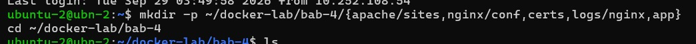

Pemisahan folder ini menerapkan konsep *separation of concerns*, sehingga konfigurasi, sertifikat TLS, kode aplikasi, dan log memiliki tempat masing-masing.

## 4.2 Sertifikat TLS Laboratorium

Pembuatan sertifikat self-signed X.509 dan kunci privat RSA 2048-bit untuk komunikasi HTTPS terenkripsi pada port 8443:

```bash
openssl req -x509 -nodes -days 365 -newkey rsa:2048 \
  -keyout certs/lab.key \
  -out certs/lab.crt \
  -subj "/CN=localhost/O=DevSecOps Docker Lab" \
  -addext "subjectAltName=DNS:localhost,IP:127.0.0.1"

chmod 600 certs/lab.key
chmod 644 certs/lab.crt
ls -l certs/
```

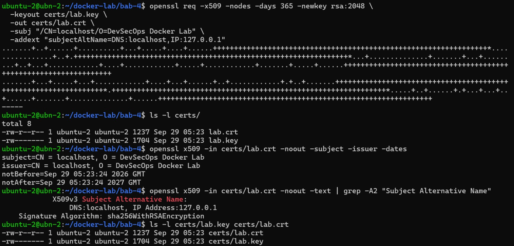

Perintah openssl req menghasilkan dua berkas sertifikat di direktori certs/, yaitu lab.crt sebagai sertifikat publik dan lab.key sebagai kunci privat RSA 2048-bit.

## 4.3 File compose.yaml

Penyusunan berkas deklaratif `compose.yaml` untuk mengoordinasikan service proxy (NGINX), web server (Apache), dan backend API (Flask):

```bash
nano compose.yaml
```

```yaml
services:
  proxy:
    image: nginx:alpine
    ports:
      - "127.0.0.1:8080:80"
      - "127.0.0.1:8443:443"
    volumes:
      - ./nginx/conf:/etc/nginx/conf.d:ro
      - ./certs:/etc/nginx/certs:ro
      - ./logs/nginx:/var/log/nginx
    networks:
      - web-net
    depends_on:
      apache-web:
        condition: service_started
      flask-app:
        condition: service_healthy

  apache-web:
    image: httpd:2.4-alpine
    volumes:
      - ./apache/sites:/usr/local/apache2/htdocs:ro
    networks:
      - web-net

  flask-app:
    build:
      context: ./app
    networks:
      - web-net
    healthcheck:
      test:
        - CMD
        - python
        - -c
        - "import urllib.request; urllib.request.urlopen('http://127.0.0.1:5000/health')"
      interval: 5s
      timeout: 3s
      retries: 5
      start_period: 5s

networks:
  web-net:
    driver: bridge
```

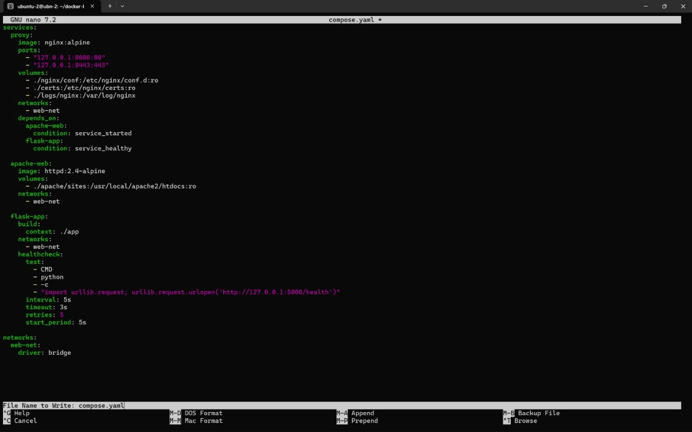

## 4.4 File nginx/conf/default.conf

Konfigurasi reverse proxy NGINX untuk routing HTTP->HTTPS redirect (301), reverse proxy ke Apache (`/`) dan Flask (`/api/`), serta penambahan security headers:

```bash
nano nginx/conf/default.conf
```

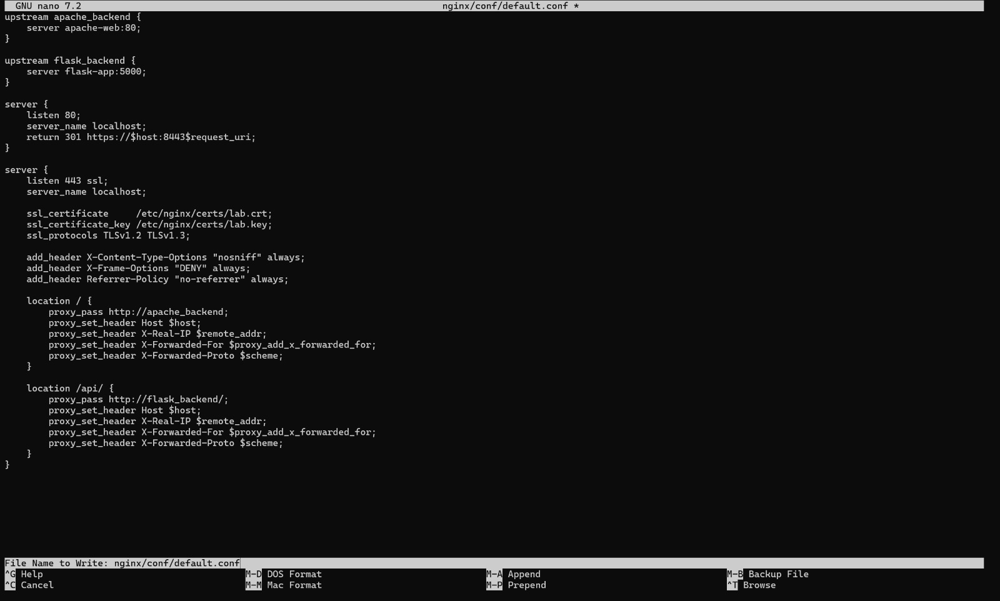

Konfigurasi NGINX menggunakan upstream untuk menghubungkan trafik ke apache-web:80 dan flask-app:5000. Pada port HTTP, seluruh permintaan dialihkan dengan status 301 ke HTTPS melalui port 8443.

## 4.5 File apache/sites/index.html

Pembuatan halaman web statis HTML yang akan disajikan oleh service Apache melalui reverse proxy NGINX:

```bash
nano apache/sites/index.html
```

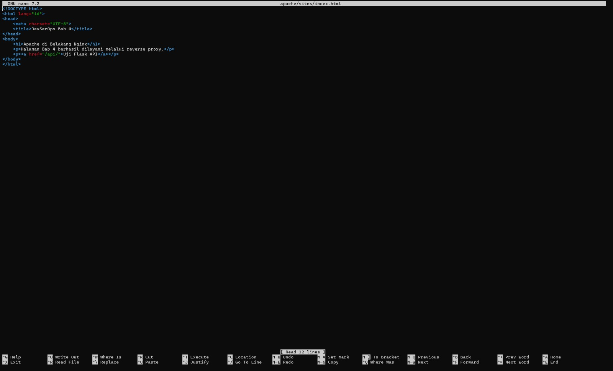

Dengan konfigurasi tersebut, client tidak mengakses Apache secara langsung, tetapi request diterima oleh Nginx terlebih dahulu dan kemudian diteruskan ke Apache.

## 4.6 File app/requirements.txt

Mendefinisikan daftar pustaka Python yang dibutuhkan oleh aplikasi Flask:

```bash
nano app/requirements.txt
```

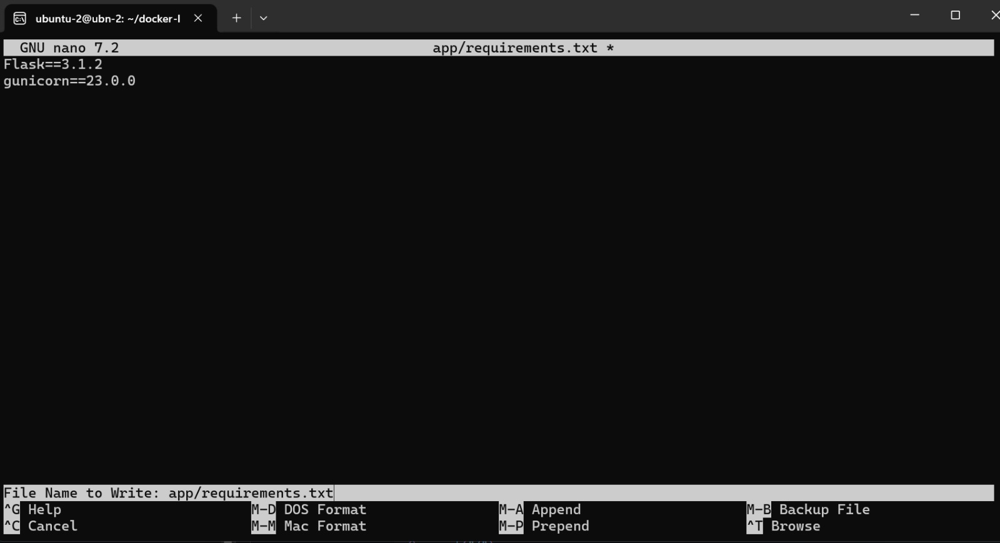

## 4.7 File app/app.py

Pembuatan file kode backend Flask yang menyediakan endpoint root `/` dan endpoint kesehatan `/health`:

```bash
nano app/app.py
```

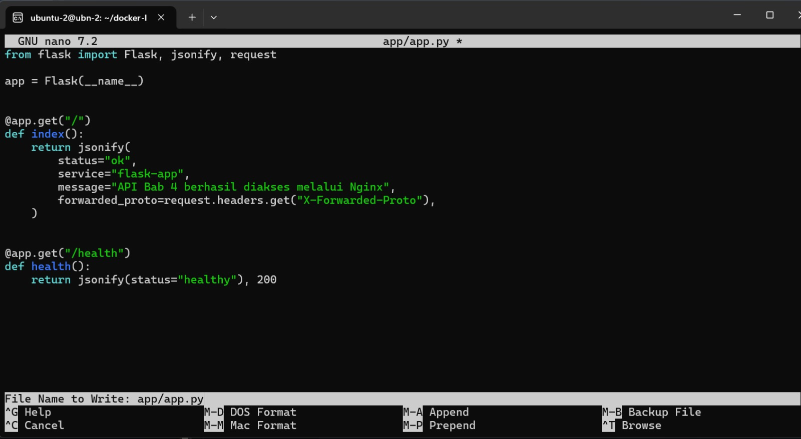

## 4.8 File app/Dockerfile

Pembuatan Dockerfile aplikasi backend berbasis python:3.12-slim dengan pengguna non-root (`USER appuser`):

```bash
nano app/Dockerfile
```

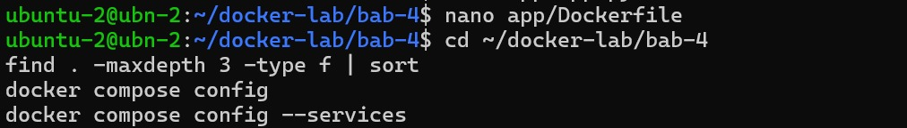

Konfigurasi user non-root dan perintah eksekusi Gunicorn:

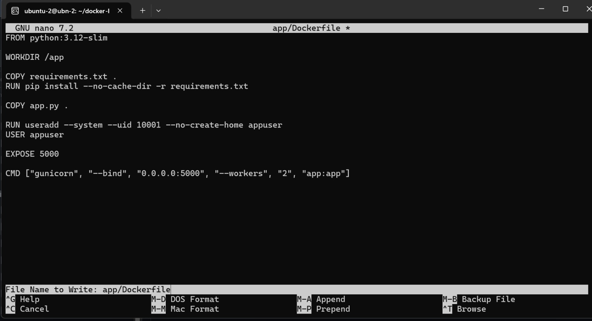

## 4.9 Validasi

Memvalidasi struktur direktori file serta memeriksa sintaks Docker Compose:

```bash
cd ~/docker-lab/bab-4
find . -maxdepth 3 -type f | sort
docker compose config
docker compose config --services
```

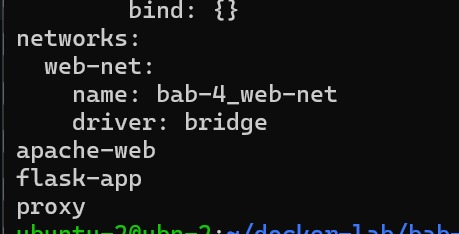

Perintah find menampilkan struktur file yang telah dibuat dalam direktori bab-4. Selanjutnya, docker compose config memeriksa konfigurasi compose.yaml dan menghasilkan konfigurasi tanpa pesan kesalahan.

## 4.10 Build dan Menjalankan Stack

Membangun image custom Flask dan menjalankan seluruh stack multi-container di latar belakang:

```bash
docker compose up -d --build
docker compose ps
docker compose logs --tail 100
```

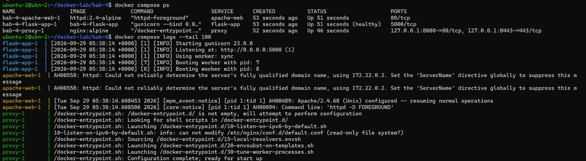

Perintah docker compose ps menunjukkan ketiga layanan berhasil berjalan, yaitu apache-web berstatus Up, flask-app berstatus Up (healthy), dan proxy berstatus Up dengan port 8080 dan 8443.

## 4.11 Pengujian Cepat

Rangkaian pengujian cepat konektivitas HTTP redirect, HTTPS Apache, API Flask, dan sertifikat TLS:

```bash
curl -I http://localhost:8080/
curl -k -i https://localhost:8443/
curl -k https://localhost:8443/api/
curl -k -i https://localhost:8443/api/health
openssl s_client -connect localhost:8443 -servername localhost -brief </dev/null
```

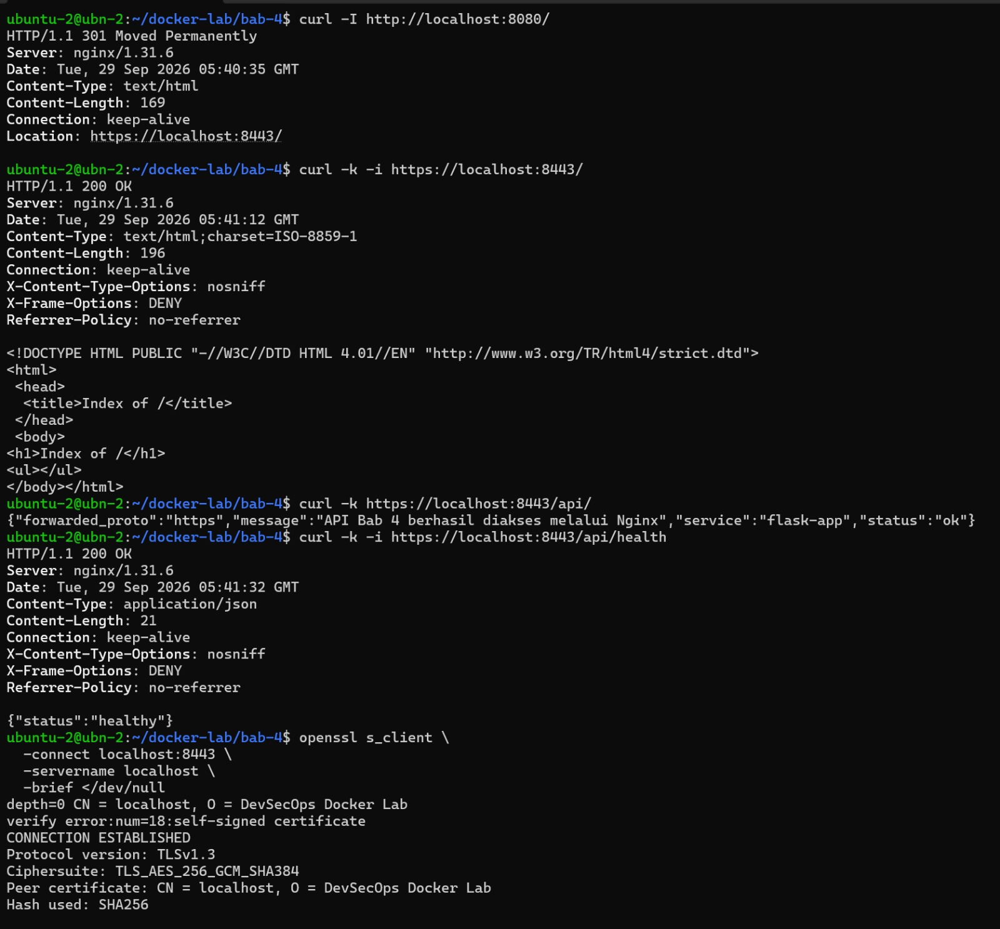

## 4.12 Pemeriksaan Isolasi

Memeriksa published port pada host dan memastikan hanya NGINX proxy yang terekspos:

```bash
docker compose ps
```

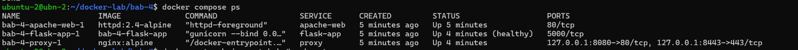

Memeriksa konfigurasi jaringan terisolasi `bab-4_web-net`:

```bash
docker network inspect bab-4_web-net
```

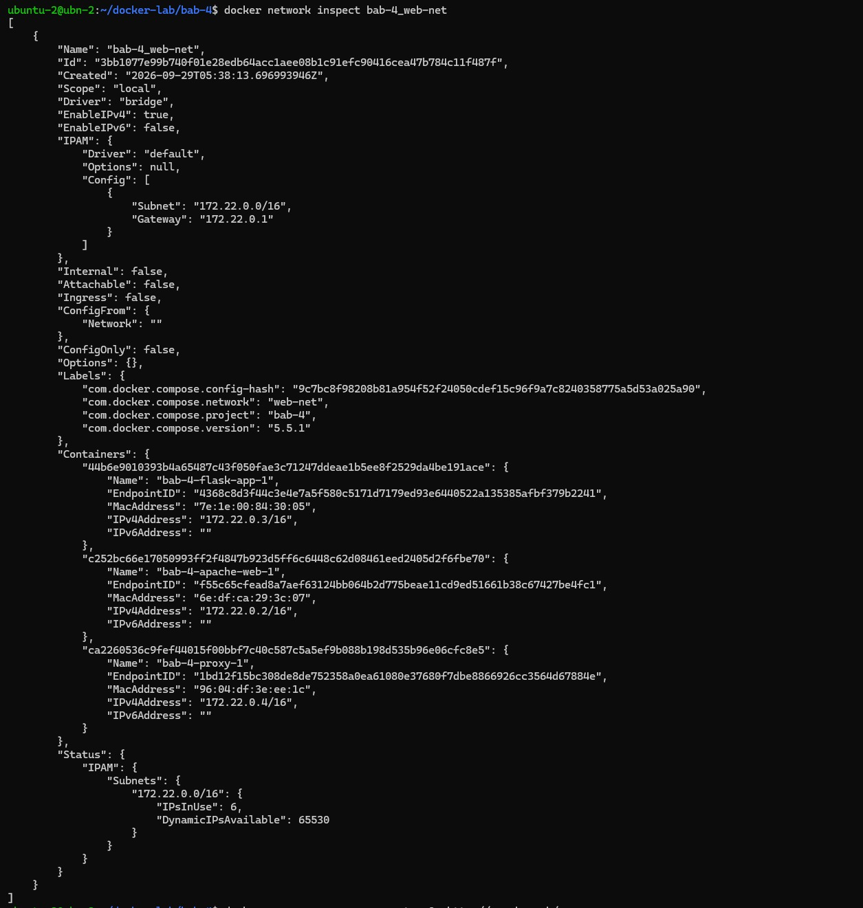

Memverifikasi komunikasi internal antar kontainer menggunakan hostname Docker:

```bash
docker compose exec proxy wget -qO- http://apache-web/
docker compose exec proxy wget -qO- http://flask-app:5000/health
```

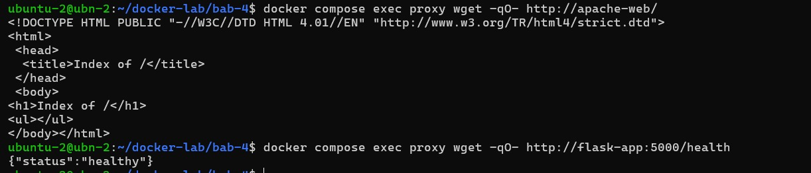

## 4.13 Log

Pemeriksaan pencatatan log pada proxy, backend, dan file access log hasil bind mount:

```bash
docker compose logs proxy
docker compose logs apache-web
docker compose logs flask-app
tail -n 20 logs/nginx/access.log
tail -n 20 logs/nginx/error.log
```

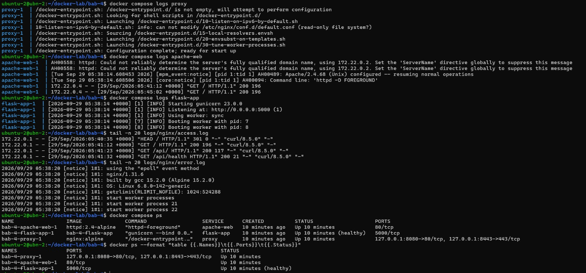

## 4.14 Troubleshooting Cepat

### 4.14.1 Cek Semua Container

Pemeriksaan status seluruh layanan Docker Compose:

```bash
docker compose ps
```

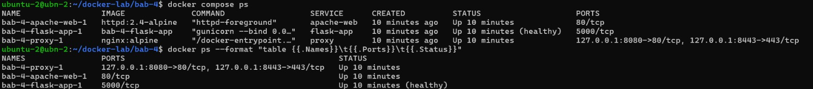

### 4.14.2 Pemeriksaan Log Nginx

Memeriksa log kontainer proxy NGINX untuk memastikan tidak terdapat kesalahan konfigurasi:

```bash
docker compose logs proxy
```

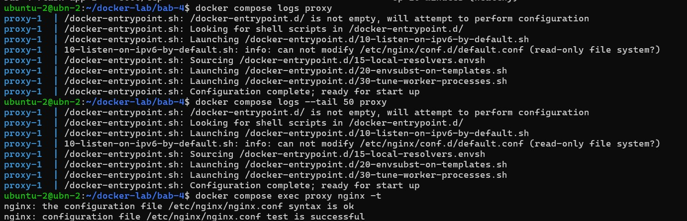

### 4.14.3 Pemeriksaan Log Apache

Memeriksa log web server Apache:

```bash
docker compose logs apache-web
```

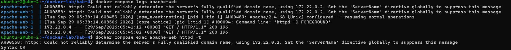

### 4.14.4 Pemeriksaan Log Flask

Memeriksa log aplikasi backend Flask dan server Gunicorn:

```bash
docker compose logs flask-app
```

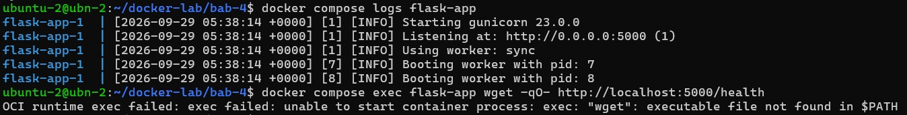

### 4.14.5 Pengujian Komunikasi Nginx ke Apache

Menguji konektivitas internal dari kontainer proxy ke Apache menggunakan wget:

```bash
docker compose exec proxy wget -qO- http://apache-web/
```

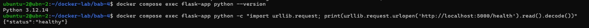

### 4.14.6 Pengujian Komunikasi Nginx ke Flask

Menguji endpoint kesehatan Flask dari kontainer proxy:

```bash
docker compose exec proxy wget -qO- http://flask-app:5000/health
```

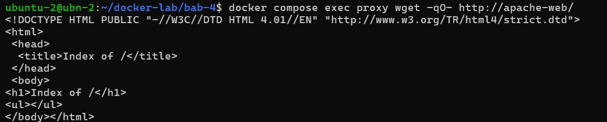

### 4.14.7 Pemeriksaan Koneksi HTTPS dan Handshake TLS

Menguji negosiasi TLS dan validasi sertifikat:

```bash
openssl s_client -connect localhost:8443 -servername localhost -brief </dev/null
```

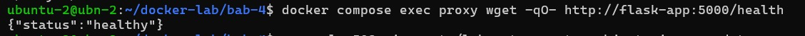

### 4.14.8 Pemeriksaan Published Port Host

Memeriksa port binding pada host untuk memastikan port backend tidak bocor:

```bash
docker ps --format "table {{.Names}}\t{{.Ports}}"
```

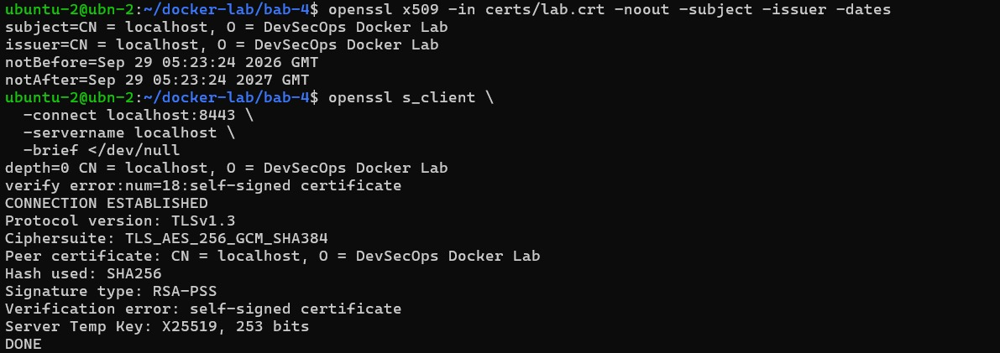

### 4.14.9 Pengujian Akses Endpoint API

Menguji akses endpoint `/api/` melalui HTTPS NGINX:

```bash
curl -k https://localhost:8443/api/
```

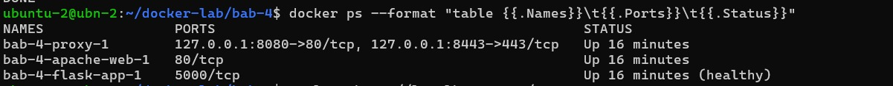

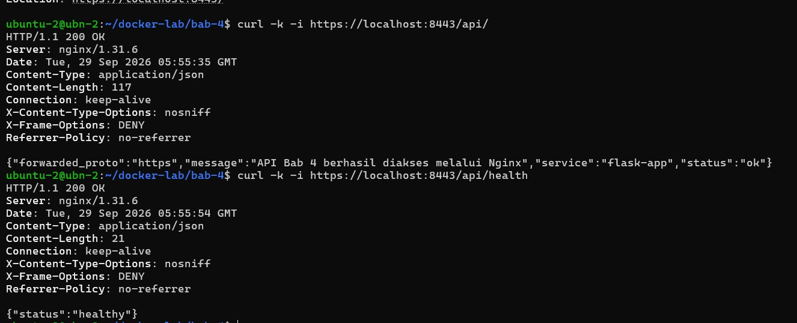

## 4.15 Checklist PASS

| **No.** | **Pemeriksaan**                                | **Hasil**    |
|---------|------------------------------------------------|--------------|
| 1       | docker compose config tidak menghasilkan galat | \[✔\] PASSED |
| 2       | flask-app berstatus healthy                    | \[✔\] PASSED |
| 3       | HTTP port 8080 menghasilkan redirect 301       | \[✔\] PASSED |
| 4       | HTTPS port 8443 menampilkan halaman Apache     | \[✔\] PASSED |
| 5       | /api/ menghasilkan JSON Flask                  | \[✔\] PASSED |
| 6       | TLS 1.2 atau TLS 1.3 berhasil dinegosiasikan   | \[✔\] PASSED |
| 7       | Apache dan Flask tidak memiliki published port | \[✔\] PASSED |
| 8       | Request tercatat pada access log Nginx         | \[✔\] PASSED |

### 4.15.1 Validasi Konfigurasi Docker Compose

```bash
docker compose config
```

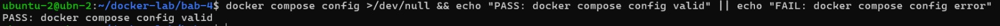

### 4.15.2 Pemeriksaan Status Flask

```bash
docker compose ps flask-app
```

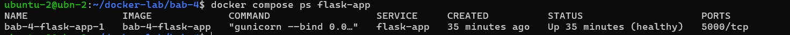

### 4.15.3 Pengujian Redirect HTTP

```bash
curl -I http://localhost:8080/
```

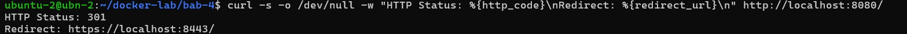

### 4.15.4 Pengujian HTTPS dan Apache

```bash
curl -k -i https://localhost:8443/
```

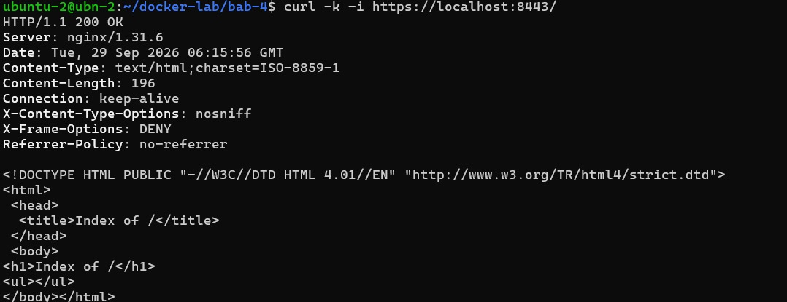

### 4.15.5 Pengujian API Flask

```bash
curl -k https://localhost:8443/api/
```

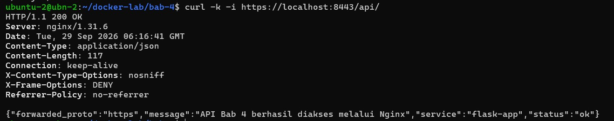

### 4.15.6 Pengujian TLS

```bash
openssl s_client -connect localhost:8443 -servername localhost -brief </dev/null
```

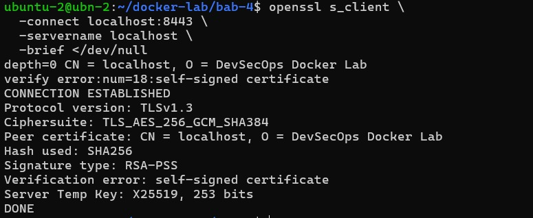

### 4.15.7 Pemeriksaan Published Port

```bash
docker compose ps
```

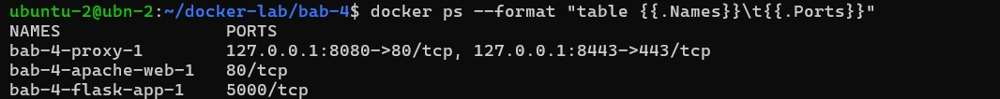

### 4.15.8 Pemeriksaan Access Log Nginx

```bash
tail -n 20 logs/nginx/access.log
```

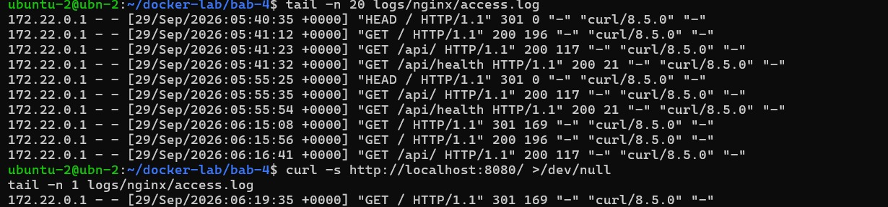
