<p align="center"></p>

# BAB IV: NGINX, APACHE, FLASH, DAN TLS DENGAN DOCKER COMPOSE

## 4. Topologi

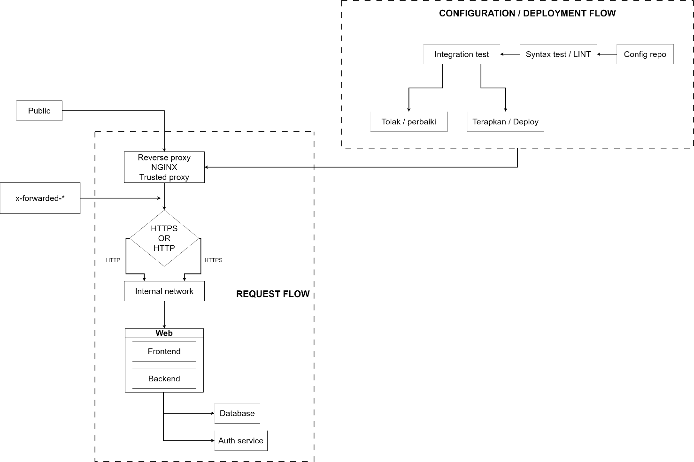

Memperlihatkan topologi web service yang dibagi menjadi dua alur, yaitu *request flow* dan *configuration/deployment flow*. Request flow menggambarkan perjalanan permintaan dari pengguna hingga layanan internal. Configuration/deployment flow menggambarkan bagaimana perubahan konfigurasi diuji sebelum diterapkan pada reverse proxy. Pemisahan ini menegaskan bahwa keamanan web layer ditentukan oleh rancangan jalur trafik sekaligus tata kelola perubahannya.

Pada request flow, trafik dari pengguna publik hanya masuk melalui satu titik, yaitu reverse proxy NGINX yang berperan sebagai *trusted proxy*. Rancangan ini sejalan dengan prinsip boundary aplikasi, yaitu hanya reverse proxy yang memiliki *published port*, sedangkan service lain tidak dipublikasikan ke host. Dengan begitu, seluruh trafik eksternal wajib melewati kebijakan yang diterapkan di lapisan depan, seperti terminasi TLS, routing, pembatasan ukuran request, pencatatan akses, dan penerapan header keamanan.

Header x-forwarded- digunakan untuk meneruskan informasi asli dari client, seperti alamat client, skema koneksi, dan host tujuan, agar tetap tersedia bagi backend. Header ini hanya dapat dipercaya apabila request benar-benar berasal dari proxy yang sah. Karena itu, backend harus dapat dijangkau hanya melalui proxy, dan trust terhadap header tersebut dibatasi oleh topologi network serta daftar proxy terpercaya. Jika tidak, penyerang dapat memalsukan header untuk memengaruhi audit log, pembuatan URL, atau keputusan keamanan.

Setelah diterima, koneksi dibedakan menjadi HTTPS dan HTTP. Pada tahap ini reverse proxy memusatkan pengelolaan sertifikat melalui terminasi TLS, sehingga kerahasiaan dan integritas data selama transit terjaga. Setelah melewati proxy, permintaan diteruskan ke *internal network*, yaitu network privat tempat seluruh service aplikasi berjalan tanpa terekspos langsung ke luar.

Di dalam network internal terdapat komponen web yang terdiri dari *frontend* dan *backend*. Frontend menyajikan antarmuka kepada pengguna, sedangkan backend memuat logika bisnis. Meskipun reverse proxy telah menerapkan kebijakan di lapisan depan, validasi input, autentikasi, otorisasi, dan pengelolaan sesi tetap harus diterapkan pada backend karena hanya service tersebut yang memiliki konteks bisnis. Backend selanjutnya terhubung ke *database* dan *auth service* yang berada pada lapisan terdalam. Kedua komponen ini tidak boleh diakses langsung dari luar, sehingga risiko kebocoran data dan penyalahgunaan layanan autentikasi berkurang.

Pada configuration/deployment flow, konfigurasi reverse proxy diperlakukan sebagai kode. Konfigurasi disimpan dan diberi versi pada *config repo*, lalu melewati *syntax test/lint* untuk memastikan sintaksnya valid. Tahap berikutnya adalah *integration test* yang menguji perilaku nyata melalui request positif maupun negatif, misalnya terhadap route tidak dikenal, body terlalu besar, dan hostname yang tidak cocok. Hasil pengujian menentukan keputusan: konfigurasi yang gagal ditolak untuk diperbaiki, sedangkan yang lulus diterapkan (*deploy*) ke reverse proxy. Mekanisme ini memastikan setiap perubahan pada virtual host, route, header, sertifikat, dan timeout dapat ditelusuri, diuji, dan dipertanggungjawabkan.

## 4.1 Direktori Kerja

Pada praktikum ini dibuat sebuah direktori kerja yang digunakan untuk menyimpan seluruh konfigurasi dan file yang dibutuhkan dalam menjalankan aplikasi menggunakan Docker Compose. Terminal menunjukkan pembuatan direktori kerja utama bab-4 beserta beberapa subdirektori, yaitu apache/sites, nginx/conf, certs, logs/nginx, dan app. Pemisahan folder ini menerapkan konsep *separation of concerns*, sehingga konfigurasi, sertifikat TLS, kode aplikasi, dan log memiliki tempat masing-masing. Struktur tersebut nantinya dapat dihubungkan ke dalam kontainer melalui *bind mount* pada Docker Compose agar data tetap tersimpan dan terorganisasi pada mesin *host*.

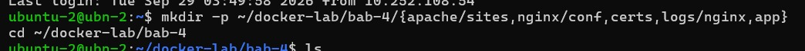

## 4.2 Sertifikat TLS Laboratorium

Perintah openssl req menghasilkan dua berkas sertifikat di direktori certs/, yaitu lab.crt sebagai sertifikat publik dan lab.key sebagai kunci privat RSA 2048-bit. Perintah ls -l certs/ mengonfirmasi kedua berkas tersebut telah berhasil dibuat. Selanjutnya, openssl x509 menunjukkan bahwa sertifikat memiliki CN=localhost, O=DevSecOps Docker Lab, berlaku selama 365 hari, serta memiliki *Subject Alternative Name* (SAN) DNS:localhost dan IP Address:127.0.0.1. Sertifikat ini digunakan oleh NGINX untuk menyediakan komunikasi HTTPS terenkripsi melalui port 8443.

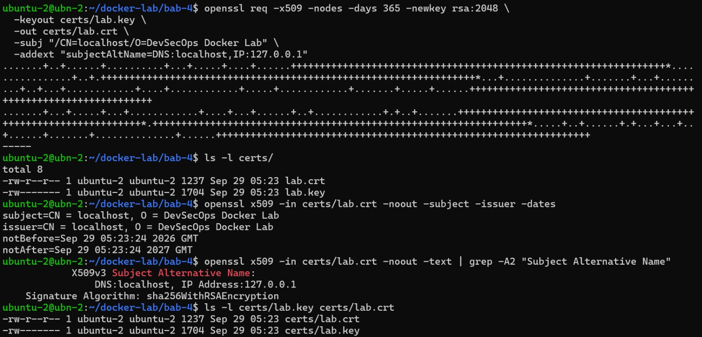

## 4.3 File compose.yaml

Berkas compose.yaml mengatur tiga layanan, yaitu proxy menggunakan NGINX, apache-web menggunakan Apache, dan flask-app sebagai backend aplikasi. NGINX memetakan port 127.0.0.1:8080 untuk HTTP dan 127.0.0.1:8443 untuk HTTPS, serta menggunakan *bind mount* untuk konfigurasi, sertifikat, dan log. apache-web menyimpan halaman web pada direktori ./apache/sites, sedangkan flask-app dibuat dari ./app dan memiliki *healthcheck* pada endpoint /health. Ketiga layanan terhubung melalui jaringan web-net. Penggunaan 127.0.0.1 membatasi akses port hanya dari mesin lokal, sementara depends_on dengan service_healthy memastikan NGINX berjalan setelah backend Flask dalam kondisi siap.

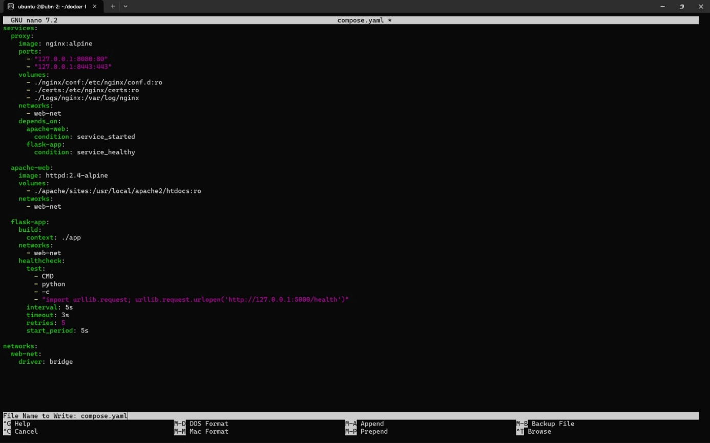

## 4.4 File nginx/conf/default.conf

Konfigurasi NGINX menggunakan upstream untuk menghubungkan trafik ke apache-web:80 dan flask-app:5000. Pada port HTTP, seluruh permintaan dialihkan dengan status 301 ke HTTPS melalui port 8443. Pada port HTTPS, NGINX menggunakan sertifikat TLS dan membatasi protokol pada TLS 1.2 dan TLS 1.3, serta menerapkan beberapa *security headers* seperti X-Content-Type-Options, X-Frame-Options, dan Referrer-Policy. Trafik pada / diteruskan ke Apache, sedangkan /api/ diteruskan ke Flask dengan beberapa header seperti X-Real-IP dan X-Forwarded-Proto. Dengan konfigurasi ini, NGINX berperan sebagai *reverse proxy* dan menjadi titik masuk utama sebelum permintaan diteruskan ke layanan backend.

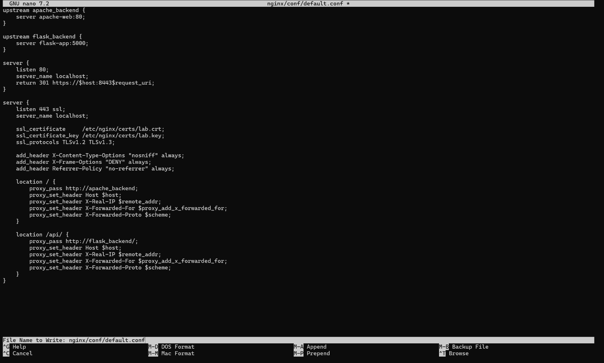

## 4.5 File apache/sites/index.html

File index.html digunakan sebagai halaman web yang disediakan oleh Apache. Halaman ini digunakan untuk memastikan bahwa Apache dapat berjalan dengan baik dan dapat diakses melalui reverse proxy Nginx.

Dengan konfigurasi tersebut, client tidak mengakses Apache secara langsung, tetapi request diterima oleh Nginx terlebih dahulu dan kemudian diteruskan ke Apache.

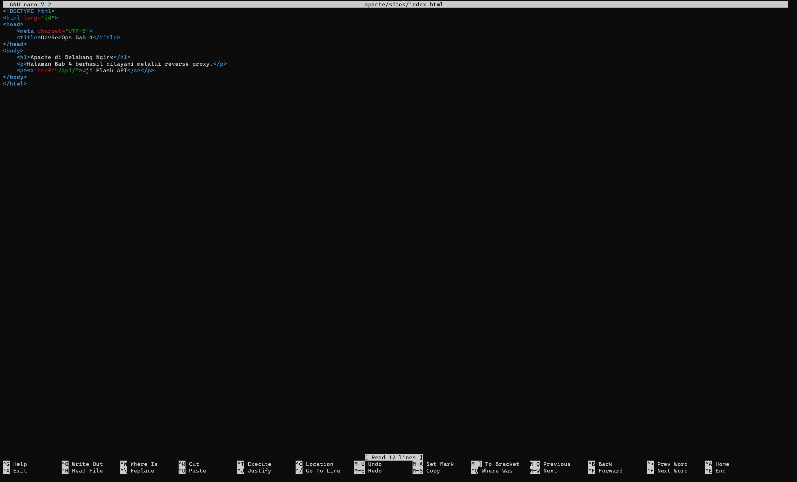

## 4.6 File app/requirements.txt

File requirements.txt digunakan untuk mendefinisikan library Python yang dibutuhkan oleh aplikasi Flask. Dependency tersebut akan di-install ketika image Flask dibuat sehingga aplikasi dapat dijalankan di dalam container.

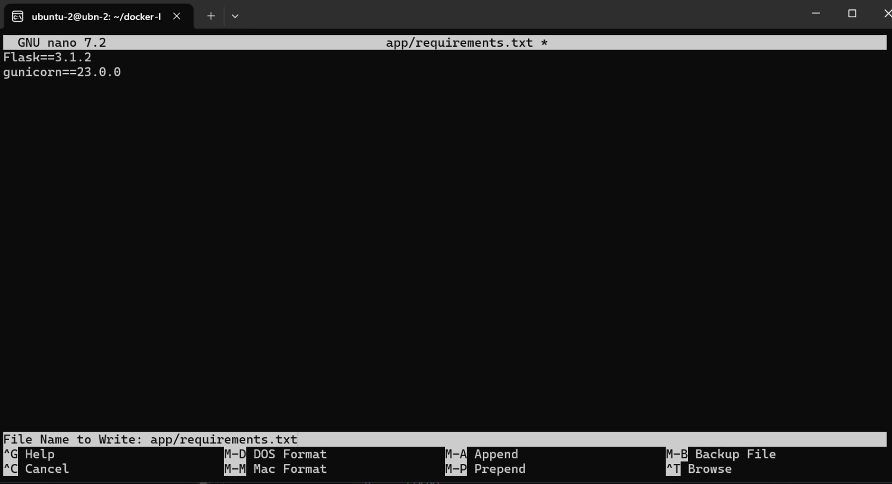

## 4.7 File app/app.py

File app.py memiliki dua endpoint, yaitu / dan /health. Endpoint / mengembalikan informasi status aplikasi, nama layanan, pesan akses melalui NGINX, serta membaca header X-Forwarded-Proto. Sementara itu, endpoint /health mengembalikan status healthy dengan HTTP 200. Endpoint /health digunakan oleh *healthcheck* Docker Compose untuk memastikan kontainer Flask dalam kondisi siap dan dapat merespons permintaan.

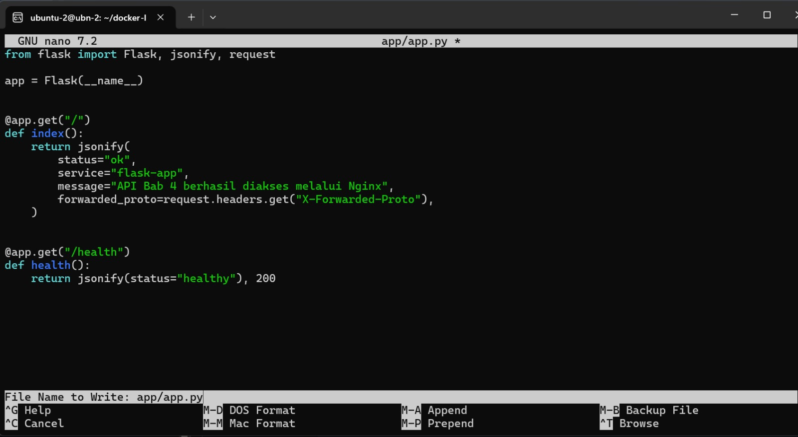

## 4.8 File app/Dockerfile

Dockerfile menggunakan python:3.12-slim sebagai *base image* yang lebih ringan sehingga dapat mengurangi ukuran image dan *attack surface*. Aplikasi ditempatkan pada direktori /app, kemudian dependensi diinstal dari requirements.txt.

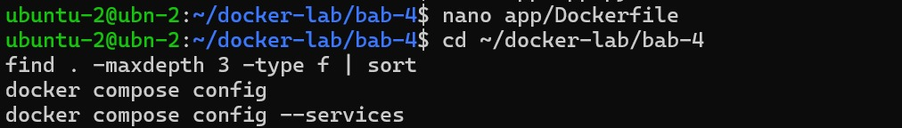

Selanjutnya dibuat user appuser dengan UID 10001 dan aplikasi dijalankan menggunakan USER appuser sehingga tidak berjalan sebagai *root*. Port 5000 diekspos untuk layanan Flask, sedangkan gunicorn digunakan sebagai *WSGI server* dengan 2 worker untuk menjalankan aplikasi.

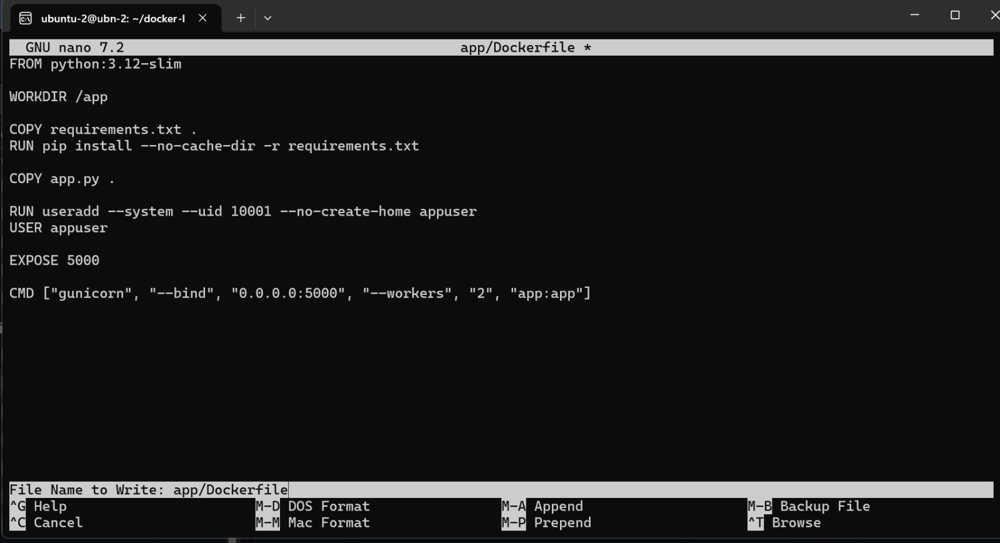

## 4.9 Validasi

Perintah find menampilkan struktur file yang telah dibuat dalam direktori bab-4. Selanjutnya, docker compose config memeriksa konfigurasi compose.yaml dan menghasilkan konfigurasi tanpa pesan kesalahan. Perintah docker compose config --services juga mengonfirmasi tiga layanan yang terdaftar, yaitu apache-web, flask-app, dan proxy. Tahap ini memastikan struktur file dan konfigurasi Docker Compose sudah benar sebelum proses deployment dijalankan.


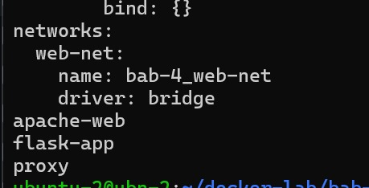

## 4.10 Build dan Menjalankan Stack

Perintah docker compose ps menunjukkan ketiga layanan berhasil berjalan, yaitu apache-web berstatus Up, flask-app berstatus Up (healthy), dan proxy berstatus Up dengan port 8080 dan 8443. Selanjutnya, docker compose logs --tail 100 menampilkan proses *startup* Gunicorn, Apache, dan NGINX tanpa masalah. Hasil ini menunjukkan seluruh kontainer berhasil dijalankan dan siap melayani trafik.

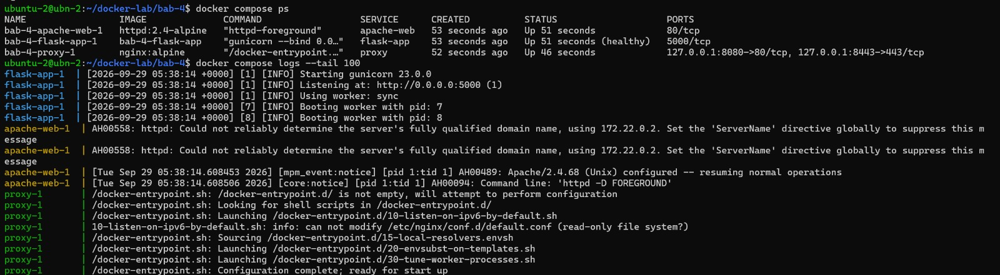

## 4.11 Pengujian Cepat

Pengujian menunjukkan konfigurasi berjalan sesuai yang diharapkan. Akses HTTP pada port 8080 berhasil dialihkan dengan status 301 ke HTTPS port 8443. Akses HTTPS ke Apache menghasilkan 200 OK dan menampilkan *security headers*, sedangkan akses /api/ berhasil diteruskan ke Flask dengan respons JSON berstatus ok. Endpoint /api/health juga mengembalikan status healthy. Pengujian openssl s_client mengonfirmasi koneksi menggunakan TLSv1.3 dengan cipher TLS_AES_256_GCM_SHA384.

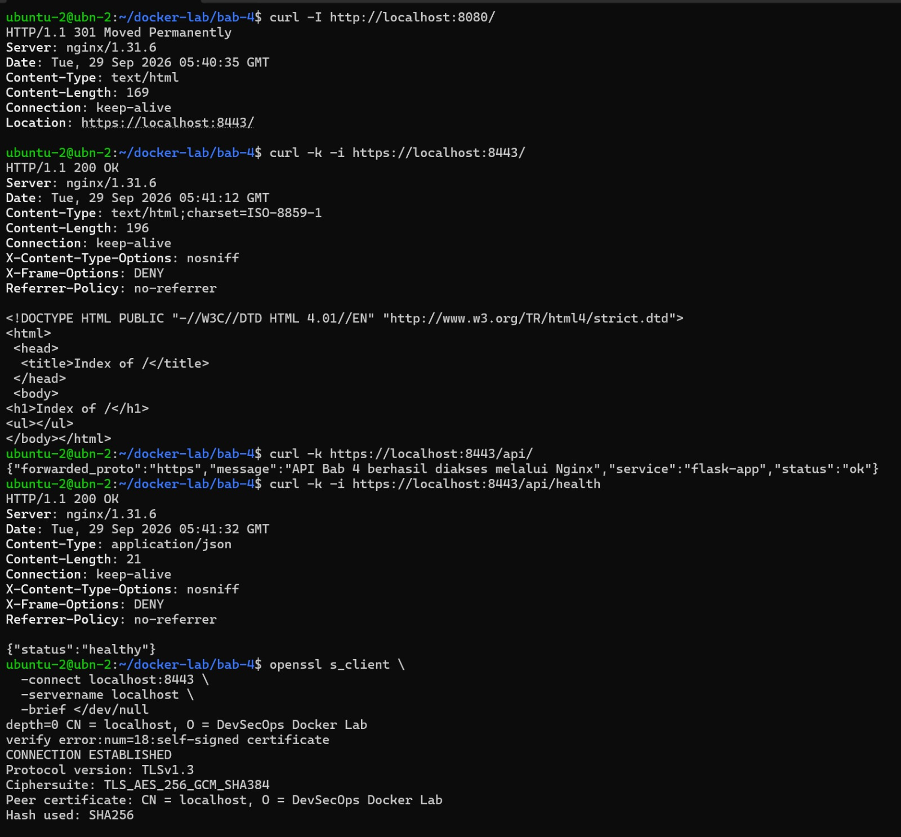

## 4.12 Pemeriksaan Isolasi

Kontainer apache-web dan flask-app tidak memiliki pemetaan port ke host sehingga backend tidak dapat diakses secara langsung melalui IP host. Hanya proxy NGINX yang membuka port 127.0.0.1:8080 dan 127.0.0.1:8443 sebagai titik masuk utama. Selain itu, status flask-app yang menunjukkan (healthy) menandakan *healthcheck* berhasil memastikan aplikasi dalam kondisi siap.

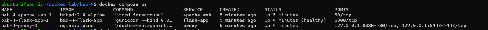

Docker Compose membuat jaringan khusus bab-4_web-net menggunakan *driver* bridge dengan subnet 172.22.0.0/16 dan gateway 172.22.0.1. Ketiga kontainer, yaitu proxy, apache-web, dan flask-app, berada dalam jaringan virtual yang sama sehingga dapat berkomunikasi secara internal. Segmentasi ini membatasi komunikasi langsung dari kontainer yang berada di luar jaringan tersebut.

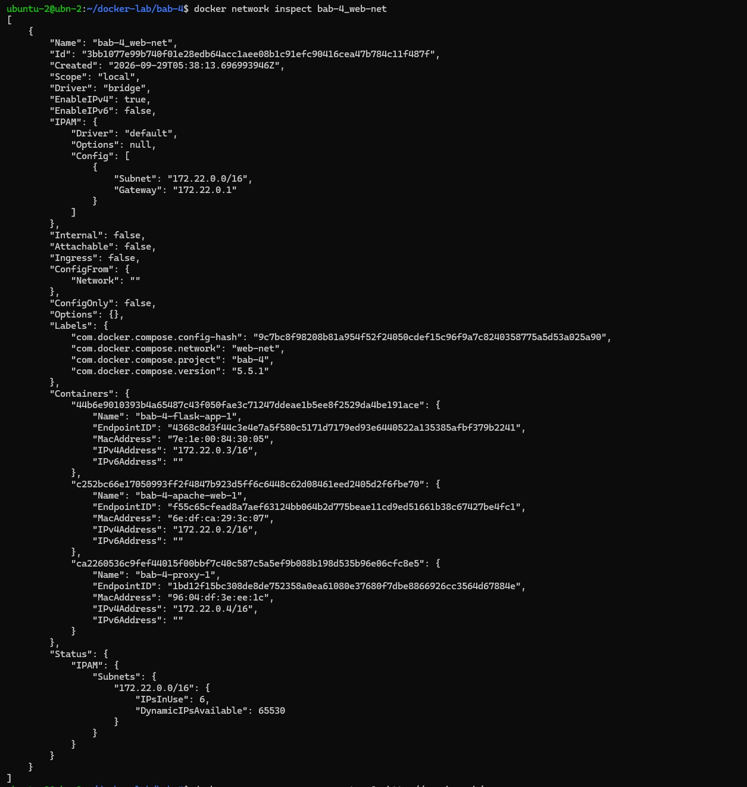

Pengujian wget dari dalam kontainer proxy berhasil mengakses apache-web dan flask-app:5000/health menggunakan nama layanan. Respons yang diterima menunjukkan Docker DNS berhasil menerjemahkan hostname tersebut ke IP internal masing-masing. Hasil ini juga membuktikan NGINX dapat berkomunikasi dengan backend melalui jaringan internal tanpa perlu mengekspos port Apache dan Flask ke host.

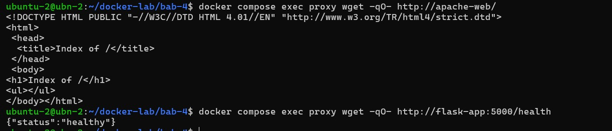

## 4.13 Log

Log NGINX menunjukkan proses inisialisasi berjalan normal hingga muncul pesan Configuration complete; ready for start up, yang menandakan konfigurasi berhasil diproses tanpa *syntax error*. Pada Apache terdapat peringatan AH00558 karena ServerName belum ditentukan secara global, tetapi layanan tetap berjalan normal. Log Apache juga menunjukkan alamat 172.22.0.4 sebagai sumber permintaan, yaitu IP internal kontainer proxy, sehingga membuktikan trafik diteruskan melalui NGINX dan bukan diakses langsung. Pada Flask, Gunicorn berhasil berjalan pada port internal 5000 dengan 2 worker process sesuai konfigurasi Dockerfile. Selain itu, tidak ditemukan error kritis pada log NGINX. Log yang tersimpan pada ./logs/nginx/ di host juga membuktikan *bind mount* berjalan dengan baik sehingga aktivitas layanan dapat dipantau dan digunakan untuk kebutuhan audit.

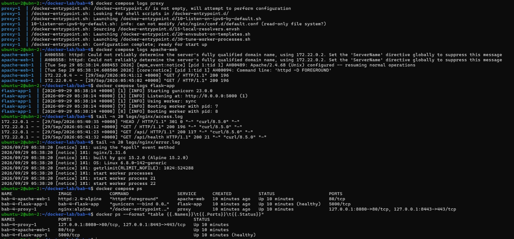

## 4.14 Troubleshooting Cepat

Tahap troubleshooting dilakukan untuk memastikan setiap service pada Docker Compose berjalan dengan baik. Pemeriksaan dimulai dengan melihat status seluruh container menggunakan perintah docker compose ps. Dari hasil pemeriksaan terlihat bahwa container proxy, apache-web, dan flask-app telah berjalan. Container Flask juga menunjukkan status healthy, sehingga healthcheck aplikasi dapat berjalan dengan baik.

### 4.14.1 Cek semua container

Pada pemeriksaan Nginx, digunakan perintah untuk melihat konfigurasi dan log container. Hasil pemeriksaan menunjukkan bahwa konfigurasi Nginx dapat dimuat dengan baik dan tidak terdapat kesalahan konfigurasi yang menyebabkan container berhenti.

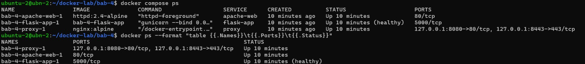

### 4.14.2 Kalau Nginx bermasalah

Selanjutnya dilakukan pemeriksaan terhadap Apache. Log Apache menunjukkan bahwa web server berhasil dijalankan dan dapat menerima request. Halaman yang ditampilkan juga menunjukkan bahwa Apache dapat diakses melalui jaringan internal Docker.

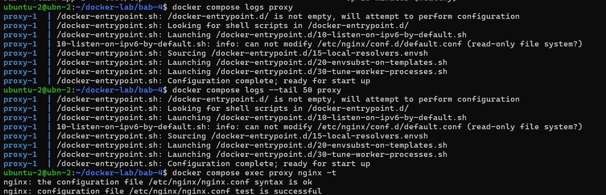

### 4.14.3 Kalau Apache bermasalah

Pemeriksaan berikutnya dilakukan terhadap Flask menggunakan log container. Dari hasil log terlihat bahwa aplikasi Flask berhasil dijalankan menggunakan Gunicorn dan mendengarkan pada port 5000. Endpoint /health juga dapat digunakan untuk melakukan pengecekan kondisi aplikasi.

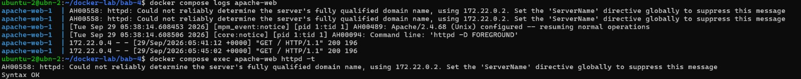

### 4.14.4 Kalau Flask bermasalah

Pada bagian perbaikan Flask, dilakukan pemeriksaan terhadap command yang digunakan untuk menjalankan aplikasi. Langkah ini digunakan untuk memastikan Flask dapat dijalankan dengan konfigurasi yang benar sehingga healthcheck dapat memberikan status healthy.

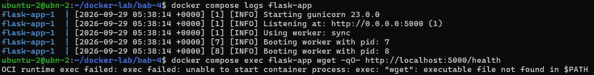

Selanjutnya dilakukan pengujian komunikasi antara Nginx dengan Apache. Pengujian dilakukan dari container proxy menggunakan wget menuju http://apache-web/. Hasil pengujian menampilkan halaman HTML Apache, sehingga dapat dibuktikan bahwa Nginx atau container proxy dapat mengakses Apache menggunakan **nama service apache-web** melalui network Docker.

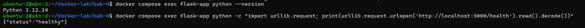

### 4.14.5 Pengujian komunikasi Nginx dengan Apache

Komunikasi Nginx dengan Flask juga diperiksa menggunakan endpoint /health. Hasil response menunjukkan: "status":"healthy". Hasil tersebut menunjukkan bahwa container proxy dapat berkomunikasi dengan backend Flask melalui port internal 5000.

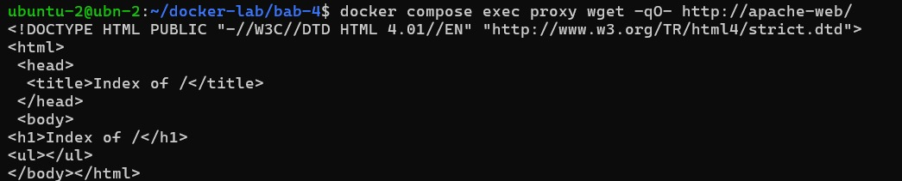

### 4.14.6 Pengujian komunikasi Nginx dengan Flask

Untuk memastikan HTTPS berjalan, dilakukan pemeriksaan menggunakan openssl s_client. Hasil menunjukkan bahwa koneksi berhasil dibangun dengan TLS 1.3 dan cipher yang digunakan adalah TLS_AES_256_GCM_SHA384. Pada hasil tersebut juga terlihat keterangan self-signed certificate. Hal ini sesuai dengan penggunaan sertifikat TLS self-signed pada praktikum.

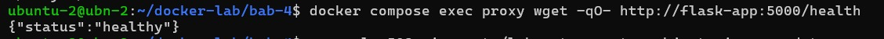

### 4.14.7 Kalau HTTPS bermasalah

Pemeriksaan port juga dilakukan menggunakan docker ps --format. Hasilnya menunjukkan bahwa port yang dipublikasikan ke host adalah port milik **proxy**, yaitu 8080 dan 8443, sedangkan Apache dan Flask hanya menggunakan port internal Docker. Hal ini menunjukkan bahwa backend tidak diekspos secara langsung ke host.

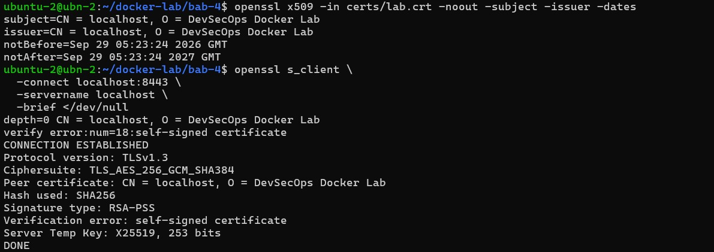

### 4.14.8 Kalau port tidak bisa diakses

Selanjutnya dilakukan pemeriksaan terhadap endpoint /api/. Request menggunakan curl ke https://localhost:8443/api/ menghasilkan response JSON dari Flask. Response tersebut menunjukkan bahwa API berhasil diteruskan melalui Nginx menuju service flask-app.

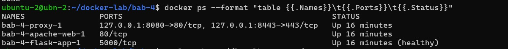

### 4.14.9 Kalau /api/ tidak bekerja

Dari rangkaian troubleshooting tersebut dapat diketahui bahwa setiap service dapat berjalan dan berkomunikasi sesuai dengan konfigurasi. Troubleshooting pada PDF memang mencakup pemeriksaan container, Nginx, Apache, Flask, komunikasi Nginx–Apache, komunikasi Nginx–Flask, HTTPS, published port, dan endpoint /api/.

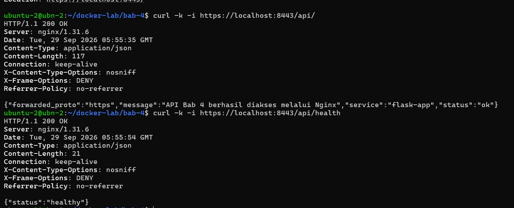

## 4.15 Checklist PASS

| **No.** | **Pemeriksaan**                                | **Hasil**    |
|---------|------------------------------------------------|--------------|
| 1       | docker compose config tidak menghasilkan galat | \[✔\] PASSED |
| 2       | flask-app berstatus healthy                    | \[✔\] PASSED |
| 3       | HTTP port 8080 menghasilkan redirect 301       | \[✔\] PASSED |
| 4       | HTTPS port 8443 menampilkan halaman Apache     | \[✔\] PASSED |
| 5       | /api/ menghasilkan JSON Flask                  | \[✔\] PASSED |
| 6       | TLS 1.2 atau TLS 1.3 berhasil dinegosiasikan   | \[✔\] PASSED |
| 7       | Apache dan Flask tidak memiliki published port | \[✔\] PASSED |
| 8       | Request tercatat pada access log Nginx         | \[✔\] PASSED |

### 4.15.1 Validasi Konfigurasi Docker Compose

Validasi konfigurasi dilakukan menggunakan docker compose config. Hasil pemeriksaan menunjukkan pesan PASS: docker compose config valid. Hal ini menunjukkan bahwa file Compose dapat diproses tanpa menghasilkan kesalahan konfigurasi.

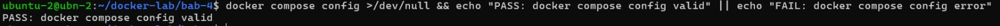

### 4.15.2 Pemeriksaan Status Flask

Pemeriksaan dilakukan menggunakan docker compose ps flask-app. Pada hasil tersebut terlihat bahwa container flask-app berada pada kondisi healthy. Status ini menunjukkan bahwa container Flask aktif dan healthcheck yang telah dikonfigurasi berhasil.

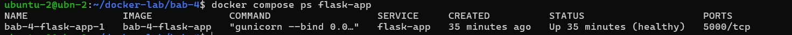

### 4.15.3 Pengujian Redirect HTTP

Pengujian dilakukan menggunakan curl terhadap http://localhost:8080/. Hasil response menunjukkan:

```http
HTTP/1.1 301 Moved Permanently
Location: https://localhost:8443/
```

Hasil tersebut membuktikan bahwa request HTTP pada port 8080 diarahkan secara permanen menuju HTTPS pada port 8443.

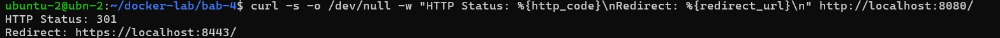

### 4.15.4 Pengujian HTTPS dan Apache

Pengujian selanjutnya dilakukan terhadap https://localhost:8443/. Response yang diperoleh memiliki status HTTP/1.1 200 OK dan menampilkan halaman HTML Apache dengan judul Index of **/**.

Hal ini membuktikan bahwa Nginx berhasil menerima request HTTPS dan meneruskannya ke Apache sebagai backend.

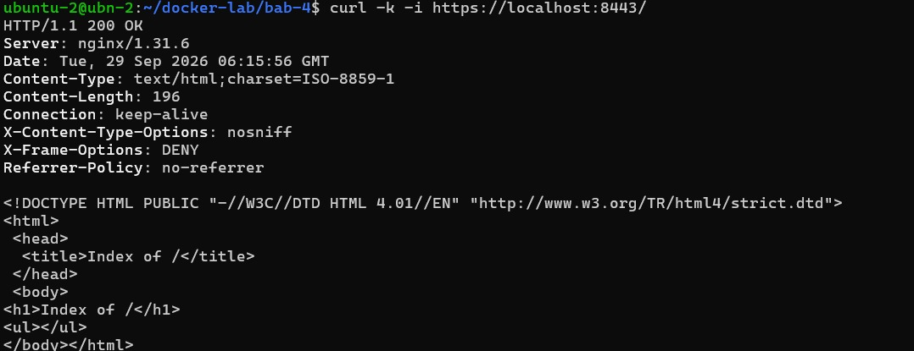

### 4.15.5 Pengujian API Flask

Response ini membuktikan bahwa request /api/ berhasil diteruskan oleh Nginx menuju service Flask. Informasi forwarded_proto yang bernilai https juga menunjukkan bahwa request berasal dari akses HTTPS.

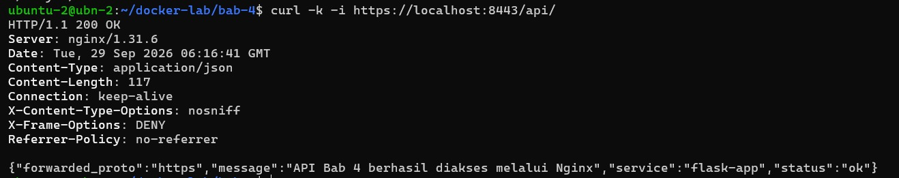

### 4.15.6 Pengujian TLS

Pengujian TLS dilakukan menggunakan openssl s_client terhadap port 8443. Pada hasil terlihat bahwa sertifikat yang digunakan merupakan self-signed certificate. Dengan demikian, HTTPS pada port 8443 berhasil menggunakan protokol TLS.

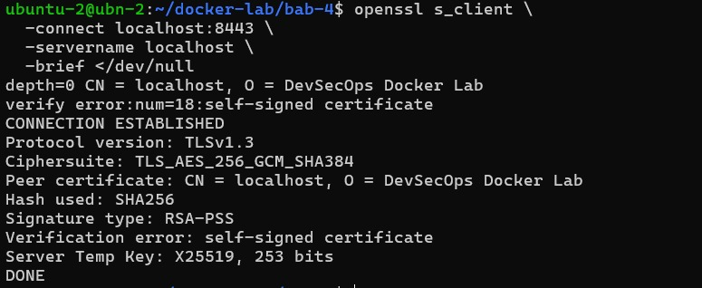

### 4.15.7 Pemeriksaan Published Port

Pemeriksaan published port dilakukan untuk memastikan hanya Nginx yang dapat diakses dari host. Hasil menunjukkan:

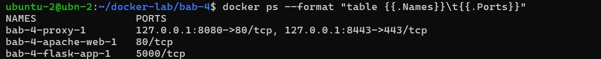

Dari hasil tersebut dapat dilihat bahwa Apache dan Flask hanya memiliki port internal, sedangkan port host 8080 dan 8443 dipublikasikan oleh proxy. Dengan demikian, akses dari host dilakukan melalui Nginx.

### 4.15.8 Pemeriksaan Access Log Nginx

Pemeriksaan terakhir dilakukan terhadap file logs/nginx/access.log. Hasilnya menunjukkan bahwa request yang dilakukan selama pengujian tercatat pada access log, termasuk request terhadap /, /api/, dan /api/health.

Pada log juga terlihat response 301 untuk request HTTP yang diarahkan ke HTTPS dan response 200 untuk request yang berhasil dilayani. Hal ini menunjukkan bahwa aktivitas request telah tercatat pada sisi Nginx.

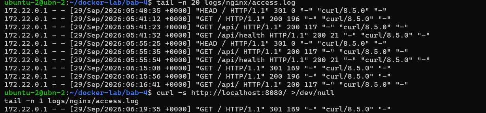
