<p align="center"></p>

# BAB V: PROSTGRESQL, PGADMIN, VOLUME, BACKUP, DAN RESTORE

## 5.1 Tahap Praktikum

### 5.1.1 Menyiapkan Direktori Bab 5

Proses diawali dengan membuat direktori untuk kebutuhan praktikum Bab 5 menggunakan perintah `mkdir`:

```bash
mkdir -p ~/docker-lab/bab-5/{init,backup,pgadmin,scripts}
cd ~/docker-lab/bab-5
ls -la
```

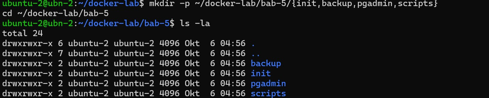

Direktori yang dibuat terdiri dari `backup`, `init`, `pgadmin`, dan `scripts`. Setelah itu dilakukan pengecekan menggunakan `ls -la` dan seluruh direktori terlihat pada hasil terminal. Hal ini menunjukkan bahwa struktur folder untuk pengerjaan Bab 5 telah berhasil disiapkan.

### 5.1.2 Konfigurasi Environment .env

File `.env.example` dibuat sebagai contoh konfigurasi untuk PostgreSQL dan pgAdmin. File tersebut kemudian disalin menjadi `.env` dan diberikan permission 600 menggunakan `chmod`:

```bash
nano .env.example
cp .env.example .env
chmod 600 .env
ls -la .env
```

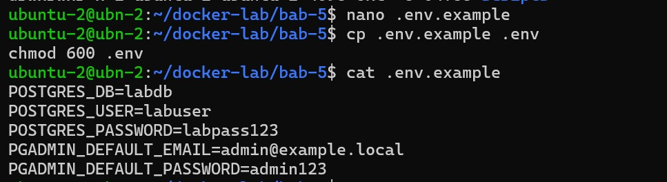

Isi konfigurasi mencakup nama database `labdb`, user `labuser`, password PostgreSQL, serta email dan password pgAdmin. Hasil ini menunjukkan bahwa konfigurasi awal telah dibuat dan file `.env` memiliki hak akses yang lebih terbatas.

### 5.1.3 Konfigurasi .gitignore

File `.gitignore` berisi aturan untuk mengabaikan file konfigurasi dan hasil backup, seperti `.env`, `backup/*.dump`, `backup/*.sha256`, dan `backup/*.log`:

```bash
nano .gitignore
cat .gitignore
```

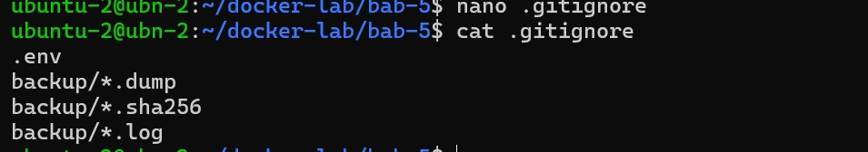

Dengan pengaturan tersebut, file yang berisi konfigurasi dan hasil backup tidak ikut dimasukkan ke dalam repository Git.

## 5.2 Konfigurasi PostgreSQL dan pgAdmin

### 5.2.1 Konfigurasi Docker Compose.yaml

Penyusunan file deklaratif `compose.yaml` yang mengatur dua service utama, yaitu `postgres-db` dan `pgadmin`:

```bash
nano compose.yaml
```

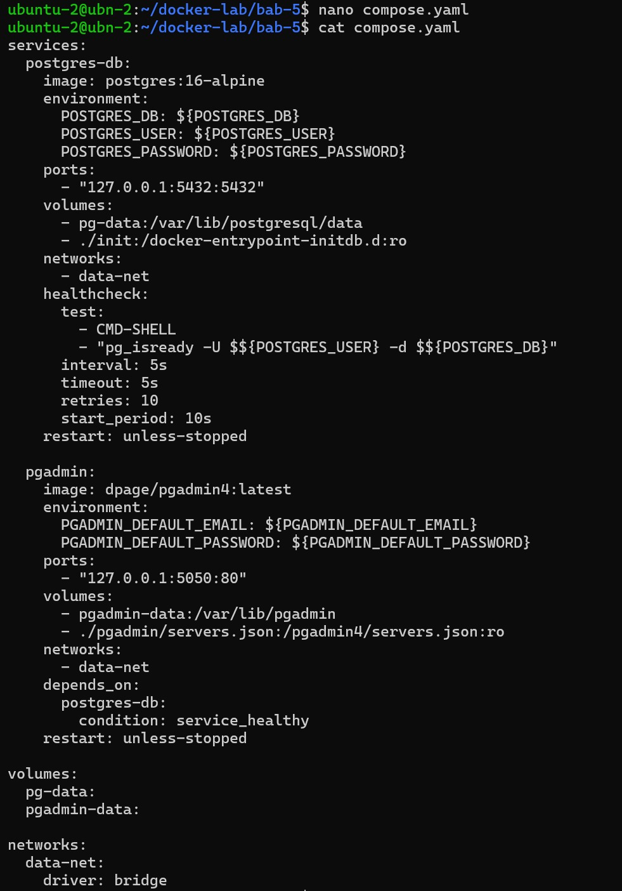

File `compose.yaml` mengatur dua service, yaitu PostgreSQL menggunakan image `postgres:16-alpine` dan pgAdmin menggunakan image `dpage/pgadmin4:latest`. PostgreSQL menggunakan volume `pg-data` untuk menyimpan data dan memiliki *healthcheck* menggunakan `pg_isready`. Service pgAdmin juga bergantung pada PostgreSQL dengan kondisi `service_healthy`.

### 5.2.2 Konfigurasi Database

File `init/01-schema.sql` dibuat untuk menyiapkan skema awal basis data:

```bash
nano init/01-schema.sql
```

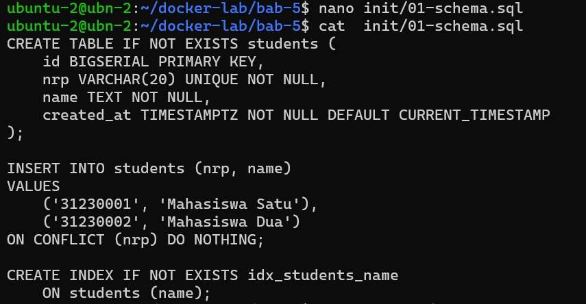

File `01-schema.sql` berisi perintah SQL untuk membuat tabel `students` dengan kolom `id`, `nrp`, `name`, dan `created_at`. Selain itu, terdapat dua data awal, yaitu `31230001 – Mahasiswa Satu` dan `31230002 – Mahasiswa Dua`. Pada bagian akhir juga dibuat index `idx_students_name` pada kolom `name`.

### 5.2.3 Konfigurasi Koneksi pgAdmin

Pendaftaran server PostgreSQL pada pgAdmin menggunakan file JSON konfigurasi:

```bash
nano pgadmin/servers.json
```

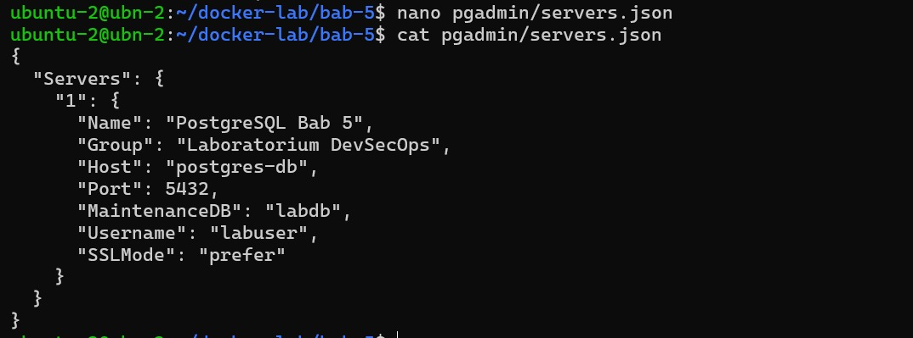

File `servers.json` berisi konfigurasi koneksi pgAdmin ke PostgreSQL. Service PostgreSQL menggunakan hostname `postgres-db`, port 5432, database `labdb`, dan username `labuser`. Konfigurasi tersebut memungkinkan pgAdmin mengetahui server PostgreSQL yang harus digunakan melalui jaringan Docker Compose.

## 5.3 Konfigurasi Backup dan Restore

### 5.3.1 Script Backup Database

Pembuatan script otomatisasi pencadangan database menggunakan `pg_dump`:

```bash
nano scripts/backup.sh
```

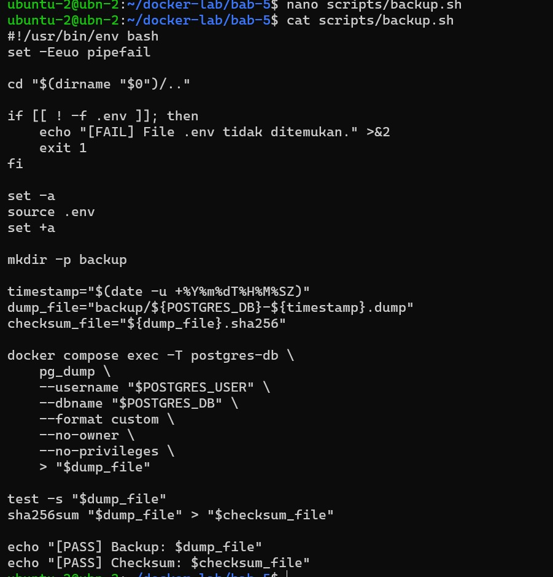

Script `backup.sh` digunakan untuk membuat backup database. Script membaca konfigurasi dari file `.env`, menyiapkan folder backup, kemudian menghasilkan file backup dengan format `.dump`. Setelah backup dibuat, script juga menghasilkan file checksum `.sha256`.

### 5.3.2 Script Restore Database

Pembuatan script pengujian pemulihan database ke basis data uji `labdb_restore_test`:

```bash
nano scripts/restore-test.sh
```

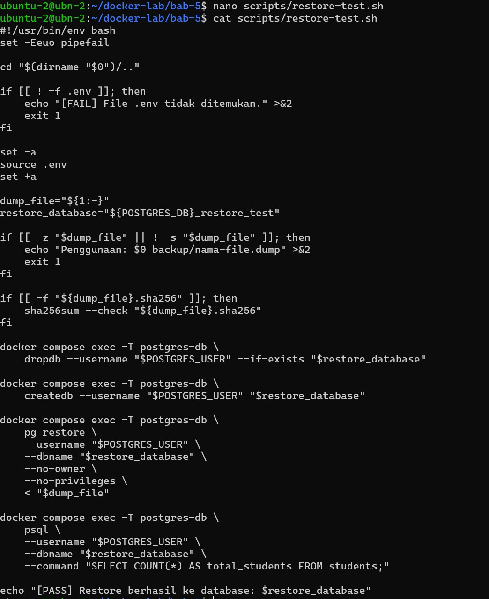

Script `restore-test.sh` digunakan untuk menguji proses restore database menggunakan file backup yang telah dibuat. Script mengambil file `.dump`, melakukan pengecekan checksum apabila file `.sha256` tersedia, kemudian menyiapkan database tujuan `labdb_restore_test`.

### 5.3.3 Permission dan Validasi File

Pemberian izin eksekusi script dan validasi struktur file serta konfigurasi Docker Compose:

```bash
cd ~/docker-lab/bab-5
chmod +x scripts/backup.sh scripts/restore-test.sh
find . -maxdepth 3 -type f | sort
```

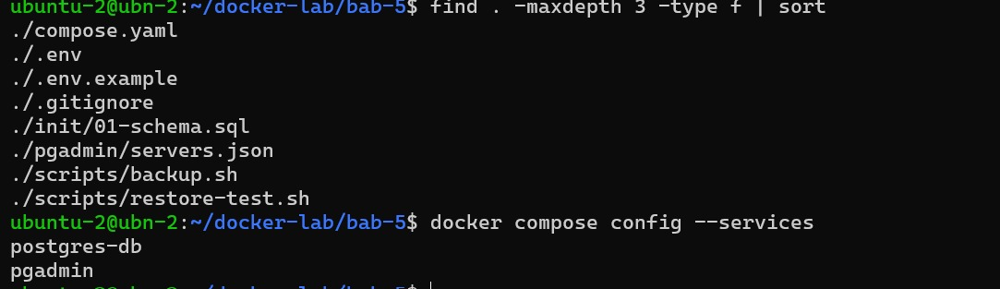

Validasi sintaks konfigurasi dan layanan Docker Compose:

```bash
docker compose config
docker compose config --services
```

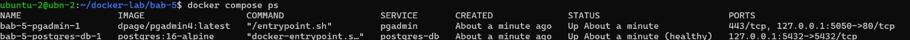

## 5.4 Menjalankan dan Menguji Database

### 5.4.1 Menjalankan Docker Compose

Menjalankan seluruh container di latar belakang dan memeriksa status kesehatan service:

```bash
docker compose up -d
docker compose ps
docker compose logs --tail 100
```

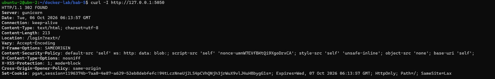

Hasil `docker compose ps` menunjukkan PostgreSQL berada dalam kondisi `healthy`, sedangkan pgAdmin berada dalam kondisi berjalan.

### 5.4.2 Pengujian Schema dan Data Awal

Memeriksa ketersediaan tabel, melakukan query data awal, dan menambahkan record baru:

```bash
docker compose exec -T postgres-db \
  psql -U labuser -d labdb \
  -c "\dt"

docker compose exec -T postgres-db \
  psql -U labuser -d labdb \
  -c "SELECT id, nrp, name, created_at FROM students ORDER BY id;"

docker compose exec -T postgres-db \
  psql -U labuser -d labdb \
  -c "INSERT INTO students(nrp, name) VALUES ('31230003', 'Mahasiswa Tiga') ON CONFLICT DO NOTHING;"

docker compose exec -T postgres-db \
  psql -U labuser -d labdb \
  -c "SELECT COUNT(*) FROM students;"
```

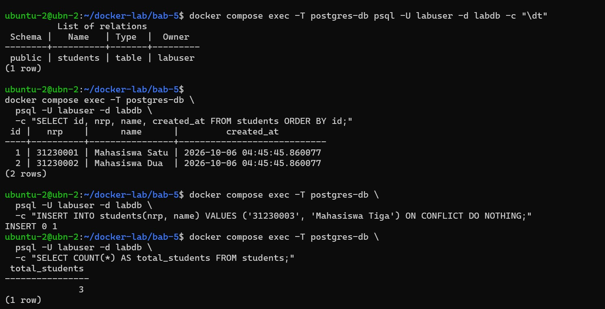

Hasil pengecekan menunjukkan jumlah data menjadi **3**, sehingga tabel berhasil dibuat dan database dapat menerima data baru.

### 5.4.3 Pengujian Persistensi Volume

Menguji ketahanan data saat container dihentikan (`down`) dan dijalankan ulang (`up`):

```bash
docker compose down
docker compose up -d
docker compose exec -T postgres-db \
  psql -U labuser -d labdb \
  -c "SELECT nrp, name FROM students ORDER BY nrp;"
```

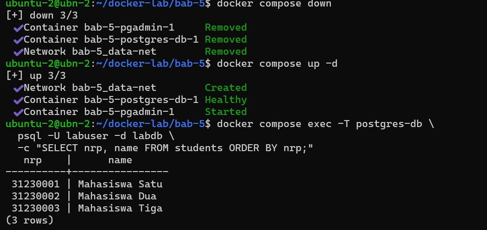

Setelah container aktif kembali, tabel `students` diperiksa dan masih berisi tiga data. Hasil ini membuktikan bahwa volume `pg-data` berhasil mempertahankan data PostgreSQL.

### 5.4.4 Pengujian Backup

Mengeksekusi script backup otomatis dan memvalidasi file output beserta checksum:

```bash
./scripts/backup.sh
ls -lh backup/
sha256sum --check backup/*.dump.sha256
```

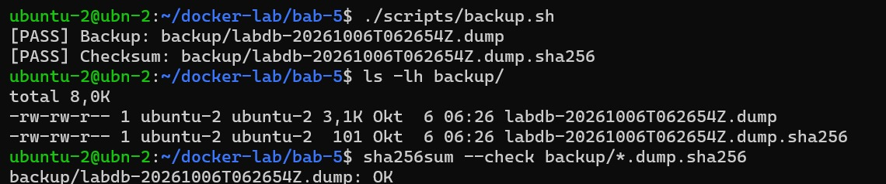

Terminal menampilkan `[PASS] Backup` dan `[PASS] Checksum`. Pemeriksaan folder backup menunjukkan adanya file `.dump` dan `.sha256` dengan ukuran valid (>0 byte).

### 5.4.5 Pengujian Restore

Menjalankan pengujian pemulihan database ke instance `labdb_restore_test`:

```bash
latest_dump="$(find backup -maxdepth 1 -name '*.dump' -type f | sort | tail -n 1)"
./scripts/restore-test.sh "$latest_dump"
docker compose exec -T postgres-db \
  psql -U labuser -d labdb_restore_test \
  -c "SELECT nrp, name FROM students ORDER BY nrp;"
```

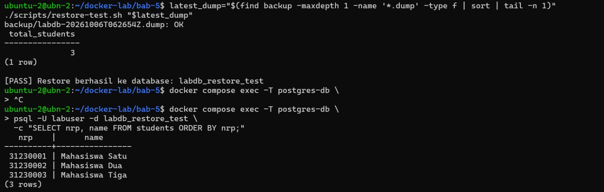

Setelah proses restore selesai, dilakukan query verifikasi yang menghasilkan data identik dengan database sumber.

### 5.4.6 Monitoring Dasar

Pemeriksaan status keseluruhan stack, log database, status kesiapan server, dan penggunaan volume Docker:

```bash
docker compose ps
docker compose logs postgres-db --tail 100
docker compose exec -T postgres-db pg_isready -U labuser -d labdb
docker compose exec -T postgres-db psql -U labuser -d labdb -c "SELECT version();"
docker volume ls
docker system df -v
```

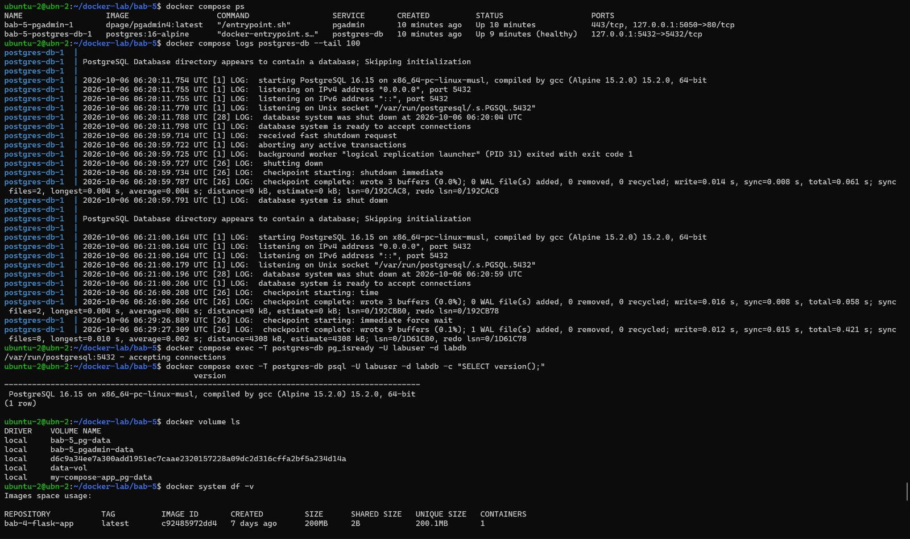

## 5.5 Checklist PASS

### 5.5.1 [✔️] docker compose config tidak menghasilkan galat.

```bash
docker compose config
```

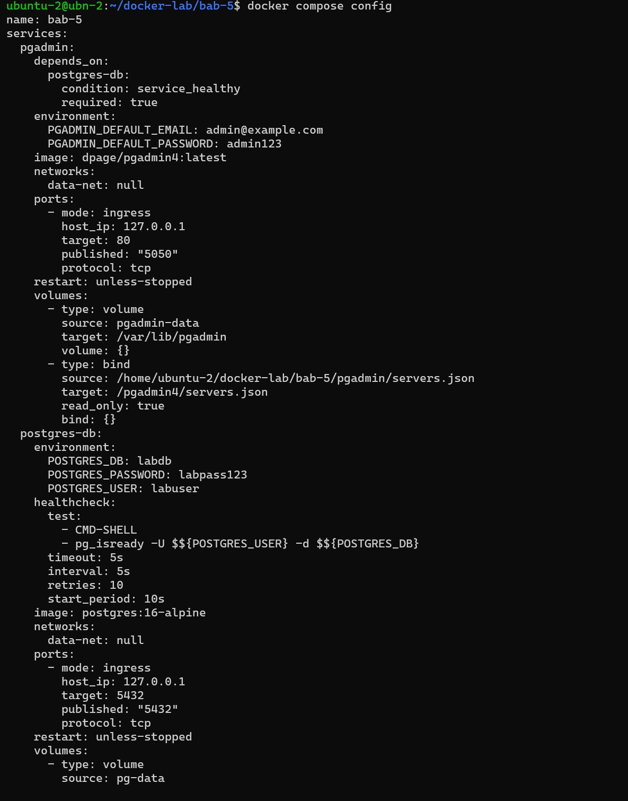

### 5.5.2 [✔️] PostgreSQL berstatus healthy.

```bash
docker compose ps
```

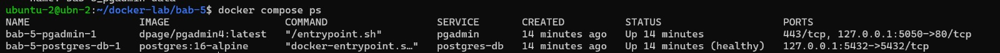

### 5.5.3 [✔️] Tabel students dan data awal tersedia.

```bash
docker compose exec -T postgres-db psql -U labuser -d labdb -c "SELECT id, nrp, name, created_at FROM students ORDER BY id;"
```

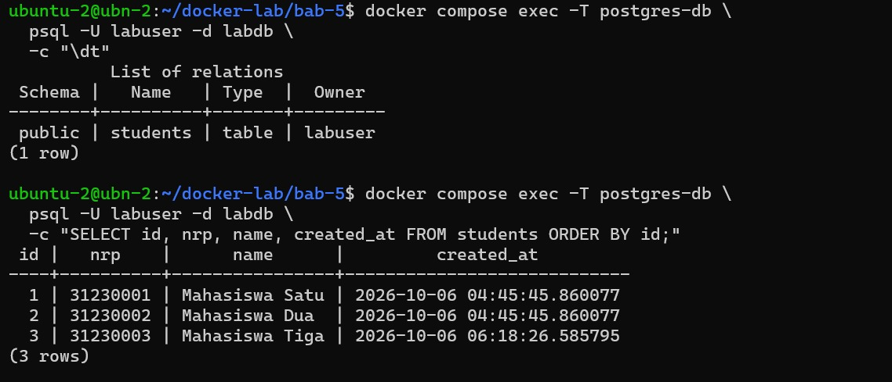

### 5.5.4 [✔️] pgAdmin dapat terhubung menggunakan hostname postgres-db.

Akses antarmuka web pgAdmin pada peramban melalui alamat:

```text
http://localhost:5050
```

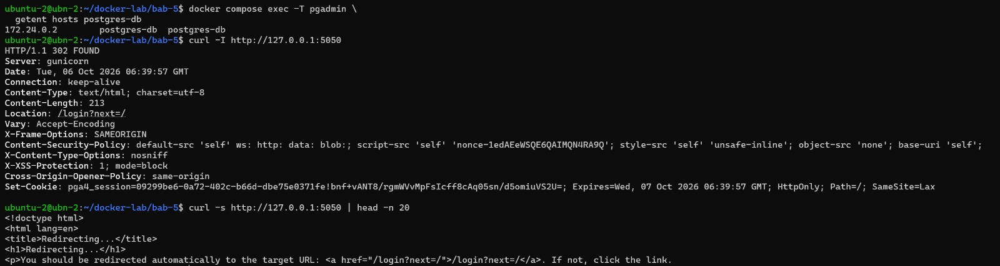

### 5.5.5 [✔️] Data tetap tersedia setelah docker compose down dan up.

```bash
docker compose down && docker compose up -d
docker compose exec -T postgres-db psql -U labuser -d labdb -c "SELECT COUNT(*) FROM students;"
```

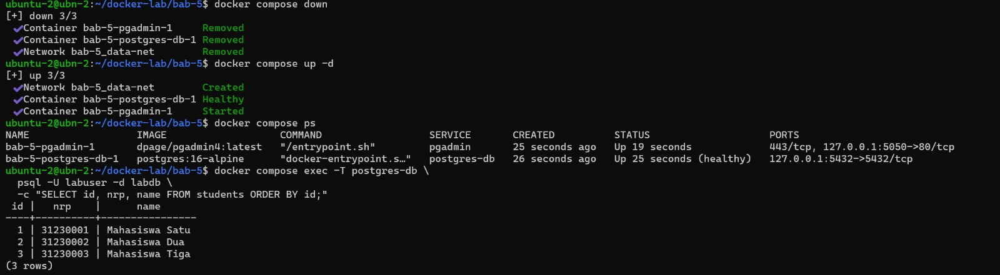

### 5.5.6 [✔️] Backup dump berukuran lebih dari nol.

```bash
ls -lh backup/
```

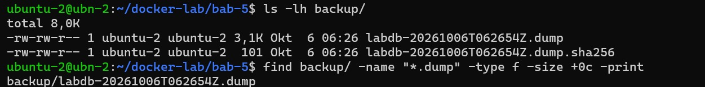

### 5.5.7 [✔️] Checksum backup valid.

```bash
sha256sum --check backup/*.dump.sha256
```

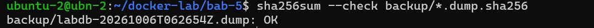

### 5.5.8 [✔️] Restore berhasil pada database labdb_restore_test.

```bash
docker compose exec -T postgres-db psql -U labuser -d labdb_restore_test -c "SELECT COUNT(*) AS total_students FROM students;"
```

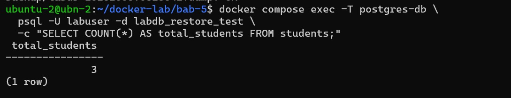

### 5.5.9 [✔️] Jumlah dan isi record hasil restore sesuai database sumber.

```bash
docker compose exec -T postgres-db psql -U labuser -d labdb -c "SELECT nrp, name FROM students;"
docker compose exec -T postgres-db psql -U labuser -d labdb_restore_test -c "SELECT nrp, name FROM students;"
```

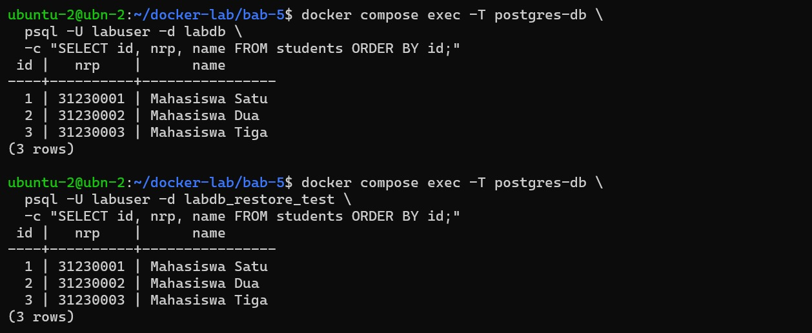

### 5.5.10 [✔️] Credential dan dump tidak masuk repository Git.

```bash
git status
git check-ignore backup/* .env
git ls-files
```

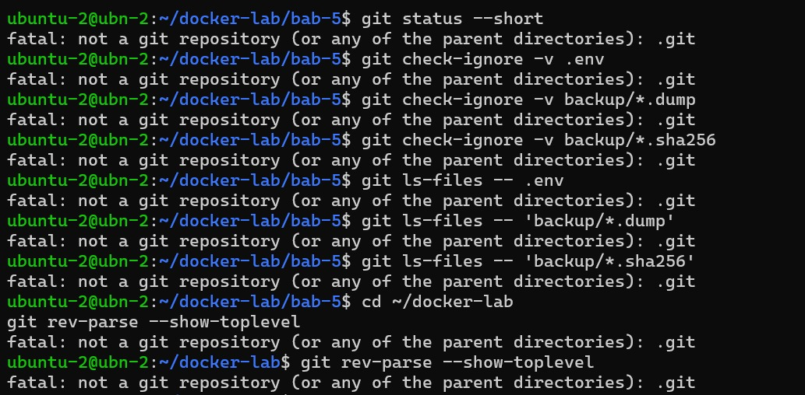

## 5.6 Best Practice untuk Menyimpan Kredensial Database

Penerapan Docker Secrets untuk mengisolasi kredensial password dari file compose dan menyimpannya pada file berhak akses terbatas (`chmod 600`):

```bash
echo "labpass123" > postgres_password.txt
chmod 600 postgres_password.txt
cat compose.yaml
```

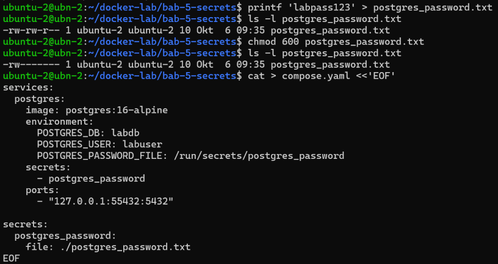

Validasi konfigurasi Compose dan verifikasi direktori secrets di dalam container:

```bash
docker compose config
docker compose up -d
docker compose exec postgres ls -l /run/secrets/
```

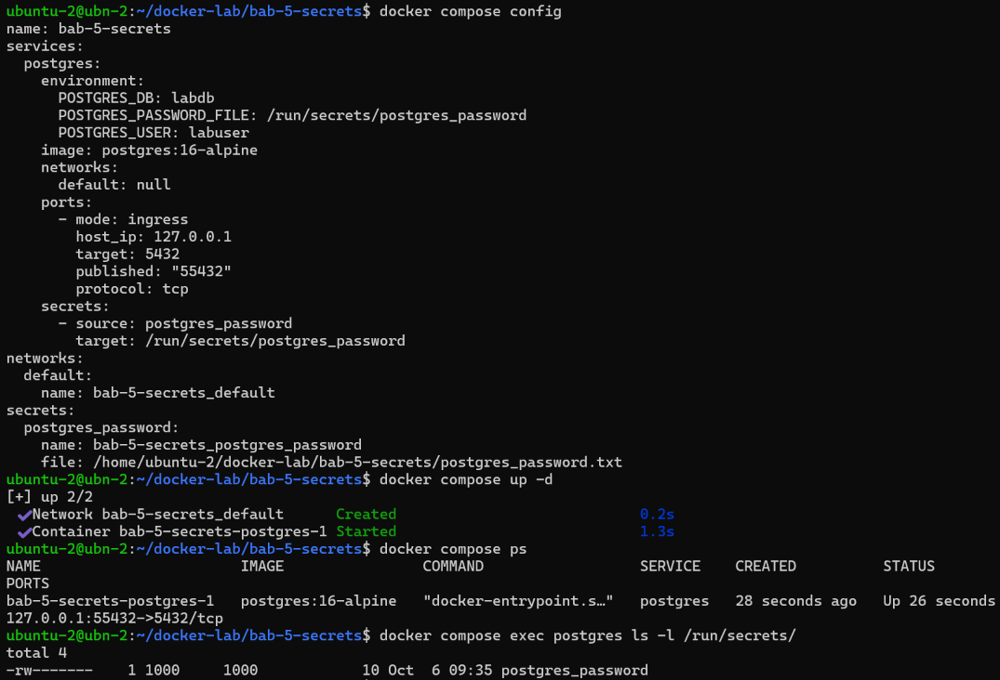

Pengujian kueri database untuk memastikan otentikasi user dan database aktif:

```bash
docker compose exec -T postgres-db psql -U labuser -d labdb -c "SELECT current_user, current_database();"
```

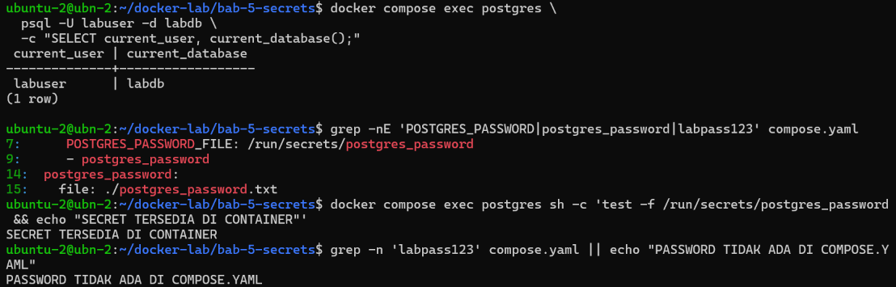

### 5.6.1 Kesimpulan Best Practice Menyimpan Kredensial Database

Berdasarkan hasil pengujian, Docker Secret dipilih sebagai *best practice* untuk menyimpan kredensial database. Password PostgreSQL tidak ditulis secara langsung pada compose.yaml, tetapi disimpan pada file secret dan diteruskan ke container melalui `/run/secrets/postgres_password`. Permission file juga dibatasi menggunakan 600. Hasil pengujian menunjukkan bahwa secret tersedia di dalam container dan PostgreSQL dapat menggunakannya tanpa menampilkan password pada konfigurasi utama. Dengan demikian, penggunaan Docker Secret membuat pengelolaan kredensial lebih terpisah dan lebih aman dibandingkan menuliskan password secara langsung pada konfigurasi service.
