

# BAB V: PROSTGRESQL, PGADMIN, VOLUME, BACKUP, DAN RESTORE

## 5.1 Tahap Praktikum

### 5.1.1 Menyiapkan Direktori Bab 5

Proses diawali dengan membuat direktori untuk kebutuhan praktikum Bab 5 menggunakan perintah mkdir. Direktori yang dibuat terdiri dari backup, init, pgadmin, dan scripts. Setelah itu dilakukan pengecekan menggunakan ls -la dan seluruh direktori terlihat pada hasil terminal. Hal ini menunjukkan bahwa struktur folder untuk pengerjaan Bab 5 telah berhasil disiapkan.

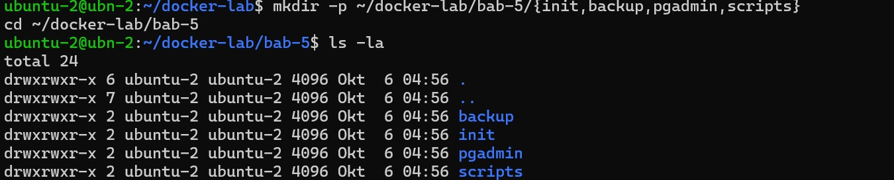

### 5.1.2 Konfigurasi Environment .env

File .env.example dibuat sebagai contoh konfigurasi untuk PostgreSQL dan pgAdmin. File tersebut kemudian disalin menjadi .env dan diberikan permission 600 menggunakan chmod. Isi konfigurasi mencakup nama database labdb, user labuser, password PostgreSQL, serta email dan password pgAdmin. Hasil ini menunjukkan bahwa konfigurasi awal telah dibuat dan file .env memiliki hak akses yang lebih terbatas.

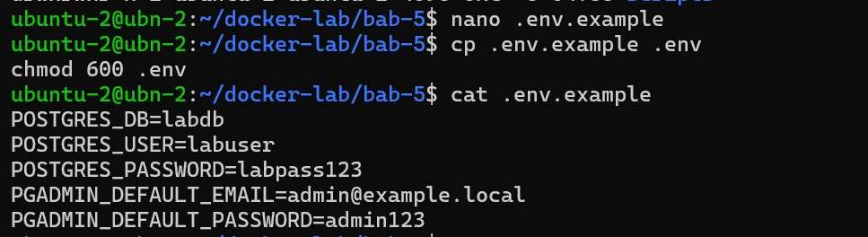

### 5.1.3 Konfigurasi .gitignore

File .gitignore berisi aturan untuk mengabaikan file konfigurasi dan hasil backup, seperti .env, backup/\*.dump, backup/\*.sha256, dan backup/\*.log. Dengan pengaturan tersebut, file yang berisi konfigurasi dan hasil backup tidak ikut dimasukkan ke dalam repository Git.

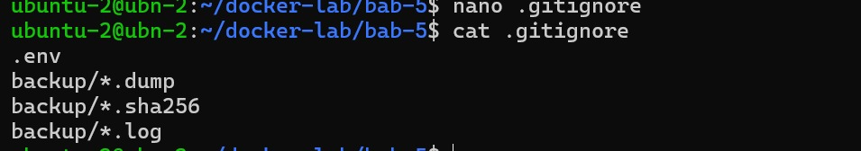

## 5.2 Konfigurasi PostgreSQL dan pgAdmin

### 5.2.1 Konfigurasi Docker Compose.yaml

File compose.yaml mengatur dua service, yaitu PostgreSQL menggunakan image postgres:16-alpine dan pgAdmin menggunakan image dpage/pgadmin4:latest. PostgreSQL menggunakan volume pg-data untuk menyimpan data dan memiliki *healthcheck* menggunakan pg_isready. Service pgAdmin juga bergantung pada PostgreSQL dengan kondisi service_healthy. Konfigurasi ini menunjukkan bahwa PostgreSQL dan pgAdmin telah disiapkan untuk berjalan sebagai satu stack menggunakan Docker Compose.

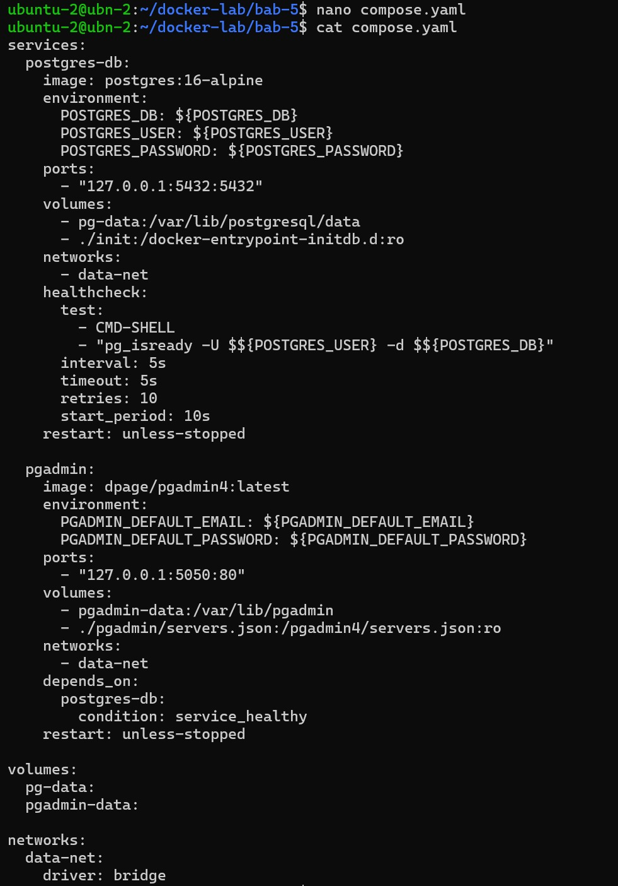

### 5.2.2 Konfigurasi Database

File 01-schema.sql berisi perintah SQL untuk membuat tabel students dengan kolom id, nrp, name, dan created_at. Selain itu, terdapat dua data awal, yaitu 31230001 – Mahasiswa Satu dan 31230002 – Mahasiswa Dua. Pada bagian akhir juga dibuat index idx_students_name pada kolom name. Hasil ini menunjukkan bahwa struktur tabel dan data awal database telah dipersiapkan.

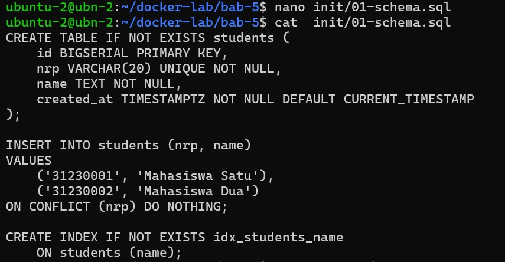

### 5.2.3 Konfigurasi Koneksi pgAdmin

File servers.json berisi konfigurasi koneksi pgAdmin ke PostgreSQL. Service PostgreSQL menggunakan hostname postgres-db, port 5432, database labdb, dan username labuser. Konfigurasi tersebut memungkinkan pgAdmin mengetahui server PostgreSQL yang harus digunakan melalui jaringan Docker Compose.

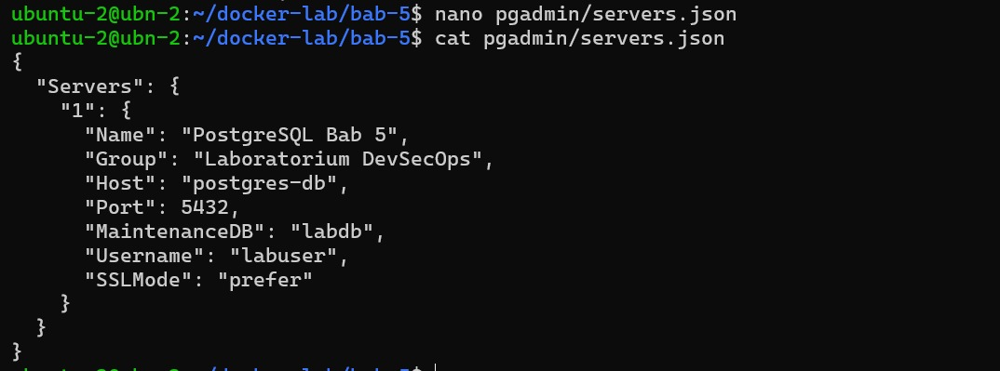

## 5.3 Konfigurasi Backup dan Restore

### 5.3.1 Script Backup Database

Script backup.sh digunakan untuk membuat backup database. Script membaca konfigurasi dari file .env, menyiapkan folder backup, kemudian menghasilkan file backup dengan format .dump. Setelah backup dibuat, script juga menghasilkan file checksum .sha256. Output \[PASS\] Backup dan \[PASS\] Checksum menunjukkan bahwa proses backup dan pembuatan checksum berhasil.

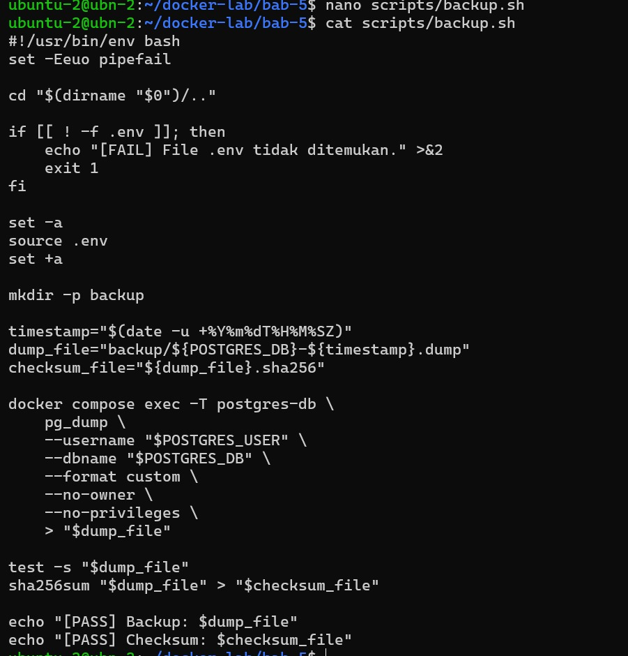

### 5.3.2 Script Restore Database

Script restore-test.sh digunakan untuk menguji proses restore database menggunakan file backup yang telah dibuat. Script mengambil file .dump, melakukan pengecekan checksum apabila file .sha256 tersedia, kemudian menyiapkan database tujuan labdb_restore_test. Setelah proses restore selesai, jumlah data pada tabel students diperiksa untuk memastikan isi database berhasil dikembalikan.

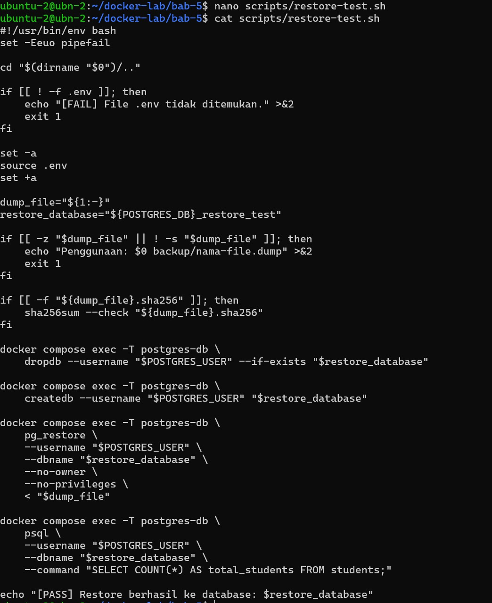

### 5.3.3 Permission dan Validasi File

script restore-test.sh yang digunakan untuk melakukan pengujian restore database. Script mengambil file backup yang diberikan, melakukan pengecekan checksum apabila file .sha256 tersedia, kemudian membuat database dengan nama labdb_restore_test.

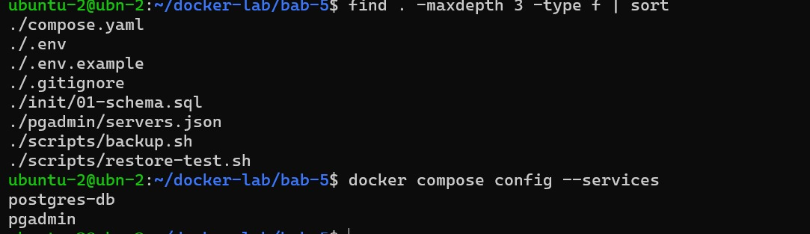

Setelah itu file backup digunakan untuk mengisi database hasil restore dan dilakukan pengecekan jumlah data pada tabel students. Hasil script menunjukkan bahwa proses restore memang disiapkan untuk menguji apakah backup dapat digunakan kembali.

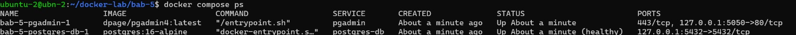

## 5.4 Menjalankan dan Menguji Database

### 5.4.1 Menjalankan Docker Compose

Stack dijalankan menggunakan Docker Compose. Container PostgreSQL dan pgAdmin berhasil dibuat dan dijalankan. Hasil docker compose ps menunjukkan PostgreSQL berada dalam kondisi healthy, sedangkan pgAdmin berada dalam kondisi berjalan. Hal ini menunjukkan bahwa stack pada compose.yaml berhasil dijalankan tanpa kegagalan.

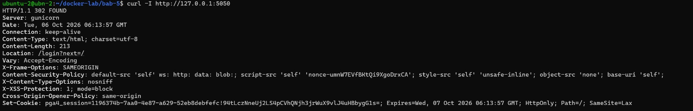

### 5.4.2 Pengujian Schema dan Data Awal

Pengecekan dilakukan terhadap database labdb untuk memastikan tabel students telah tersedia. Query berikutnya menampilkan dua data awal, yaitu Mahasiswa Satu dan Mahasiswa Dua. Setelah itu ditambahkan data Mahasiswa Tiga dengan NRP 31230003. Hasil pengecekan menunjukkan jumlah data menjadi **3**, sehingga tabel berhasil dibuat dan database dapat menerima data baru.

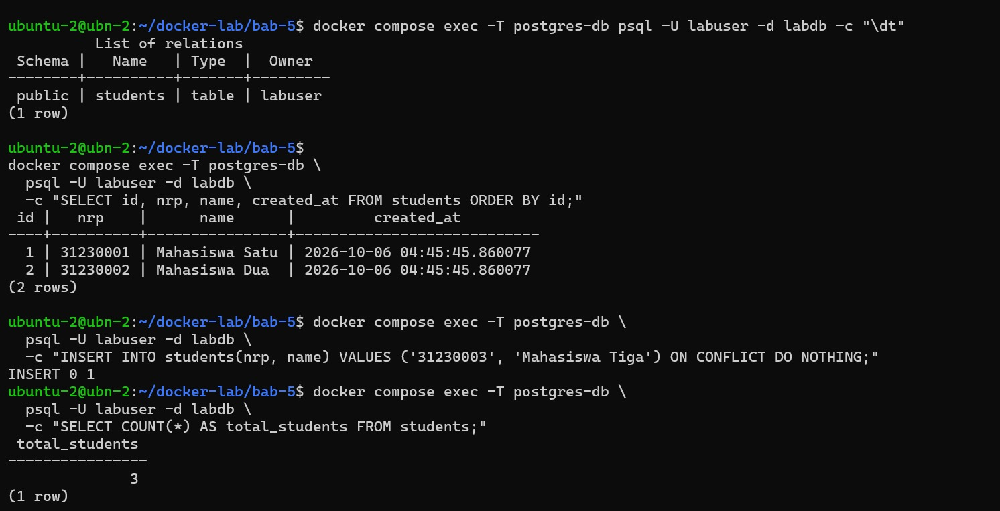

### 5.4.3 Pengujian Persistensi Volume

Pengujian dilakukan dengan menghentikan stack menggunakan docker compose down, kemudian menjalankannya kembali menggunakan docker compose up -d. Setelah container aktif kembali, tabel students diperiksa dan masih berisi tiga data, yaitu Mahasiswa Satu, Mahasiswa Dua, dan Mahasiswa Tiga. Hasil ini menunjukkan bahwa volume pg-data berhasil mempertahankan data PostgreSQL meskipun container dihentikan dan dibuat kembali.

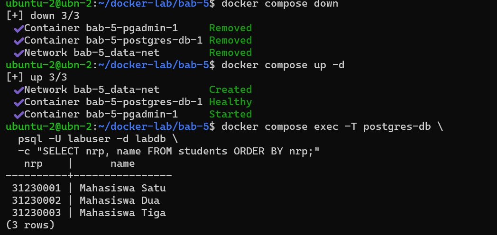

### 5.4.4 Pengujian Backup

Script ./scripts/backup.sh dijalankan untuk membuat backup database. Terminal menampilkan \[PASS\] Backup yang menunjukkan file backup berhasil dibuat dan \[PASS\] Checksum yang menunjukkan checksum berhasil dibuat. Pemeriksaan folder backup menunjukkan adanya file .dump dan .sha256. Selain itu, pengecekan ukuran menggunakan ls -lh dan find menunjukkan file backup memiliki ukuran lebih dari nol, sehingga backup tidak kosong dan dapat digunakan untuk proses restore.

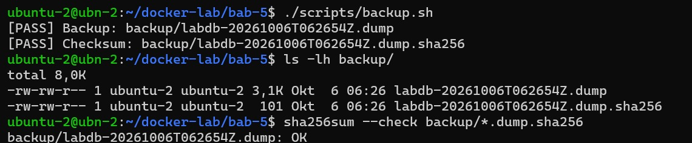

### 5.4.5 Pengujian Restore

Pengujian restore dilakukan menggunakan file backup dengan database tujuan labdb_restore_test. Setelah proses restore selesai, dilakukan query untuk menghitung jumlah data pada tabel students dan diperoleh **3 data**. Data pada database hasil restore kemudian dibandingkan dengan database sumber labdb. Ketiga record, yaitu 31230001 – Mahasiswa Satu, 31230002 – Mahasiswa Dua, dan 31230003 – Mahasiswa Tiga, memiliki isi yang sama. Hasil ini menunjukkan bahwa backup berhasil digunakan untuk mengembalikan isi database.

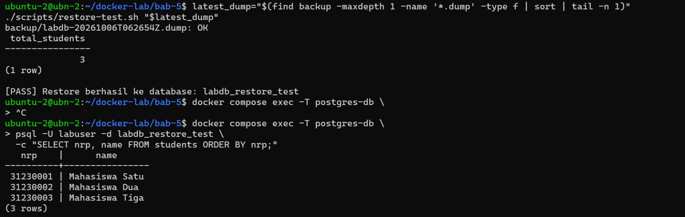

### 5.4.6 Monitoring Dasar

Monitoring dilakukan dengan melihat status container, log PostgreSQL dan pgAdmin, versi PostgreSQL, serta informasi volume Docker. Hasilnya menunjukkan bahwa PostgreSQL dan pgAdmin berjalan dengan baik dan PostgreSQL dapat menerima koneksi. Informasi volume juga menunjukkan bahwa pg-data digunakan sebagai media penyimpanan data PostgreSQL.

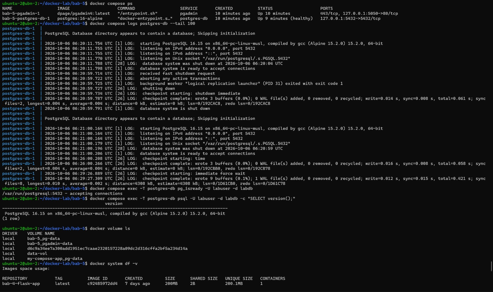

## 5.5 Checklist PASS

### 5.5.1 \[✔️\] docker compose config tidak menghasilkan galat.

Perintah docker compose config berhasil menampilkan konfigurasi tanpa pesan error. Hasil tersebut menunjukkan service postgres-db dan pgadmin beserta konfigurasi environment, volume, network, dan *healthcheck*. Hal ini menunjukkan bahwa konfigurasi Docker Compose dapat diproses dengan baik.

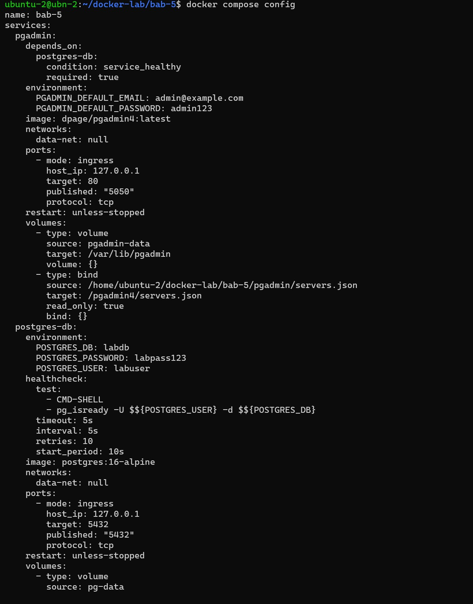

### 5.5.2 \[✔️\] PostgreSQL berstatus healthy.

Hasil docker compose ps menunjukkan container PostgreSQL berada dalam status healthy. Hal ini berarti container berhasil berjalan dan *healthcheck* yang telah dikonfigurasi memberikan hasil sesuai.

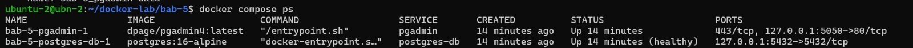

### 5.5.3 \[✔️\] Tabel students dan data awal tersedia.

Hasil query pada database labdb menunjukkan tabel students telah tersedia. Query berikutnya menampilkan tiga data mahasiswa yang telah dimasukkan, yaitu Mahasiswa Satu, Mahasiswa Dua, dan Mahasiswa Tiga. Hasil ini menunjukkan bahwa tabel dan data yang diperlukan telah tersedia.

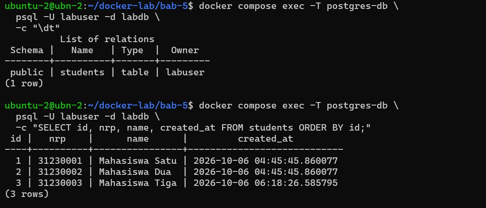

### 5.5.4 \[✔️\] pgAdmin dapat terhubung menggunakan hostname postgres-db.

Pengujian koneksi menunjukkan bahwa hostname postgres-db dapat digunakan untuk mengakses service PostgreSQL dari lingkungan Docker Compose. Hal ini menunjukkan konfigurasi koneksi antara pgAdmin dan PostgreSQL telah berjalan sesuai.

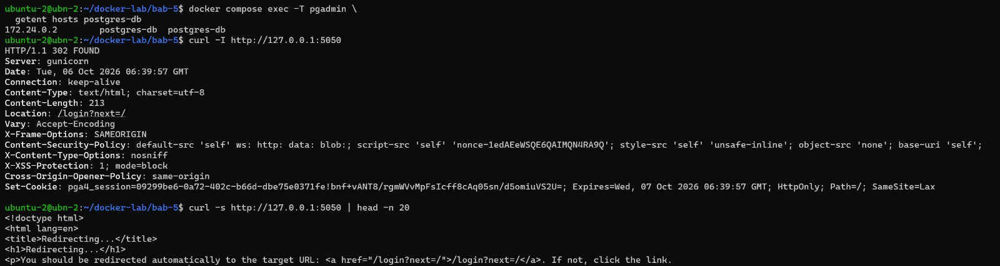

### 5.5.5 \[✔️\] Data tetap tersedia setelah docker compose down dan up.

Setelah menjalankan docker compose down kemudian docker compose up -d, data pada tabel students masih berjumlah tiga record. Hasil ini menunjukkan bahwa data tetap tersimpan pada volume PostgreSQL meskipun container dihentikan dan dijalankan kembali.

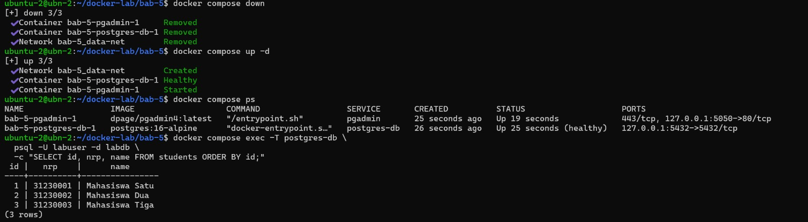

### 5.5.6 \[✔️\] Backup dump berukuran lebih dari nol.

Pengecekan folder backup menunjukkan file .dump memiliki ukuran sekitar **3,1 KB**. Ukuran tersebut menunjukkan bahwa file backup tidak kosong dan telah berisi data database.

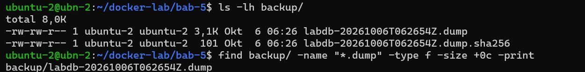

### 5.5.7 \[✔️\] Checksum backup valid.

Pengecekan menggunakan sha256sum --check menghasilkan status OK. Hasil tersebut menunjukkan bahwa file backup sesuai dengan checksum yang telah dibuat.

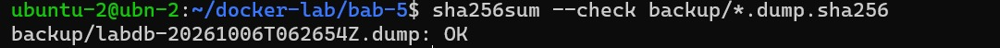

### 5.5.8 \[✔️\] Restore berhasil pada database labdb_restore_test.

Hasil pengecekan pada database labdb_restore_test menunjukkan jumlah data pada tabel students sebanyak **3 record**. Hal ini menunjukkan bahwa proses restore berhasil mengembalikan data ke database tujuan.

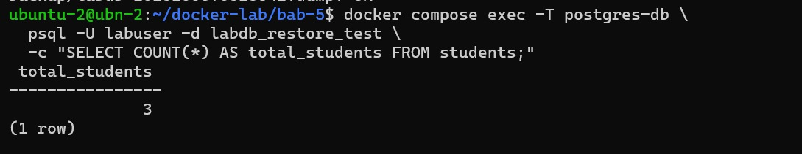

### 5.5.9 \[✔️\] Jumlah dan isi record hasil restore sesuai database sumber.

Perbandingan database labdb dan labdb_restore_test menunjukkan bahwa keduanya memiliki tiga record dengan NRP dan nama yang sama, yaitu 31230001 – Mahasiswa Satu, 31230002 – Mahasiswa Dua, dan 31230003 – Mahasiswa Tiga. Hasil ini menunjukkan bahwa isi database hasil restore sesuai dengan database sumber.

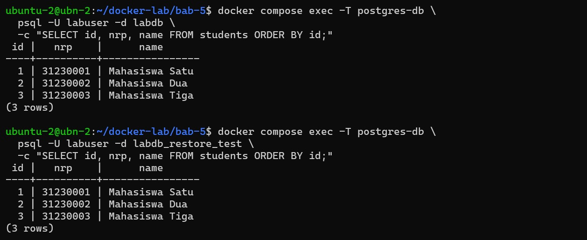

### 5.5.10 \[✔️\] Credential dan dump tidak masuk repository Git.

Pengecekan dilakukan menggunakan git status, git check-ignore, dan git ls-files. Namun, pada lingkungan pengujian muncul pesan bahwa direktori bukan merupakan repository Git. Oleh karena itu, hasil tersebut **belum dapat membuktikan secara langsung** bahwa file .env dan file backup tidak masuk ke repository Git. Yang dapat dipastikan dari pengujian tersebut adalah perintah pengecekan Git telah dilakukan, tetapi status repository belum tersedia pada direktori tersebut.

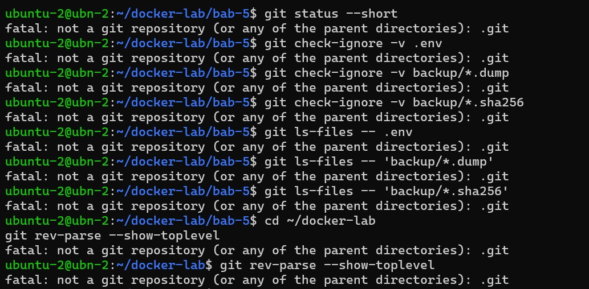

## 5.6 Best Practice untuk Menyimpan Kredensial Database

File postgres_password.txt dibuat untuk menyimpan password PostgreSQL dan diberikan permission 600 menggunakan chmod 600, sehingga hanya pemilik file yang dapat mengaksesnya. Pada compose.yaml, password tidak ditulis langsung menggunakan POSTGRES_PASSWORD, tetapi menggunakan POSTGRES_PASSWORD_FILE yang mengarah ke /run/secrets/postgres_password. File password kemudian didaftarkan sebagai secret dengan nama postgres_password dan sumber file ./postgres_password.txt. Dengan konfigurasi ini, kredensial database dipisahkan dari konfigurasi utama Docker Compose dan disimpan sebagai secret dengan akses yang terbatas.

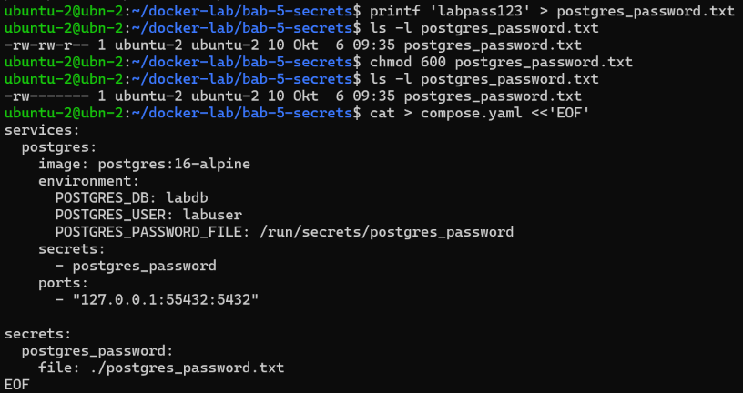

Hasil docker compose config menunjukkan bahwa PostgreSQL menggunakan POSTGRES_PASSWORD_FILE: /run/secrets/postgres_password tanpa menampilkan password secara langsung. Pada bagian secrets, file postgres_password.txt dipasang ke dalam container pada lokasi /run/secrets/postgres_password. Setelah stack dijalankan, container PostgreSQL berada dalam kondisi Up. Pemeriksaan menggunakan docker compose exec postgres ls -l /run/secrets/ juga menunjukkan bahwa file postgres_password tersedia di dalam container. Hal ini membuktikan bahwa secret berhasil diteruskan dari file host ke container PostgreSQL.

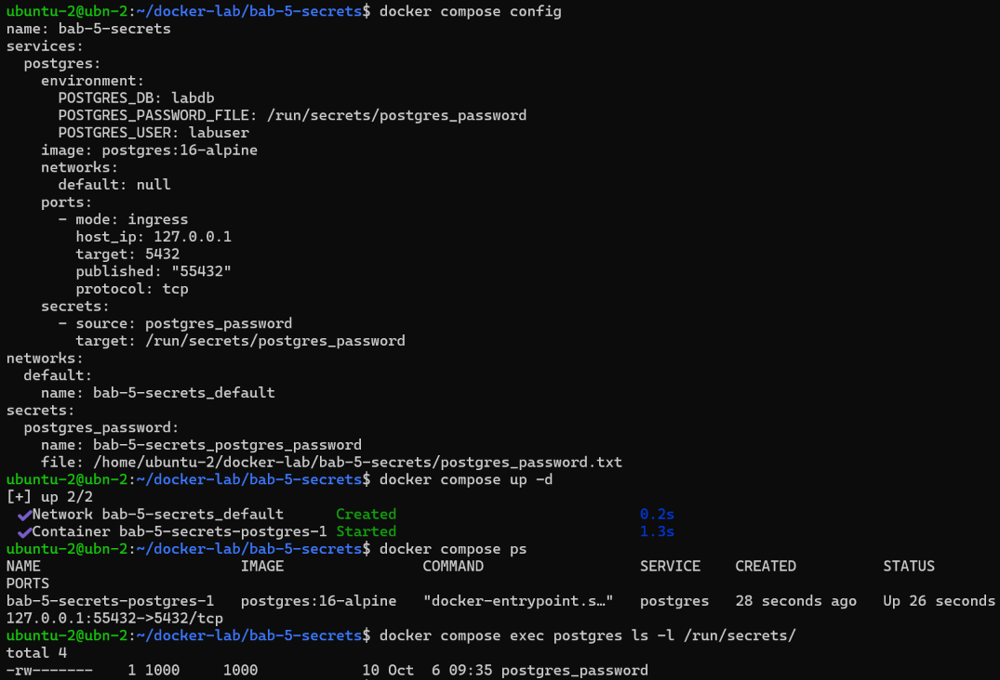

Pengujian selanjutnya menggunakan query SELECT current_user, current_database(); menghasilkan labuser sebagai user dan labdb sebagai database yang aktif. Pemeriksaan dengan grep juga menunjukkan pesan “PASSWORD TIDAK ADA DI COMPOSE.YAML”, sedangkan pengecekan file secret menghasilkan “SECRET TERSEDIA DI CONTAINER”. Hasil tersebut menunjukkan bahwa password PostgreSQL berhasil digunakan melalui mekanisme Docker Secret tanpa menuliskan nilai password secara langsung pada compose.yaml.

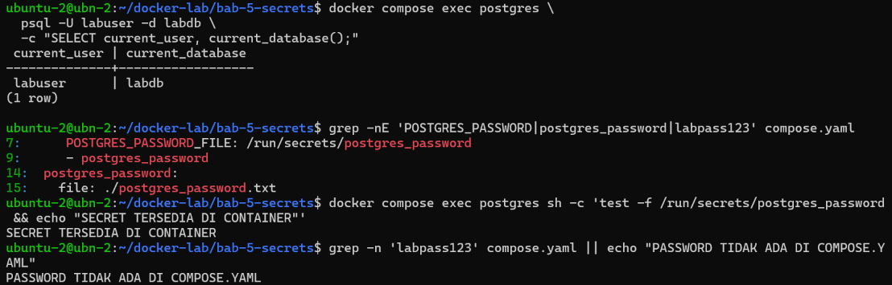

### 5.6.1 Kesimpulan Best Practice Menyimpan Kredensial Database

Berdasarkan hasil pengujian, Docker Secret dipilih sebagai *best practice* untuk menyimpan kredensial database. Password PostgreSQL tidak ditulis secara langsung pada compose.yaml, tetapi disimpan pada file secret dan diteruskan ke container melalui /run/secrets/postgres_password. Permission file juga dibatasi menggunakan 600. Hasil pengujian menunjukkan bahwa secret tersedia di dalam container dan PostgreSQL dapat menggunakannya tanpa menampilkan password pada konfigurasi utama. Dengan demikian, penggunaan Docker Secret membuat pengelolaan kredensial lebih terpisah dan lebih aman dibandingkan menuliskan password secara langsung pada konfigurasi service.
