<p align="center"></p>

# BAB VI: CENTRALIZED LOGGING DENGAN FLUENT BIT DAN POSTGRESQL

**Kelompok 2:**
- Ibram Maulana Akhsanul Qasasi (NRP. 3126640014)
- Yusuf Rahmadhani Asy’ari (NRP. 3126640042)
- Vernanda Mulia Hamonangan Manurung (NRP. 3126640044)

**Dosen Pengampu:** Dr. Ferry Astika Saputra, ST, M.Sc  
**Program Studi:** D4 Lanjut Jenjang Teknik Informatika  
**Politeknik Elektronika Negeri Surabaya**  
**2026**

---

## 6.1 Tahap Praktikum

### 6.1.1 Persiapan Konfigurasi dan Pembuatan File

#### Kotak Script 1 — File .env.example

Dilakukan pembuatan file `.env` berdasarkan `.env.example` menggunakan perintah `cp .env.example .env`. File `.env.example` berfungsi sebagai contoh konfigurasi variabel lingkungan yang dibutuhkan oleh PostgreSQL dan Fluent Bit, seperti nama database, pengguna database, dan password. Perintah `chmod 600 .env` digunakan untuk membatasi hak akses file agar hanya pemiliknya yang dapat membaca dan mengubah file tersebut:

```bash
cp .env.example .env
chmod 600 .env
stat -c '%a %n' .env
cat .env
```

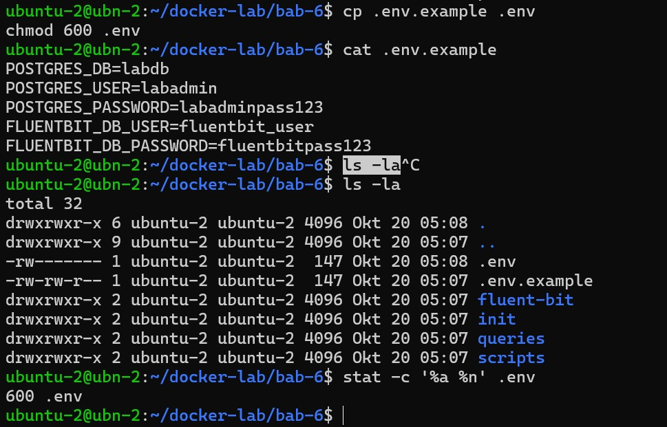

Pemeriksaan menggunakan `stat -c '%a %n' .env` menunjukkan izin 600, yang berarti akses terhadap file telah dibatasi.

#### Kotak Script 2 — File .gitignore

Diperlihatkan isi file `.gitignore` yang digunakan untuk menentukan file atau direktori yang tidak perlu dimasukkan ke dalam repositori Git:

```bash
cat .gitignore
```

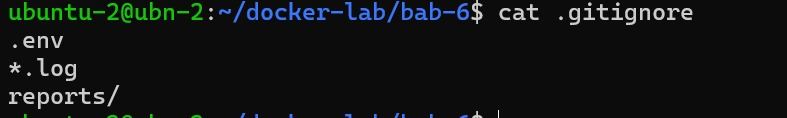

Konfigurasi `.env` mencegah file yang berisi konfigurasi sensitif ikut dilacak oleh Git, sedangkan `*.log` digunakan untuk mengabaikan file yang memiliki ekstensi log dan `reports/` untuk mengabaikan direktori laporan.

#### Kotak Script 3 — File compose.yaml

Dibuat konfigurasi Docker Compose untuk menjalankan PostgreSQL, Fluent Bit, dan tiga container pembangkit log, yaitu `generator-auth`, `generator-api`, dan `generator-worker`:

```bash
cat compose.yaml
```

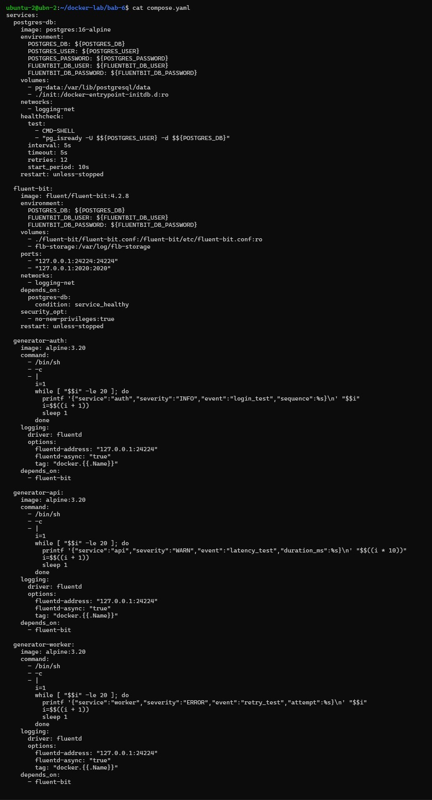

PostgreSQL menggunakan image `postgres:16-alpine`, sedangkan Fluent Bit menggunakan image `fluent/fluent-bit:4.2.8`. Bagian volumes pada layanan PostgreSQL menggunakan named volume `pg-data` untuk menyimpan data database agar tetap tersedia meskipun container dibuat ulang.

### 6.1.2 Pembuatan Database dan Konfigurasi Pengumpulan Log

#### Kotak Script 4 — File init/01-init-logging.sh

Script inisialisasi PostgreSQL yang bertugas menyiapkan akun pengguna, schema, tabel, indeks, view, dan hak akses yang dibutuhkan Fluent Bit:

```bash
cat init/01-init-logging.sh
```

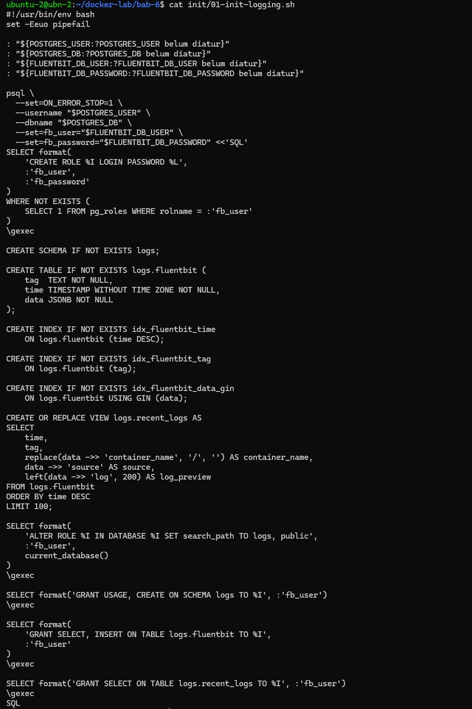

Perintah `psql` dijalankan dengan `ON_ERROR_STOP=1` agar kesalahan SQL dapat menghentikan proses inisialisasi. Script menggunakan `CREATE ROLE` untuk membuat pengguna khusus Fluent Bit, membuat tabel `logs.fluentbit` bertipe JSONB, dan memberikan izin akses yang sesuai.

#### Kotak Script 5 — File fluent-bit/fluent-bit.conf

Dilakukan konfigurasi Fluent Bit sebagai penerima dan penerus log:

```bash
cat fluent-bit/fluent-bit.conf
```

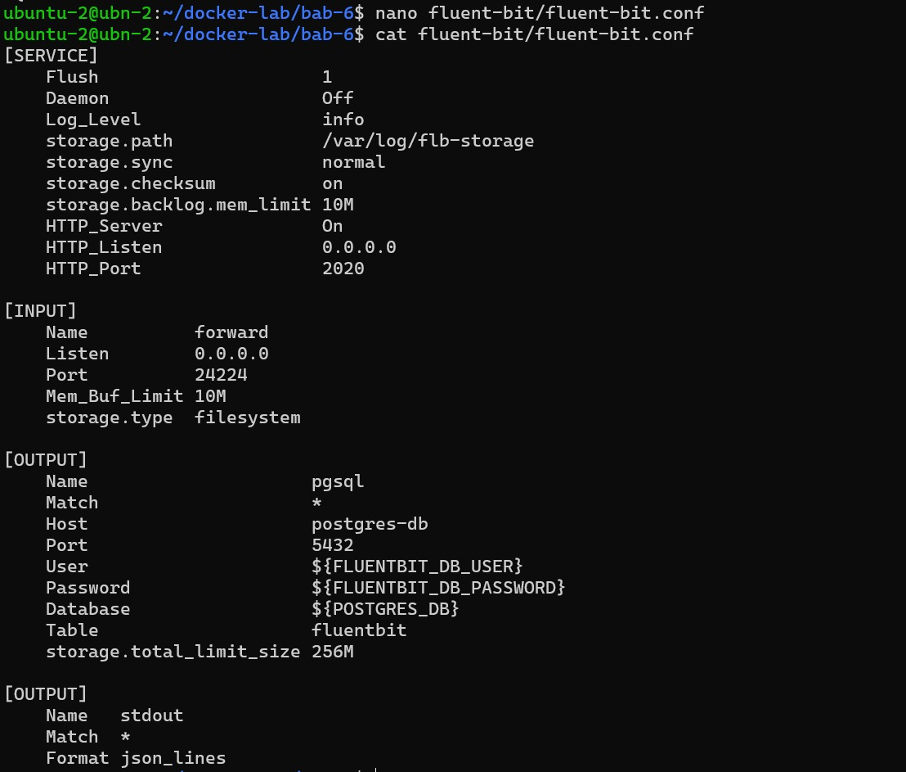

Bagian `[SERVICE]` mengatur perilaku umum Fluent Bit, `[INPUT]` menggunakan plugin `forward` port 24224 untuk menerima log Docker logging driver, dan `[OUTPUT]` mengirimkan data ke PostgreSQL (`pgsql`) serta keluaran standar (`stdout`).

### 6.1.3 Pembuatan Query dan Script Pengujian

#### Kotak Script 6 — File queries/analysis.sql

Dibuat kumpulan query SQL untuk menganalisis data log yang telah disimpan dalam tabel `logs.fluentbit`:

```bash
cat queries/analysis.sql
```

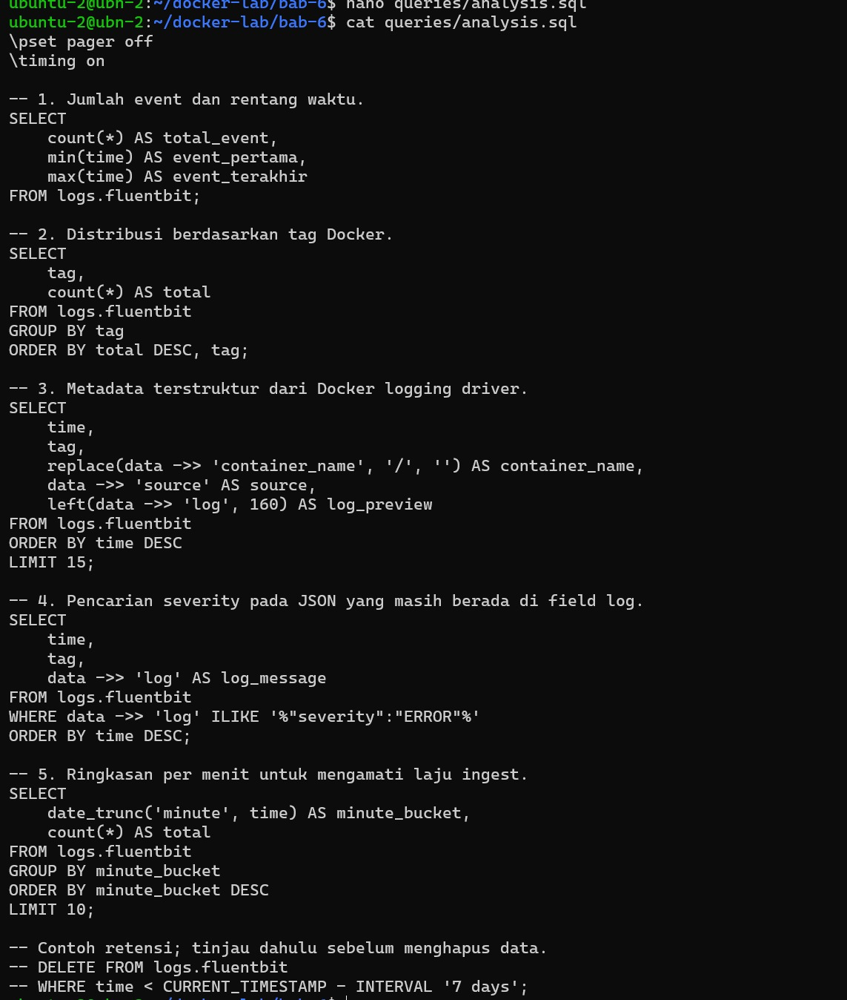

Query mencakup penghitungan jumlah total event (`COUNT(*)`), distribusi sumber log (`GROUP BY tag`), ekstraksi atribut JSONB (`->>`), filter error level, dan laju log per menit (`date_trunc`).

#### Kotak Script 7 — File scripts/generate-logs.sh

Dibuat script untuk menjalankan layanan yang dibutuhkan dan menghasilkan log pengujian secara otomatis:

```bash
cat scripts/generate-logs.sh
```

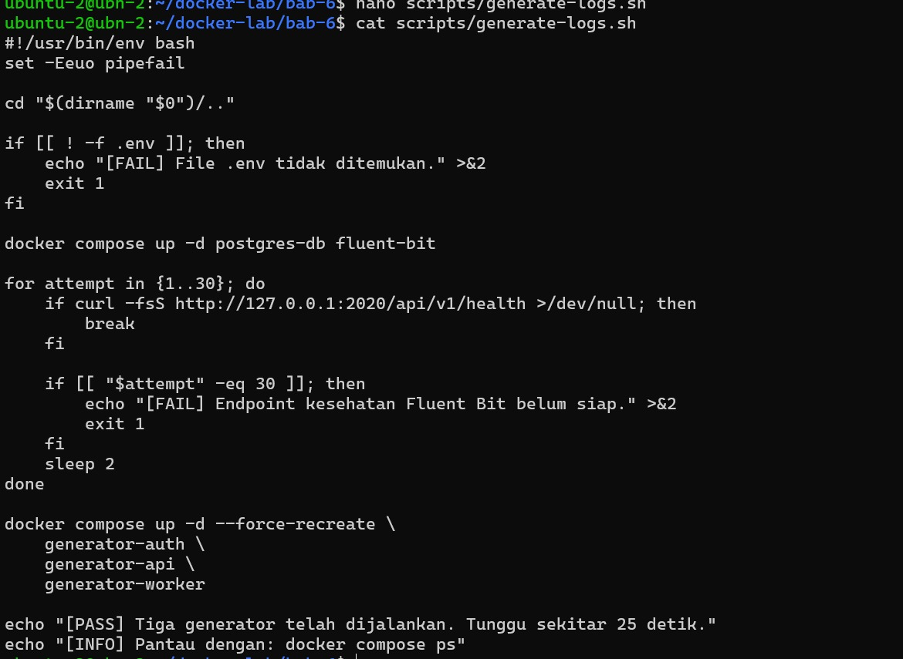

Script memastikan file `.env` tersedia, menjalankan PostgreSQL dan Fluent Bit di latar belakang, memvalidasi endpoint kesehatan, dan me-restart generator dengan `--force-recreate`.

#### Kotak Script 8 — File scripts/test-buffering.sh

Dibuat script untuk menguji apakah Fluent Bit dapat mempertahankan log ketika PostgreSQL berhenti sementara dan melanjutkan pengiriman setelah database kembali aktif:

```bash
cat scripts/test-buffering.sh
```

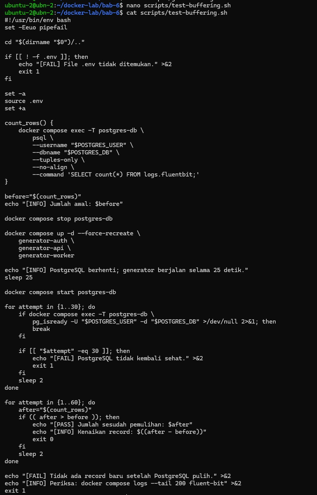

Script membandingkan jumlah record sebelum dan sesudah PostgreSQL dimatikan sementara (`docker compose stop postgres-db`) dan dihidupkan kembali.

### 6.1.4 Pelaksanaan dan Pemeriksaan Hasil Praktikum

#### Kotak Perintah B — Memberi Izin Eksekusi dan Memvalidasi Berkas

Dilakukan persiapan script dan validasi konfigurasi sebelum pipeline dijalankan:

```bash
chmod +x scripts/generate-logs.sh scripts/test-buffering.sh
docker compose config --quiet
```

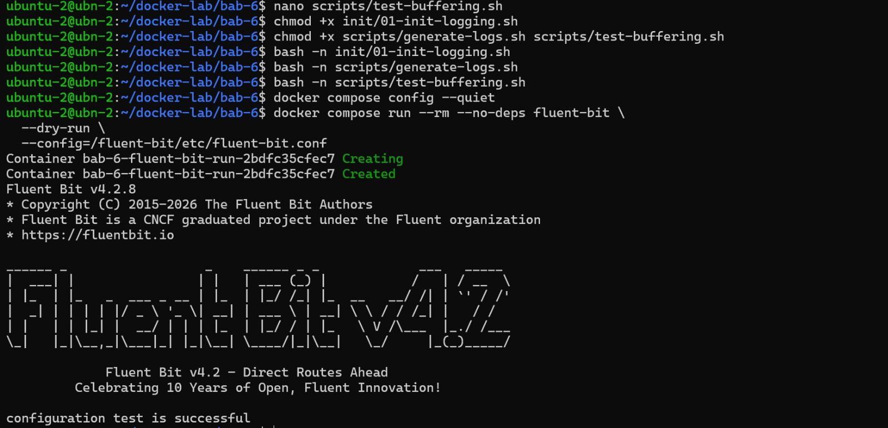

Perintah tersebut memvalidasi struktur dan sintaks konfigurasi Compose tanpa menampilkan seluruh konfigurasi yang sudah diproses.

#### Kotak Perintah C — Menjalankan Pipeline dan Menghasilkan Log

Pipeline dijalankan dengan memanggil script `generate-logs.sh`:

```bash
./scripts/generate-logs.sh
```

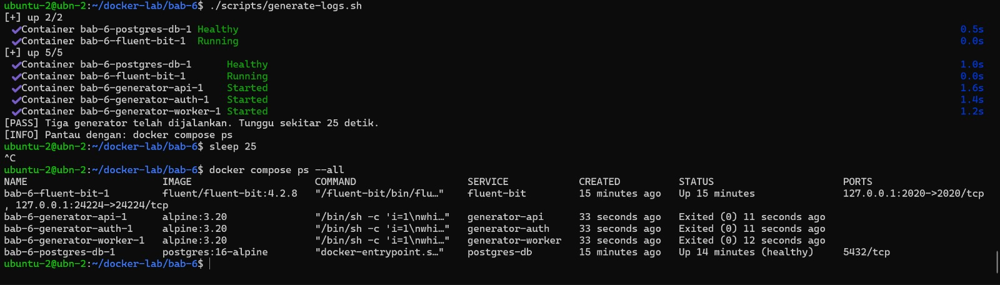

Script menjalankan PostgreSQL dan Fluent Bit terlebih dahulu, memeriksa endpoint kesehatan, lalu memulai ketiga generator log.

#### Kotak Perintah D — Memeriksa Monitoring Fluent Bit

Pemeriksaan status kesehatan Fluent Bit melalui endpoint monitoring HTTP port 2020:

```bash
curl -fsS http://127.0.0.1:2020/api/v1/health
```

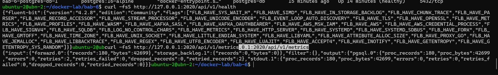

Pemeriksaan endpoint metrik:

```bash
curl -s http://127.0.0.1:2020/api/v1/metrics
```

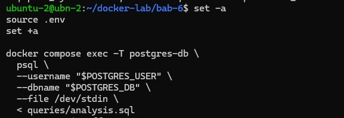

Pemeriksaan status buffer penyimpanan (storage):

```bash
curl -s http://127.0.0.1:2020/api/v1/storage
```

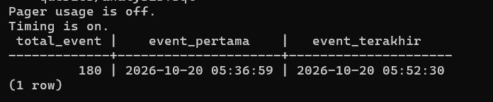

Pemeriksaan waktu operasional (uptime):

```bash
curl -s http://127.0.0.1:2020/api/v1/uptime
```

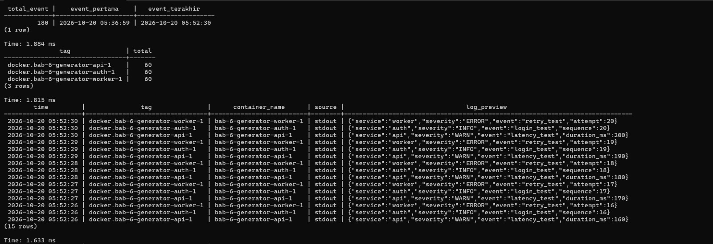

Ringkasan metrik data monitoring Fluent Bit:

```bash
curl -s http://127.0.0.1:2020/api/v1/metrics | jq .
```

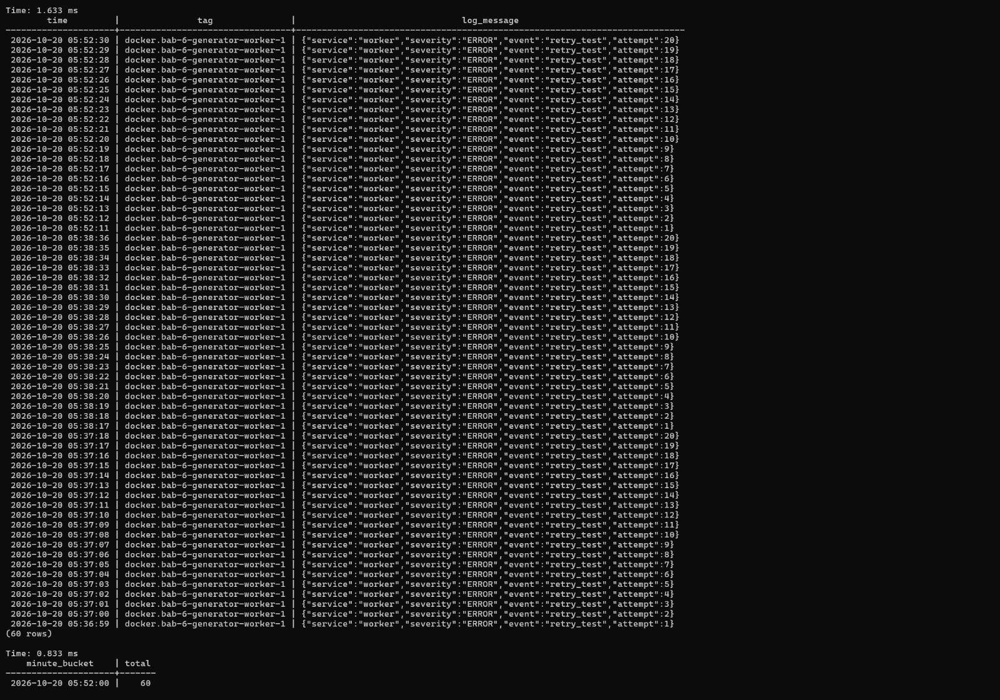

#### Kotak Perintah E — Memverifikasi Record PostgreSQL

Pemeriksaan terhadap record yang berhasil disimpan di PostgreSQL:

```bash
docker compose exec -T postgres-db psql -U fluentbit_writer -d labdb -c "SELECT count(*) FROM logs.fluentbit;"
docker compose exec -T postgres-db psql -U fluentbit_writer -d labdb -c "SELECT tag, count(*) FROM logs.fluentbit GROUP BY tag;"
```

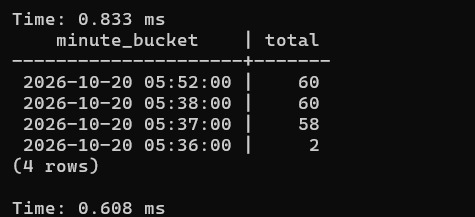

Hasil query menampilkan jumlah total baris log dan sebaran record yang masuk dari tag ketiga generator.

#### Verifikasi Tipe Data JSONB

Pemeriksaan tipe data kolom penyimpanan log di PostgreSQL:

```bash
docker compose exec -T postgres-db psql -U fluentbit_writer -d labdb -c "SELECT pg_typeof(data) FROM logs.fluentbit LIMIT 1;"
```

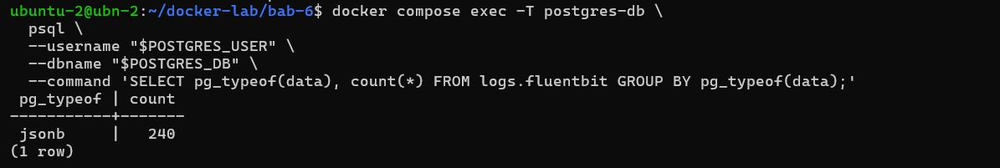

Hasil mengonfirmasi bahwa tipe data kolom `data` adalah `jsonb`, mendukung pengindeksan biner dan ekstraksi atribut secara instan.

### 6.1.5 Verifikasi PASS/FAIL

#### Verifikasi 1 — Validasi Compose

Verifikasi validitas sintaks berkas Compose tanpa pesan galat:

```bash
docker compose config --quiet
```

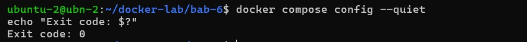

#### Verifikasi 2 — Kesehatan Backend

Verifikasi status layanan PostgreSQL dan hasil healthcheck:

```bash
docker compose ps
```

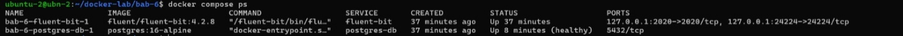

Status `healthy` menunjukkan database PostgreSQL siap melayani koneksi.

#### Verifikasi 3 — Kesehatan Collector

Verifikasi respon kode HTTP dari endpoint kesehatan Fluent Bit:

```bash
curl -s -o /dev/null -w "%{http_code}\n" http://127.0.0.1:2020/api/v1/health
```

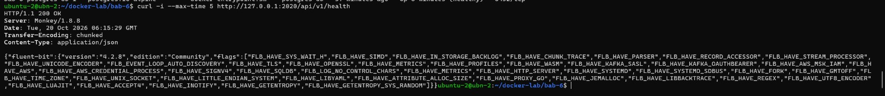

Respon kode HTTP 200 menunjukkan layanan Fluent Bit berjalan prima.

#### Verifikasi 4 — Tiga Sumber Log

Verifikasi penerimaan log dari ketiga generator (`auth`, `api`, dan `worker`):

```bash
docker compose exec -T postgres-db psql -U fluentbit_writer -d labdb -c "SELECT tag, count(*) FROM logs.fluentbit GROUP BY tag;"
```

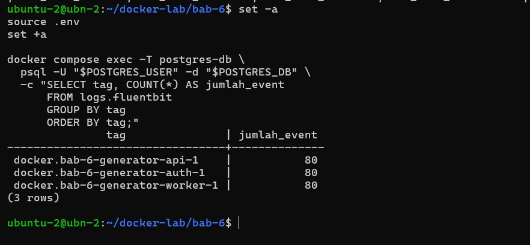

#### Verifikasi 5 — Struktur Record

Pemeriksaan atribut field penting `container_name`, `source`, dan `log` pada data JSONB:

```bash
docker compose exec -T postgres-db psql -U fluentbit_writer -d labdb -c "SELECT tag, data->>'container_name' AS container_name, data->>'source' AS source, left(data->>'log', 40) AS sample_log FROM logs.fluentbit LIMIT 5;"
```

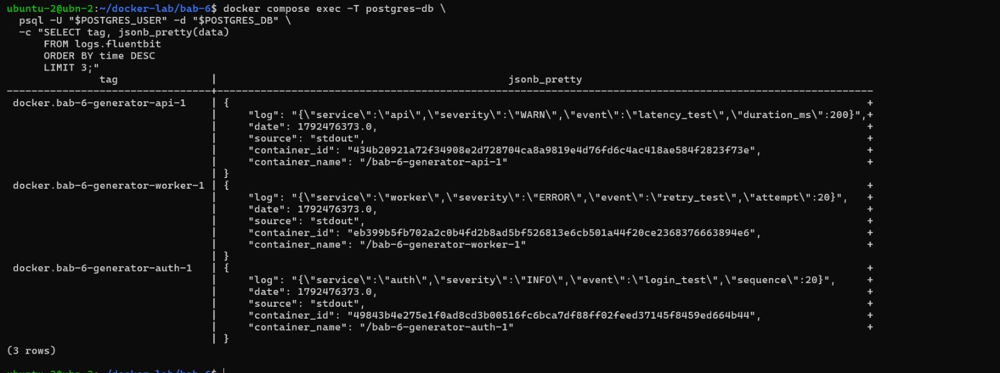

#### Verifikasi 6 — Penyimpanan JSONB

Pemeriksaan tipe data kolom serta skema tabel `logs.fluentbit`:

```bash
docker compose exec -T postgres-db psql -U fluentbit_writer -d labdb -c "SELECT pg_typeof(data) FROM logs.fluentbit LIMIT 1;"
```

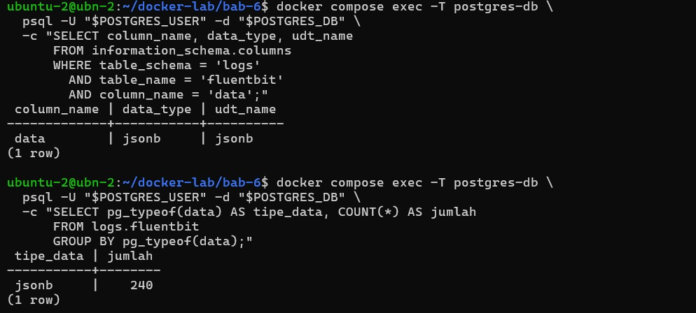

Pemeriksaan definisi skema kolom tabel `logs.fluentbit`:

```bash
docker compose exec -T postgres-db psql -U fluentbit_writer -d labdb -c "\d logs.fluentbit"
```

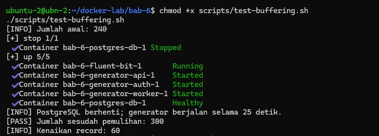

#### Verifikasi 7 — Pemulihan Output

Pemeriksaan kemampuan buffer Fluent Bit saat PostgreSQL dimatikan sementara:

```bash
./scripts/test-buffering.sh
```

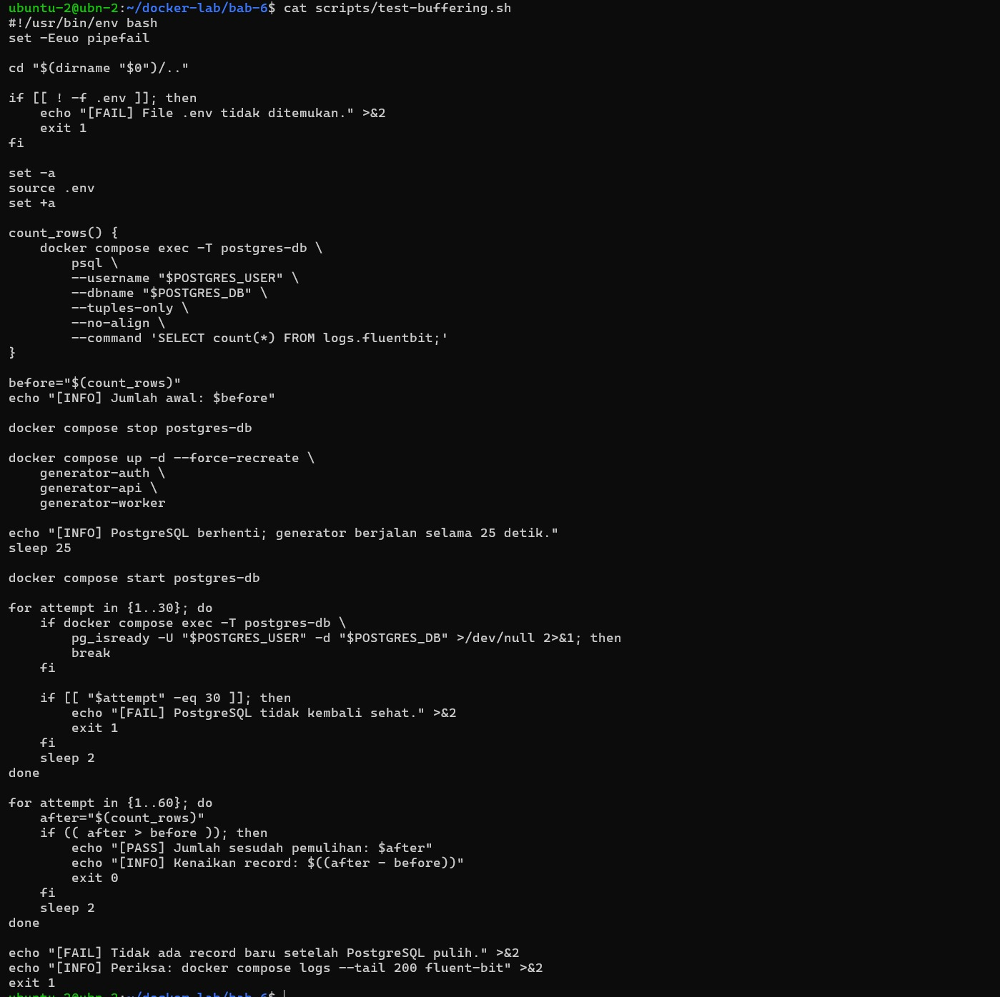

Output `[PASS]` membuktikan data tetap tersimpan di buffer Fluent Bit dan diteruskan kembali saat PostgreSQL pulih.

#### Verifikasi 8 — Pembatasan Jaringan PostgreSQL

Pemeriksaan published port untuk memastikan port database tidak dibuka langsung ke host:

```bash
docker compose ps
```

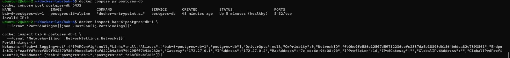

PostgreSQL tidak memiliki pemetaan port ke host dan hanya dapat diakses melalui jaringan internal bridge Docker Compose.

---

## 6.2 Penambahan Grafana di Luar Cheatsheet BAB 6

### 6.2.1 Konfigurasi Kredensial dan Penyiapan Hak Akses Basis Data

Pembuatan role khusus `grafana_reader` dengan hak akses baca (*least privilege*) pada PostgreSQL:

```bash
docker compose exec -T postgres-db psql -U labuser -d labdb -c "CREATE ROLE grafana_reader WITH LOGIN PASSWORD 'grafana_pass'; GRANT CONNECT ON DATABASE labdb TO grafana_reader; GRANT USAGE ON SCHEMA logs TO grafana_reader; GRANT SELECT ON ALL TABLES IN SCHEMA logs TO grafana_reader;"
```

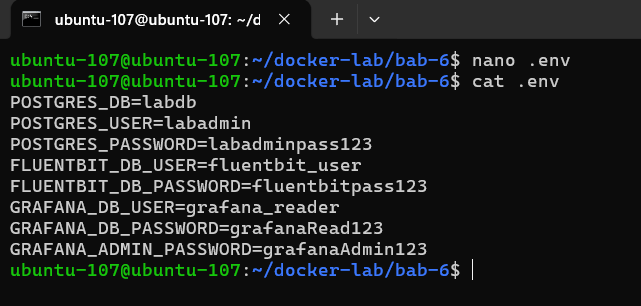

### 6.2.2 Pengaturan Service pada Docker Compose dan Penyebaran Stack

Validasi compose dan deployment service Grafana bersama seluruh stack:

```bash
docker compose config --quiet
docker compose up -d
docker compose ps
```

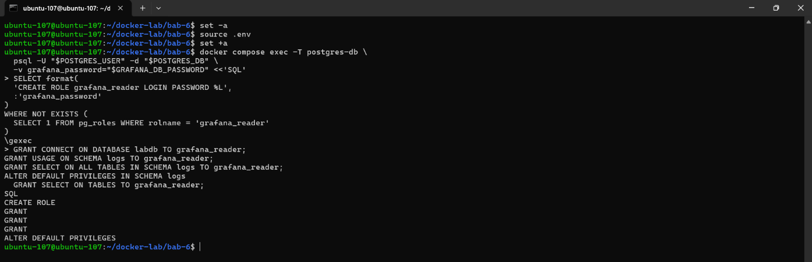

Berikut adalah konfigurasi lengkap `compose.yaml` yang memuat service PostgreSQL, Fluent Bit, Grafana, dan generator log:

```bash
cat compose.yaml
```

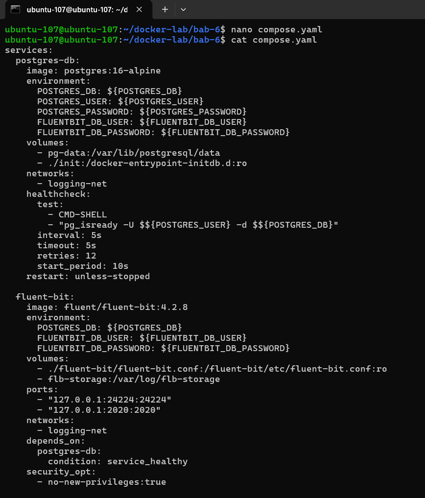

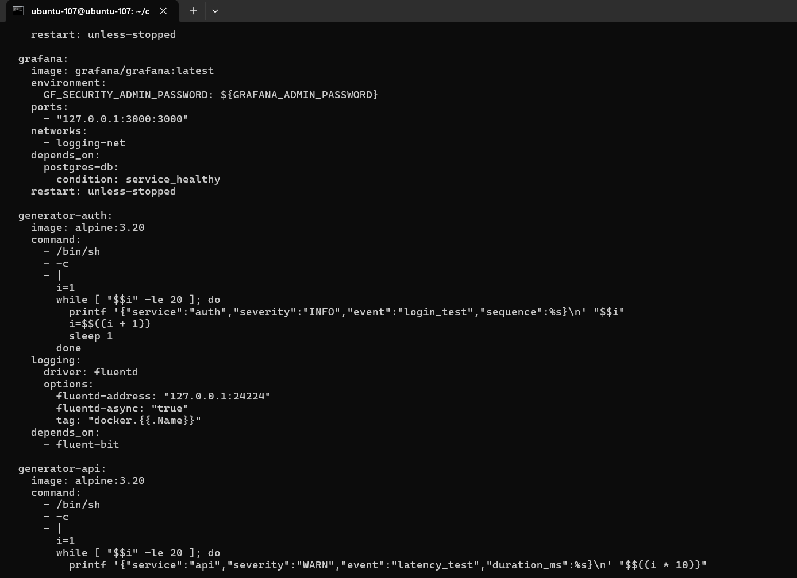

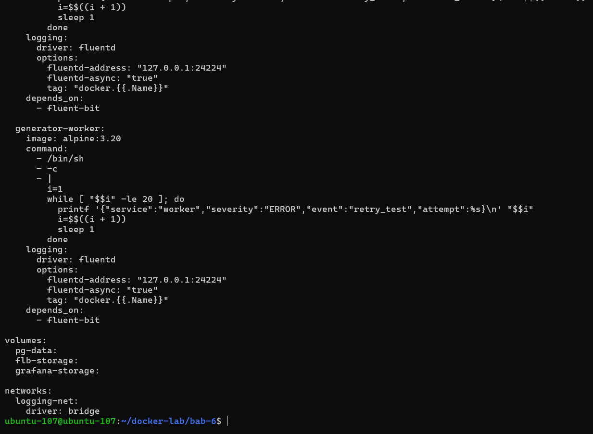

Pemeriksaan konfigurasi dan pengujian deployment service Grafana:

```bash
docker compose config --quiet
docker compose up -d grafana
docker compose ps
```

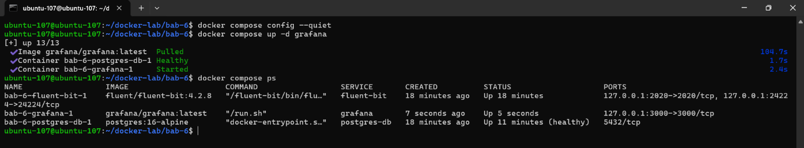

### 6.2.3 Pengalihan Port SSH dan Akses Antarmuka Grafana

Pemeriksaan log inisialisasi dan migrasi database Grafana:

```bash
docker compose logs --tail 50 grafana
```

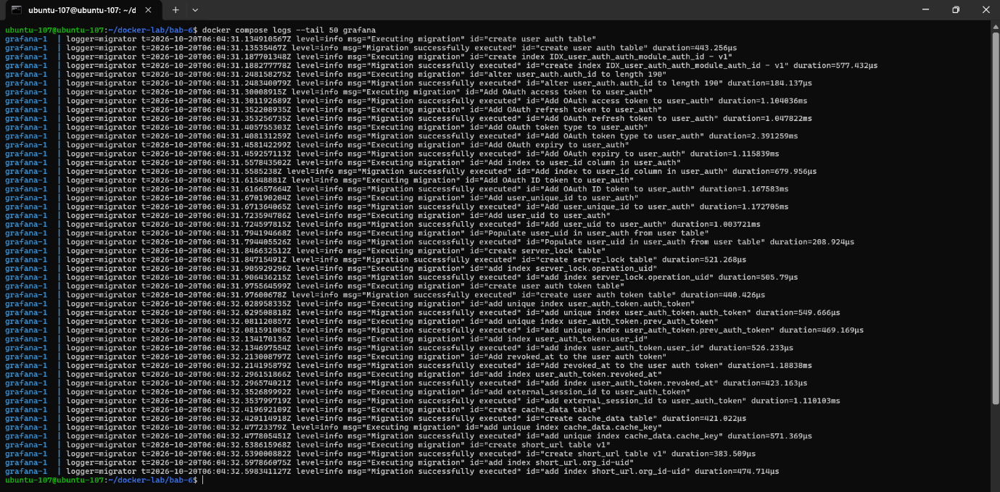

Untuk mengakses antarmuka Grafana dari mesin lokal secara aman, dijalankan perintah pengalihan port SSH (*Local Port Forwarding*):

```bash
ssh -L 3000:127.0.0.1:3000 ubuntu-2@10.252.108.103
```

Setelah pengalihan port aktif, antarmuka web Grafana diakses melalui peramban pada URL `http://localhost:3000`:

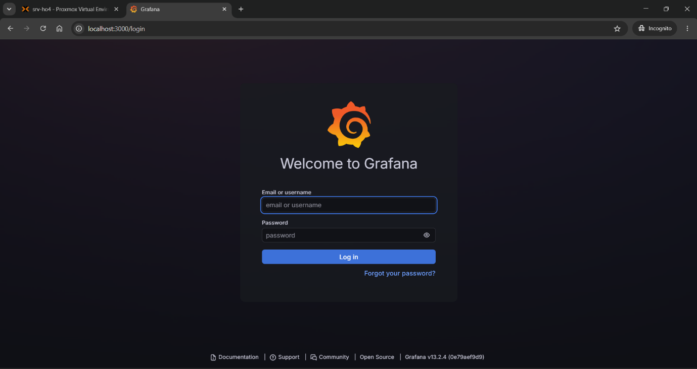

Halaman utama Grafana setelah autentikasi berhasil:

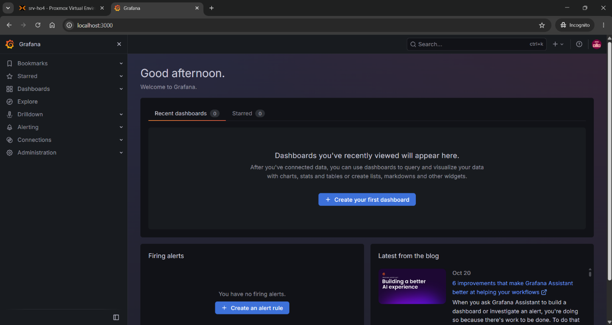

### 6.2.4 Konfigurasi Data Source PostgreSQL

Integrasi basis data dilakukan melalui menu *Data Sources* di Grafana dengan menambahkan koneksi baru berlabel `grafana-postgresql-datasource` mengarahkan Host ke `postgres-db:5432`:

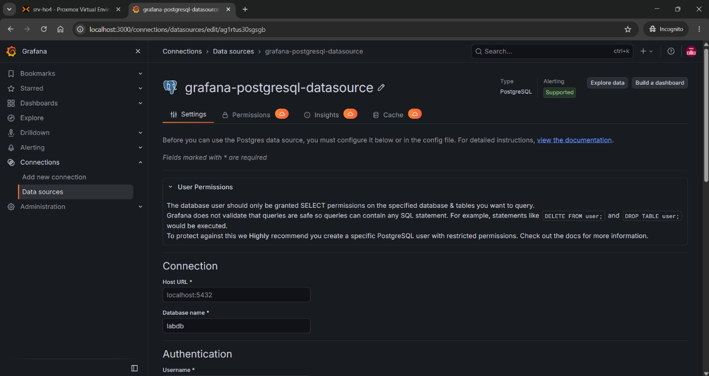

Pengisian kredensial user `grafana_reader` dan penonaktifan SSL:

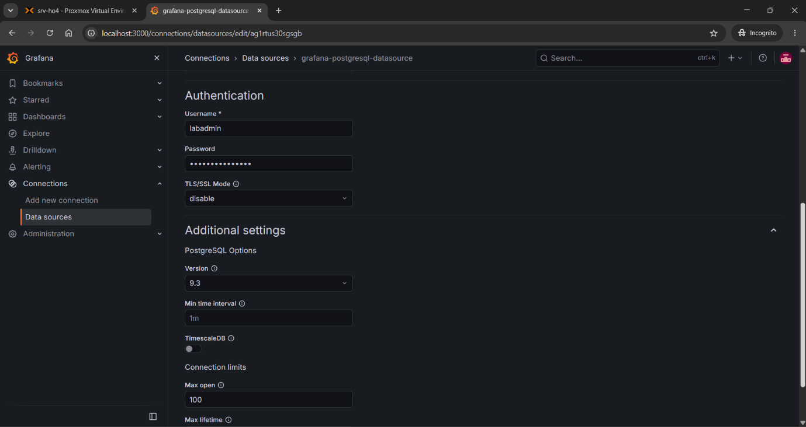

Pengujian koneksi berhasil divalidasi dengan munculnya pesan *Database Connection OK*:

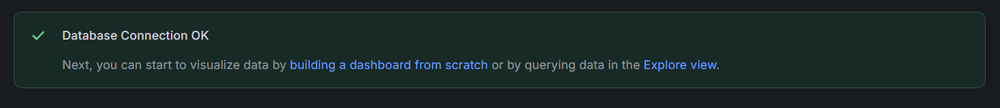

### 6.2.5 Visualisasi dan Pembuatan Dashboard Log

Penyusunan query SQL untuk panel visualisasi tabel log terstruktur:

```sql
SELECT
  time AS "time",
  tag,
  data ->> 'log' AS log_message
FROM logs.fluentbit
WHERE $__timeFilter(time)
ORDER BY time DESC
LIMIT 100
```

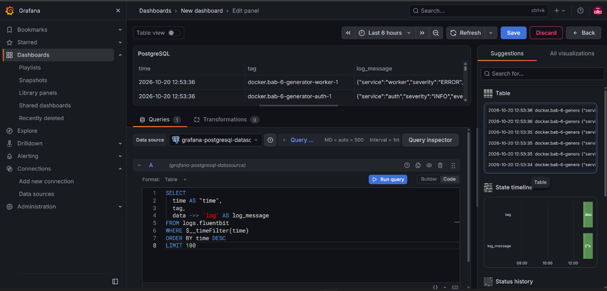

Tampilan akhir dashboard analitik terpadu dengan panel Tabel dan grafik tren volume log secara *real-time*:

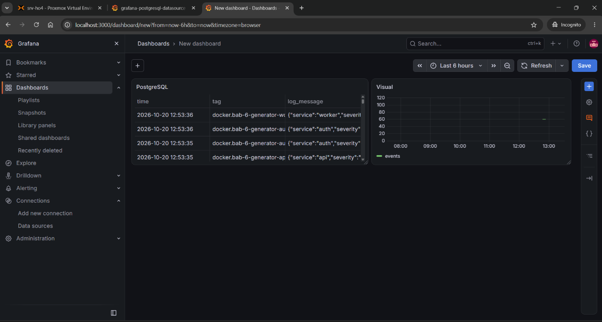
