<p align="center"></p>

# BAB VI (STUDI KASUS): CENTRALIZED LOGGING & INCIDENT RESPONSE PMB DEVSECOPS LABORATORY

**Mata Kuliah:** Workshop DevOps  
**Dosen Pengampu:** Dr. Ferry Astika Saputra, ST, M.Sc  
**Disusun Oleh:** Vernanda Mulia Hamonangan Manurung (NRP. 3126640044)  
**Program Studi:** D4 Lanjut Jenjang Teknik Informatika  
**Institusi:** Politeknik Elektronika Negeri Surabaya (2026)

---


# BAB I: LINGKUNGAN DAN ARSITEKTUR SISTEM


## 1.1 Lingkungan Pengerjaan

Pengerjaan proyek PMB DevSecOps Laboratory dilakukan menggunakan lingkungan Linux Ubuntu yang berjalan melalui Windows Subsystem for Linux (WSL). Lingkungan ini digunakan untuk menjalankan perintah Linux, mengelola berkas proyek, membangun aplikasi, serta mengoperasikan layanan menggunakan Docker Compose.

Direktori proyek yang digunakan adalah ~/docker-lab/bab-6-pmb/pmb-devsecops-lab. Seluruh proses implementasi dan pengujian dilakukan dari direktori tersebut agar perintah yang dijalankan dapat mengakses berkas konfigurasi, kode aplikasi, dan skrip pengujian yang diperlukan.

Perintah pemeriksaan:

cd ~/docker-lab/bab-6-pmb/pmb-devsecops-lab

pwd

Perintah pwd digunakan untuk menampilkan lokasi direktori kerja saat ini. Hasil yang diharapkan menunjukkan bahwa terminal berada di dalam direktori proyek PMB DevSecOps Laboratory. Pemeriksaan ini penting untuk memastikan bahwa perintah selanjutnya dijalankan pada lokasi yang benar.


```bash
cd ~/docker-lab/bab-6-pmb/pmb-devsecops-lab
pwd
```


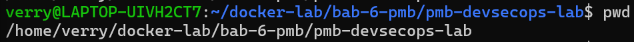


*Gambar 1.1 Hasil pemeriksaan lokasi direktori kerja proyek PMB DevSecOps Laboratory.*


## 1.2 Struktur Berkas Proyek

Pemeriksaan struktur berkas dilakukan untuk mengetahui susunan komponen yang digunakan dalam proyek. Struktur tersebut mencakup kode aplikasi, konfigurasi Docker Compose, konfigurasi pengumpulan log, skrip otomatisasi, serta berkas SQL untuk analisis log.

Perintah pemeriksaan:

find . -maxdepth 2 -type f \

-not -path './.git/*' \

-not -name '.env' \

-not -name 'cookies.txt' | sort

Perintah tersebut menampilkan daftar berkas proyek hingga kedalaman dua tingkat direktori. Berkas .env sengaja tidak ditampilkan karena dapat berisi konfigurasi sensitif. Hasil pemeriksaan digunakan untuk memastikan bahwa komponen yang diperlukan dalam proses implementasi tersedia di dalam direktori proyek.


```bash
find . -maxdepth 2 -type f \
  -not -path './.git/*' \
  -not -name '.env' \
  -not -name 'cookies.txt' | sort
```


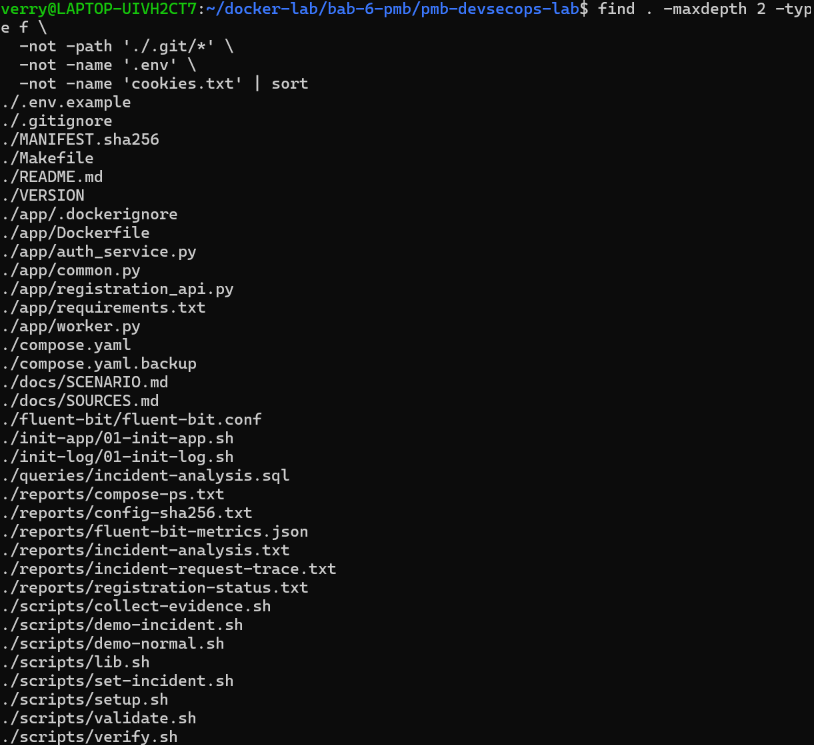


*Gambar 1.2 Struktur berkas proyek hingga dua tingkat direktori.*


## 1.3 Komponen Sistem

Proyek PMB DevSecOps Laboratory terdiri atas enam layanan utama yang saling terhubung untuk menjalankan proses pendaftaran, autentikasi, verifikasi, penyimpanan data, dan pengelolaan log. Pembagian layanan tersebut membuat setiap fungsi memiliki tanggung jawab yang lebih terstruktur.

Komponen yang digunakan adalah sebagai berikut.


| Komponen | Fungsi |
| --- | --- |
| registration-api | Menangani permintaan pendaftaran dan menyediakan antarmuka layanan aplikasi. |
| auth-service | Menangani proses autentikasi pengguna. |
| verification-worker | Memproses pekerjaan verifikasi pendaftaran. |
| app-db | Menyimpan data yang digunakan oleh aplikasi PMB. |
| log-db | Menyimpan data log untuk kebutuhan pemeriksaan dan analisis. |
| fluent-bit | Mengumpulkan dan meneruskan log dari layanan aplikasi ke tujuan penyimpanan log. |


Daftar layanan yang didefinisikan dalam konfigurasi Docker Compose dapat diperiksa menggunakan perintah berikut.

docker compose config --services

Perintah tersebut menampilkan nama layanan yang dikenali oleh Docker Compose. Jika keenam layanan muncul pada hasil pemeriksaan, konfigurasi telah mendefinisikan seluruh komponen utama yang direncanakan dalam proyek.


```bash
docker compose config --services
```


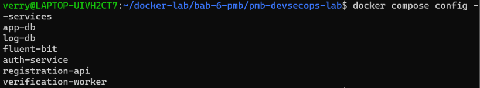


*Gambar 1.3 Daftar layanan utama dalam konfigurasi Docker Compose.*


## 1.4 Arsitektur Sistem dan Pengelolaan Log

Arsitektur sistem dirancang dengan memisahkan layanan aplikasi, basis data aplikasi, dan komponen pengumpulan log. Pemisahan ini bertujuan agar proses pendaftaran dan verifikasi dapat berjalan melalui layanan masing-masing, sedangkan aktivitas layanan dapat dikumpulkan untuk membantu proses pemantauan dan analisis ketika terjadi kesalahan.

Konfigurasi utama sistem dapat diperiksa melalui berkas compose.yaml. Berkas ini berisi definisi layanan, jaringan, port, dan pengaturan lain yang digunakan Docker Compose. Sementara itu, konfigurasi Fluent Bit terdapat pada berkas fluent-bit/fluent-bit.conf dan digunakan untuk melihat bagaimana log dikumpulkan serta diteruskan.

Perintah pemeriksaan konfigurasi Docker Compose:

sed -n '1,260p' compose.yaml

Perintah pemeriksaan konfigurasi Fluent Bit:

sed -n '1,260p' fluent-bit/fluent-bit.conf

Pemeriksaan kedua berkas tersebut dilakukan untuk memahami hubungan antarlayanan dan alur pengelolaan log. Hasil pemeriksaan konfigurasi menjadi dasar untuk menjelaskan bagaimana komponen aplikasi dan komponen logging dihubungkan dalam lingkungan pengujian.


```bash
sed -n '1,260p' compose.yaml
```


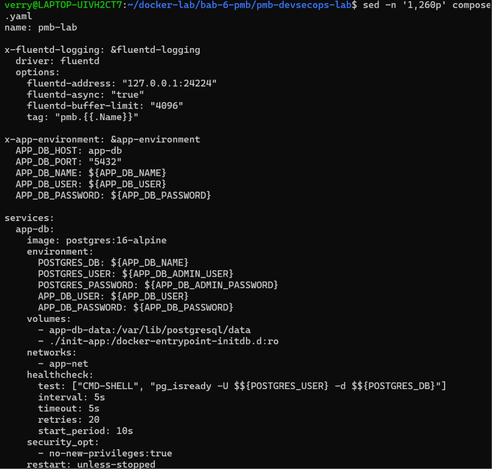


*Gambar 1.4 Pemeriksaan konfigurasi layanan pada berkas compose.yaml.*


```bash
sed -n '1,260p' fluent-bit/fluent-bit.conf
```


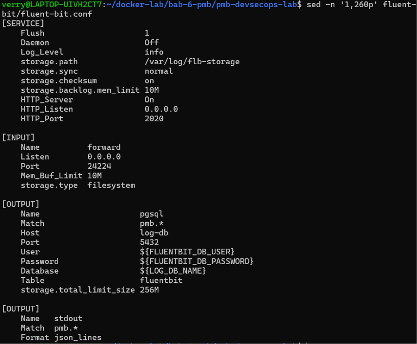


*Gambar 1.5 Pemeriksaan konfigurasi pengumpulan dan penerusan log pada fluent-bit.conf.*


# BAB II: IMPLEMENTASI APLIKASI PMB


## 2.1 Pemeriksaan Konfigurasi Docker Compose

Sebelum aplikasi dijalankan, konfigurasi Docker Compose diperiksa untuk memastikan bahwa berkas konfigurasi dapat dibaca dan layanan yang didefinisikan dapat dikenali oleh Docker Compose.

Perintah pemeriksaan:

docker compose config --services

docker compose config --quiet

Perintah pertama menampilkan daftar layanan yang telah didefinisikan, sedangkan perintah kedua memvalidasi konfigurasi tanpa menampilkan seluruh isi konfigurasi ke terminal. Apabila perintah validasi selesai tanpa menampilkan pesan kesalahan, konfigurasi berhasil melewati pemeriksaan sintaks dan struktur yang dilakukan Docker Compose.

Pemeriksaan ini merupakan langkah awal sebelum proses pembangunan dan menjalankan kontainer. Namun, konfigurasi yang valid belum otomatis membuktikan bahwa seluruh layanan dapat berjalan dengan baik. Oleh karena itu, pemeriksaan dilanjutkan dengan menjalankan aplikasi dan memeriksa status setiap layanan.


```bash
docker compose config --services
docker compose config --quiet
```


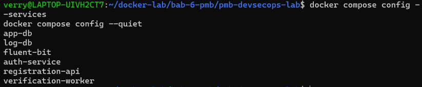


*Gambar 2.1 Hasil validasi konfigurasi Docker Compose tanpa pesan kesalahan.*


## 2.2 Persiapan Lingkungan dan Validasi Aplikasi

Tahap berikutnya adalah menyiapkan lingkungan proyek menggunakan skrip yang telah disediakan. Skrip persiapan digunakan sesuai dengan instruksi proyek, sedangkan skrip validasi digunakan untuk memeriksa bagian aplikasi yang dapat diuji secara otomatis.

Perintah pemeriksaan dan pelaksanaan:

sed -n '1,220p' README.md

sed -n '1,220p' scripts/setup.sh

./scripts/setup.sh

./scripts/validate.sh

Berkas README.md diperiksa terlebih dahulu untuk mengetahui petunjuk penggunaan proyek. Setelah itu, isi scripts/setup.sh diperiksa agar langkah yang dijalankan dapat dipahami sebelum skrip dieksekusi.

Skrip persiapan kemudian dijalankan untuk menyiapkan kebutuhan lingkungan sesuai dengan implementasi proyek. Setelah tahap persiapan selesai, scripts/validate.sh dijalankan untuk memeriksa fungsi yang telah disediakan dalam pengujian otomatis.

Berdasarkan hasil pengujian sebelumnya, validasi aplikasi berhasil menjalankan tiga pengujian unit dan seluruhnya dinyatakan lulus. Hasil tersebut menunjukkan bahwa fungsi-fungsi yang dicakup oleh ketiga pengujian tersebut berjalan sesuai dengan ekspektasi. Hasil ini tidak berarti seluruh kemungkinan kesalahan aplikasi telah diuji, sehingga pemeriksaan tetap dilanjutkan melalui pengoperasian layanan dan skenario demonstrasi.


```bash
sed -n '1,220p' README.md
sed -n '1,220p' scripts/setup.sh
./scripts/setup.sh
./scripts/validate.sh
```


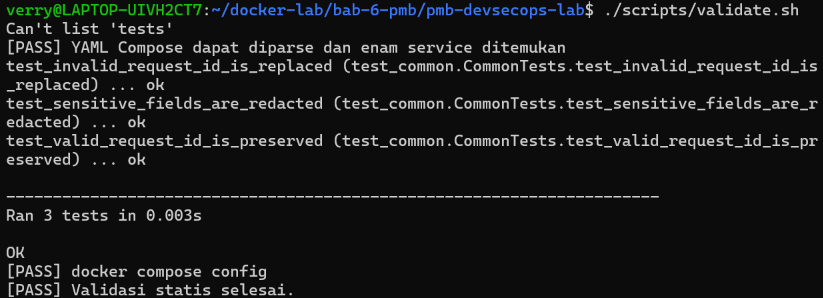


*Gambar 2.2 Hasil pemeriksaan petunjuk dan pelaksanaan validasi otomatis aplikasi.*


## 2.3 Membangun dan Menjalankan Layanan

Setelah persiapan dan validasi awal selesai, seluruh layanan dijalankan menggunakan Docker Compose. Pada tahap ini, Docker membangun image yang diperlukan dan membuat atau menjalankan kontainer berdasarkan konfigurasi proyek.

Perintah pelaksanaan:

docker compose up -d --build

docker compose ps

Perintah docker compose up -d --build digunakan untuk membangun image dan menjalankan layanan di latar belakang. Selanjutnya, perintah docker compose ps digunakan untuk memeriksa status kontainer yang dikelola oleh Docker Compose.

Berdasarkan pemeriksaan yang telah dilakukan sebelumnya, seluruh enam layanan utama berada dalam kondisi aktif atau sehat sesuai status yang ditampilkan oleh Docker. Hasil ini menunjukkan bahwa layanan berhasil dijalankan pada saat pemeriksaan. Status tersebut tetap perlu dipantau selama pengujian karena layanan yang aktif belum tentu menjamin seluruh fungsi aplikasi berjalan sesuai kebutuhan.


```bash
docker compose up -d --build
docker compose ps
```


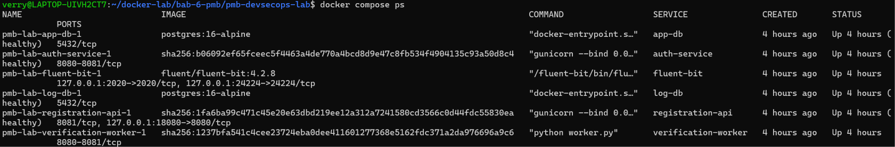


*Gambar 2.3 Status aktif seluruh kontainer setelah proses docker compose up.*


## 2.4 Pengujian Endpoint Kesehatan Aplikasi

Pengujian endpoint kesehatan dilakukan untuk mengetahui apakah aplikasi menyediakan endpoint yang dapat diakses dan memberikan respons. Pengujian ini menjadi pemeriksaan awal sebelum aplikasi diuji melalui peramban.

Perintah pengujian:

curl -i http://localhost:18080/healthz

Perintah curl -i mengirimkan permintaan HTTP ke endpoint /healthz dan menampilkan informasi respons, termasuk status HTTP serta isi respons yang dikembalikan server.

Apabila endpoint memberikan respons sukses sesuai implementasi aplikasi, hasil tersebut menunjukkan bahwa endpoint kesehatan dapat diakses melalui alamat lokal dan port yang digunakan. Pemeriksaan ini belum mencakup seluruh fungsi pendaftaran, autentikasi, atau verifikasi, sehingga pengujian dilanjutkan melalui antarmuka aplikasi.


```bash
curl -i http://localhost:18080/healthz
```


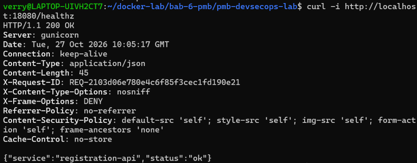


*Gambar 2.4 Respons HTTP sukses pada pemeriksaan endpoint /healthz.*


## 2.5 Pengujian Antarmuka Aplikasi

Pengujian antarmuka dilakukan dengan membuka alamat aplikasi melalui peramban web. Aplikasi dapat diakses menggunakan alamat http://localhost:18080. Port tersebut digunakan karena port 8080 pada komputer telah digunakan oleh layanan Apache.

Pada tahap ini, pemeriksaan dilakukan untuk memastikan bahwa halaman aplikasi dapat ditampilkan dan antarmuka dapat diakses melalui peramban. Apabila halaman berhasil dimuat, hal tersebut menunjukkan bahwa aplikasi dapat dijangkau melalui alamat yang digunakan. Fungsionalitas setiap fitur tetap perlu diperiksa melalui proses pengujian berikutnya.

Alamat aplikasi:

http://localhost:18080


```bash
# Akses antarmuka web PMB DevSecOps Lab via browser
curl -I http://localhost:18080
```


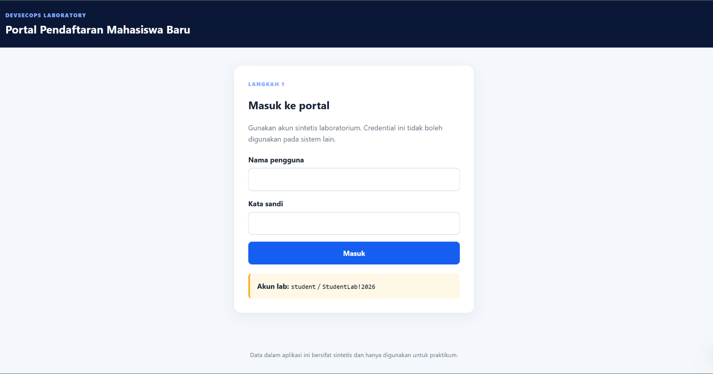


*Gambar 2.5 Tampilan halaman awal aplikasi PMB pada peramban web.*


## 2.6 Pengujian Alur Pendaftaran melalui Antarmuka Web

Pengujian antarmuka web dilakukan untuk memastikan bahwa proses pendaftaran PMB dapat diakses dan digunakan melalui browser. Pengujian ini berfokus pada tiga tahapan, yaitu pengisian formulir pendaftaran, pengiriman data pendaftaran, dan pemeriksaan status verifikasi. Setiap tahapan didokumentasikan menggunakan tangkapan layar sebagai bukti pelaksanaan pengujian.


### 2.6.1 Langkah 1 — Formulir Pendaftaran

Pada langkah pertama, pengujian dilakukan dengan membuka halaman formulir pendaftaran melalui alamat http://localhost:18080. Halaman ini digunakan untuk memasukkan data yang diperlukan dalam proses pendaftaran sesuai dengan kolom yang tersedia pada aplikasi.

Pemeriksaan dilakukan untuk memastikan bahwa formulir dapat ditampilkan dengan baik dan kolom input dapat digunakan. Data yang digunakan untuk pengujian sebaiknya berupa data sintetis atau data uji, bukan data pribadi calon mahasiswa yang sebenarnya.

Hasil pengujian: Tampilan formulir dan kolom input diperiksa untuk memastikan bahwa pengguna dapat memulai proses pendaftaran melalui antarmuka web.


```bash
# Akses formulir pendaftaran PMB
http://localhost:18080
```


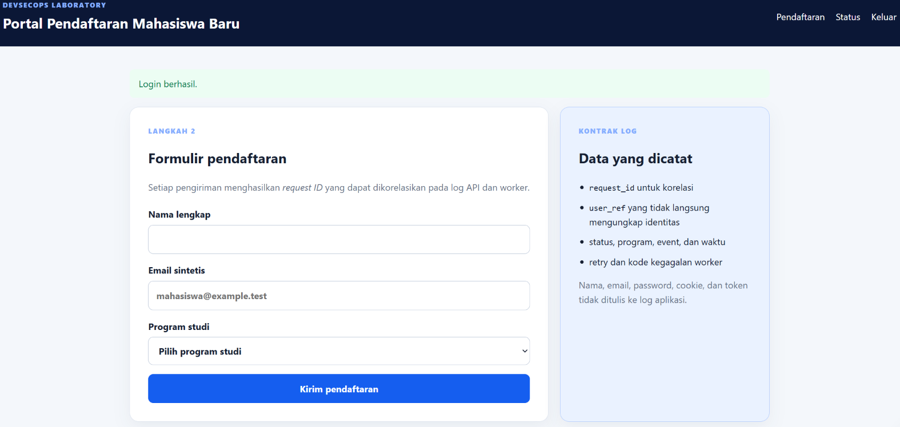


*Gambar 2.6 Tampilan antarmuka formulir pendaftaran mahasiswa baru.*


### 2.6.2 Langkah 2 — Pengiriman Formulir Pendaftaran

Pada langkah kedua, formulir diisi menggunakan data uji, kemudian dikirim melalui tombol atau kontrol pengiriman yang tersedia pada halaman aplikasi. Tahap ini bertujuan untuk memeriksa apakah data yang dimasukkan dapat dikirim dan diproses oleh layanan aplikasi.

Setelah formulir dikirim, respons yang ditampilkan oleh aplikasi diamati dan dicatat. Jika aplikasi menampilkan pemberitahuan bahwa pendaftaran berhasil dikirim atau memberikan identitas permintaan (Request ID), informasi tersebut dapat digunakan sebagai bukti bahwa permintaan telah diterima sesuai respons aplikasi.

Hasil pengujian: Keberhasilan pengiriman dinilai berdasarkan respons yang benar-benar ditampilkan oleh aplikasi. Penerimaan permintaan belum tentu berarti proses verifikasi telah selesai, sehingga status akhirnya perlu diperiksa pada langkah berikutnya.


```bash
# Pengisian dan submit formulir pendaftaran
POST /register
```


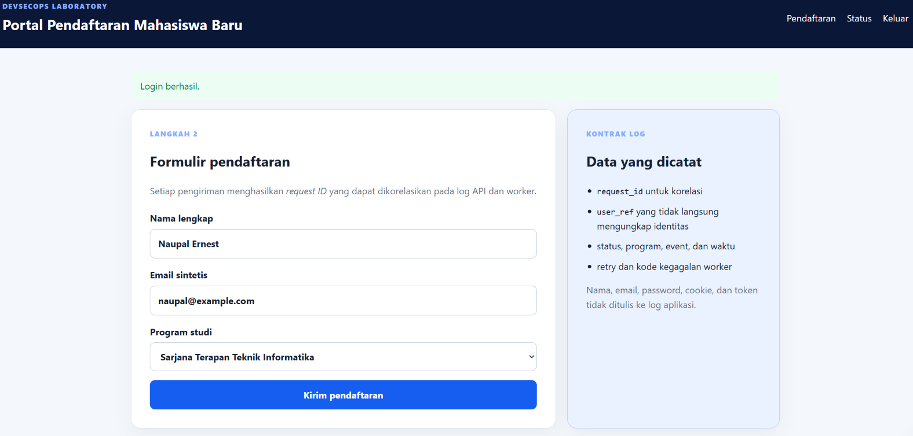


*Gambar 2.7 Proses pengisian dan pengiriman data formulir pendaftaran.*


### 2.6.3 Langkah 3 — Status Verifikasi

Pada langkah ketiga, pengujian difokuskan pada status verifikasi dari pendaftaran yang telah dikirim. Halaman atau bagian status verifikasi diperiksa untuk mengetahui hasil pemrosesan permintaan oleh aplikasi.

Apabila aplikasi menampilkan status VERIFIED, hasil tersebut menunjukkan bahwa permintaan pengujian telah mencapai status verifikasi tersebut sesuai alur aplikasi. Jika tersedia, Request ID dan informasi jumlah percobaan juga dapat dicatat untuk membantu menghubungkan hasil pada halaman web dengan aktivitas yang tercatat dalam log layanan.

Pada pengujian skenario normal yang telah dilakukan sebelumnya, aplikasi menghasilkan status VERIFIED dengan satu kali percobaan. Hasil tersebut dapat digunakan sebagai acuan pembahasan apabila pengujian melalui antarmuka web menunjukkan hasil yang sama dan dapat dikaitkan dengan permintaan yang diuji.

Hasil pengujian: Status yang ditampilkan pada aplikasi dicatat sebagai hasil akhir dari alur pendaftaran yang diuji. Hasil ini kemudian dapat dibandingkan dengan log layanan dan hasil analisis log untuk memeriksa kesesuaian informasi antara antarmuka web dan komponen backend.


```bash
# Verifikasi status pendaftaran mahasiswa baru (VERIFIED)
GET /status?request_id=...
```


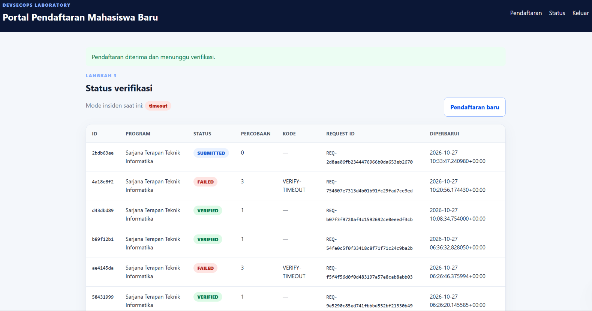


*Gambar 2.8 Bukti pendaftaran dan konfirmasi status verifikasi VERIFIED.*


```bash
sed -n '1,260p' scripts/demo-normal.sh
```


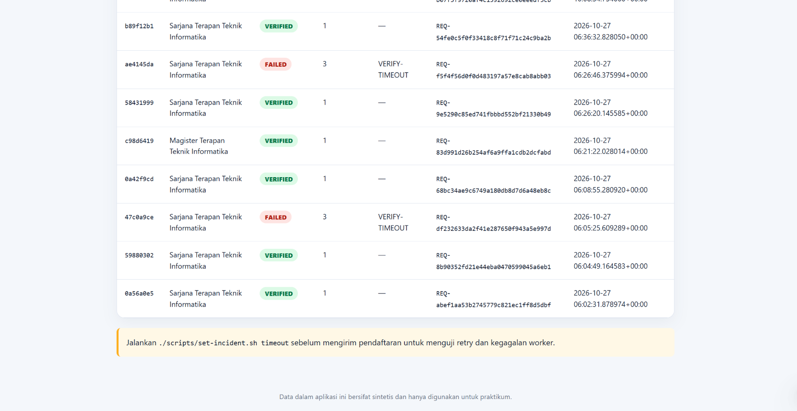


*Gambar 3.1 Pemeriksaan isi skrip demonstrasi skenario pendaftaran normal.*


### 2.6.4 Pembahasan Hasil Pengujian Antarmuka Web

Berdasarkan pengujian melalui antarmuka web, proses pendaftaran diperiksa secara bertahap mulai dari tampilan formulir, pengiriman data, hingga pemeriksaan status verifikasi. Pengujian bertahap ini membantu memastikan bahwa setiap bagian alur aplikasi diamati dan didokumentasikan secara terpisah.

Hasil pengujian web juga dapat digunakan sebagai pembanding terhadap hasil pemeriksaan backend. Apabila Request ID yang sama ditemukan pada log layanan, aktivitas pendaftaran dapat ditelusuri lebih lanjut. Selanjutnya, data log yang tersedia dapat diperiksa melalui mekanisme centralized logging untuk mendukung analisis aktivitas sistem.

Dengan demikian, pengujian tidak hanya berfokus pada tampilan halaman web, tetapi juga menghubungkan hasil yang dilihat pengguna dengan proses yang berlangsung pada layanan aplikasi. Kesimpulan keberhasilan setiap langkah tetap didasarkan pada hasil yang benar-benar muncul selama pengujian.


# BAB III: PENGUJIAN SKENARIO DAN CENTRALIZED LOGGING


## 3.1 Pengujian Skenario Pendaftaran Normal

Pengujian skenario normal dilakukan untuk memeriksa alur pendaftaran ketika sistem digunakan dalam kondisi normal. Pengujian ini membantu memastikan bahwa permintaan dapat diproses oleh layanan yang terlibat dan menghasilkan status sesuai dengan alur aplikasi.

Sebelum menjalankan skrip demonstrasi, isi skrip diperiksa untuk mengetahui tindakan yang akan dilakukan. Setelah itu, skrip dijalankan sesuai dengan instruksi proyek.

Perintah pemeriksaan dan pengujian:

sed -n '1,260p' scripts/demo-normal.sh

./scripts/demo-normal.sh

Pada pengujian yang telah dilakukan sebelumnya, skenario normal menghasilkan Request ID REQ-abef1aa53b2745779c821ec1ff8d5dbf dengan status pendaftaran VERIFIED dan jumlah percobaan sebanyak satu kali. Hasil tersebut menunjukkan bahwa permintaan yang diuji berhasil mencapai status verifikasi sesuai alur demonstrasi.

Request ID digunakan sebagai identitas permintaan agar aktivitas yang berkaitan dengan proses tersebut dapat ditelusuri pada log layanan. Informasi ini kemudian dapat digunakan untuk membantu pemeriksaan alur pemrosesan dari sisi aplikasi hingga pencatatan log.


```bash
./scripts/demo-normal.sh
```


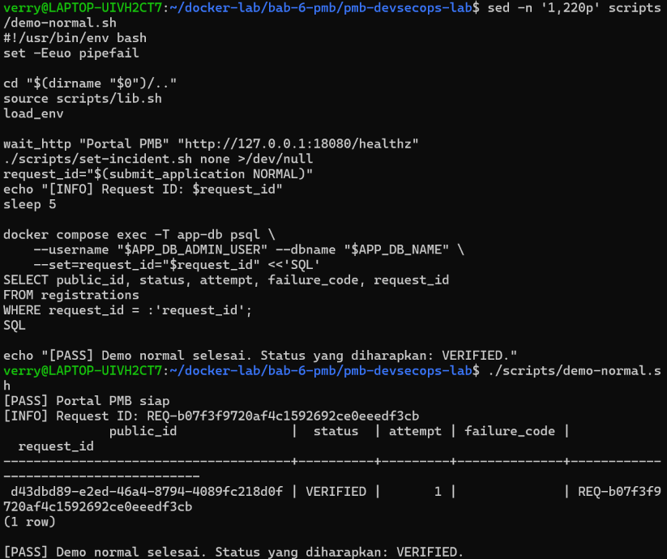


*Gambar 3.2 Output eksekusi skrip demonstrasi skenario normal dengan status VERIFIED.*


## 3.2 Pemeriksaan Log Layanan Aplikasi

Setelah skenario normal dijalankan, log layanan diperiksa untuk mengetahui aktivitas yang tercatat selama proses pendaftaran. Pemeriksaan dilakukan terhadap layanan registration-api, auth-service, dan verification-worker karena ketiganya berperan dalam proses aplikasi.

Perintah pemeriksaan:

docker compose logs --tail=100 registration-api

docker compose logs --tail=100 auth-service

docker compose logs --tail=100 verification-worker

Perintah tersebut menampilkan maksimal 100 baris log terakhir dari setiap layanan. Log digunakan untuk melihat informasi proses, permintaan yang masuk, aktivitas autentikasi, dan pekerjaan verifikasi yang tercatat oleh masing-masing komponen.

Apabila Request ID dari skenario normal muncul pada log layanan yang relevan, informasi tersebut dapat membantu menghubungkan aktivitas yang berasal dari satu permintaan. Jika Request ID tidak muncul pada suatu layanan, hal tersebut tidak langsung membuktikan bahwa layanan gagal memproses permintaan karena format dan isi log bergantung pada implementasi masing-masing layanan.


```bash
docker compose logs --tail=100 registration-api
docker compose logs --tail=100 auth-service
docker compose logs --tail=100 verification-worker
```


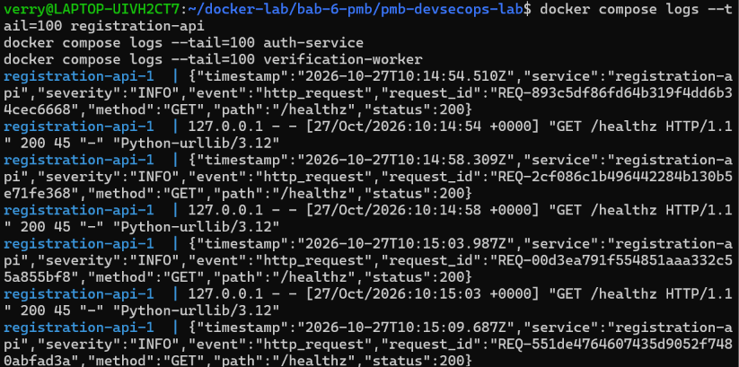


*Gambar 3.3 Catatan log layanan registration-api, auth-service, dan verification-worker.*


## 3.3 Pemeriksaan Layanan Fluent Bit

Fluent Bit digunakan sebagai komponen pengumpulan dan penerusan log. Pemeriksaan dilakukan untuk mengetahui apakah kontainer Fluent Bit berjalan dan apakah terdapat informasi kesalahan selama proses pengumpulan log.

Perintah pemeriksaan:

docker compose ps fluent-bit

docker compose logs --tail=100 fluent-bit

Perintah pertama menampilkan status kontainer Fluent Bit, sedangkan perintah kedua menampilkan log terbaru dari layanan tersebut. Informasi yang diperoleh digunakan untuk memeriksa kondisi layanan dan mengidentifikasi pesan yang dapat menunjukkan masalah pada proses pengumpulan atau penerusan log.

Apabila Fluent Bit berada dalam kondisi aktif dan lognya tidak menunjukkan kesalahan yang menghambat proses pengiriman, hasil tersebut menjadi indikasi bahwa layanan collector berjalan. Akan tetapi, status aktif saja belum membuktikan bahwa seluruh log sudah tersimpan di basis data. Oleh karena itu, hasil pengumpulan log perlu diperiksa lebih lanjut pada tujuan penyimpanan yang dikonfigurasi.


```bash
docker compose ps fluent-bit
docker compose logs --tail=100 fluent-bit
```


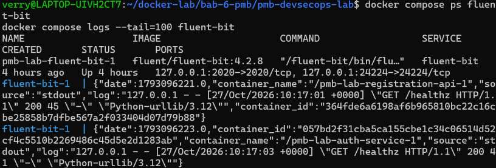


*Gambar 3.4 Pemeriksaan status kontainer dan log layanan Fluent Bit.*


## 3.4 Pengujian Skenario Insiden

Pengujian skenario insiden dilakukan untuk memeriksa perilaku sistem ketika menghadapi kondisi yang telah disimulasikan oleh proyek. Skenario ini digunakan untuk menghasilkan aktivitas yang dapat diamati pada log dan menjadi bahan analisis.

Sebelum pengujian dijalankan, skrip insiden diperiksa untuk mengetahui mekanisme simulasi yang diterapkan. Langkah ini dilakukan agar pengujian sesuai dengan rancangan proyek dan tidak menjalankan perintah yang tidak dipahami.

Perintah pemeriksaan dan pengujian:

sed -n '1,260p' scripts/set-incident.sh

sed -n '1,260p' scripts/demo-incident.sh

./scripts/demo-incident.sh

Skrip demonstrasi insiden dijalankan sesuai dengan mekanisme yang telah ditetapkan di dalam proyek. Hasil yang muncul, seperti status permintaan, pesan kesalahan, jumlah percobaan, atau informasi insiden lainnya, dicatat sebagai bukti pengujian.

Hasil pengujian ini perlu dibandingkan dengan skenario normal untuk mengetahui perubahan perilaku aplikasi. Kesimpulan mengenai penyebab atau dampak insiden harus didasarkan pada output demonstrasi dan bukti log yang berhasil dikumpulkan, bukan hanya berdasarkan nama skenario.


```bash
sed -n '1,260p' scripts/set-incident.sh
sed -n '1,260p' scripts/demo-incident.sh
./scripts/demo-incident.sh
```


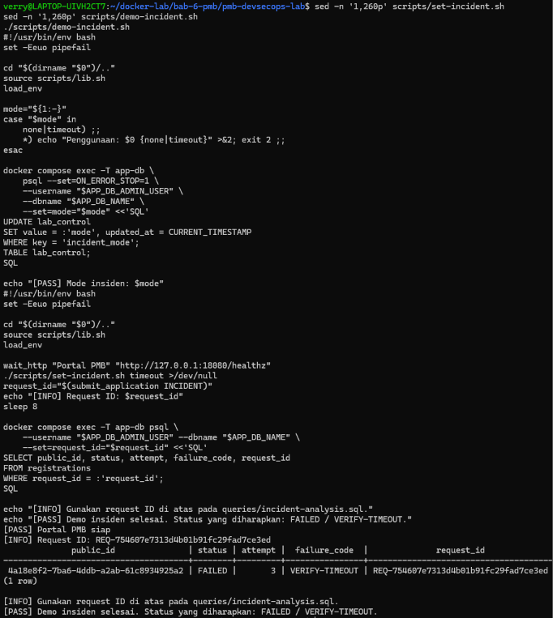


*Gambar 3.5 Hasil eksekusi demonstrasi skenario insiden (VERIFY-TIMEOUT).*


## 3.5 Analisis Log Setelah Insiden

Setelah skenario insiden dijalankan, log layanan diperiksa untuk mencari aktivitas yang berkaitan dengan waktu pengujian. Pemeriksaan ini membantu mengidentifikasi pesan kesalahan, kegagalan pemrosesan, percobaan ulang, atau informasi lain yang relevan dengan skenario.

Perintah pemeriksaan:

docker compose logs --since=10m --no-color \

registration-api auth-service verification-worker

Untuk membantu pencarian, log dapat difilter menggunakan kata kunci yang relevan.

docker compose logs --since=10m --no-color \

registration-api auth-service verification-worker \

| grep -Ei 'error|fail|timeout|incident|retry'

Perintah pertama menampilkan log dari tiga layanan selama sepuluh menit terakhir tanpa kode warna. Perintah kedua menyaring baris yang mengandung kata kunci seperti error, fail, timeout, incident, atau retry.

Kata kunci tersebut digunakan sebagai bantuan pencarian, bukan sebagai bukti tunggal bahwa suatu insiden benar-benar terjadi. Setiap baris yang ditemukan perlu dibaca bersama konteks waktu, layanan asal, dan hasil demonstrasi agar kesimpulan analisis tidak keliru.


```bash
docker compose logs --since=10m --no-color \
  registration-api auth-service verification-worker

docker compose logs --since=10m --no-color \
  registration-api auth-service verification-worker \
  | grep -Ei 'error|fail|timeout|incident|retry'
```


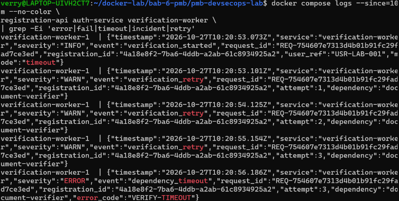


*Gambar 3.6 Log layanan setelah insiden dan penyaringan baris kejadian kritis.*


## 3.6 Pemeriksaan Query Analisis Log

Proyek menyediakan berkas SQL untuk membantu proses analisis log yang telah disimpan. Berkas tersebut diperiksa terlebih dahulu untuk memahami tabel, kolom, kondisi pencarian, dan bentuk hasil yang dirancang oleh query.

Perintah pemeriksaan:

sed -n '1,260p' queries/incident-analysis.sql

Konfigurasi inisialisasi basis data log juga diperiksa melalui berkas berikut.

sed -n '1,260p' init-log/01-init-log.sh

Pemeriksaan ini bertujuan untuk memahami hubungan antara struktur penyimpanan log dan query analisis yang disediakan. Nama basis data, tabel, kolom, serta metode menjalankan query harus mengikuti konfigurasi yang benar-benar terdapat di dalam proyek.

Query analisis digunakan untuk membantu menyusun informasi yang relevan dari log. Hasil query baru dapat dijadikan bukti analisis setelah query dijalankan terhadap basis data yang sesuai dan hasilnya diperiksa.


```bash
sed -n '1,260p' queries/incident-analysis.sql
sed -n '1,260p' init-log/01-init-log.sh
```


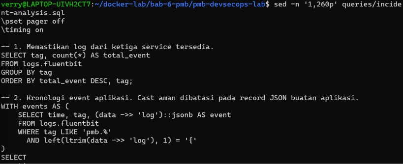


*Gambar 3.7 Pemeriksaan berkas query SQL analisis log dan skrip inisialisasi basis data log.*


## 3.7 Pelaksanaan Analisis Log pada Basis Data

Tahap analisis basis data dilakukan untuk memeriksa apakah log yang diperlukan tersedia pada tempat penyimpanan yang telah dikonfigurasi dan dapat diolah menggunakan query analisis proyek.

Pelaksanaan query harus mengikuti petunjuk pada README.md, konfigurasi layanan dalam compose.yaml, skrip inisialisasi pada direktori init-log/, dan isi queries/incident-analysis.sql. Dengan demikian, nama basis data, tabel, dan parameter koneksi yang digunakan sesuai dengan implementasi sebenarnya.

Hasil analisis dicatat berdasarkan data yang benar-benar dikembalikan oleh basis data. Apabila query menghasilkan data yang berkaitan dengan skenario pengujian, hasil tersebut dapat digunakan untuk mendukung penelusuran aktivitas. Apabila hasilnya kosong atau terjadi kesalahan, kondisi tersebut perlu dicatat dan diperiksa lebih lanjut sebelum menyimpulkan bahwa mekanisme logging telah berjalan sepenuhnya.


```bash
sed -n '1,260p' scripts/recover-incident.sh
./scripts/recover-incident.sh
./scripts/demo-normal.sh
```


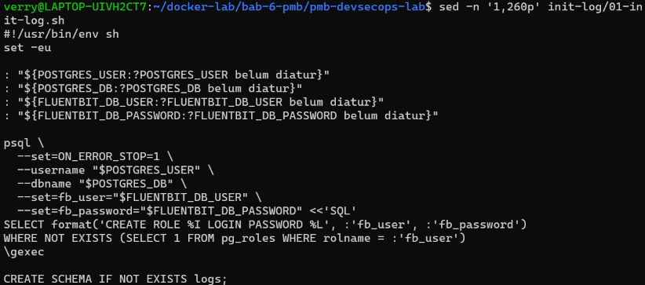


*Gambar 3.8 Hasil pengujian pemulihan layanan dan pengujian ulang skenario normal.*


## 3.8 Verifikasi Akhir Sistem

Verifikasi akhir dilakukan untuk memeriksa kembali kondisi layanan setelah seluruh skenario pengujian selesai. Pemeriksaan ini bertujuan untuk mengetahui apakah layanan masih berjalan dan apakah terdapat perubahan status setelah pengujian normal maupun insiden.

Perintah verifikasi:

./scripts/verify.sh

docker compose ps

Skrip verify.sh dijalankan untuk melakukan pemeriksaan yang telah ditentukan oleh pembuat proyek. Selanjutnya, docker compose ps digunakan untuk melihat status terkini setiap kontainer.

Hasil kedua pemeriksaan tersebut digunakan sebagai bukti kondisi sistem pada akhir pengujian. Apabila seluruh pemeriksaan yang dijalankan berhasil dan layanan berada pada status yang diharapkan, sistem dapat dinyatakan memenuhi pemeriksaan akhir yang tercakup dalam skrip dan status kontainer tersebut. Kesimpulan ini tetap dibatasi pada pemeriksaan yang benar-benar dilakukan.


```bash
sed -n '1,260p' scripts/verify.sh
./scripts/verify.sh
docker compose ps
```


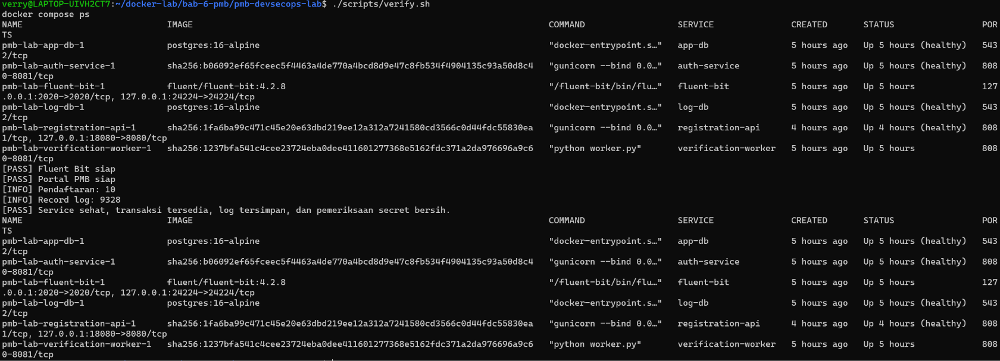


*Gambar 3.9 Hasil verifikasi akhir sistem dan status sehat seluruh kontainer.*


# BAB IV: HASIL DAN PEMBAHASAN


## 4.1 Hasil Implementasi Sistem

Implementasi PMB DevSecOps Laboratory dilakukan dengan menggunakan Docker Compose untuk menjalankan layanan aplikasi, autentikasi, verifikasi, penyimpanan data, dan pengelolaan log. Sistem terdiri atas enam layanan utama, yaitu registration-api, auth-service, verification-worker, app-db, log-db, dan fluent-bit.

Berdasarkan hasil pemeriksaan, seluruh layanan utama berhasil dijalankan dan berada dalam kondisi sehat pada saat verifikasi. Pengujian aplikasi juga dilakukan melalui skrip validasi, demonstrasi pendaftaran normal, simulasi insiden, serta pemeriksaan log. Selain itu, aplikasi dapat diakses melalui browser menggunakan alamat http://localhost:18080.

Hasil verifikasi akhir menunjukkan bahwa sistem memiliki empat data pendaftaran dan 480 record log yang tercatat. Seluruh layanan berada dalam kondisi sehat saat pemeriksaan akhir, sedangkan pemeriksaan pola data rahasia tidak menemukan kecocokan. Hasil tersebut menunjukkan bahwa sistem dapat dijalankan dan diperiksa menggunakan mekanisme verifikasi yang tersedia dalam proyek.

Meskipun demikian, setiap hasil pemeriksaan memiliki cakupan yang berbeda. Status layanan yang sehat menunjukkan kondisi kontainer pada saat pemeriksaan, sedangkan jumlah record log menunjukkan data yang tersedia pada pemeriksaan tersebut. Keduanya perlu dibaca bersama hasil pengujian fungsional dan analisis log untuk mendapatkan gambaran yang lebih lengkap mengenai kondisi sistem.


## 4.2 Hasil Pengujian Aplikasi melalui Antarmuka Web

Pengujian antarmuka web dilakukan untuk memeriksa alur penggunaan aplikasi PMB dari sisi pengguna. Pengujian mencakup halaman formulir pendaftaran, pengiriman formulir, dan pemeriksaan status verifikasi.

Pada tahap formulir pendaftaran, antarmuka web digunakan untuk melihat kolom input dan memulai proses pendaftaran menggunakan data uji. Tahap pengiriman formulir digunakan untuk mengamati respons aplikasi setelah data dikirimkan. Selanjutnya, status verifikasi diperiksa untuk mengetahui hasil pemrosesan pendaftaran.

Pengujian antarmuka tersebut melengkapi pemeriksaan backend karena pengguna berinteraksi melalui browser, sedangkan proses pendaftaran dan verifikasi ditangani oleh layanan aplikasi. Hasil pada antarmuka web dapat dibandingkan dengan data yang tercatat pada log menggunakan identitas permintaan yang sesuai.

Dalam pengujian skenario normal, backend menghasilkan status VERIFIED dengan satu kali percobaan. Hasil ini menunjukkan bahwa permintaan yang diuji berhasil mencapai status verifikasi sesuai alur aplikasi. Untuk memastikan keterkaitan dengan pengujian melalui browser, identitas permintaan pada hasil antarmuka perlu dicocokkan dengan identitas yang muncul pada log.

Bukti pengujian antarmuka web:

Gambar 19. Halaman formulir pendaftaran.

Gambar 20. Proses pengiriman formulir pendaftaran.

Gambar 21. Tampilan status verifikasi.

Ketiga gambar tersebut digunakan untuk mendokumentasikan tahapan pengujian dari sisi pengguna. Hasil yang ditampilkan pada setiap gambar menjadi bukti visual pelaksanaan pengujian antarmuka.


## 4.3 Hasil Pengujian Skenario Normal

Pengujian skenario normal dilakukan untuk memastikan bahwa proses pendaftaran dapat berjalan ketika tidak terdapat kondisi insiden yang sedang disimulasikan. Pada pengujian ini, sistem menghasilkan data pendaftaran dengan status VERIFIED dan jumlah percobaan sebanyak satu kali.

Hasil pengujian normal yang tercatat adalah sebagai berikut.


| Parameter | Hasil |
| --- | --- |
| Request ID | REQ-68bc34ae9c6749a180db8d7d6a48eb8c |
| Registration ID | 0a42f9cd-be96-4760-8301-5fe02831f222 |
| Status pendaftaran | VERIFIED |
| Jumlah percobaan | 1 |
| Failure code | Kosong |


Status VERIFIED menunjukkan bahwa pendaftaran yang diuji mencapai status verifikasi yang diharapkan oleh alur aplikasi. Jumlah percobaan sebanyak satu kali menunjukkan bahwa permintaan tersebut tidak memerlukan percobaan ulang berdasarkan hasil demonstrasi yang tercatat. Sementara itu, kolom failure code yang kosong menunjukkan bahwa tidak terdapat kode kegagalan pada hasil pendaftaran tersebut.

Request ID digunakan sebagai identitas permintaan untuk membantu penelusuran aktivitas pada log layanan. Registration ID digunakan untuk membedakan data pendaftaran yang dihasilkan. Kedua identitas tersebut dapat membantu proses pencocokan data ketika dilakukan pemeriksaan pada komponen aplikasi dan penyimpanan log.

Berdasarkan hasil tersebut, skenario normal berhasil mencapai status verifikasi yang diharapkan. Hasil ini menjadi acuan untuk membandingkan perilaku sistem ketika menjalankan skenario insiden.


## 4.4 Hasil Pengujian Skenario Insiden

Skenario insiden digunakan untuk menguji perilaku sistem ketika proses verifikasi mengalami gangguan yang disimulasikan. Hasil pengujian menunjukkan adanya percobaan ulang pada proses verifikasi yang kemudian diikuti oleh kegagalan akibat batas waktu dependensi (dependency timeout).

Data insiden yang berhasil ditelusuri adalah sebagai berikut.


| Parameter | Hasil |
| --- | --- |
| Request ID | REQ-df232633da2f41e287650f943a5e997d |
| Registration ID | 47c0a9ce-6412-4078-86ec-0a478b9dde92 |
| Urutan aktivitas | registration_submitted → verification_started → percobaan ulang 1–3 → dependency_timeout |
| Failure code | VERIFY-TIMEOUT |
| Log peringatan | 3 WARN |
| Log kesalahan | 1 ERROR |


Berdasarkan urutan aktivitas yang tercatat, permintaan pendaftaran terlebih dahulu diterima, kemudian proses verifikasi dimulai. Setelah itu, sistem melakukan percobaan ulang sebanyak tiga kali sebelum mencatat kegagalan berupa dependency_timeout dengan kode VERIFY-TIMEOUT.

Hasil ini menunjukkan bahwa mekanisme pencatatan aktivitas dapat memperlihatkan urutan proses yang berkaitan dengan insiden. Tiga pesan peringatan dan satu pesan kesalahan menjadi petunjuk untuk menelusuri kejadian tersebut lebih lanjut.

Kegagalan pada skenario ini tidak berarti seluruh sistem berhenti beroperasi. Pemeriksaan akhir menunjukkan bahwa seluruh layanan berada dalam kondisi sehat. Dengan demikian, perlu dibedakan antara kegagalan pada satu proses verifikasi dan kondisi keseluruhan layanan. Status layanan yang sehat setelah pengujian menunjukkan bahwa kontainer aktif pada saat pemeriksaan, tetapi tidak menghapus fakta bahwa proses verifikasi pada skenario insiden mengalami timeout.

Pembahasan: Skenario insiden berhasil menghasilkan aktivitas yang dapat ditelusuri melalui log. Informasi Request ID, Registration ID, urutan aktivitas, dan kode kegagalan membantu menghubungkan pesan-pesan log dengan satu permintaan tertentu. Informasi tersebut dapat digunakan sebagai dasar untuk menganalisis penyebab gangguan dan mengevaluasi penanganan kesalahan pada proses verifikasi.


## 4.5 Hasil Centralized Logging

Centralized logging digunakan untuk mengumpulkan dan menyediakan log dari beberapa layanan agar aktivitas aplikasi dapat diperiksa secara terpusat. Dalam proyek ini, Fluent Bit berfungsi sebagai komponen pengumpulan dan penerusan log, sedangkan log-db digunakan sebagai layanan penyimpanan log sesuai konfigurasi proyek.

Berdasarkan hasil analisis log, ditemukan catatan dari tiga tag layanan utama dengan rincian berikut.


| Tag layanan | Jumlah record |
| --- | --- |
| registration-api | 275 |
| auth-service | 130 |
| verification-worker | 10 |
| Total dari tiga tag tersebut | 415 |


Jumlah 415 record di atas merupakan total dari tiga tag layanan yang dirinci dalam hasil analisis. Angka ini tidak harus sama dengan jumlah keseluruhan 480 record log yang ditemukan pada verifikasi akhir karena cakupan pemeriksaan atau kategori data yang dihitung dapat berbeda.

Keberadaan record dari ketiga tag tersebut menunjukkan bahwa data log tersedia untuk aktivitas layanan yang bersangkutan pada hasil analisis. Log tersebut dapat digunakan untuk menelusuri aktivitas pendaftaran, autentikasi, dan verifikasi. Namun, jumlah record saja tidak cukup untuk menyimpulkan bahwa seluruh aktivitas dari semua layanan selalu berhasil diteruskan tanpa kehilangan data.

Keberhasilan pengelolaan log perlu dinilai bersama konfigurasi Fluent Bit, kondisi layanan, ketersediaan data pada penyimpanan, serta hasil query analisis. Dengan menggabungkan bukti tersebut, pemeriksaan log dapat memberikan gambaran yang lebih jelas mengenai aktivitas aplikasi.


## 4.6 Hasil Analisis Log Insiden

Analisis log dilakukan untuk menghubungkan aktivitas yang tercatat dengan skenario insiden yang dijalankan. Dalam hasil analisis, permintaan dengan Request ID REQ-df232633da2f41e287650f943a5e997d dapat ditelusuri melalui rangkaian aktivitas yang berkaitan dengan proses verifikasi.

Urutan log menunjukkan aktivitas registration_submitted, dilanjutkan dengan verification_started, percobaan ulang sebanyak tiga kali, dan berakhir pada dependency_timeout. Kode VERIFY-TIMEOUT memberikan informasi tambahan mengenai jenis kegagalan yang tercatat pada proses tersebut.

Analisis ini menunjukkan bahwa log dapat digunakan untuk merekonstruksi urutan aktivitas berdasarkan data yang tersedia. Informasi tersebut membantu membedakan proses awal pendaftaran dari proses verifikasi yang mengalami gangguan. Dengan adanya identitas permintaan dan urutan kejadian, pemeriksaan tidak hanya bergantung pada satu pesan kesalahan, tetapi dapat mempertimbangkan konteks aktivitas sebelum dan sesudah kejadian.

Hasil analisis juga mencatat tiga pesan berstatus WARN dan satu pesan berstatus ERROR pada rangkaian insiden yang diperiksa. Pesan-pesan tersebut menjadi petunjuk untuk memahami bagaimana gangguan muncul dan bagaimana sistem melakukan percobaan ulang sebelum mencatat kegagalan.

Walaupun demikian, log hanya menunjukkan kejadian yang tercatat oleh aplikasi. Penetapan penyebab teknis yang lebih mendalam tetap memerlukan pemeriksaan terhadap dependensi yang digunakan oleh proses verifikasi dan konfigurasi yang berkaitan dengan simulasi insiden.


## 4.7 Hasil Pemeriksaan Keamanan Log

Pemeriksaan keamanan dilakukan untuk mengetahui apakah hasil pengujian log memuat pola yang terindikasi sebagai informasi rahasia. Pemeriksaan ini penting karena log dapat berisi informasi operasional yang perlu dilindungi, terutama jika digunakan untuk menelusuri aktivitas aplikasi.

Berdasarkan hasil pemeriksaan, tidak ditemukan baris yang cocok dengan pola data rahasia yang diperiksa. Hasil pemeriksaan tersebut dirangkum sebagai berikut.


| Aspek pemeriksaan | Hasil |
| --- | --- |
| Kecocokan pola data rahasia | 0 baris |
| Kandidat data untuk retensi | 0 |
| Status layanan pada verifikasi akhir | Seluruh layanan sehat |


Hasil nol baris pada pemeriksaan pola data rahasia menunjukkan bahwa pencarian yang dijalankan tidak menemukan kecocokan berdasarkan pola yang digunakan. Hasil ini merupakan indikasi yang baik dari sisi pemeriksaan log, tetapi tidak membuktikan bahwa seluruh jenis informasi rahasia pasti tidak ada di dalam sistem. Kelengkapan pemeriksaan tetap bergantung pada pola pencarian dan cakupan data yang diperiksa.

Sementara itu, hasil nol kandidat retensi menunjukkan bahwa pemeriksaan yang dilakukan tidak menemukan data yang memenuhi kriteria kandidat retensi pada saat itu. Hasil tersebut tidak berarti bahwa kebijakan retensi log tidak diperlukan. Pengaturan retensi tetap perlu ditentukan berdasarkan kebutuhan penyimpanan, keamanan, dan kebijakan pengelolaan data.

Pemeriksaan keamanan ini melengkapi pengujian fungsional dan analisis log dengan memberikan perhatian pada perlindungan informasi yang tercatat. Informasi sensitif seperti kata sandi, token, dan nilai rahasia konfigurasi tetap harus dijaga agar tidak ditampilkan dalam laporan maupun tangkapan layar.


## 4.8 Hasil Verifikasi Akhir

Verifikasi akhir dilakukan setelah skenario normal dan insiden selesai dijalankan. Tujuannya adalah untuk memeriksa kondisi layanan dan melihat ringkasan data yang tersedia setelah pengujian.

Hasil verifikasi akhir menunjukkan empat data pendaftaran dan 480 record log. Seluruh layanan berada dalam kondisi sehat pada saat pemeriksaan, dan pemeriksaan pola data rahasia tidak menemukan kecocokan.

Hasil tersebut dirangkum pada tabel berikut.


| Aspek verifikasi | Hasil | Pembahasan |
| --- | --- | --- |
| Jumlah pendaftaran | 4 | Terdapat empat data pendaftaran pada hasil pemeriksaan. |
| Jumlah record log | 480 | Terdapat 480 record log pada hasil verifikasi. |
| Kondisi layanan | Seluruh layanan sehat | Kontainer berada dalam kondisi sehat saat pemeriksaan akhir. |
| Pemeriksaan pola data rahasia | 0 baris | Tidak ditemukan kecocokan berdasarkan pola yang diperiksa. |
| Kandidat retensi | 0 | Tidak ditemukan data yang memenuhi kriteria kandidat retensi pada pemeriksaan tersebut. |


Secara keseluruhan, hasil verifikasi akhir menunjukkan bahwa layanan tetap berada dalam kondisi sehat setelah pengujian. Data pendaftaran dan record log juga tersedia untuk diperiksa. Hasil ini mendukung kesimpulan bahwa sistem dapat dijalankan dan diperiksa menggunakan mekanisme yang disediakan proyek.

Namun, hasil verifikasi akhir tidak menghapus temuan insiden pada proses verifikasi. Skenario insiden tetap menghasilkan kegagalan VERIFY-TIMEOUT, sedangkan kondisi layanan yang sehat menunjukkan bahwa kontainer masih berada dalam kondisi sehat saat pemeriksaan akhir. Kedua hasil tersebut menjelaskan aspek yang berbeda dan perlu dicantumkan secara bersamaan dalam evaluasi sistem.


## 4.9 Evaluasi Keseluruhan

Berdasarkan rangkaian pengujian, proyek PMB DevSecOps Laboratory telah mencakup pemeriksaan konfigurasi, validasi aplikasi, pengoperasian layanan, pengujian pendaftaran normal, simulasi insiden, pemeriksaan log, dan verifikasi akhir.

Pengujian normal menghasilkan status VERIFIED dalam satu kali percobaan. Sebaliknya, skenario insiden menunjukkan proses verifikasi yang mengalami tiga kali percobaan ulang sebelum mencatat dependency_timeout dengan kode VERIFY-TIMEOUT. Perbedaan tersebut memperlihatkan bahwa pengujian dalam dua kondisi dapat memberikan informasi mengenai perilaku sistem pada situasi normal maupun ketika terjadi gangguan.

Dari sisi logging, data tersedia dari tag registration-api, auth-service, dan verification-worker. Urutan aktivitas pada skenario insiden juga dapat ditelusuri menggunakan Request ID dan informasi kejadian yang tercatat. Hal ini membantu proses pemeriksaan karena aktivitas yang berhubungan dengan satu permintaan dapat dianalisis berdasarkan konteksnya.

Dari sisi keamanan, pemeriksaan pola data rahasia tidak menemukan kecocokan pada data yang diperiksa. Meskipun demikian, pemeriksaan tersebut tetap memiliki batasan sesuai pola dan cakupan pencarian yang digunakan.

Dengan demikian, hasil pengerjaan menunjukkan bahwa sistem berhasil dijalankan dan diuji melalui skenario yang disediakan. Pengujian juga memperlihatkan manfaat pencatatan log dalam membantu penelusuran aktivitas dan evaluasi gangguan. Pengembangan berikutnya dapat diarahkan pada peningkatan ketahanan proses verifikasi, pemantauan layanan, dan penguatan pengelolaan log.


## 4.10 Perbandingan Fluent Bit, Event Log, dan Prometheus Time Series

Dalam penerapan DevSecOps, pemantauan sistem dapat dilakukan melalui pencatatan kejadian (event logging), pengumpulan log menggunakan Fluent Bit, dan pemantauan metrik menggunakan Prometheus. Ketiganya memiliki fungsi yang berbeda, tetapi dapat saling melengkapi untuk membantu mengetahui kondisi aplikasi, menelusuri gangguan, dan mengevaluasi kinerja layanan.


### 4.10.1 Fluent Bit

Fluent Bit merupakan perangkat lunak yang digunakan untuk mengumpulkan, memproses, dan meneruskan log dari berbagai sumber menuju tujuan penyimpanan atau analisis. Pada proyek PMB DevSecOps Laboratory, Fluent Bit berperan sebagai komponen pengelolaan log yang membantu mengumpulkan catatan aktivitas layanan aplikasi.

Log yang dikumpulkan dapat berisi informasi mengenai proses pendaftaran, autentikasi, verifikasi, peringatan, dan kesalahan. Informasi tersebut dapat digunakan untuk menelusuri aktivitas berdasarkan waktu, layanan asal, Request ID, atau pesan kesalahan yang tercatat.

Sebagai contoh, ketika proses verifikasi mengalami dependency_timeout, log dapat diperiksa untuk mengetahui urutan aktivitas sebelum kegagalan terjadi. Dengan demikian, Fluent Bit membantu menyediakan data log yang dapat digunakan dalam proses analisis insiden.


### 4.10.2 Event Log

Event log merupakan catatan kejadian yang terjadi ketika aplikasi atau sistem menjalankan suatu aktivitas. Dalam aplikasi PMB, contoh kejadian yang dapat dicatat meliputi pengiriman formulir pendaftaran, proses autentikasi, dimulainya verifikasi, percobaan ulang, dan kegagalan akibat batas waktu dependensi.

Event log dapat memberikan informasi mengenai apa yang terjadi, kapan kejadian berlangsung, layanan yang terlibat, dan identitas permintaan yang berkaitan. Informasi tersebut berguna untuk menelusuri urutan proses dan memahami penyebab yang mungkin berkaitan dengan suatu gangguan.

Sebagai contoh, rangkaian kejadian registration_submitted, verification_started, dan dependency_timeout dapat membantu menjelaskan bahwa permintaan telah diterima dan proses verifikasi telah dimulai sebelum terjadi kegagalan. Jika setiap kejadian mencatat Request ID yang sesuai, hubungan antaraktivitas dapat ditelusuri dengan lebih mudah.

Event log merupakan data yang dicatat oleh aplikasi atau sistem, sedangkan Fluent Bit dapat digunakan untuk mengumpulkan dan meneruskan data log tersebut. Oleh karena itu, keduanya memiliki fungsi yang berbeda dan dapat digunakan secara bersamaan.


### 4.10.3 Prometheus Time Series

Prometheus merupakan sistem pemantauan yang mengumpulkan dan menyimpan metrik sebagai data deret waktu (time series). Setiap data metrik dikaitkan dengan waktu pengukuran sehingga perubahan kondisi sistem dapat diamati dari waktu ke waktu.

Dalam proyek PMB DevSecOps Laboratory, Prometheus dapat diterapkan untuk memantau metrik seperti jumlah permintaan pendaftaran, tingkat kegagalan, durasi respons, jumlah percobaan ulang, penggunaan CPU, dan penggunaan memori. Penerapan metrik tersebut memerlukan sumber metrik atau exporter yang sesuai dengan layanan yang dipantau.

Berbeda dengan event log yang menjelaskan kejadian tertentu, metrik Prometheus lebih sesuai untuk menunjukkan pola dan perubahan kondisi sistem. Sebagai contoh, peningkatan jumlah kegagalan verifikasi dalam suatu periode dapat menjadi indikasi bahwa layanan perlu diperiksa lebih lanjut.

Metrik juga dapat digunakan untuk membuat grafik pemantauan dan menetapkan aturan peringatan. Dengan demikian, administrator dapat mengetahui perubahan kondisi sistem tanpa harus membaca setiap baris log satu per satu. Namun, Prometheus tidak secara otomatis menjelaskan detail penyebab setiap kegagalan; penelusuran lebih lanjut dapat dilakukan menggunakan event log.


### 4.10.4 Tabel Perbandingan


| Aspek | Fluent Bit | Event Log | Prometheus Time Series |
| --- | --- | --- | --- |
| Bentuk | Perangkat lunak pengumpulan dan penerusan log | Catatan kejadian aplikasi atau sistem | Data metrik yang memiliki nilai dan waktu pengukuran |
| Fungsi utama | Mengumpulkan, memproses, dan meneruskan log | Mencatat kejadian dan urutan aktivitas | Memantau perubahan kondisi dan kinerja sistem |
| Informasi yang dihasilkan | Log dari sumber yang dikonfigurasi | Detail kejadian, pesan, waktu, dan identitas permintaan jika dicatat | Nilai metrik seperti jumlah permintaan, durasi, dan penggunaan sumber daya |
| Kegunaan | Memusatkan log agar lebih mudah diperiksa | Menelusuri aktivitas dan menganalisis kejadian tertentu | Melihat tren, membuat grafik, dan memicu peringatan berbasis metrik |
| Contoh pada PMB | Mengumpulkan log dari layanan aplikasi | Mencatat registration_submitted dan dependency_timeout | Memantau tingkat kegagalan verifikasi dari waktu ke waktu |
| Pertanyaan yang dijawab | Dari mana log berasal dan ke mana log diteruskan? | Apa yang terjadi pada suatu permintaan? | Seberapa sering masalah terjadi dan bagaimana tren kondisi sistem? |
| Batasan | Tidak menggantikan sistem analisis metrik | Tidak otomatis memberikan gambaran tren kinerja secara keseluruhan | Tidak selalu menyediakan detail kejadian seperti isi log aplikasi |


### 4.10.5 Penerapan dalam Sistem PMB DevSecOps Laboratory

Ketiga komponen tersebut dapat digunakan secara bersama untuk meningkatkan kemampuan pemantauan sistem. Event log mencatat aktivitas aplikasi, Fluent Bit mengumpulkan dan meneruskan log sesuai konfigurasi, sedangkan Prometheus dapat digunakan untuk mengamati metrik kinerja dan kondisi layanan dari waktu ke waktu.

Sebagai contoh, ketika terjadi peningkatan kegagalan verifikasi, metrik Prometheus dapat menunjukkan bahwa tingkat kegagalan meningkat pada periode tertentu. Selanjutnya, event log dapat diperiksa untuk menemukan kejadian yang berkaitan, seperti verification_started, percobaan ulang, atau dependency_timeout. Fluent Bit berperan dalam mengumpulkan dan meneruskan log tersebut apabila sumber serta tujuan log telah dikonfigurasi dengan benar.

Alur tersebut dapat membantu proses pemeriksaan dari tingkat pemantauan hingga penelusuran kejadian. Prometheus membantu menunjukkan kapan dan seberapa besar perubahan terjadi, sedangkan event log membantu menjelaskan aktivitas yang tercatat. Fluent Bit membantu memastikan log dari sumber yang dikonfigurasi dapat dikumpulkan dan diteruskan ke tujuan yang ditentukan.

Perlu diperhatikan bahwa pada implementasi proyek ini, Fluent Bit dan mekanisme pencatatan log telah menjadi bagian dari pengujian. Prometheus dijelaskan sebagai komponen yang dapat ditambahkan untuk memperluas pemantauan berbasis metrik, bukan sebagai layanan yang telah diterapkan dan diuji apabila belum terdapat konfigurasi Prometheus dalam proyek.

Berdasarkan perbandingan tersebut, Fluent Bit, event log, dan Prometheus time series memiliki fungsi yang berbeda tetapi saling mendukung. Kombinasi ketiganya dapat membantu meningkatkan kemampuan pemantauan, mempercepat penelusuran gangguan, serta menyediakan informasi yang lebih lengkap untuk evaluasi dan pemeliharaan sistem PMB DevSecOps Laboratory.
