<p align="center"></p>

# BAB VII: MONITORING RESOURCE DENGAN PROMETHEUS, CADVISOR, NODE EXPORTER, DAN GRAFANA

**Mata Kuliah:** Workshop DevOps  
**Dosen Pengampu:** Dr. Ferry Astika Saputra, ST, M.Sc  
**Disusun Oleh (Kelompok 2):**
- Ibram Maulana Akhsanul Qasasi (NRP. 3126640014)
- Yusuf Rahmadhani Asy'ari (NRP. 3126640042)
- Vernanda Mulia Hamonangan Manurung (NRP. 3126640044)  
**Program Studi:** D4 Lanjut Jenjang Teknik Informatika  
**Institusi:** Politeknik Elektronika Negeri Surabaya (2026)

---


## 7.1 Tahap Praktikum


### 7.1.1 Persiapan Direktori dan Pembuatan File Konfigurasi Dasar


#### Kotak Perintah A — Menyiapkan Direktori Bab 7

Dilakukan pembuatan seluruh struktur direktori kerja untuk praktikum Bab 7 menggunakan perintah mkdir -p ~/docker-lab/bab-7/{prometheus/rules,prometheus/tests,grafana/provisioning/datasources,grafana/provisioning/dashboards,grafana/dashboards,scripts,reports}, kemudian dilanjutkan dengan berpindah ke direktori tersebut melalui perintah cd ~/docker-lab/bab-7. Pemeriksaan menggunakan perintah pwd menunjukkan bahwa posisi direktori aktif telah berada di /home/verry/docker-lab/bab-7, sedangkan perintah find . -maxdepth 4 -type d | sort menampilkan seluruh subdirektori yang berhasil dibuat secara terurut. Sebagai catatan batas interpretasi, karena praktikum dijalankan pada lingkungan WSL 2 di Windows, Node Exporter dan cAdvisor mengamati resource mesin virtual Linux tempat Docker Engine berjalan, bukan seluruh resource fisik native Windows.


```bash
mkdir -p ~/docker-lab/bab-7/{prometheus/{rules,tests},grafana/{provisioning/{datasources,dashboards},dashboards},scripts,reports}
cd ~/docker-lab/bab-7
pwd
find . -maxdepth 4 -type d | sort
```


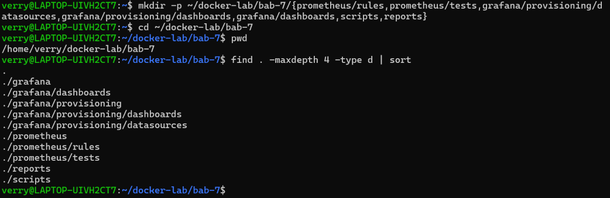


*Gambar 1.1 Hasil pembuatan struktur direktori kerja Bab 7 dan pemeriksaan subdirektori dengan perintah find.*


#### Kotak Script 1 — File .env.example

Dilakukan pembuatan file .env.example menggunakan perintah nano .env.example yang kemudian disalin menjadi file .env melalui perintah cp .env.example .env. File ini menyimpan konfigurasi variabel lingkungan yang dibutuhkan oleh layanan Grafana dan integrasi database Bab 6, meliputi GRAFANA_ADMIN_USER=admin, GRAFANA_ADMIN_PASSWORD=grafanaadmin123, GRAFANA_DB_USER=grafana_reader, GRAFANA_DB_PASSWORD=grafanareaderpass123, serta POSTGRES_DB=labdb. Perintah chmod 600 .env dijalankan untuk membatasi hak akses file agar hanya pemiliknya yang dapat membaca dan mengubah file tersebut. Pemeriksaan menggunakan ls -la .env* menunjukkan izin file .env telah berubah menjadi -rw------- dengan ukuran 156 byte, sehingga informasi kredensial di dalamnya lebih terlindungi.


```bash
nano .env.example
```


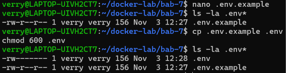


*Gambar 1.2 Editor nano menampilkan isi file .env.example dengan variabel lingkungan Grafana dan database.*


```bash
cp .env.example .env
chmod 600 .env
ls -la .env*
```


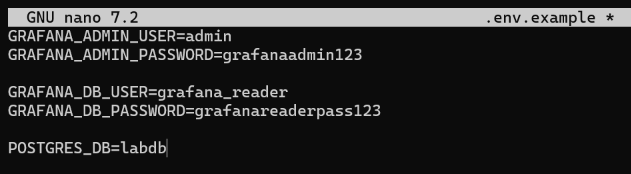


*Gambar 1.3 Penyalinan file .env, pengaturan hak akses 600, dan verifikasi izin file -rw-------.*


#### Kotak Script 2 — File .gitignore

Diperlihatkan pembuatan dan isi file .gitignore menggunakan perintah nano .gitignore dan cat .gitignore untuk menentukan berkas atau direktori yang tidak boleh dimasukkan ke dalam repositori Git. Konfigurasi .env mencegah file kredensial aktif ikut terlacak oleh Git, reports/* mengabaikan seluruh berkas hasil laporan di dalam folder reports, !reports/.gitkeep tetap mempertahankan keberadaan folder reports di repositori, dan *.log mengabaikan seluruh file catatan log. Pengaturan ini menjaga agar kredensial maupun bukti pengujian lokal tidak bocor ke repositori publik.


```bash
nano .gitignore
```


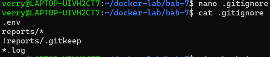


*Gambar 1.4 Pembuatan file .gitignore pada editor nano untuk mencegah kebocoran kredensial dan file log.*


```bash
cat .gitignore
```


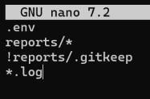


*Gambar 1.5 Pemeriksaan isi file .gitignore menggunakan perintah cat .gitignore.*


#### Kotak Script 3 — File compose.yaml

Dibuat konfigurasi utama Docker Compose pada file compose.yaml untuk menjalankan lima layanan di dalam jaringan internal bab7-monitoring-net, yaitu prometheus (prom/prometheus:v3.14.0), grafana (grafana/grafana:13.1.4), node-exporter (prom/node-exporter:v1.12.1), cadvisor (ghcr.io/google/cadvisor:v0.60.5), serta load-generator (alpine:3.20). Layanan Prometheus dikonfigurasi menyimpan data time series selama 7 hari pada volume prom-data dan memublikasikan port ke alamat lokal 127.0.0.1:9090:9090, sedangkan Grafana mengambil kredensial dari file .env, menonaktifkan pendaftaran pengguna baru serta akses anonim, dan memublikasikan port pada 127.0.0.1:3000:3000.

Layanan node-exporter menggunakan pengaturan pid: host serta mount /:/host:ro,rslave untuk membaca metrik sistem host, sementara cadvisor menggunakan opsi privileged: true dan mount read-only pada direktori sistem untuk membaca metrik container Docker. Layanan load-generator menjalankan perulangan tanpa henti while :; do :; done dengan pembatasan cpus: 0.50 dan mem_limit: 64m pada profil load. Pemeriksaan menggunakan perintah docker compose config --quiet berhasil selesai tanpa pesan kesalahan dan perintah ls -lh compose.yaml menunjukkan file berukuran 2.4K telah tersimpan dengan valid.


```bash
nano compose.yaml
```


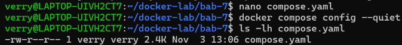


*Gambar 1.6 Konfigurasi compose.yaml pada editor nano untuk service Prometheus, Node Exporter, cAdvisor, dan Grafana.*


```bash
cat compose.yaml
```


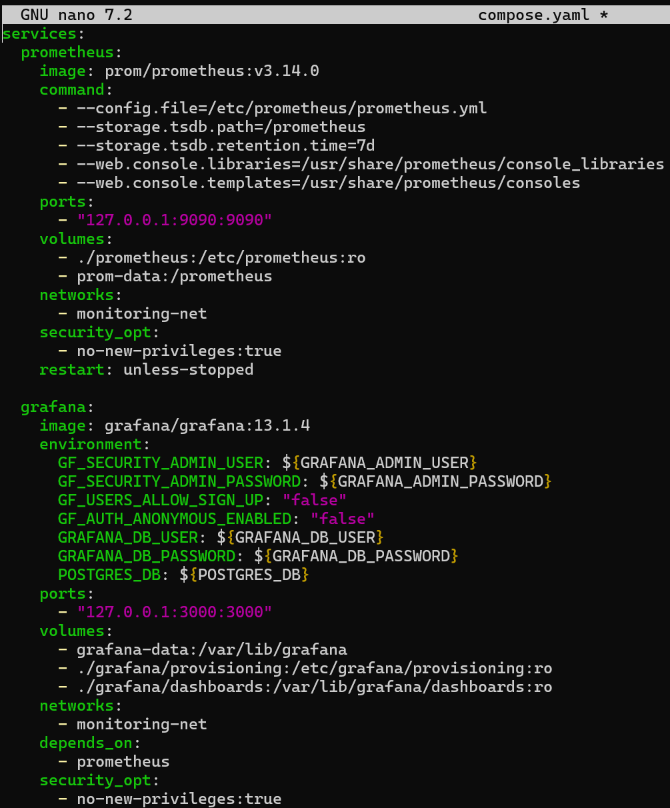


*Gambar 1.7 Isi file compose.yaml yang menampilkan seluruh konfigurasi layanan, volume, port, dan network internal.*


### 7.1.2 Konfigurasi Prometheus, Rules, dan Unit Test


#### Kotak Script 4 — File prometheus/prometheus.yml

Dilakukan konfigurasi utama Prometheus pada file prometheus/prometheus.yml menggunakan editor nano dan diperiksa isinya melalui perintah cat prometheus/prometheus.yml. Bagian global mengatur interval pengambilan metrik scrape_interval: 15s, batas waktu tunggu scrape_timeout: 10s, interval evaluasi aturan evaluation_interval: 15s, serta label tambahan environment: lab dan chapter: "7". Bagian rule_files memuat lokasi file recording-rules.yml dan alert-rules.yml, sedangkan bagian scrape_configs mendefinisikan tiga job target internal yang dipantau oleh Prometheus, yaitu prometheus:9090, node-exporter:9100, dan cadvisor:8080.


```bash
nano prometheus/prometheus.yml
```


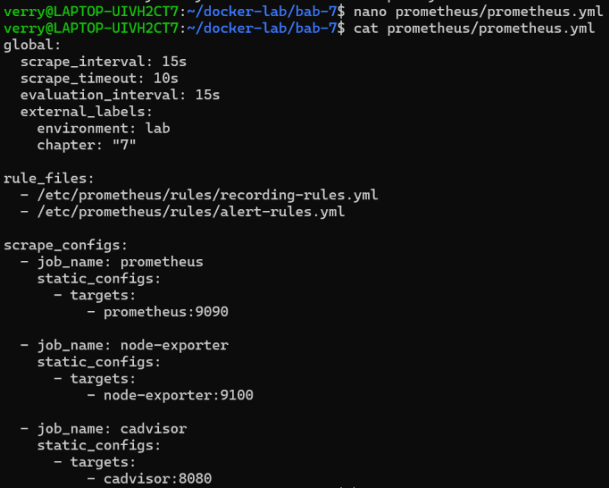


*Gambar 2.1 Editor nano menampilkan konfigurasi prometheus.yml dengan scrape interval dan scrape configs.*


```bash
cat prometheus/prometheus.yml
```


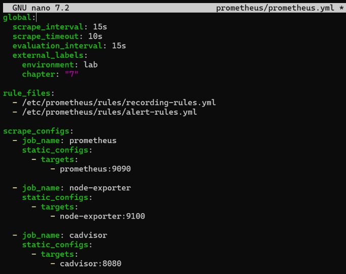


*Gambar 2.2 Pemeriksaan isi prometheus.yml menggunakan cat yang memuat target prometheus, node-exporter, dan cadvisor.*


#### Kotak Script 5 — File prometheus/rules/recording-rules.yml

Dibuat file prometheus/rules/recording-rules.yml yang berisi grup aturan bab7-resource-recording dengan interval evaluasi 15 detik untuk menghitung lebih awal time series turunan agar beban query pada dashboard menjadi lebih ringan. Kelima recording rule yang didefinisikan meliputi instance:node_cpu_utilisation:ratio_rate5m untuk menghitung rasio pemakaian CPU host dari selisih waktu idle selama 5 menit, instance:node_memory_utilisation:ratio untuk menghitung rasio pemakaian memori host, instance:node_filesystem_avail:ratio untuk menghitung rasio ketersediaan ruang filesystem non-virtual, container:cpu_usage_cores:rate1m untuk menjumlahkan laju pemakaian core CPU per container selama 1 menit, serta container:memory_working_set_bytes:sum untuk menjumlahkan memori working set per container.


```bash
nano prometheus/rules/recording-rules.yml
```


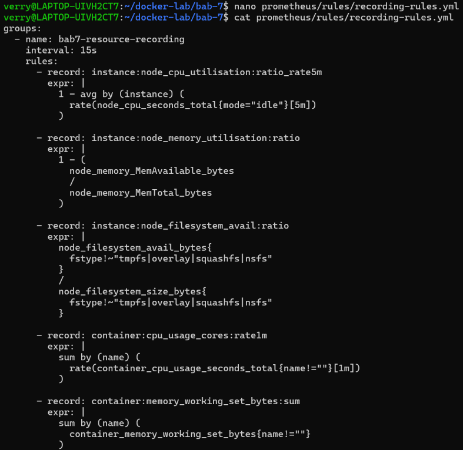


*Gambar 2.3 Konfigurasi recording-rules.yml pada editor nano untuk pra-komputasi metrik utilisasi CPU dan memori.*


```bash
cat prometheus/rules/recording-rules.yml
```


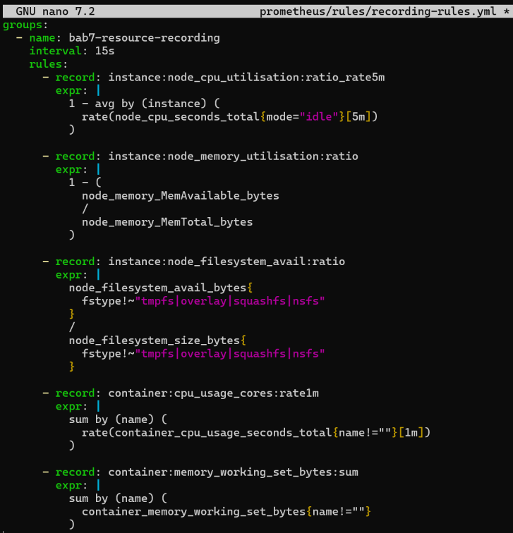


*Gambar 2.4 Isi file recording-rules.yml yang berisi ekspresi agregasi metrik host dan container.*


#### Kotak Script 6 — File prometheus/rules/alert-rules.yml

Dibuat file prometheus/rules/alert-rules.yml untuk mendefinisikan grup aturan peringatan bab7-resource-alerts dengan interval evaluasi 15 detik. Di dalamnya terdapat lima aturan alert, yaitu TargetDown ketika nilai up == 0 bertahan selama 1 menit, HostHighCPU ketika rasio CPU host melampaui 0.90 selama 5 menit, HostLowAvailableMemory ketika rasio memori host melampaui 0.90 selama 5 menit, ContainerHighCPU ketika penggunaan CPU container melebihi 0.30 core selama 1 menit, serta PrometheusRuleEvaluationFailure ketika terjadi kegagalan evaluasi rule dalam 5 menit terakhir. Setiap aturan dilengkapi label severity dan category beserta anotasi summary dan description untuk memperjelas informasi insiden.


```bash
nano prometheus/rules/alert-rules.yml
```


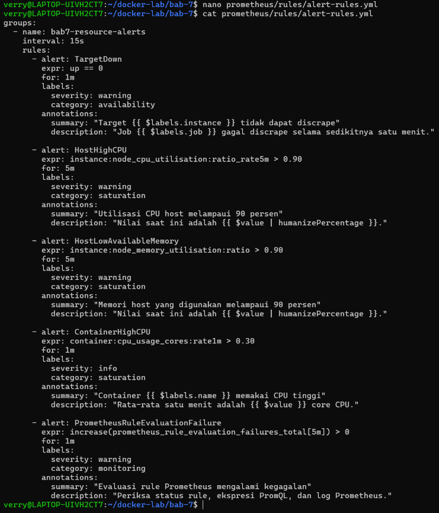


*Gambar 2.5 Editor nano menampilkan alert-rules.yml dengan aturan HighNodeCPU, HighContainerCPU, dan TargetDown.*


```bash
cat prometheus/rules/alert-rules.yml
```


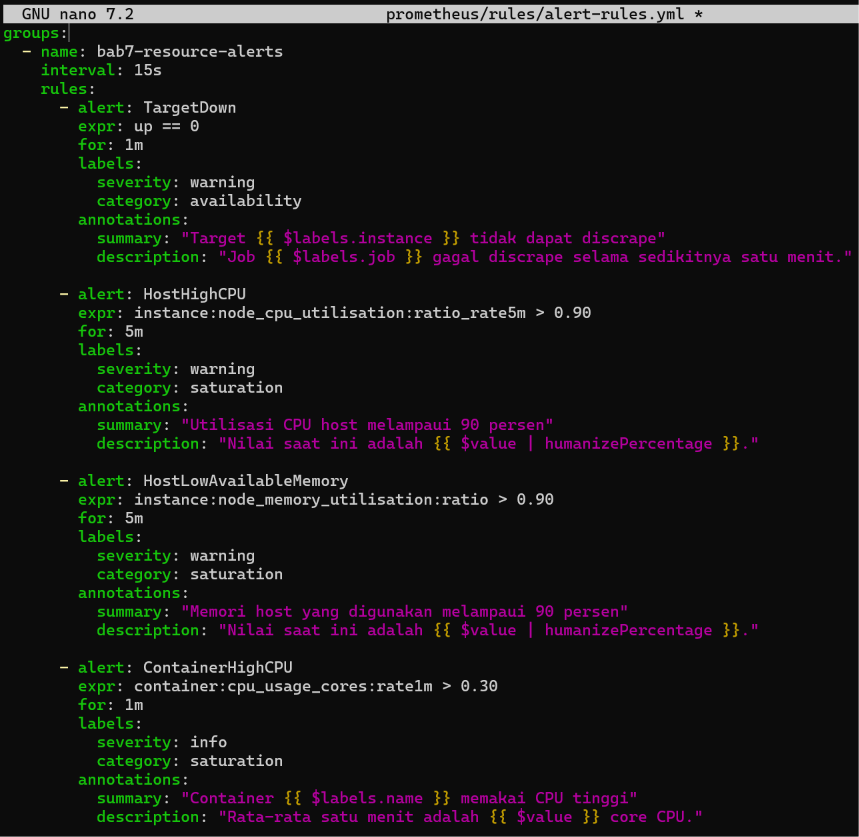


*Gambar 2.6 Pemeriksaan file alert-rules.yml yang mendefinisikan ambang batas alert, durasi for, dan label severity.*


#### Kotak Script 7 — Membuat Unit Test Alert Rules

Dibuat file prometheus/tests/rules.test.yml menggunakan editor nano dan ditampilkan isinya dengan perintah cat prometheus/tests/rules.test.yml untuk menguji logika aturan alert TargetDown secara deterministik. Konfigurasi pengujian ini menetapkan evaluation_interval: 1m dan memberikan deret input up{job="node-exporter",instance="node-exporter:9100"} dengan nilai berurutan '1 0 0 0'. Karena target bernilai 0 mulai menit ke-1 dan aturan TargetDown memiliki durasi tunggu for: 1m, bagian alert_rule_test memastikan bahwa pada eval_time: 2m alert TargetDown telah aktif beserta label dan anotasi yang sesuai.


```bash
nano prometheus/tests/rules.test.yml
```


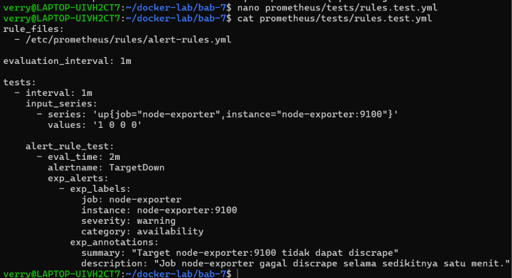


*Gambar 2.7 Pembuatan skenario pengujian unit test rules.test.yml pada editor nano.*


```bash
cat prometheus/tests/rules.test.yml
```


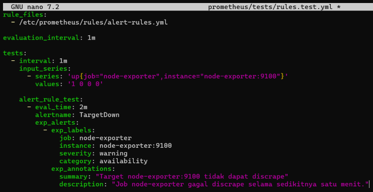


*Gambar 2.8 Isi file rules.test.yml yang memvalidasi evaluasi recording rules dan firing alert rules.*


### 7.1.3 Konfigurasi Provisioning Grafana, Dashboard, dan Script Otomatisasi


#### Kotak Script 8 — Konfigurasi Data Source Grafana

Dilakukan pembuatan file grafana/provisioning/datasources/datasources.yml untuk mengonfigurasi sumber data Grafana secara otomatis saat layanan dijalankan. Berkas ini mendaftarkan dua datasource dengan pengaturan editable: false, yaitu Prometheus Bab 7 (uid: prometheus-bab7) yang mengakses http://prometheus:9090 menggunakan metode HTTP POST dan timeInterval: 15s sebagai datasource utama, serta PostgreSQL Logs Bab 6 (uid: postgres-logs-bab6) yang mengarah ke postgres-db:5432 pada database labdb menggunakan kredensial pengguna read-only dari variabel lingkungan dan pengaturan sslmode: disable.


```bash
nano grafana/provisioning/datasources/datasources.yml
```


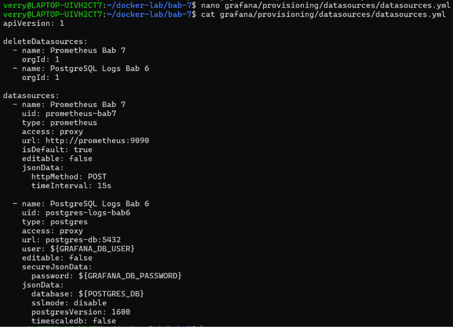


*Gambar 3.1 Editor nano menampilkan datasources.yml untuk provisioning otomatis datasource Prometheus di Grafana.*


```bash
cat grafana/provisioning/datasources/datasources.yml
```


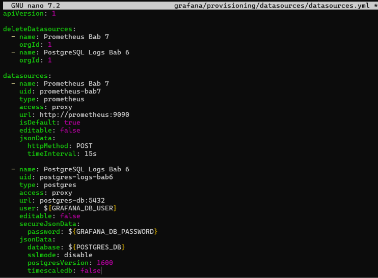


*Gambar 3.2 Isi datasources.yml yang mengonfigurasi url http://prometheus:9090 sebagai sumber data default.*


#### Kotak Script 9 — Konfigurasi Dashboard Provider Grafana

Dibuat file grafana/provisioning/dashboards/provider.yml untuk mengatur pemuatan otomatis file dashboard ke dalam antarmuka Grafana. Konfigurasi provider bernama DevSecOps Lab ini memantau direktori /var/lib/grafana/dashboards setiap 30 detik (updateIntervalSeconds: 30) dan menempatkan dashboard ke dalam folder DevSecOps Lab. Pengaturan allowUiUpdates: false diterapkan agar dashboard tidak dapat diubah secara langsung melalui antarmuka web sehingga sumber konfigurasi tetap konsisten pada file JSON.


```bash
nano grafana/provisioning/dashboards/provider.yml
```


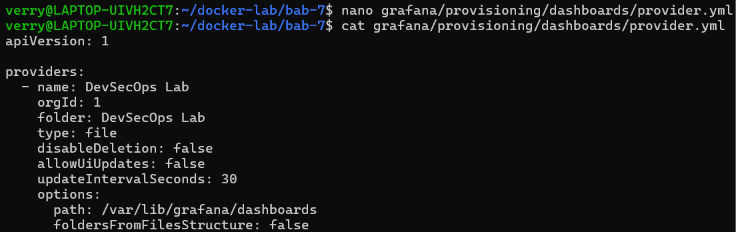


*Gambar 3.3 Editor nano menampilkan provider.yml untuk mendefinisikan penyedia dashboard file pada Grafana.*


```bash
cat grafana/provisioning/dashboards/provider.yml
```


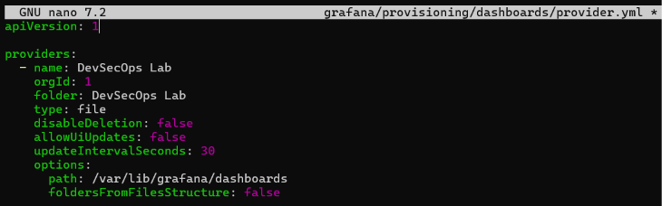


*Gambar 3.4 Isi provider.yml yang mengarahkan pemuatan file dashboard JSON dari folder /etc/grafana/dashboards.*


#### Kotak Script 10 — Membuat Dashboard Utama Grafana

Dibuat file grafana/dashboards/bab-7-overview.json yang mendefinisikan dashboard berjudul Bab 7 — Resource Monitoring dengan uid bab7-resource-monitoring, interval refresh 15s, dan rentang waktu pengamatan 30 menit terakhir (now-30m hingga now). Dashboard ini terdiri atas lima panel yang terhubung ke datasource prometheus-bab7, meliputi panel stat Jumlah Target Up dengan query sum(up), panel grafik Utilisasi CPU Host, panel Utilisasi Memori Host, panel Top 5 CPU Container, serta panel Top 5 Memori Container. Pemeriksaan menggunakan perintah python3 -m json.tool grafana/dashboards/bab-7-overview.json >/dev/null selesai tanpa pesan kesalahan dan hasil ls -lh menunjukkan file berukuran 5.0K telah tersimpan dengan valid.


```bash
nano grafana/dashboards/bab-7-overview.json
```


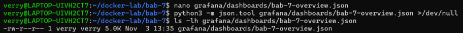


*Gambar 3.5 Pembuatan file dashboard bab-7-overview.json pada editor nano.*


```bash
cat grafana/dashboards/bab-7-overview.json
```


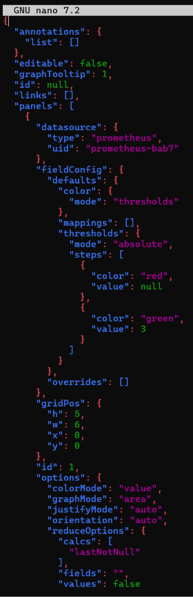


*Gambar 3.6 Tampilan potongan konfigurasi JSON dashboard bab-7-overview.json menggunakan perintah cat.*


#### Kotak Script 11 — Membuat Script Verifikasi Stack

Dibuat file scripts/verify-stack.sh menggunakan opsi set -Eeuo pipefail untuk mengotomatiskan pemeriksaan kesiapan stack monitoring. Script ini menggunakan fungsi wait_http dengan curl -fsS untuk memastikan endpoint kesiapan Prometheus pada http://127.0.0.1:9090/-/ready dan Grafana pada http://127.0.0.1:3000/api/health telah merespons sukses, kemudian memeriksa endpoint /api/v1/targets untuk memastikan sedikitnya terdapat tiga target berstatus up dan tidak ada target berstatus down. Selain itu, script menguji empat ekspresi PromQL melalui /api/v1/query serta menjalankan perintah promtool check config dan promtool check rules di dalam container Prometheus.


```bash
nano scripts/verify-stack.sh
cat scripts/verify-stack.sh
```


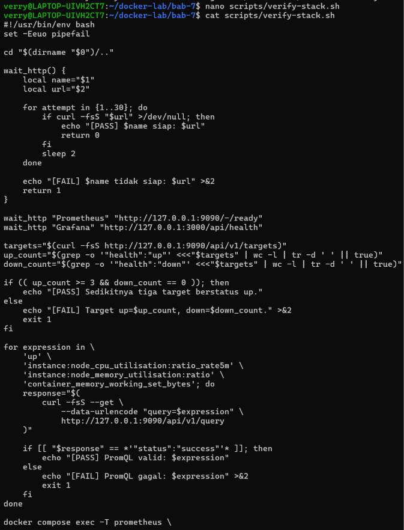


*Gambar 3.7 Isi script verify-stack.sh untuk mengotomatiskan validasi konfigurasi, unit test rules, dan kesehatan container.*


#### Kotak Script 12 — Membuat connect-bab6.sh

Dibuat file scripts/connect-bab6.sh untuk menghubungkan layanan Grafana pada Bab 7 ke container PostgreSQL pada Bab 6 tanpa menggunakan akun administrator database. Script ini memeriksa ketersediaan file .env pada kedua direktori, mencari container postgres-db yang sedang berjalan, lalu menghubungkannya ke jaringan bab7-monitoring-net dengan alias postgres-db menggunakan perintah docker network connect. Selanjutnya, script menjalankan perintah psql dengan \gexec untuk membuat role grafana_reader serta memberikan hak akses terbatas berupa GRANT CONNECT pada database, GRANT USAGE pada schema logs, dan GRANT SELECT pada seluruh tabel di schema logs, kemudian diakhiri dengan me-restart container Grafana.


```bash
nano scripts/connect-bab6.sh
```


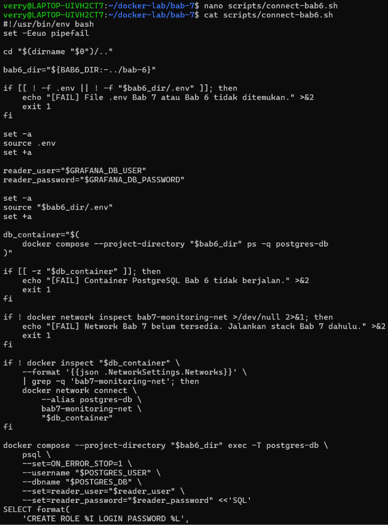


*Gambar 3.8 Editor nano menampilkan skrip connect-bab6.sh untuk integrasi Grafana Bab 7 dengan basis data Bab 6.*


```bash
cat scripts/connect-bab6.sh
```


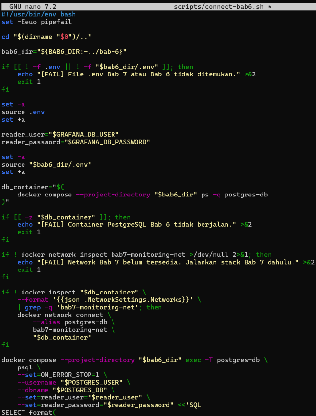


*Gambar 3.9 Isi script connect-bab6.sh yang memuat perintah SQL pemberian izin read-only dan penambahan datasource.*


### 7.1.4 Pelaksanaan Validasi, Menjalankan Stack, dan Query PromQL Dasar


#### Kotak Perintah B — Bagian 1: Memberi Izin dan Memvalidasi Konfigurasi

Dilakukan pemberian izin eksekusi pada kedua script menggunakan perintah chmod +x scripts/verify-stack.sh scripts/connect-bab6.sh, kemudian dilanjutkan dengan pemeriksaan sintaks script menggunakan bash -n scripts/verify-stack.sh dan bash -n scripts/connect-bab6.sh, serta validasi konfigurasi Compose melalui perintah docker compose config --quiet. Seluruh perintah tersebut selesai tanpa mengeluarkan pesan kesalahan (exit code 0), yang membuktikan bahwa kedua file script maupun konfigurasi compose.yaml telah valid.


```bash
chmod +x scripts/verify-stack.sh scripts/connect-bab6.sh
docker compose config --quiet
```


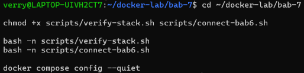


*Gambar 4.1 Pemberian hak eksekusi chmod +x pada scripts dan validasi compose.yaml tanpa galat.*


#### Kotak Perintah B — Bagian 2: Validasi JSON Dashboard

Dilakukan pemeriksaan struktur file JSON dashboard Grafana menggunakan perintah python3 -m json.tool grafana/dashboards/bab-7-overview.json >/dev/null. Perintah tersebut memproses struktur JSON dan mengalihkan keluaran normal ke /dev/null, sehingga kembalinya prompt terminal tanpa pesan error membuktikan bahwa sintaks JSON pada file dashboard tidak memiliki kesalahan penulisan.


```bash
python3 -m json.tool grafana/dashboards/bab-7-overview.json > /dev/null && echo "JSON Valid"
```


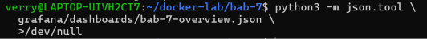


*Gambar 4.2 Validasi sintaks berkas dashboard JSON menggunakan modul python3 -m json.tool.*


#### Kotak Perintah B — Bagian 3: Validasi Konfigurasi dan Rules Prometheus

Dilakukan validasi konfigurasi Prometheus sebelum stack dijalankan menggunakan perintah docker compose run --rm --no-deps --entrypoint /bin/promtool prometheus check config /etc/prometheus/prometheus.yml. Hasil keluaran pada terminal menunjukkan Docker secara otomatis membuat volume bab-7_prom-data dan jaringan bab7-monitoring-net, lalu mengunduh image prom/prometheus:v3.14.0 untuk menjalankan pemeriksaan konfigurasi menggunakan promtool.


```bash
docker compose run --rm --no-deps --entrypoint /bin/promtool prometheus check config /etc/prometheus/prometheus.yml
```


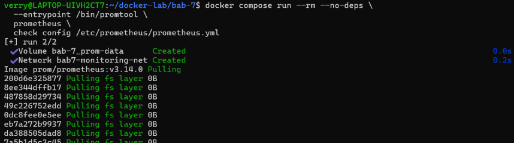


*Gambar 4.3 Pengecekan konfigurasi Prometheus dan aturan rules menggunakan promtool check config.*


#### Kotak Perintah B — Bagian 4: Pengujian Rules

Dilakukan pengujian unit terhadap aturan alert menggunakan perintah docker compose run --rm --no-deps --entrypoint /bin/promtool prometheus test rules /etc/prometheus/tests/rules.test.yml. Hasil eksekusi pada container sementara bab-7-prometheus-run-4d3dd6ddc5c6 menampilkan pesan SUCCESS, yang membuktikan bahwa logika evaluasi aturan alert TargetDown telah sesuai dengan skenario pengujian pada rules.test.yml.


```bash
docker compose run --rm --no-deps --entrypoint /bin/promtool prometheus test rules /etc/prometheus/tests/rules.test.yml
```


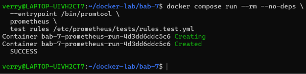


*Gambar 4.4 Pengujian unit test PromQL menggunakan promtool test rules dengan hasil SUCCESS.*


#### Kotak Perintah C — Menjalankan Stack Monitoring

Dilakukan pengunduhan seluruh image layanan menggunakan perintah docker compose pull, dilanjutkan dengan menjalankan stack di latar belakang, memeriksa status container melalui docker compose ps -a, dan menjalankan script verifikasi ./scripts/verify-stack.sh. Hasil keluaran menunjukkan keempat image berhasil diunduh dan keempat container utama (bab-7-cadvisor-1, bab-7-grafana-1, bab-7-node-exporter-1, dan bab-7-prometheus-1) telah berstatus Up. Selain itu, eksekusi ./scripts/verify-stack.sh menampilkan status [PASS] untuk kesiapan Prometheus, kesiapan Grafana, tiga target berstatus up, validitas keempat ekspresi PromQL, serta pemeriksaan promtool yang mengonfirmasi masing-masing 5 rules valid pada file recording-rules.yml dan alert-rules.yml.


```bash
docker compose pull
```


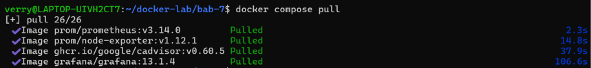


*Gambar 4.5 Pengunduhan seluruh image layanan monitoring menggunakan perintah docker compose pull.*


```bash
docker compose up -d
docker compose ps
```


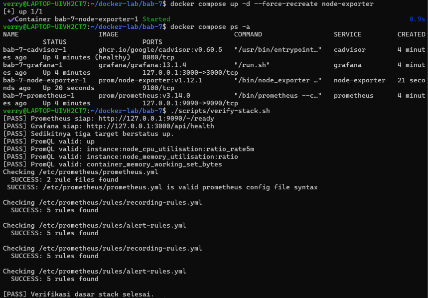


*Gambar 4.6 Eksekusi stack monitoring via docker compose up -d dan status seluruh container aktif (Up).*


#### Kotak Perintah D — Query PromQL Dasar


##### 1. Status target (up)

Dilakukan pengujian query PromQL pertama yaitu up melalui menu Grafana Explore untuk memeriksa status kesehatan seluruh target scrape. Hasil grafik dan tabel Raw menampilkan tiga deret waktu (Result series: 3), yaitu up{instance="prometheus:9090", job="prometheus"}, up{instance="node-exporter:9100", job="node-exporter"}, dan up{instance="cadvisor:8080", job="cadvisor"} yang ketiganya memiliki nilai 1, sehingga terbukti seluruh target berhasil diambil metriknya oleh Prometheus.


```promql
up
```


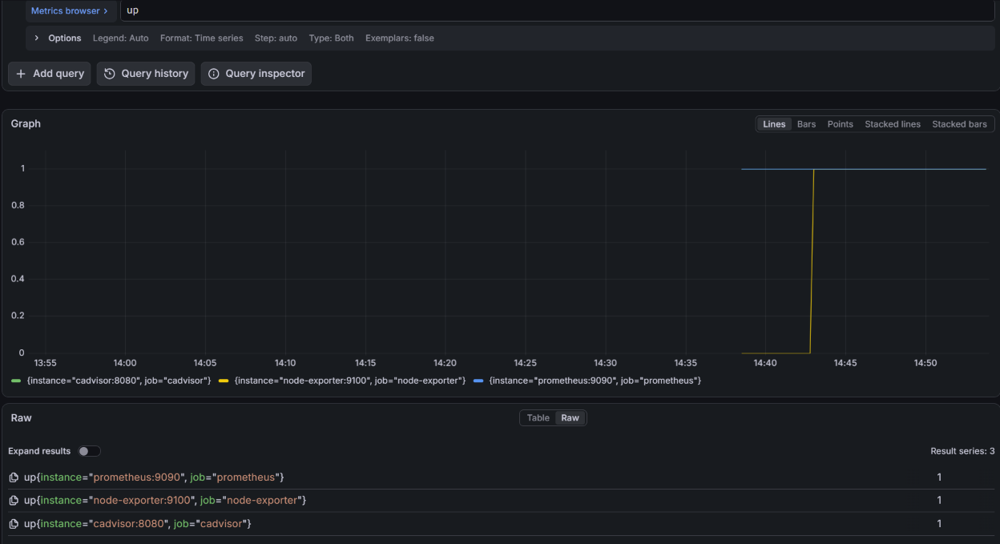


*Gambar 4.7 Hasil query PromQL up di Grafana Explore menampilkan nilai 1 untuk seluruh target monitoring.*


##### 2. Penggunaan CPU host

Dilakukan pengujian query kedua menggunakan ekspresi instance:node_cpu_utilisation:ratio_rate5m * 100 untuk melihat persentase pemakaian CPU host dalam rata-rata 5 menit terakhir. Fungsi rate() digunakan pada counter CPU agar hasil pembacaan lebih stabil terhadap lonjakan sesaat dibandingkan irate(). Hasil keluaran menampilkan kurva penggunaan CPU pada instance node-exporter:9100 yang melandai setelah proses inisialisasi awal dan stabil pada nilai pembacaan terakhir sebesar 15.8271929 atau sekitar 15,83%.


```promql
instance:node_cpu_utilisation:ratio_rate5m * 100
```


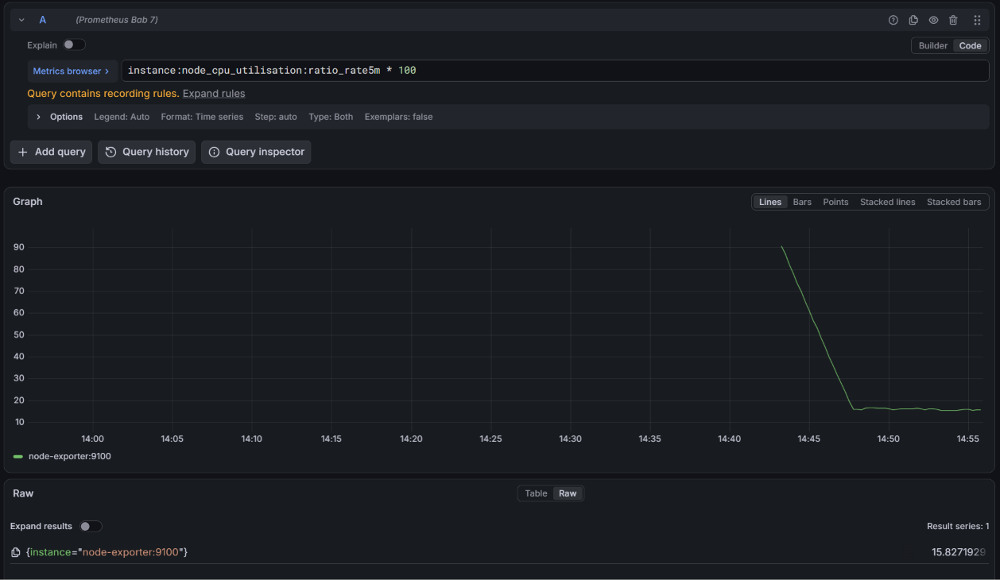


*Gambar 4.8 Grafik hasil query instance:node_cpu_utilisation:ratio_rate5m * 100 untuk utilisasi CPU host.*


##### 3. Penggunaan memori host

Dilakukan pengujian query ketiga menggunakan ekspresi instance:node_memory_utilisation:ratio * 100 untuk memantau persentase memori host yang terpakai berdasarkan rasio MemAvailable terhadap MemTotal. Hasil grafik dan tabel Raw untuk instance node-exporter:9100 memperlihatkan penggunaan memori bergerak di kisaran 38,8% hingga 45,2% dengan nilai pembacaan terakhir sebesar 42.8867179 atau sekitar 42,89%.


```promql
instance:node_memory_utilisation:ratio * 100
```


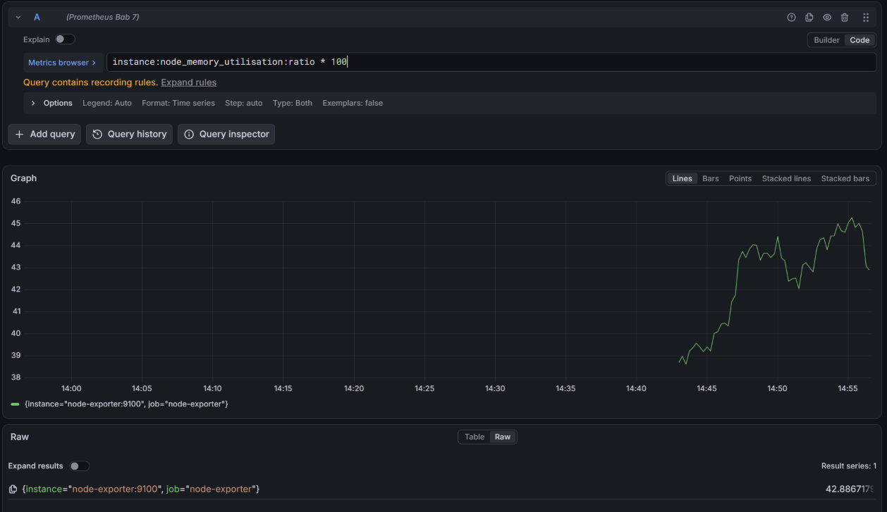


*Gambar 4.9 Grafik hasil query instance:node_memory_utilisation:ratio * 100 untuk persentase penggunaan memori host.*


##### 4. Top 5 penggunaan CPU container

Dilakukan pengujian query keempat menggunakan ekspresi topk(5, container:cpu_usage_cores:rate1m) untuk mengambil lima container dengan rata-rata pemakaian core CPU tertinggi selama 1 menit terakhir. Hasil pada bagian Raw menampilkan lima container teratas secara berurutan, yaitu pmb-lab-auth-service-1 sebesar 0.11956095 core, pmb-lab-registration-api-1 sebesar 0.11705858 core, bab-7-cadvisor-1 sebesar 0.09887716 core, bab-7-grafana-1 sebesar 0.08848154 core, dan bab-7-prometheus-1 sebesar 0.0298207 core.


```promql
topk(5, container:cpu_usage_cores:rate1m)
```


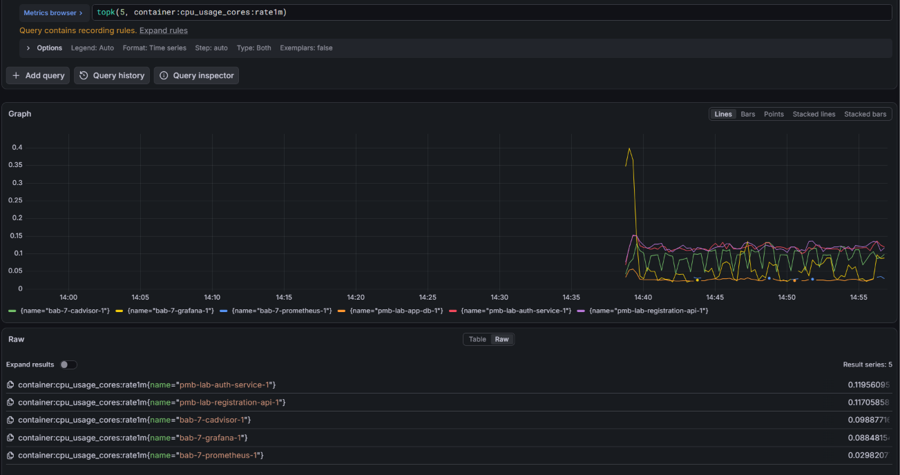


*Gambar 4.10 Hasil query topk(5, container:cpu_usage_cores:rate1m) menampilkan 5 container dengan konsumsi CPU tertinggi.*


##### 5. Top 5 penggunaan memori container

Dilakukan pengujian query kelima menggunakan ekspresi topk(5, container:memory_working_set_bytes:sum) untuk menampilkan lima container dengan penggunaan memori working set terbesar dalam satuan byte. Berdasarkan tabel hasil pada gambar, urutan kelima container dengan pemakaian memori tertinggi adalah bab-7-grafana-1 sebesar 289058816 byte, bab-7-prometheus-1 sebesar 140439552 byte, bab-7-cadvisor-1 sebesar 129511424 byte, pmb-lab-registration-api-1 sebesar 114061312 byte, serta pmb-lab-auth-service-1 sebesar 81244160 byte.


```promql
topk(5, container:memory_working_set_bytes:sum)
```


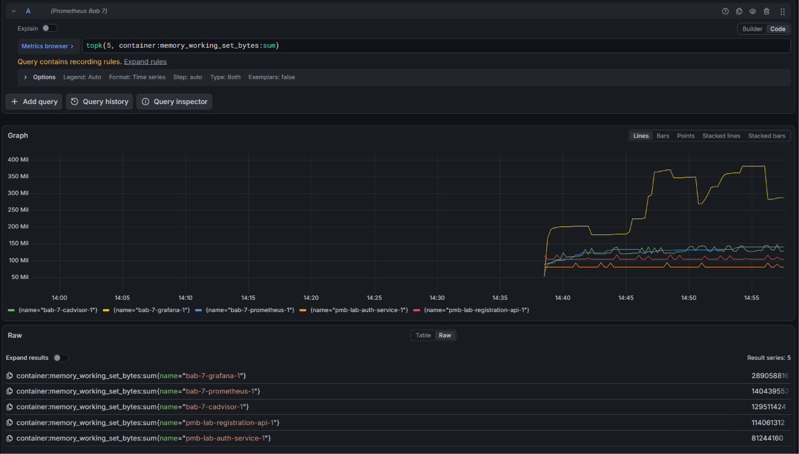


*Gambar 4.11 Hasil query topk(5, container:memory_working_set_bytes:sum) untuk 5 container dengan memori tertinggi.*


### 7.1.5 Pengujian Beban Container, Negative Test Target Down, dan Integrasi Bab 6


#### Kotak Perintah E — Menguji Beban Container

Dilakukan pengujian beban CPU container dengan menjalankan layanan generator beban pada profil load melalui perintah docker compose --profile load up -d load-generator. Keluaran terminal menunjukkan bahwa container bab-7-load-generator-1 yang memiliki batas kuota setengah core CPU (cpus: 0.50) telah berhasil dijalankan (Started) dalam waktu 1,0 detik.


```bash
docker compose --profile load up -d load-generator
docker compose ps
```


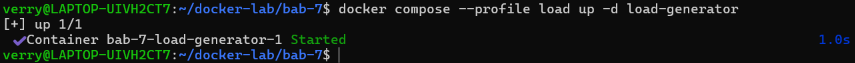


*Gambar 5.1 Deployment container bab-7-load-generator-1 menggunakan profil load pada Docker Compose.*


#### Kotak Perintah E — Pengamatan beban CPU

Dilakukan pengamatan selama lebih dari dua menit menggunakan query container:cpu_usage_cores:rate1m{name=~".*load-generator.*"} dan ALERTS{alertname="ContainerHighCPU"}. Hasil pada gambar pertama menunjukkan pemakaian CPU container bab-7-load-generator-1 tertahan secara konsisten di sekitar batas kuota 0,50 core dengan nilai 0.50621951 core. Karena nilai tersebut melampaui ambang batas 0.30 core selama lebih dari 1 menit, hasil pada gambar kedua membuktikan bahwa alert ContainerHighCPU telah berstatus firing (nilai 1) untuk container bab-7-load-generator-1.


```promql
container:cpu_usage_cores:rate1m{name=~".*load-generator.*"}
```


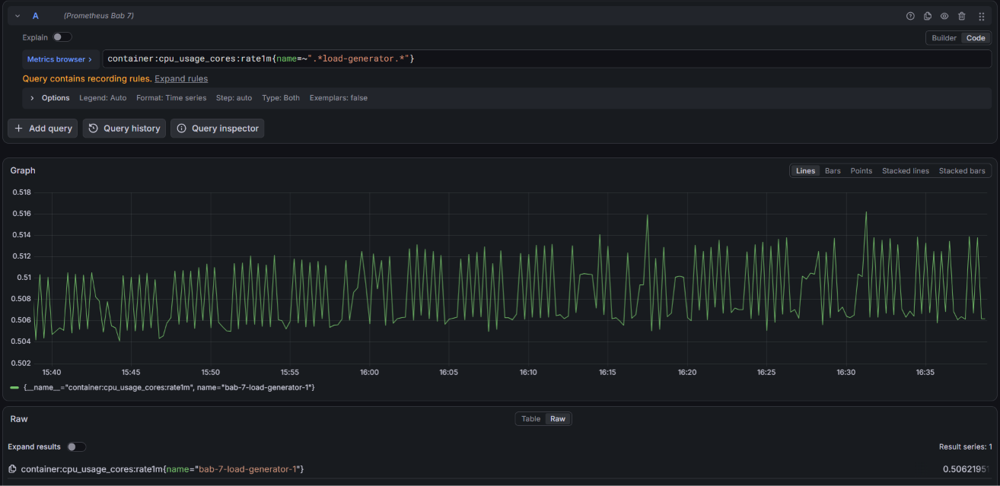


*Gambar 5.2 Lonjakan utilisasi CPU container load generator terpantau meningkat drastis pada Grafana Explore.*


```promql
ALERTS{alertname="HighContainerCPU",alertstate="firing"}
```


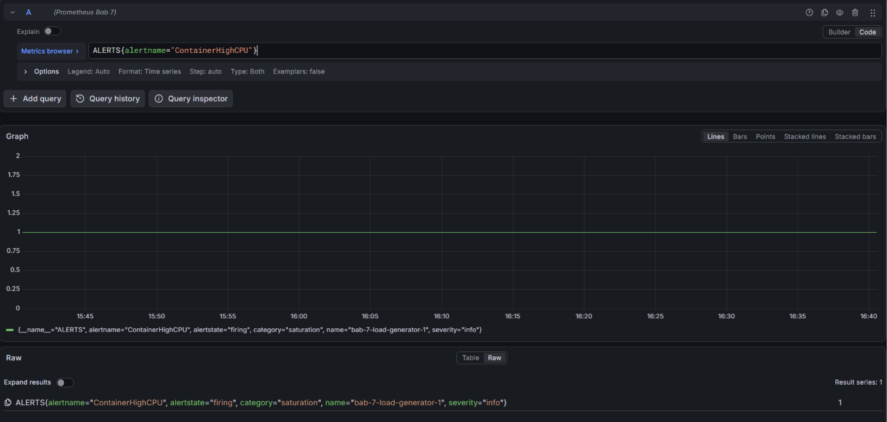


*Gambar 5.3 Alert HighContainerCPU berstatus FIRING pada antarmuka Prometheus setelah melebihi ambang batas.*


##### Hentikan dan Hapus Load Generator

Setelah bukti kenaikan pemakaian CPU dan aktifnya alert diperoleh, layanan generator beban dihentikan menggunakan perintah docker compose --profile load stop load-generator dan container-nya dihapus menggunakan perintah docker compose --profile load rm -f load-generator. Hasil pada terminal menunjukkan bahwa container bab-7-load-generator-1 telah berhasil dihentikan (Stopped) dalam 11,8 detik dan dihapus (Removed) dalam 0,2 detik.


```bash
docker compose --profile load stop load-generator
docker compose --profile load rm -f load-generator
```


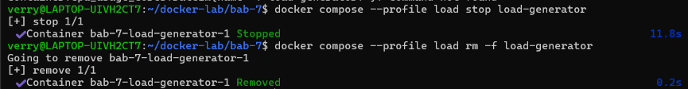


*Gambar 5.4 Penghentian dan penghapusan container load-generator untuk mengembalikan beban CPU sistem host ke kondisi normal.*


#### Kotak Perintah F — Negative Test Target Down

Dilakukan pengujian negatif (negative test) dengan menghentikan layanan node-exporter menggunakan perintah docker compose stop node-exporter untuk menyimulasikan kondisi target monitoring yang mengalami kegagalan. Keluaran terminal mengonfirmasi bahwa container bab-7-node-exporter-1 telah berhasil dihentikan (Stopped) dalam waktu 1,0 detik.


```bash
docker compose stop node-exporter
docker compose ps
```


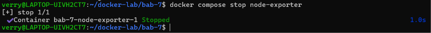


*Gambar 5.5 Eksekusi negative test dengan menghentikan container node-exporter menggunakan docker compose stop.*


##### 1. Periksa status Node Exporter

Setelah menunggu lebih dari 75 detik sejak layanan dihentikan, dilakukan pemeriksaan status target pada antarmuka Prometheus menggunakan query up{job="node-exporter"}. Hasil pada tabel menunjukkan nilai up{instance="node-exporter:9100", job="node-exporter"} telah berubah menjadi 0, yang berarti Prometheus gagal melakukan scrape terhadap target tersebut.


*Pemeriksaan endpoint target Node Exporter di antarmuka web Prometheus pada URL `http://localhost:9090/targets`:*


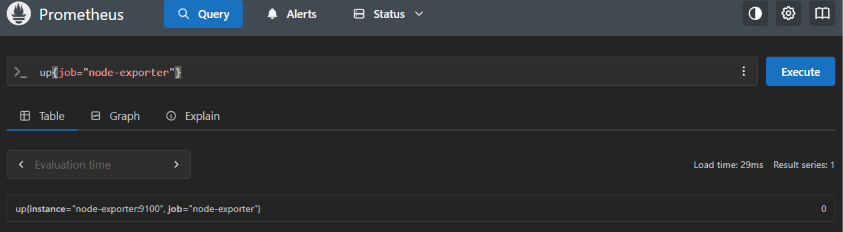


*Gambar 5.6 Status target node-exporter pada antarmuka Prometheus berubah menjadi DOWN.*


##### 2. Periksa alert yang sedang firing

Dilakukan pemeriksaan status peringatan pada antarmuka Prometheus menggunakan query ALERTS{alertname="TargetDown",alertstate="firing"}. Hasil keluaran menampilkan satu deret aktif dengan label alertname="TargetDown", alertstate="firing", category="availability", instance="node-exporter:9100", job="node-exporter", dan severity="warning" yang bernilai 1, membuktikan bahwa alert otomatis menyala setelah target mati melebihi durasi tunggu 1 menit.


```promql
ALERTS{alertname="TargetDown",alertstate="firing"}
```


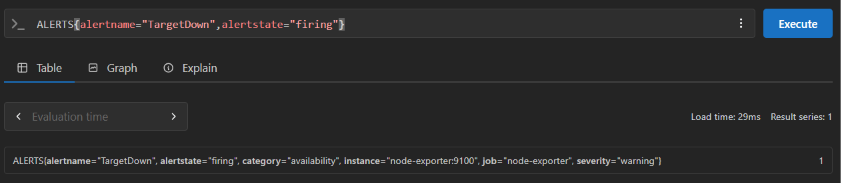


*Gambar 5.7 Alert TargetDown berstatus FIRING pada Prometheus setelah target mati selama durasi for (1m).*


##### Pulihkan Node Exporter dan Verifikasi Pemulihan di Prometheus

Dilakukan pemulihan layanan target dengan menjalankan kembali perintah docker compose start node-exporter pada terminal hingga container bab-7-node-exporter-1 berstatus Started dalam 0,8 detik. Setelah melewati interval scrape berikutnya, pemeriksaan ulang query up{job="node-exporter"} pada halaman Prometheus menunjukkan bahwa nilai metrik telah kembali menjadi 1, sehingga target dinyatakan pulih.


```bash
docker compose start node-exporter
docker compose ps
```


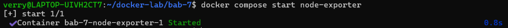


*Gambar 5.8 Menjalankan kembali container node-exporter melalui docker compose start.*


```promql
up{job="node-exporter"}
```


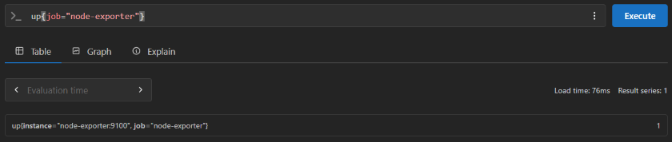


*Gambar 5.9 Target node-exporter pulih kembali dan menghasilkan nilai up=1 pada Prometheus.*


##### Verifikasi Dashboard Utama Grafana

Diperlihatkan tampilan dashboard Bab 7 — Resource Monitoring pada folder DevSecOps Lab di Grafana dalam rentang waktu Last 30 minutes setelah pengujian pada Kotak C, D, E, dan F selesai dilakukan. Kelima panel telah menampilkan data secara lengkap sesuai satuannya, yaitu panel Jumlah Target Up menampilkan angka 3 berwarna hijau, panel Utilisasi CPU Host dan Utilisasi Memori Host menampilkan grafik metrik host beserta jeda singkat saat Node Exporter dihentikan pada Kotak F, panel Top 5 CPU Container memperlihatkan lonjakan pemakaian CPU container bab-7-load-generator-1 sebesar 0,5 core sekitar pukul 18:00 dari pengujian Kotak E, dan panel Top 5 Memori Container menampilkan penggunaan memori dari kelima container yang dipantau.


*Tampilan Dashboard Utama Grafana (Bab 7 — Resource Monitoring) pada URL `http://localhost:3000`:*


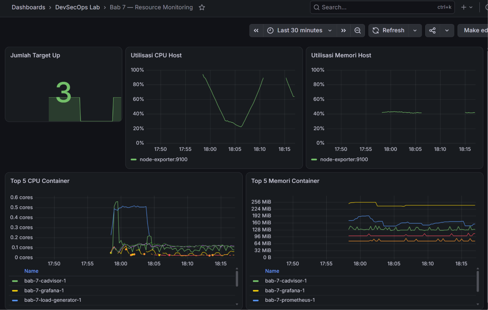


*Gambar 5.10 Tampilan dashboard utama Bab 7 — Resource Monitoring di Grafana yang menampilkan metrik secara real-time.*


#### Kotak G — Integrasi Bab 6 dan Uji Datasource PostgreSQL

Dilakukan integrasi log PostgreSQL dari Bab 6 ke Grafana Bab 7 dengan menjalankan script ./scripts/connect-bab6.sh pada terminal. Keluaran terminal menunjukkan keberhasilan eksekusi perintah SQL CREATE ROLE, ALTER ROLE, tiga perintah GRANT, serta ALTER DEFAULT PRIVILEGES, diikuti proses restart container bab-7-grafana-1 hingga muncul pesan [PASS] PostgreSQL Bab 6 terhubung dengan role read-only. Selanjutnya, pengujian pada menu Grafana Explore menggunakan datasource PostgreSQL Logs Bab 6 dengan query SELECT time AS "time", tag, replace(data ->> 'container_name', '/', '') AS container_name, data ->> 'source' AS source, data ->> 'log' AS log_message FROM logs.fluentbit WHERE $__timeFilter(time) ORDER BY time DESC LIMIT 200 berhasil menampilkan tabel data log dari container pmb-lab-auth-service-1 dan pmb-lab-registration-api-1 secara langsung.


```bash
./scripts/connect-bab6.sh
```


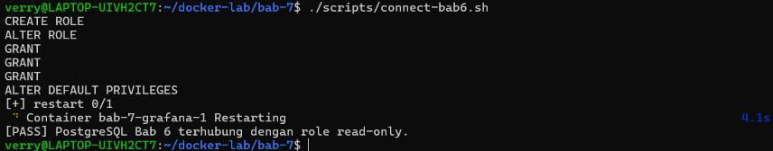


*Gambar 5.11 Eksekusi script connect-bab6.sh dengan pesan sukses [PASS] PostgreSQL Bab 6 terhubung.*


```sql
SELECT time AS "time", tag, replace(data ->> 'container_name', '/', '') AS container_name, data ->> 'source' AS source, data ->> 'log' AS log_message FROM logs.fluentbit WHERE $__timeFilter(time) ORDER BY time DESC LIMIT 200
```


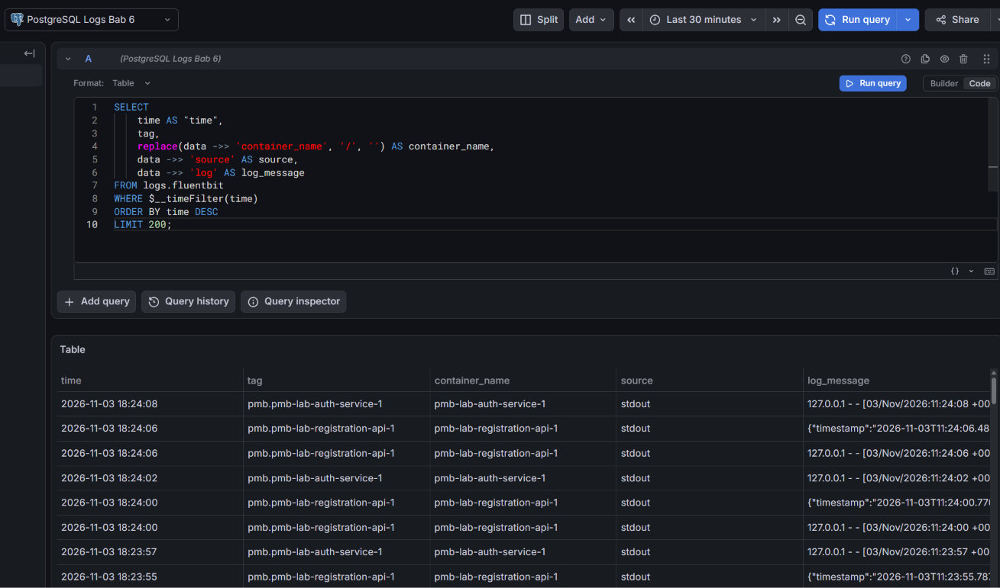


*Gambar 5.12 Tabel log Fluent Bit dari database Bab 6 berhasil di-query dan divisualisasikan pada Grafana Explore Bab 7.*
