<p align="center"></p>

# BAB VIII: HARDENING CONTAINER, SECRETS, TRIVY, DAN PRIVATE REGISTRY

**Mata Kuliah:** Workshop DevOps  
**Dosen Pengampu:** Dr. Ferry Astika Saputra, ST, M.Sc  
**Disusun Oleh (Kelompok 2):**
- Ibram Maulana Akhsanul Qasasi (NRP. 3126640014)
- Yusuf Rahmadhani Asy’ari (NRP. 3126640042)
- Vernanda Mulia Hamonangan Manurung (NRP. 3126640044)  
**Program Studi:** D4 Lanjut Jenjang Teknik Informatika  
**Institusi:** Politeknik Elektronika Negeri Surabaya (2026)

---

## 8.1 Tahap Praktikum

### 8.1.1 Persiapan Direktori dan Konfigurasi Dasar

#### Kotak Perintah A — Menyiapkan Direktori Bab 8

Dilakukan pembuatan seluruh struktur direktori kerja untuk praktikum Bab 8 menggunakan perintah `mkdir -p ~/docker-lab/bab-8/{app,secrets,registry/certs,registry/auth,scripts,reports}`, kemudian dilanjutkan dengan berpindah ke direktori tersebut serta membuat berkas penanda melalui perintah `cd ~/docker-lab/bab-8 && touch reports/.gitkeep`. Perintah ini menyiapkan subdirektori khusus untuk kode aplikasi, penyimpanan secret, sertifikat TLS dan autentikasi registry, kumpulan script otomatisasi, serta folder laporan hasil pemindaian. Keberadaan berkas `.gitkeep` memastikan struktur direktori `reports` tetap dipertahankan di dalam repositori Git meskipun isi laporannya diabaikan.

```bash
mkdir -p ~/docker-lab/bab-8/{app,secrets,registry/certs,registry/auth,scripts,reports}
cd ~/docker-lab/bab-8 && touch reports/.gitkeep
```

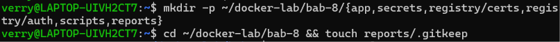

*Gambar 8.1 Hasil pembuatan struktur direktori kerja Bab 8 dan berkas penanda .gitkeep.*

#### Kotak Script 1 — File .env.example

Dilakukan pembuatan file `.env.example` menggunakan perintah `nano .env.example` yang kemudian disalin menjadi file konfigurasi aktif `.env` melalui perintah `cp .env.example .env`. Berkas ini mendefinisikan empat variabel lingkungan utama, yaitu `APP_IMAGE=pens-web:1.0` sebagai nama dan tag image aplikasi, `REGISTRY_HOST=localhost:5000` sebagai alamat private registry lokal, serta `REGISTRY_USER=labpublisher` dan `REGISTRY_PASSWORD=registrypass123` sebagai kredensial autentikasi registry. Perintah `chmod 600 .env` dijalankan untuk membatasi hak akses file agar hanya pemiliknya yang dapat membaca dan mengubah file tersebut. Pemeriksaan menggunakan `ls -l .env` menunjukkan izin file telah menjadi `-rw-------` dengan ukuran 113 byte.

```bash
nano .env.example
```

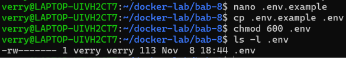

*Gambar 8.2 Pembuatan file konfigurasi .env.example menggunakan editor nano.*

```bash
cp .env.example .env
chmod 600 .env
ls -l .env
```

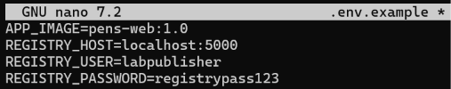

*Gambar 8.3 Penyalinan ke file .env, pengaturan izin chmod 600, dan verifikasi atribut hak akses.*

#### Kotak Script 2 — File .gitignore

Diperlihatkan pembuatan dan isi file `.gitignore` menggunakan perintah `nano .gitignore` dan `cat .gitignore` untuk mencegah berkas sensitif maupun artefak hasil pengujian masuk ke dalam repositori Git. Aturan yang diterapkan mencakup `.env`, `secrets/*.txt` dengan pengecualian `!secrets/*.txt.example`, `registry/auth/*`, `registry/certs/*`, `reports/*` dengan pengecualian `!reports/.gitkeep`, serta seluruh file berekstensi `*.tar` dan `*.log`. Pengaturan ini melindungi private key TLS, hash password htpasswd, nilai secret aktif, arsip image, dan laporan pemindaian kerentanan agar tidak bocor ke repositori.

```bash
nano .gitignore
```

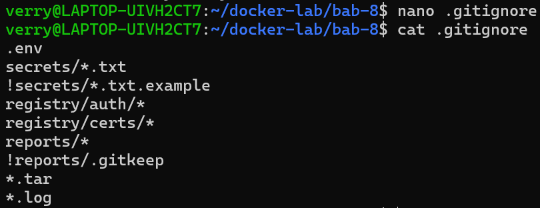

*Gambar 8.4 Pembuatan file .gitignore menggunakan editor nano.*

```bash
cat .gitignore
```

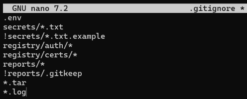

*Gambar 8.5 Verifikasi aturan pengabaian berkas sensitif dan artefak uji pada .gitignore.*

#### Kotak Script 3 — File .dockerignore

Diperlihatkan pembuatan dan isi file `.dockerignore` menggunakan perintah `nano .dockerignore` dan `cat .dockerignore` untuk memperkecil ukuran build context sekaligus menjadi lapisan pengaman tambahan agar berkas rahasia tidak ikut terkirim ke daemon Docker saat proses build. Daftar pengecualian mencakup `.git`, `.gitignore`, `.env`, `secrets/`, `registry/`, `reports/`, `scripts/`, `compose.yaml`, direktori cache Python `**/__pycache__/`, `**/*.py[cod]`, serta berkas `**/*.log` dan `**/*.tar`. Dengan demikian, hanya berkas aplikasi yang dibutuhkan dari direktori `app/` yang dapat disalin ke dalam image.

```bash
nano .dockerignore
```

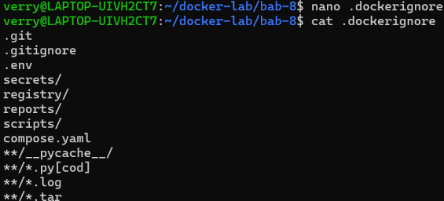

*Gambar 8.6 Pembuatan aturan pembatasan build context pada .dockerignore menggunakan editor nano.*

```bash
cat .dockerignore
```

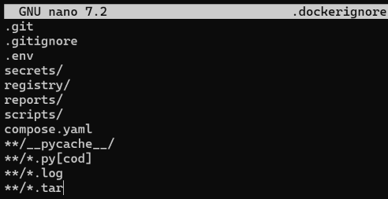

*Gambar 8.7 Verifikasi isi file .dockerignore untuk mengamankan proses build image.*

### 8.1.2 Pembuatan Aplikasi, Multi-Stage Dockerfile, Secret, dan Konfigurasi Compose

#### Kotak Script 4 — File app/requirements.txt

Dilakukan pembuatan file `app/requirements.txt` menggunakan editor nano dan diperiksa isinya dengan perintah `cat app/requirements.txt` untuk mendefinisikan daftar pustaka Python yang dibutuhkan aplikasi. Di dalam berkas tersebut ditetapkan dua paket dengan versi yang dikunci secara spesifik, yaitu `Flask==3.1.3` sebagai kerangka kerja aplikasi web dan `gunicorn==26.1.0` sebagai server WSGI untuk menjalankan aplikasi pada lingkungan produksi atau container. Penguncian versi dependency ini bertujuan agar proses pembuatan image dapat direproduksi secara konsisten.

```bash
nano app/requirements.txt
```

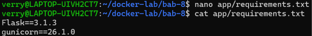

*Gambar 8.8 Penulisan pustaka Flask dan gunicorn pada app/requirements.txt.*

```bash
cat app/requirements.txt
```

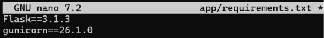

*Gambar 8.9 Verifikasi daftar paket pustaka terkunci pada app/requirements.txt.*

#### Kotak Script 5 — File app/app.py

Dibuat kode sumber aplikasi utama pada file `app/app.py` menggunakan kerangka kerja Flask dengan lokasi pembacaan secret pada variabel `SECRET_PATH = "/run/secrets/app_secret"`. Endpoint utama (`"/"`) mengembalikan respons JSON berisi nama layanan `"pens-web"`, status `"running"`, nilai uid dari `os.getuid()`, nilai gid dari `os.getgid()`, serta indikator boolean `secret_mounted` yang memeriksa keberadaan file secret tanpa menampilkan isi rahasianya ke pengguna. Selain itu, endpoint `"/health"` memeriksa keberadaan file secret tersebut dan mengembalikan status HTTP 200 (`"healthy"`) apabila secret terpasang, atau HTTP 503 (`"unhealthy"`) apabila secret tidak ditemukan.

```bash
nano app/app.py
```

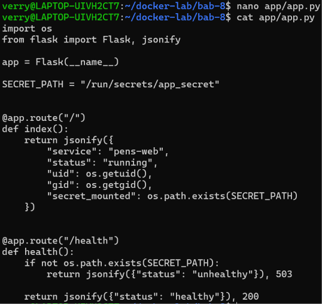

*Gambar 8.10 Penulisan kode sumber aplikasi Flask pada app/app.py.*

```bash
cat app/app.py
```

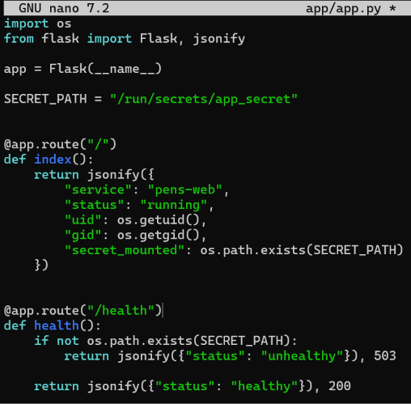

*Gambar 8.11 Verifikasi implementasi endpoint dan penanganan secret pada app/app.py.*

#### Kotak Script 6 — File app/Dockerfile

Dibuat file `app/Dockerfile` dengan menerapkan teknik multi-stage build berbasis image `python:3.11.16-slim` yang memisahkan tahap pembangunan dependency (`AS builder`) dari tahap eksekusi akhir (`AS runtime`). Pada tahap builder, dependency dari `app/requirements.txt` dipasang ke dalam virtual environment `/opt/venv` menggunakan `pip install --no-cache-dir`. Pada tahap runtime, dibuat grup `appgroup` dan pengguna non-root `appuser` dengan identitas numerik UID 10001 dan GID 10001 tanpa direktori home (`--no-create-home`), kemudian direktori `/opt/venv` disalin dari builder dan berkas `app/app.py` disalin dengan kepemilikan `--chown=10001:10001`. Konfigurasi ditutup dengan instruksi `USER 10001:10001`, `EXPOSE 8080`, pemeriksaan `HEALTHCHECK` ke endpoint lokal `/health`, serta perintah `CMD` untuk menjalankan server gunicorn.

```bash
nano app/Dockerfile
```

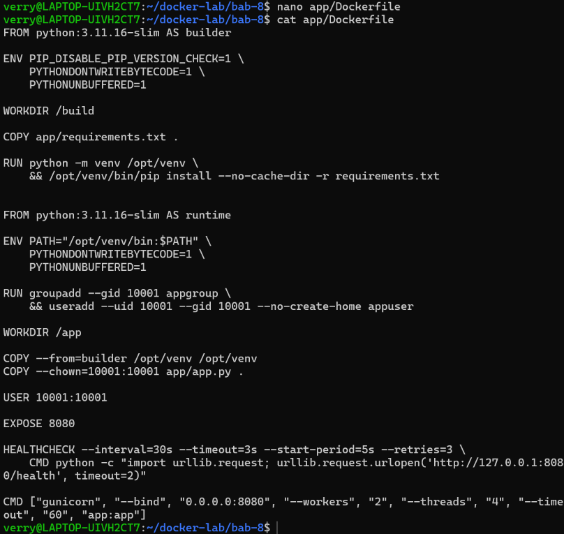

*Gambar 8.12 Penulisan multi-stage Dockerfile pada app/Dockerfile menggunakan editor nano.*

```bash
cat app/Dockerfile
```

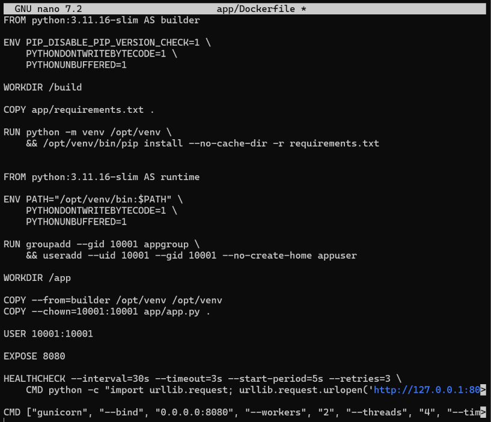

*Gambar 8.13 Verifikasi instruksi hardening dan pengguna non-root pada app/Dockerfile.*

#### Kotak Script 7 — File secrets/app_secret.txt.example

Dilakukan pembuatan file template `secrets/app_secret.txt.example` berisi teks contoh `GANTI_DENGAN_NILAI_ACAK_KHUSUS_LAB` menggunakan editor nano. Selanjutnya, dibuat nilai secret aktif secara acak sepanjang 32 byte heksadesimal menggunakan perintah `openssl rand -hex 32 > secrets/app_secret.txt` dan dibatasi hak aksesnya dengan perintah `chmod 600 secrets/app_secret.txt`. Hasil pemeriksaan `ls -l secrets/app_secret.txt` menunjukkan bahwa berkas secret berukuran 65 byte telah memiliki izin akses `-rw-------` sehingga hanya pemilik akun yang dapat membacanya.

```bash
nano secrets/app_secret.txt.example
```

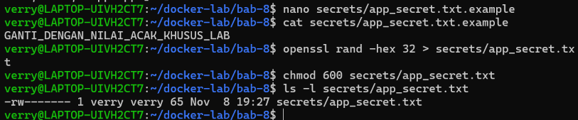

*Gambar 8.14 Pembuatan template file secret secrets/app_secret.txt.example.*

```bash
openssl rand -hex 32 > secrets/app_secret.txt
chmod 600 secrets/app_secret.txt
ls -l secrets/app_secret.txt
```

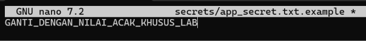

*Gambar 8.15 Pembangkitan secret acak 32-byte heksadesimal dan pembatasan izin chmod 600.*

#### Kotak Script 8 — File compose.yaml

Dibuat konfigurasi orkestrasi pada file `compose.yaml` yang mengatur tiga layanan, yaitu `app`, `registry`, dan `trivy`. Layanan `app` dikonfigurasi dengan pengendalian hardening yang ketat meliputi eksekusi sebagai user `"10001:10001"`, opsi `init: true`, sistem berkas utama `read_only: true`, direktori sementara tmpfs pada `/tmp` dengan atribut `rw,noexec,nosuid,size=64m,mode=1777`, penghapusan seluruh kapabilitas kernel melalui `cap_drop: ALL`, pencegahan eskalasi hak akses `no-new-privileges:true`, serta pembatasan resource `pids_limit: 100`, `cpus: 0.50`, `mem_limit: 256m`, dan `memswap_limit: 256m`. Layanan `app` juga menerima injeksi secret `app_secret` dan memublikasikan port ke `127.0.0.1:8088:8080`.

Layanan kedua yaitu `registry` menggunakan image `registry:3.1.1` yang diamankan dengan sertifikat TLS (`/certs/domain.crt` dan `/certs/domain.key`), autentikasi htpasswd (`/auth/htpasswd`), sistem berkas `read_only: true`, `cap_drop: ALL`, `no-new-privileges:true`, dan pemetaan port lokal `127.0.0.1:5000:5000`. Layanan ketiga yaitu `trivy` menggunakan image `aquasec/trivy:0.74.0` pada profil tools dengan mount direktori kerja secara read-only (`.:/workspace:ro`) sehingga pemindaian dilakukan tanpa memerlukan akses ke Docker socket. Hasil eksekusi perintah `docker compose config --quiet` selesai tanpa pesan kesalahan, yang membuktikan struktur YAML pada compose.yaml telah valid.

```bash
nano compose.yaml
```

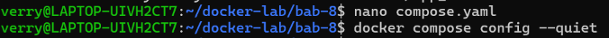

*Gambar 8.16 Penyusunan konfigurasi layanan compose.yaml menggunakan editor nano.*

```bash
cat compose.yaml
docker compose config --quiet
```

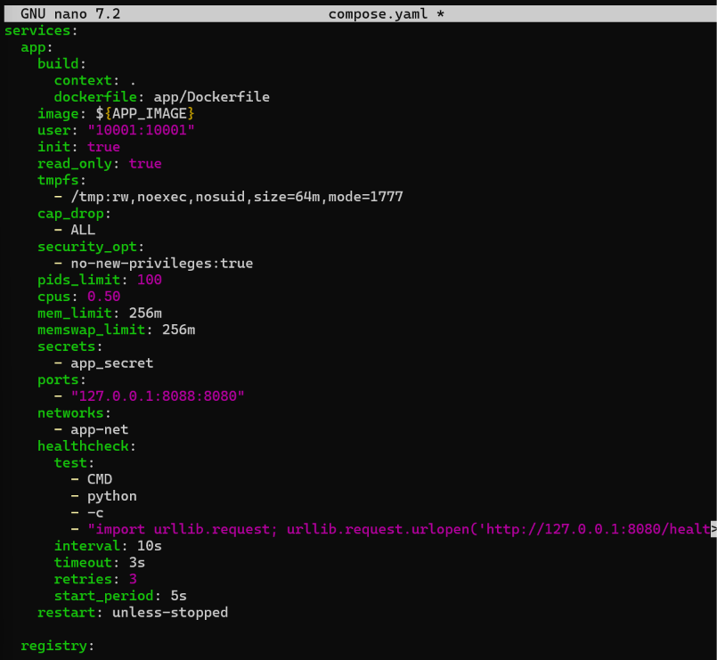

*Gambar 8.17 Verifikasi konfigurasi orkestrasi layanan compose.yaml.*

### 8.1.3 Pembuatan Script Aset Registry, Pemindaian Trivy, Push Registry, dan Verifikasi Hardening

#### Kotak Script 9 — File scripts/generate-registry-assets.sh

Dibuat script `scripts/generate-registry-assets.sh` dan diperiksa sintaksnya menggunakan perintah `bash -n scripts/generate-registry-assets.sh`. Script ini bertugas memuat kredensial dari file `.env`, menyiapkan direktori `registry/certs` serta `registry/auth` dengan umask 077, dan menjalankan perintah `openssl req -newkey rsa:3072 -nodes -sha256 -x509 -days 365` untuk membuat pasangan kunci privat `domain.key` serta sertifikat self-signed `domain.crt` yang dilengkapi ekstensi Subject Alternative Name (SAN) `DNS:localhost,IP:127.0.0.1`. Selain itu, script membuat file autentikasi `registry/auth/htpasswd` berformat bcrypt dan mengatur izin akses 600 pada file kunci privat serta htpasswd.

```bash
nano scripts/generate-registry-assets.sh
```

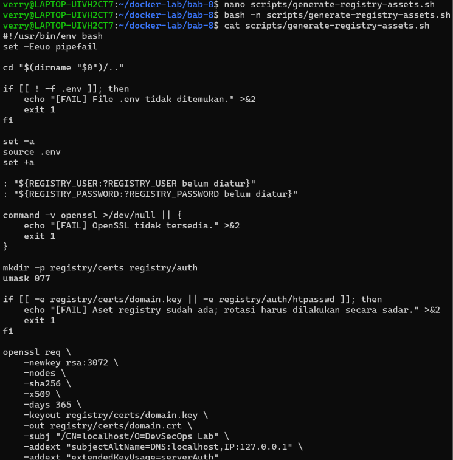

*Gambar 8.18 Pembuatan script otomasi sertifikat dan akun registry scripts/generate-registry-assets.sh.*

```bash
bash -n scripts/generate-registry-assets.sh
```

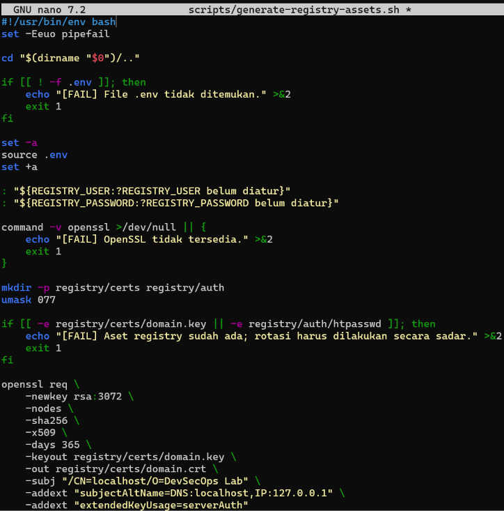

*Gambar 8.19 Validasi sintaks script generate-registry-assets.sh.*

#### Kotak Script 10 — File scripts/scan-image.sh

Dibuat script `scripts/scan-image.sh`, diberikan izin eksekusi melalui `chmod +x scripts/scan-image.sh`, dan divalidasi sintaksnya dengan `bash -n scripts/scan-image.sh`. Script ini menyimpan image `pens-web:1.0` ke dalam arsip `reports/pens-web-1.0.tar` menggunakan `docker image save`, lalu menjalankan container Trivy untuk menghasilkan laporan kerentanan dan secret berformat JSON (`reports/trivy-image.json`), dokumen SBOM berformat CycloneDX (`reports/pens-web-1.0.cdx.json`), hasil audit misconfiguration pada Dockerfile dan compose.yaml (`reports/trivy-config.txt`), serta pemindaian secret pada kode sumber (`reports/trivy-secret.txt`). Di bagian akhir, script menerapkan security gate yang memeriksa kerentanan berstatus HIGH dan CRITICAL yang sudah memiliki perbaikan (`--ignore-unfixed`), menuliskan status PASS atau BLOCKED ke `reports/gate-status.txt`, serta membuat daftar checksum SHA256SUMS.

```bash
chmod +x scripts/scan-image.sh
bash -n scripts/scan-image.sh
```

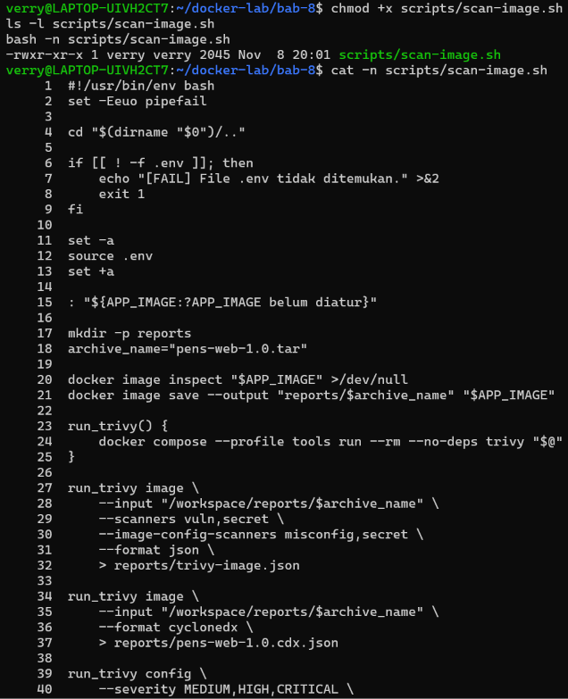

*Gambar 8.20 Pembuatan, pemberian izin eksekusi, dan validasi sintaks scripts/scan-image.sh.*

#### Kotak Script 11 — File scripts/push-registry.sh

Dibuat file `scripts/push-registry.sh`, diberikan hak eksekusi dengan `chmod +x scripts/push-registry.sh`, dan diperiksa sintaksnya melalui `bash -n scripts/push-registry.sh`. Script ini terlebih dahulu memeriksa isi berkas `reports/gate-status.txt` dan akan membatalkan proses distribusi apabila statusnya bukan PASS. Jika security gate telah lulus, script melakukan autentikasi `docker login` ke `localhost:5000` menggunakan `--password-stdin`, memberikan tag `localhost:5000/pens-web:1.0`, mengunggah image dengan `docker push`, menguji pengunduhan kembali dengan `docker pull`, serta memverifikasi isi katalog (`/v2/_catalog`), daftar tag (`/v2/pens-web/tags/list`), dan digest image sebelum menjalankan `docker logout`.

```bash
chmod +x scripts/push-registry.sh
bash -n scripts/push-registry.sh
```

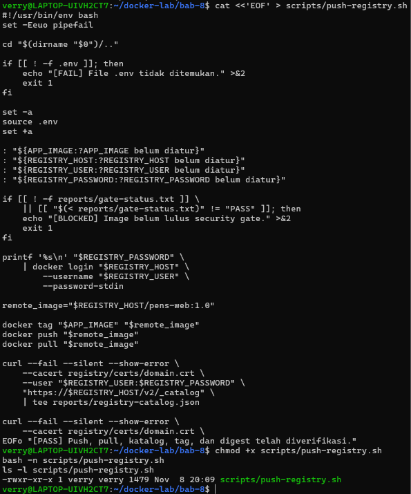

*Gambar 8.21 Pembuatan, pemberian izin eksekusi, dan validasi sintaks scripts/push-registry.sh.*

#### Kotak Script 12 — File scripts/verify-hardening.sh

Dibuat file `scripts/verify-hardening.sh`, diberikan izin eksekusi melalui `chmod +x scripts/verify-hardening.sh`, dan divalidasi sintaksnya dengan `bash -n scripts/verify-hardening.sh`. Script ini menjalankan sebelas pengujian otomatis dan pengujian negatif terhadap container aplikasi serta registry, meliputi pemeriksaan UID 10001, penolakan penulisan file ke root filesystem (`/unauthorized-write`), keberhasilan penulisan sementara ke tmpfs `/tmp`, pemeriksaan nilai CapEff sebesar `0000000000000000` dan NoNewPrivs sebesar `1` pada `/proc/1/status`, ketersediaan file secret read-only di `/run/secrets/app_secret` tanpa eksposur variabel lingkungan `APP_SECRET`, ketiadaan Docker socket di dalam container, keaktifan limit resource pada HostConfig, kesiapan endpoint `/health`, serta penolakan akses anonim ke registry dengan kode HTTP 401.

```bash
chmod +x scripts/verify-hardening.sh
bash -n scripts/verify-hardening.sh
```

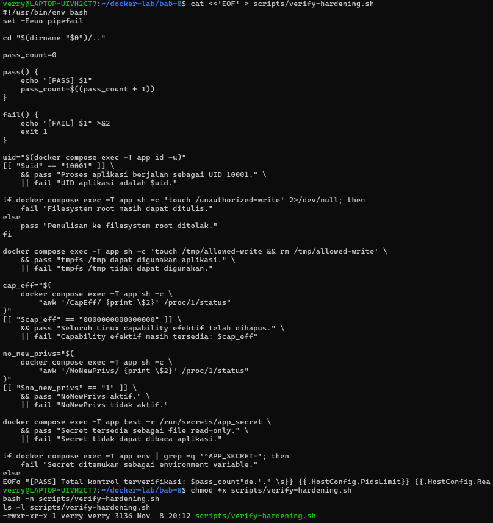

*Gambar 8.22 Pembuatan, pemberian izin eksekusi, dan validasi sintaks scripts/verify-hardening.sh.*

### 8.1.4 Validasi Statis, Pembuatan Sertifikat TLS, dan Konfigurasi Trust CA Docker Engine

#### Kotak Perintah B — Izin Eksekusi dan Validasi Statis

Dilakukan pemberian izin eksekusi secara menyeluruh dengan perintah `chmod +x scripts/*.sh`, diikuti pemeriksaan sintaks `bash -n` pada seluruh script di dalam folder scripts/, kompilasi statis kode Python menggunakan perintah `python3 -m py_compile app/app.py`, serta validasi konfigurasi Compose dengan `docker compose config --quiet`. Seluruh perintah validasi tersebut berhasil dijalankan tanpa pesan kesalahan, dan hasil pemeriksaan `ls -l scripts/*.sh` mengonfirmasi bahwa seluruh berkas script telah memiliki atribut izin eksekusi `-rwxr-xr-x`.

```bash
chmod +x scripts/*.sh
bash -n scripts/*.sh
python3 -m py_compile app/app.py
docker compose config --quiet
ls -l scripts/*.sh
```

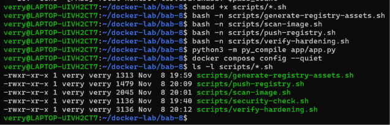

*Gambar 8.23 Pemberian hak eksekusi dan validasi statis seluruh berkas script dan kode sumber.*

#### Kotak Perintah C — Membuat Secret, Sertifikat, dan Akun Registry

Dilakukan eksekusi script `./scripts/generate-registry-assets.sh` untuk membangkitkan sertifikat TLS self-signed beserta akun autentikasi htpasswd untuk private registry. Pada percobaan awal ketika dilakukan pengujian pembuatan kunci RSA 3072-bit, proses dihentikan sementara dan kemudian dijalankan versi penuh menggunakan image `httpd:2.4-alpine` untuk memproses utilitas htpasswd dengan algoritma bcrypt secara non-interaktif. Keluaran terminal mengonfirmasi pengunduhan image `httpd:2.4-alpine` telah selesai dan menampilkan pesan `[PASS] Sertifikat dan htpasswd berhasil dibuat` serta informasi masa berlaku sertifikat selama 365 hari untuk localhost.

```bash
./scripts/generate-registry-assets.sh
```

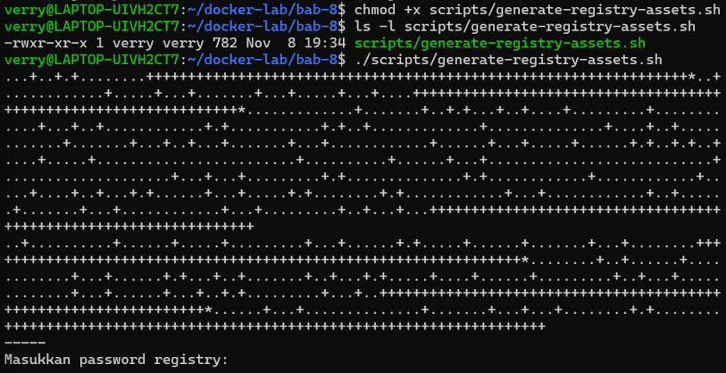

*Gambar 8.24 Eksekusi script generate-registry-assets.sh (tahap pembuatan kunci TLS).*

```bash
./scripts/generate-registry-assets.sh
```

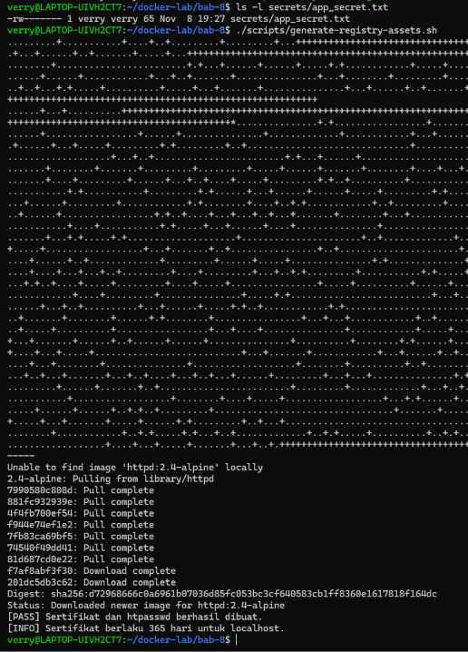

*Gambar 8.25 Penyelesaian pembuatan sertifikat self-signed dan akun autentikasi htpasswd private registry.*

#### Periksa Sertifikat

Dilakukan pemeriksaan metadata sertifikat TLS yang telah dibuat menggunakan perintah `openssl x509 -in registry/certs/domain.crt -noout -subject -issuer -dates -ext subjectAltName`. Hasil keluaran menunjukkan nilai subject dan issuer adalah `CN = localhost, O = DevSecOps Lab`, masa berlaku sertifikat dimulai dari Nov 8 13:39:14 2026 GMT hingga Nov 8 13:39:14 2027 GMT, serta ekstensi X509v3 Subject Alternative Name telah memuat `DNS:localhost` dan `IP Address:127.0.0.1` sesuai kebutuhan validasi TLS Docker.

```bash
openssl x509 -in registry/certs/domain.crt -noout -subject -issuer -dates -ext subjectAltName
```

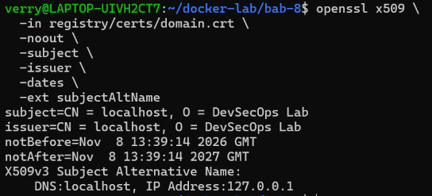

*Gambar 8.26 Pemeriksaan detail subjek, penerbit, masa aktif, dan SAN sertifikat TLS registry.*

#### Kotak Perintah D — Memercayai CA Registry pada Docker Engine

Dilakukan pendaftaran sertifikat CA registry ke dalam direktori kepercayaan Docker Engine menggunakan perintah `sudo mkdir -p /etc/docker/certs.d/localhost:5000`, dilanjutkan dengan menyalin sertifikat melalui `sudo cp registry/certs/domain.crt /etc/docker/certs.d/localhost:5000/ca.crt` dan mengatur izin baca melalui `sudo chmod 644 /etc/docker/certs.d/localhost:5000/ca.crt`. Pemeriksaan menggunakan `ls -l` menunjukkan berkas `ca.crt` berukuran 1594 byte telah tersimpan dengan izin `-rw-r--r--`, sedangkan perintah `ps -p 1 -o comm=` dan `systemctl is-active docker` memastikan sistem menggunakan init systemd dan layanan Docker sedang aktif.

```bash
sudo mkdir -p /etc/docker/certs.d/localhost:5000
sudo cp registry/certs/domain.crt /etc/docker/certs.d/localhost:5000/ca.crt
sudo chmod 644 /etc/docker/certs.d/localhost:5000/ca.crt
ls -l /etc/docker/certs.d/localhost:5000/ca.crt
ps -p 1 -o comm=
systemctl is-active docker
```

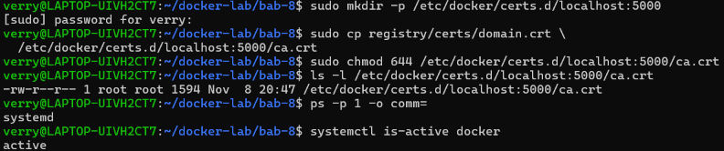

*Gambar 8.27 Penempatan sertifikat CA ke direktori trust Docker Engine dan verifikasi layanan.*

#### Restart Docker Engine

Setelah sertifikat CA ditempatkan pada direktori `/etc/docker/certs.d/localhost:5000`, dilakukan pemuatan ulang layanan daemon Docker menggunakan perintah `sudo systemctl restart docker`. Pemeriksaan kembali menggunakan perintah `systemctl is-active docker` menampilkan status `active` dan perintah `docker ps` berjalan normal tanpa pesan kesalahan, yang menandakan Docker Engine telah siap memercayai koneksi HTTPS menuju `localhost:5000`.

```bash
sudo systemctl restart docker
systemctl is-active docker
docker ps
```

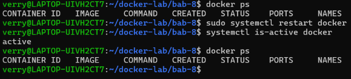

*Gambar 8.28 Restart layanan daemon Docker dan konfirmasi kesiapan runtime.*

### 8.1.5 Pelaksanaan Build, Pengujian Hardening, Pemindaian Trivy, Distribusi Registry, dan Verifikasi Secret

#### Kotak Perintah E — Build dan Menjalankan Runtime yang Diperkeras

Dilakukan pembangunan image aplikasi menggunakan perintah `docker compose build --pull app`, dilanjutkan dengan menjalankan layanan aplikasi dan registry melalui perintah `docker compose up -d app registry`. Keluaran proses build menunjukkan seluruh 15 langkah multi-stage Dockerfile selesai dalam 5,5 detik dan menghasilkan image `pens-web:1.0`, sedangkan perintah compose up berhasil mengunduh image `registry:3.1.1`, membuat jaringan internal `bab-8_app-net` serta `bab-8_registry-net`, membuat volume `bab-8_registry-data`, dan menjalankan container `bab-8-registry-1` serta `bab-8-app-1`.

Selanjutnya, pemeriksaan status layanan menggunakan perintah `docker compose ps` menunjukkan bahwa container `bab-8-app-1` telah berstatus `Up 5 minutes (healthy)` pada port `127.0.0.1:8088->8080/tcp` dan `bab-8-registry-1` berstatus `Up 5 minutes` pada port `127.0.0.1:5000->5000/tcp`. Pengujian akses ke endpoint aplikasi menggunakan perintah `curl --fail --silent --show-error http://127.0.0.1:8088/ | python3 -m json.tool` mengembalikan objek JSON dengan nilai `gid: 10001`, `secret_mounted: true`, `service: "pens-web"`, `status: "running"`, dan `uid: 10001`, yang membuktikan aplikasi berjalan sebagai pengguna non-root dan berhasil mengakses file secret.

```bash
docker compose build --pull app
```

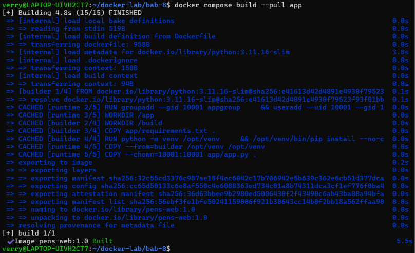

*Gambar 8.29 Proses build multi-stage image pens-web:1.0.*

```bash
docker compose up -d app registry
docker compose ps
```

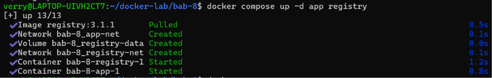

*Gambar 8.30 Menjalankan layanan aplikasi dan registry serta verifikasi status container.*

```bash
curl --fail --silent --show-error http://127.0.0.1:8088/ | python3 -m json.tool
```

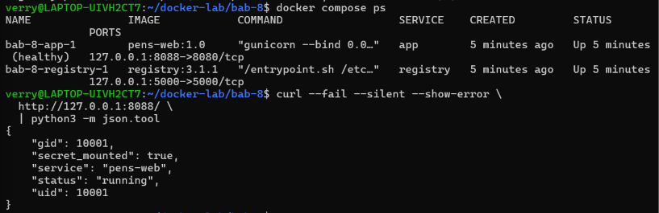

*Gambar 8.31 Respons JSON endpoint aplikasi menampilkan identitas non-root UID 10001 dan secret terpasang.*

#### Kotak Perintah F — Menjalankan Negative Test Hardening

Dilakukan pengujian ketahanan keamanan container dengan mengeksekusi script `./scripts/verify-hardening.sh`. Hasil keluaran terminal menunjukkan seluruh sebelas pemeriksaan berhasil lulus dengan status `[PASS]`, yaitu proses aplikasi berjalan sebagai UID 10001, percobaan penulisan ke filesystem root ditolak, direktori tmpfs `/tmp` dapat digunakan aplikasi, seluruh Linux capability efektif telah dihapus, fitur NoNewPrivs aktif, secret tersedia sebagai file read-only di `/run/secrets/app_secret`, secret tidak diekspos sebagai environment variable `APP_SECRET`, Docker socket tidak tersedia di container aplikasi, limit memory, CPU, PID, dan read-only rootfs aktif, health endpoint aplikasi merespons sukses, serta registry menolak akses anonim dengan HTTP 401 (Total kontrol terverifikasi: 11).

```bash
./scripts/verify-hardening.sh
```

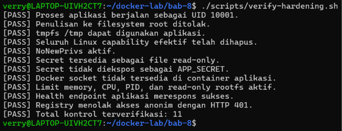

*Gambar 8.32 Hasil pengujian ketahanan keamanan (11 security controls) dan negative test container.*

#### Simpan Bukti Konfigurasi

Dilakukan penyimpanan bukti konfigurasi runtime container dan konfigurasi image ke dalam folder `reports` menggunakan perintah `docker inspect "$(docker compose ps -q app)" --format '{{json .HostConfig}}' > reports/app-hostconfig.json` dan `docker image inspect pens-web:1.0 --format '{{json .Config}}' > reports/app-image-config.json`. Pemeriksaan menggunakan `ls -lh` menunjukkan kedua berkas bukti tersebut telah berhasil dibuat dengan ukuran 1.8K untuk `app-hostconfig.json` dan 864 byte untuk `app-image-config.json`.

```bash
docker inspect "$(docker compose ps -q app)" --format '{{json .HostConfig}}' > reports/app-hostconfig.json
docker image inspect pens-web:1.0 --format '{{json .Config}}' > reports/app-image-config.json
ls -lh reports/app-hostconfig.json reports/app-image-config.json
```

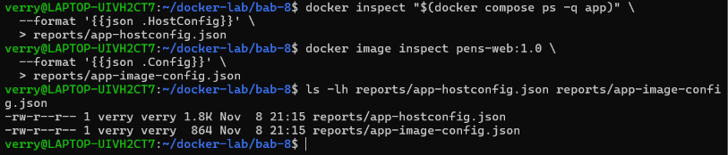

*Gambar 8.33 Penyimpanan konfigurasi runtime container HostConfig dan konfigurasi image ke folder reports.*

#### Kotak Perintah G — Trivy, SBOM, dan Security Gate

Dilakukan pemindaian menyeluruh terhadap arsip image, konfigurasi, dan kode sumber dengan menjalankan script `./scripts/scan-image.sh`. Keluaran log Trivy pada terminal menunjukkan proses pemindaian kerentanan (vuln), kesalahan konfigurasi (misconfig), dan deteksi rahasia (secret) terhadap sistem operasi Debian 13.7 (87 paket) serta paket Python di dalam image `pens-web:1.0`, pembuatan dokumen SBOM CycloneDX, hingga evaluasi security gate untuk kerentanan tingkat HIGH dan CRITICAL. Di akhir proses, terminal menampilkan pesan `[PASS] Security gate lulus` dan `[PASS] Laporan, SBOM, dan checksum berhasil dibuat`, yang menandakan image layak dipromosikan ke private registry.

```bash
./scripts/scan-image.sh
```

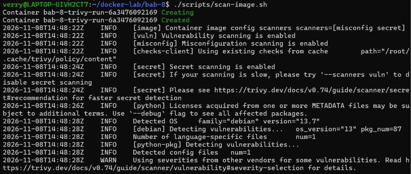

*Gambar 8.34 Pemindaian kerentanan, miskonfigurasi, dan secret pada image menggunakan Trivy.*

```bash
./scripts/scan-image.sh
```

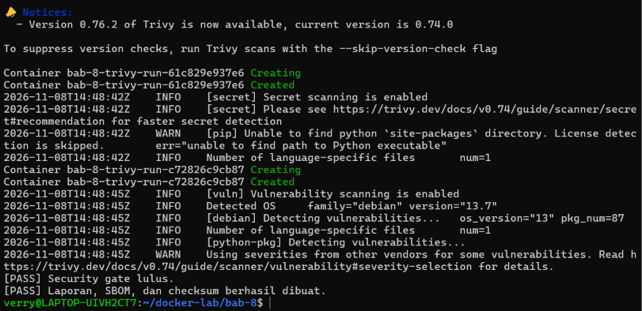

*Gambar 8.35 Evaluasi Security Gate Trivy dan pembuatan SBOM CycloneDX serta SHA256SUMS.*

#### Kotak Perintah H — Menguji dan Mengisi Private Registry

Dilakukan pengujian akses tanpa kredensial terlebih dahulu ke endpoint registry menggunakan perintah `curl --silent --output /dev/null --write-out 'HTTP %{http_code}\n' --cacert registry/certs/domain.crt https://localhost:5000/v2/` yang menghasilkan keluaran HTTP 401, membuktikan bahwa registry menolak permintaan anonim. Selanjutnya, dijalankan script `./scripts/push-registry.sh` yang berhasil melakukan `Login Succeeded` ke `localhost:5000`, mengunggah seluruh layer image `localhost:5000/pens-web:1.0`, menarik kembali image tersebut, memverifikasi isi katalog `{"repositories":["pens-web"]}`, daftar tag `{"name":"pens-web","tags":["1.0"]}`, serta nilai digest `sha256:7e5d5c91a69f22c66a209f80dbf8034911995435635a79af92fdff194475a1f4`, lalu menutup sesi dengan pesan `[PASS] Push, pull, katalog, tag, dan digest telah diverifikasi`.

```bash
curl --silent --output /dev/null --write-out 'HTTP %{http_code}\n' --cacert registry/certs/domain.crt https://localhost:5000/v2/
./scripts/push-registry.sh
```

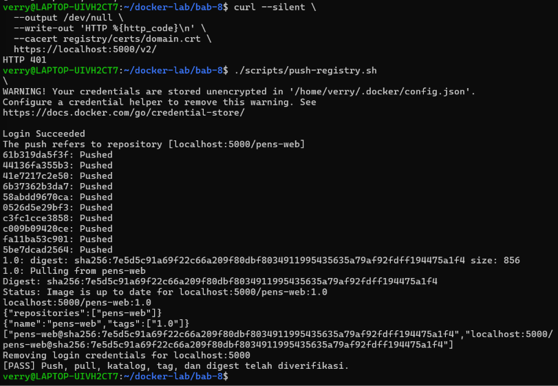

*Gambar 8.36 Pengujian penolakan akses anonim HTTP 401 dan pengunggahan serta verifikasi image pada private registry.*

#### Kotak Perintah I — Membuktikan Secret Tidak Masuk ke Image

Dilakukan pemeriksaan akhir untuk memastikan bahwa berkas secret tidak ikut tertanam di dalam layer maupun sistem berkas image `pens-web:1.0`. Perintah pertama yaitu `docker history --no-trunc pens-web:1.0 | tee reports/docker-history.txt` mencatat seluruh riwayat instruksi pembuatan layer image ke dalam berkas laporan. Perintah kedua yaitu `docker run --rm --entrypoint sh pens-web:1.0 -c 'test ! -e /run/secrets/app_secret && test ! -d /secrets'` memeriksa secara langsung bahwa baik file `/run/secrets/app_secret` maupun direktori `/secrets` tidak ditemukan di dalam image statis, dan kembalinya prompt terminal tanpa pesan kesalahan (exit code 0) membuktikan bahwa secret hanya disuntikkan secara aman pada saat runtime.

```bash
docker history --no-trunc pens-web:1.0 | tee reports/docker-history.txt
```

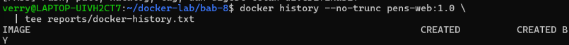

*Gambar 8.37 Pemeriksaan riwayat instruksi layer image pens-web:1.0 untuk membuktikan ketiadaan secret.*

```bash
docker run --rm --entrypoint sh pens-web:1.0 -c 'test ! -e /run/secrets/app_secret && test ! -d /secrets'
```

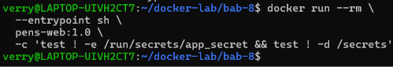

*Gambar 8.38 Verifikasi runtime assertion ketiadaan file dan direktori secret di dalam container.*
