<p align="center"></p>

# BAB IX: IAM, OIDC, PKCE, DAN RBAC DENGAN KEYCLOAK

**Mata Kuliah:** Workshop DevOps  
**Dosen Pengampu:** Dr. Ferry Astika Saputra, ST, M.Sc  
**Disusun Oleh (Kelompok 2):**
- Ibram Maulana Akhsanul Qasasi (NRP. 3126640014)
- Yusuf Rahmadhani Asy’ari (NRP. 3126640042)
- Vernanda Mulia Hamonangan Manurung (NRP. 3126640044)  
**Program Studi:** D4 Lanjut Jenjang Teknik Informatika  
**Institusi:** Politeknik Elektronika Negeri Surabaya (2026)

---

## 9.1 Tahap Praktikum

### 9.1.1 Persiapan Direktori dan Konfigurasi Dasar

#### Kotak Perintah A — Menyiapkan Direktori Bab 9

Dilakukan pembuatan seluruh struktur direktori kerja untuk praktikum Bab 9 menggunakan perintah `mkdir -p ~/docker-lab/bab-09/{app,realm,scripts,reports}`, kemudian dilanjutkan dengan berpindah ke direktori tersebut melalui perintah `cd ~/docker-lab/bab-09` dan memeriksa posisi direktori menggunakan perintah `pwd`. Hasil keluaran pada terminal menunjukkan jalur aktif telah berada di `/home/verry/docker-lab/bab-09` dengan empat subdirektori utama, yaitu `app` untuk kode aplikasi Flask, `realm` untuk berkas konfigurasi realm Keycloak, `scripts` untuk kumpulan skrip validasi serta pengujian, dan `reports` untuk penyimpanan bukti pengujian.

```bash
mkdir -p ~/docker-lab/bab-09/{app,realm,scripts,reports}
cd ~/docker-lab/bab-09
pwd
```

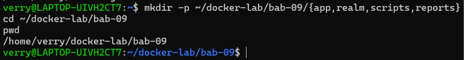

*Gambar 9.1 Pembuatan dan verifikasi struktur direktori kerja Bab 9.*

#### Kotak Script 1 — File .env.example

Dilakukan pembuatan file template `.env.example` menggunakan perintah `nano .env.example` untuk mendokumentasikan seluruh nama variabel lingkungan yang dibutuhkan oleh sistem tanpa menyertakan kredensial operasional. Berkas ini memuat konfigurasi database PostgreSQL (`POSTGRES_DB=keycloak`, `POSTGRES_USER=keycloak`, `POSTGRES_PASSWORD`), akun administrator awal Keycloak (`KC_BOOTSTRAP_ADMIN_USERNAME=kcadmin` dan `KC_BOOTSTRAP_ADMIN_PASSWORD`), identitas dan rahasia client Flask (`FLASK_CLIENT_ID=flask-app`, `FLASK_CLIENT_SECRET`, `FLASK_SESSION_SECRET`), serta kata sandi pengguna uji (`MAHASISWA_PASSWORD` dan `ADMINLAB_PASSWORD`) yang seluruhnya diisi placeholder `GANTI_DENGAN_NILAI_ACAK`. Pemeriksaan dengan `ls -l .env.example` mengonfirmasi berkas berukuran 377 byte telah tersimpan.

```bash
nano .env.example
```

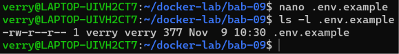

*Gambar 9.2 Pembuatan file template konfigurasi .env.example menggunakan editor nano.*

```bash
ls -l .env.example
cat .env.example
```

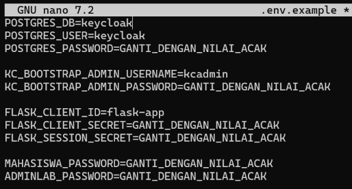

*Gambar 9.3 Pemeriksaan ukuran dan isi template variabel lingkungan .env.example.*

#### Kotak Script 2 — File .gitignore

Diperlihatkan pembuatan file `.gitignore` menggunakan perintah `nano .gitignore` yang dilanjutkan dengan pembuatan berkas penanda `touch reports/.gitkeep` serta pemeriksaan melalui perintah `ls -la .gitignore reports/`. Aturan di dalam `.gitignore` mengecualikan berkas `.env`, seluruh isi direktori `reports/*` dengan pengecualian `!reports/.gitkeep`, direktori cache Python `__pycache__/`, berkas kompilasi `*.py[cod]`, serta `.pytest_cache/`. Pengaturan ini mencegah kebocoran rahasia lingkungan maupun laporan hasil pengujian ke dalam repositori Git sembari tetap mempertahankan struktur direktori `reports`.

```bash
nano .gitignore
```

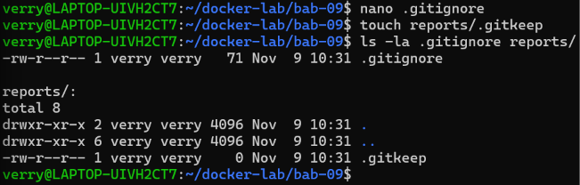

*Gambar 9.4 Pembuatan berkas pengabaian Git .gitignore menggunakan editor nano.*

```bash
touch reports/.gitkeep
ls -la .gitignore reports/
cat .gitignore
```

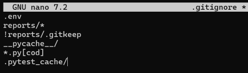

*Gambar 9.5 Pembuatan .gitkeep, verifikasi keberadaan file, dan isi aturan .gitignore.*

#### Kotak Script 3 — File .dockerignore

Diperlihatkan pembuatan dan pemeriksaan isi file `.dockerignore` menggunakan perintah `nano .dockerignore` dan `cat .dockerignore`. Berkas ini mengecualikan `.env`, `.git`, `.gitignore`, `reports`, `realm`, `scripts`, `__pycache__`, `*.pyc`, serta `*.pyo` agar tidak ikut dikirimkan ke dalam build context saat pembangunan image aplikasi Flask, sehingga ukuran context tetap kecil dan berkas konfigurasi sensitif tidak berisiko masuk ke dalam layer image.

```bash
nano .dockerignore
```

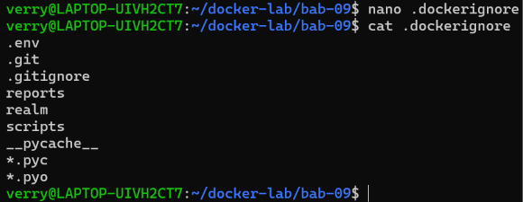

*Gambar 9.6 Pembuatan aturan pembatasan build context pada .dockerignore menggunakan editor nano.*

```bash
cat .dockerignore
```

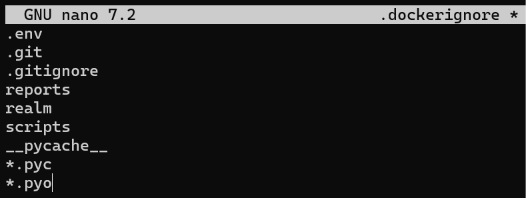

*Gambar 9.7 Verifikasi isi aturan .dockerignore untuk mengamankan proses build Docker.*

### 9.1.2 Pembuatan Konfigurasi Realm Keycloak, Aplikasi Flask, Dockerfile, dan Compose

#### Kotak Script 4 — File realm/devsecops-lab-realm.json

Dibuat file `realm/devsecops-lab-realm.json` menggunakan editor nano dan ditampilkan isinya melalui perintah `cat realm/devsecops-lab-realm.json` untuk mendefinisikan konfigurasi realm `devsecops-lab` sebagai kode. Konfigurasi ini mengaktifkan perlindungan `bruteForceProtected: true`, menonaktifkan pendaftaran mandiri (`registrationAllowed: false`), mengatur masa berlaku access token selama 300 detik, serta mendefinisikan dua realm role yaitu `viewer` dan `admin`. Selain itu, dikonfigurasi confidential client (`${FLASK_CLIENT_ID}`) dengan protokol `openid-connect` yang hanya mengizinkan Authorization Code Flow (`standardFlowEnabled: true`), mewajibkan metode PKCE S256 (`pkce.code.challenge.method: S256`), menolak implicit flow maupun direct access grant, mengunci `redirectUris` secara eksak ke `http://localhost:5000/callback`, memetakan scope `roles`, serta menyiapkan dua akun pengguna yaitu `mahasiswa1` (role `viewer`) dan `adminlab` (role `viewer` dan `admin`).

```bash
nano realm/devsecops-lab-realm.json
```

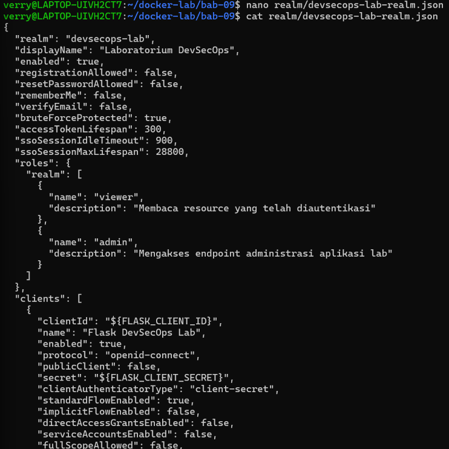

*Gambar 9.8 Konfigurasi deklaratif realm devsecops-lab pada realm/devsecops-lab-realm.json.*

```bash
cat realm/devsecops-lab-realm.json
```

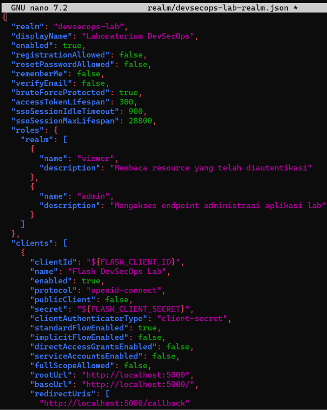

*Gambar 9.9 Verifikasi isi konfigurasi realm Keycloak sebagai kode.*

#### Kotak Script 5 — File app/requirements.txt

Dilakukan pembuatan file `app/requirements.txt` menggunakan editor nano dan diperiksa isinya dengan perintah `cat app/requirements.txt` untuk menetapkan daftar dependensi Python yang dipin versinya. Ketiga paket yang digunakan adalah `Flask==3.1.3` sebagai kerangka kerja web, `Authlib==1.7.2` sebagai pustaka klien OpenID Connect dan OAuth 2.0 untuk menangani alur PKCE serta validasi token, dan `gunicorn==26.1.0` sebagai server aplikasi WSGI.

```bash
nano app/requirements.txt
```

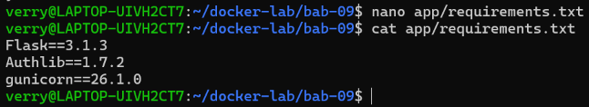

*Gambar 9.10 Penulisan pustaka dependensi pada app/requirements.txt.*

```bash
cat app/requirements.txt
```

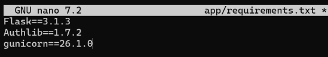

*Gambar 9.11 Verifikasi daftar pustaka terkunci Flask, Authlib, dan gunicorn.*

#### Kotak Script 6 — File app/app.py

Dibuat kode aplikasi relying party pada file `app/app.py` yang kemudian diperiksa jumlah barisnya menggunakan `wc -l app/app.py` (170 baris) dan divalidasi sintaksnya melalui perintah `python3 -m py_compile app/app.py`. Aplikasi ini mengonfigurasi cookie sesi dengan atribut `SESSION_COOKIE_HTTPONLY=True` dan `SESSION_COOKIE_SAMESITE="Lax"`, serta mendaftarkan klien OAuth ke server metadata OIDC Keycloak dengan scope `"openid profile email roles"` dan metode PKCE `"S256"`. Fungsi dekorator `require_role` memeriksa apakah pengguna telah login dan memiliki role yang disyaratkan pada sesi; jika belum login maka diarahkan ke `/login` (HTTP 302), sedangkan jika role tidak sesuai maka ditolak dengan respons JSON forbidden dan kode HTTP 403. Saat callback berhasil, aplikasi hanya menyimpan klaim minimum yang telah disanitasi (`sub`, `preferred_username`, `email`, dan `roles`) ke dalam sesi tanpa menyimpan atau menampilkan token mentah.

```bash
nano app/app.py
```

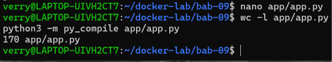

*Gambar 9.12 Penulisan kode relying party Flask dengan dukungan OIDC dan PKCE pada app/app.py.*

```bash
wc -l app/app.py
python3 -m py_compile app/app.py
```

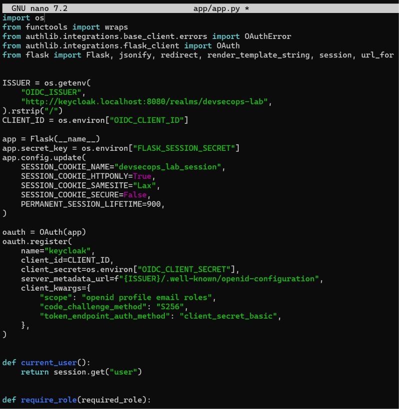

*Gambar 9.13 Pemeriksaan jumlah baris (170 baris) dan kompilasi statis app/app.py.*

#### Kotak Script 7 — File app/Dockerfile

Dibuat file `app/Dockerfile` dengan metode multi-stage build berbasis `python:3.11.16-slim` untuk memisahkan proses instalasi pustaka pada tahap builder dari image runtime akhir. Pada tahap builder, seluruh paket dari `requirements.txt` dipasang ke dalam virtual environment `/opt/venv`. Pada tahap runtime, dibuat grup dan pengguna non-root `appuser` dengan UID dan GID 10001 tanpa direktori home dan dengan shell `/usr/sbin/nologin`, lalu direktori `/opt/venv` serta berkas `app.py` disalin dengan kepemilikan 10001:10001. Container dijalankan sebagai `USER 10001:10001` pada port 5000 dengan pemeriksaan kesehatan otomatis ke endpoint `http://127.0.0.1:5000/healthz` dan perintah utama gunicorn.

```bash
nano app/Dockerfile
```

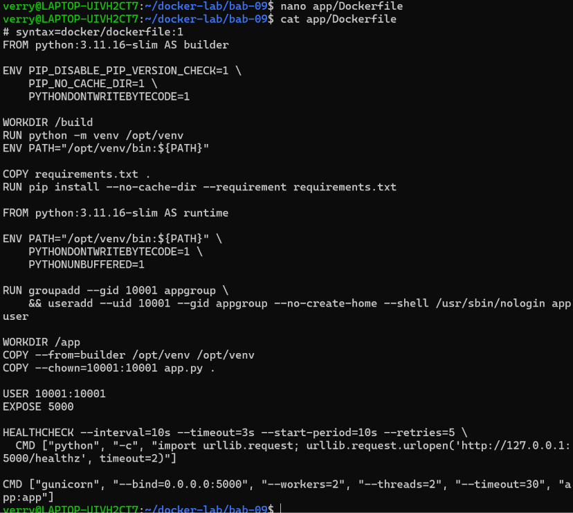

*Gambar 9.14 Penulisan instruksi multi-stage build dan pengerasan non-root pada app/Dockerfile.*

```bash
cat app/Dockerfile
```

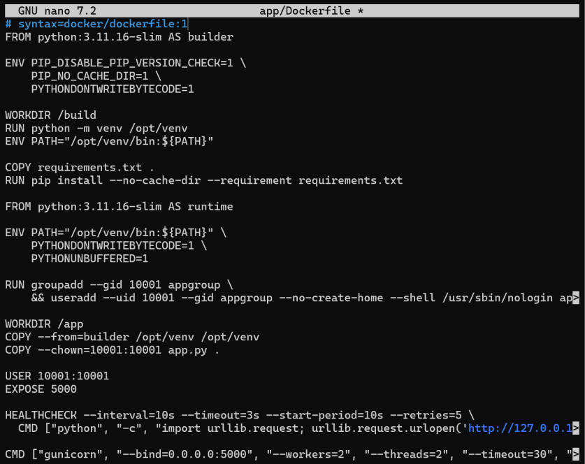

*Gambar 9.15 Verifikasi konfigurasi builder dan runtime non-root UID 10001 pada app/Dockerfile.*

#### Kotak Script 8 — File compose.yaml

Dibuat berkas orkestrasi `compose.yaml` dengan nama proyek `devsecops-bab09` yang mendefinisikan layanan database PostgreSQL (`postgres:17.11-alpine3.24`), layanan identity provider Keycloak (`quay.io/keycloak/keycloak:26.7.2`), serta layanan aplikasi Flask (`devsecops-bab09-flask:1.0`) di dalam jaringan internal `iam-net`. Layanan db menyimpan state secara persisten pada volume `keycloak-db-data` tanpa memublikasikan port 5432 ke host, dilengkapi healthcheck `pg_isready`, `no-new-privileges:true`, `cap_drop: ALL` dengan penambahan capability minimum PostgreSQL, `pids_limit: 200`, dan `mem_limit: 512m`.

Layanan keycloak dijalankan dengan perintah `start-dev --import-realm` untuk mengimpor berkas `realm/devsecops-lab-realm.json` secara otomatis setelah layanan db berstatus sehat, menggunakan hostname `http://keycloak.localhost:8080`, serta mengaktifkan fitur health dan metrics. Sementara itu, layanan app dikonfigurasi dengan pengendalian hardening penuh berupa `read_only: true`, direktori sementara tmpfs pada `/tmp`, security_opt `no-new-privileges:true`, `cap_drop: ALL`, `pids_limit: 100`, dan `mem_limit: 256m`, dengan akses antarmuka aplikasi dan Keycloak yang diikat hanya ke alamat loopback `127.0.0.1`.

```bash
nano compose.yaml
```

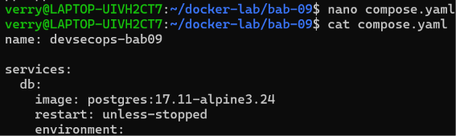

*Gambar 9.16 Penulisan konfigurasi orkestrasi compose.yaml menggunakan editor nano.*

```bash
cat compose.yaml
```

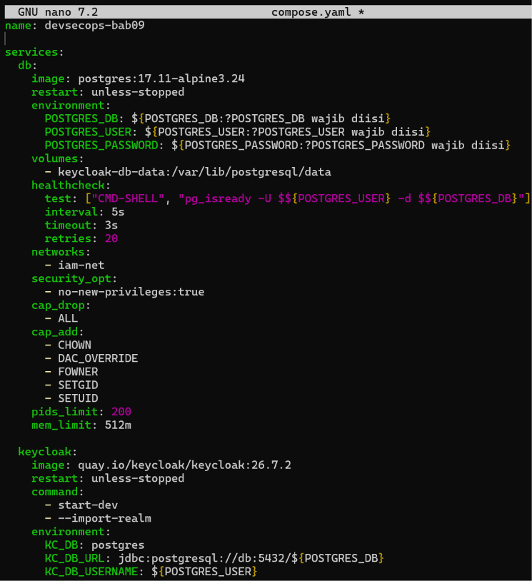

*Gambar 9.17 Verifikasi orkestrasi layanan PostgreSQL, Keycloak, dan Flask pada compose.yaml.*

### 9.1.3 Pembuatan Script Generator Environment, Validasi, Pengujian Negatif, dan Pengumpulan Bukti

#### Kotak Script 9 — File scripts/generate-env.sh

Dibuat file `scripts/generate-env.sh` menggunakan editor nano dan ditampilkan isinya dengan perintah `cat scripts/generate-env.sh`. Script ini menerapkan umask 077, menolak menimpa berkas `.env` apabila sudah ada sebelumnya, dan menggunakan fungsi `openssl rand -hex 24` untuk membangkitkan nilai acak kriptografis sepanjang 48 karakter heksadesimal bagi seluruh variabel password serta secret (`POSTGRES_PASSWORD`, `KC_BOOTSTRAP_ADMIN_PASSWORD`, `FLASK_CLIENT_SECRET`, `FLASK_SESSION_SECRET`, `MAHASISWA_PASSWORD`, dan `ADMINLAB_PASSWORD`), kemudian mengunci izin berkas `.env` dengan `chmod 600`.

```bash
nano scripts/generate-env.sh
```

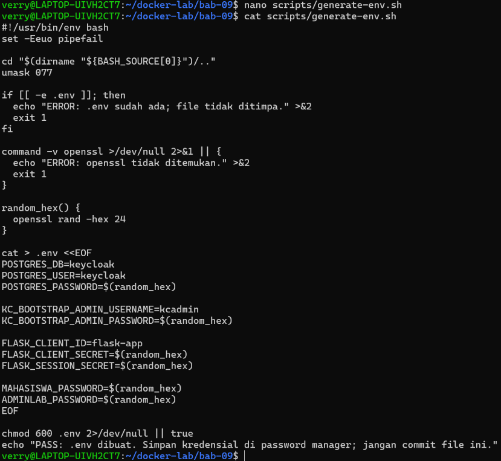

*Gambar 9.18 Pembuatan skrip generator environment otomatis scripts/generate-env.sh.*

```bash
cat scripts/generate-env.sh
```

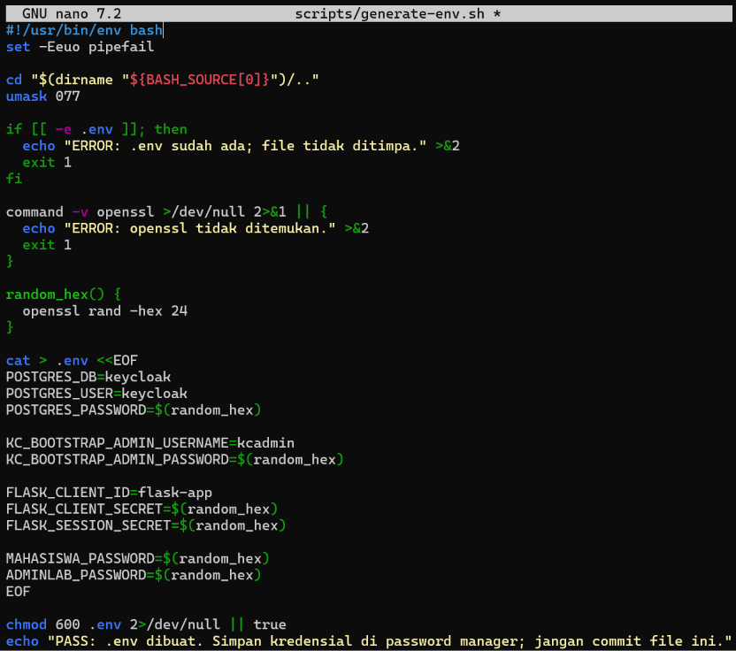

*Gambar 9.19 Verifikasi logika pembangkitan password acak kriptografis dan izin chmod 600.*

#### Kotak Script 10 — File scripts/validate-lab.sh

Dibuat file `scripts/validate-lab.sh` untuk menjalankan pemeriksaan kebijakan keamanan secara statis sebelum container dibangun. Script ini mengeksekusi blok kode Python untuk memverifikasi isi `realm/devsecops-lab-realm.json` menggunakan pernyataan assert, memastikan nama realm adalah `devsecops-lab`, fitur `bruteForceProtected` aktif, client bersifat confidential (`publicClient: false`), hanya `standardFlowEnabled` yang aktif, `redirectUris` tepat mengarah ke `http://localhost:5000/callback` tanpa karakter wildcard, metode PKCE disetel ke `S256`, serta pemetaan role pengguna `mahasiswa1` dan `adminlab` telah sesuai. Selanjutnya, script mengompilasi `app/app.py`, memeriksa keberadaan instruksi `USER 10001:10001` di Dockerfile serta `read_only: true` dan `cap_drop` di compose.yaml, lalu memvalidasi sintaks Docker Compose.

```bash
nano scripts/validate-lab.sh
```

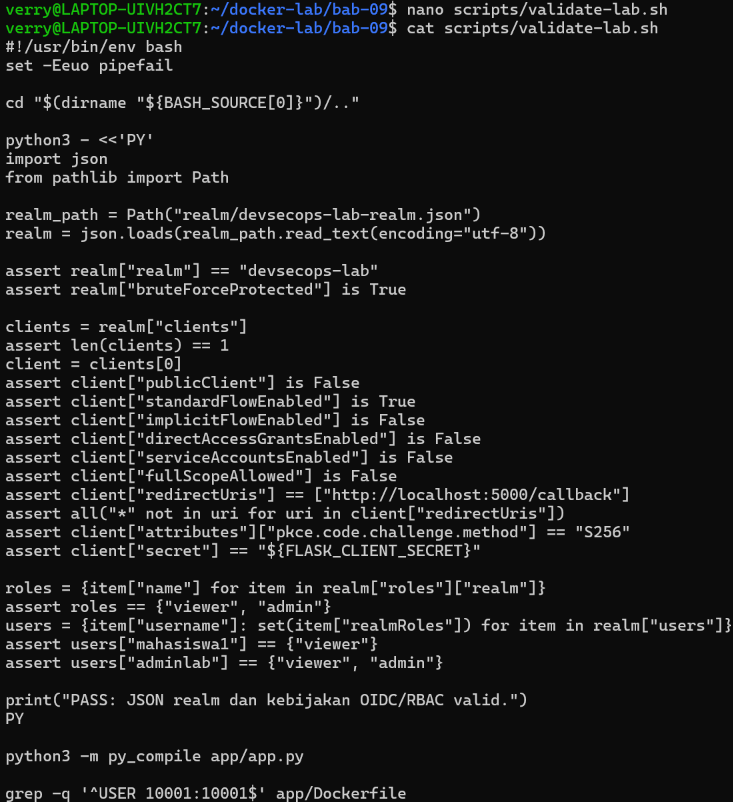

*Gambar 9.20 Pembuatan skrip validasi statis kebijakan OIDC dan RBAC scripts/validate-lab.sh.*

```bash
cat scripts/validate-lab.sh
```

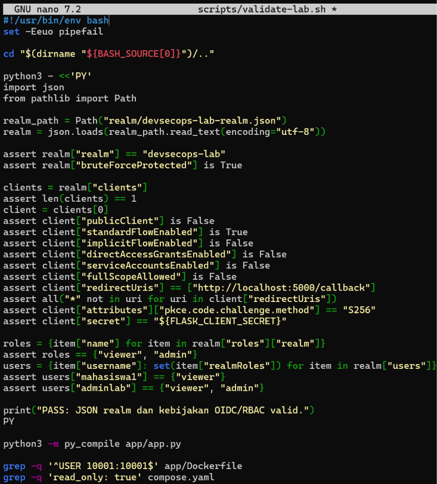

*Gambar 9.21 Verifikasi logika pemeriksaan statis pada scripts/validate-lab.sh.*

#### Kotak Script 11 — File scripts/negative-tests.sh

Dibuat file `scripts/negative-tests.sh` untuk menguji penolakan otomatis terhadap lima skenario penyalahgunaan autentikasi dan otorisasi. Script ini menggunakan fungsi expect_status dan curl untuk memastikan bahwa akses ke endpoint `/viewer` maupun `/admin` tanpa sesi aktif dialihkan ke halaman login dengan kode HTTP 302, permintaan otorisasi OIDC dengan `redirect_uri` tidak terdaftar (`http://attacker.invalid/callback`) ditolak oleh Keycloak dengan HTTP 400, permintaan Authorization Code tanpa parameter PKCE ditolak, serta percobaan login langsung menggunakan Resource Owner Password Credentials (Direct Access Grant) ditolak dengan HTTP 400 atau 401.

```bash
nano scripts/negative-tests.sh
```

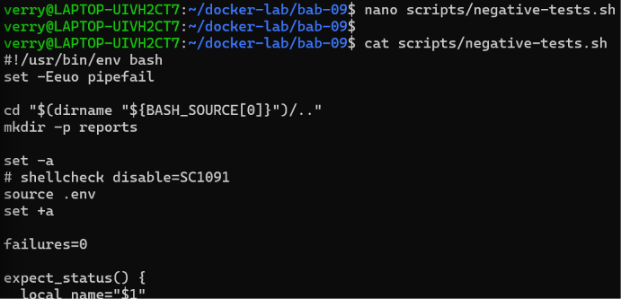

*Gambar 9.22 Pembuatan skrip pengujian negatif otomatis scripts/negative-tests.sh.*

```bash
cat scripts/negative-tests.sh
```

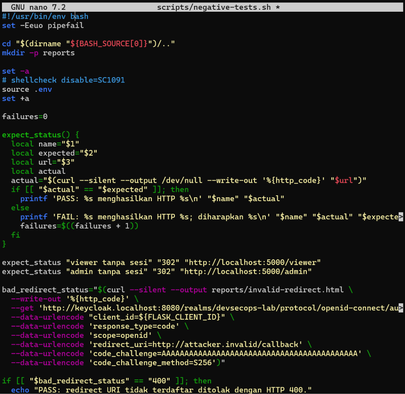

*Gambar 9.23 Verifikasi implementasi 5 skenario negative testing pada scripts/negative-tests.sh.*

#### Kotak Script 12 — File scripts/collect-evidence.sh

Dibuat file `scripts/collect-evidence.sh` untuk mengumpulkan seluruh bukti teknis pelaksanaan praktikum ke dalam direktori `reports/` tanpa membocorkan kredensial maupun token. Script ini menyimpan status container (`compose-ps.txt`), daftar image (`compose-images.txt`), konfigurasi Compose tanpa interpolasi nilai rahasia (`compose-no-interpolate.yaml`), potongan log layanan (`service-logs.txt`), respons kesiapan Keycloak (`keycloak-readiness.json`), dokumen discovery OIDC (`openid-configuration.json`), status kesehatan aplikasi (`app-health.json`), serta nilai hash SHA-256 dari berkas sumber (`source-sha256.txt`). Di akhir eksekusi, script memindai folder reports menggunakan grep untuk memastikan nilai `FLASK_CLIENT_SECRET` tidak ikut tercatat di dalam berkas bukti.

```bash
nano scripts/collect-evidence.sh
```

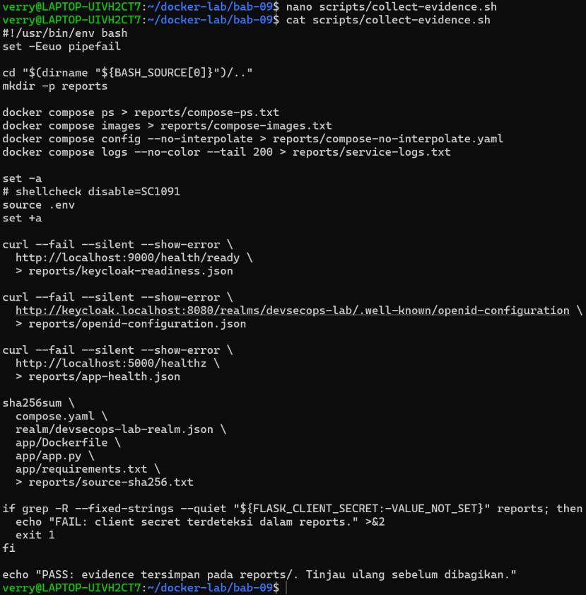

*Gambar 9.24 Pembuatan skrip pengumpul artefak bukti teknis scripts/collect-evidence.sh.*

```bash
cat scripts/collect-evidence.sh
```

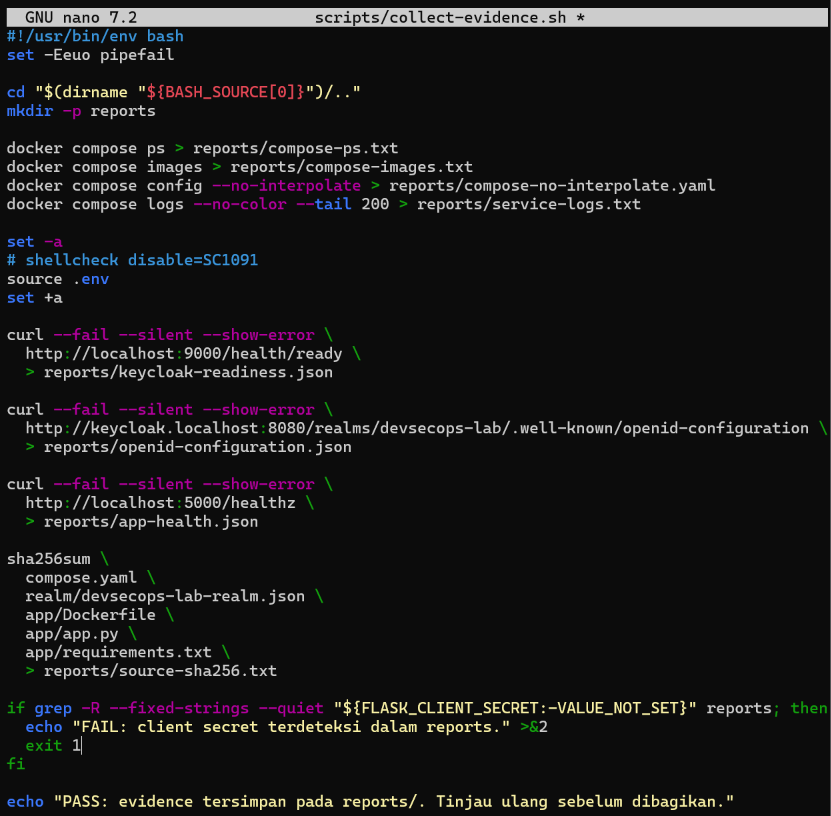

*Gambar 9.25 Verifikasi logika sanitasi dan pengumpulan evidence pada scripts/collect-evidence.sh.*

### 9.1.4 Eksekusi Pembuatan Environment, Validasi Statis, dan Penyalaan Laboratorium

#### Kotak Perintah B — Memberikan Izin Eksekusi dan Membuat .env

Dilakukan pemberian izin eksekusi pada seluruh skrip menggunakan perintah `chmod +x scripts/*.sh`, dilanjutkan dengan pemanggilan `./scripts/generate-env.sh` yang menghasilkan keluaran `PASS: .env dibuat`. Pemeriksaan menggunakan perintah `ls -l .env` membuktikan bahwa berkas berukuran 527 byte tersebut memiliki izin akses ketat `-rw-------` (600). Selanjutnya, dijalankan perintah `sed -n 's/^\([^=]*\)=.*/\1=<REDACTED>/p' .env` untuk menampilkan daftar kesembilan nama variabel lingkungan di dalam `.env` dengan menyensor seluruh nilainya menjadi `<REDACTED>` sehingga kredensial tetap terlindungi di dalam bukti laporan.

```bash
chmod +x scripts/*.sh
./scripts/generate-env.sh
ls -l .env
sed -n 's/^\([^=]*\)=.*/\1=<REDACTED>/p' .env
```

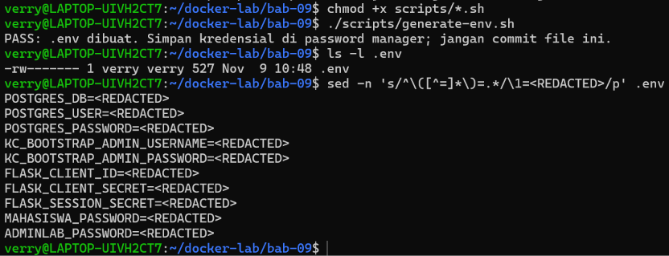

*Gambar 9.26 Pemberian izin eksekusi skrip, pembuatan .env, dan verifikasi variabel tersensor.*

#### Kotak Perintah C — Validasi Statis

Dilakukan pengujian konfigurasi statis dengan menjalankan script `./scripts/validate-lab.sh` yang menghasilkan pesan `PASS: JSON realm dan kebijakan OIDC/RBAC valid` serta `PASS: validasi statis selesai`. Pemeriksaan dilanjutkan dengan perintah `docker compose config --services` yang menampilkan daftar layanan pada stack (`db`, `keycloak`, dan `app`), serta perintah `docker compose config --images` yang mengonfirmasi ketiga image yang digunakan yaitu `quay.io/keycloak/keycloak:26.7.2`, `devsecops-bab09-flask:1.0`, dan `postgres:17.11-alpine3.24`.

```bash
./scripts/validate-lab.sh
docker compose config --services
docker compose config --images
```

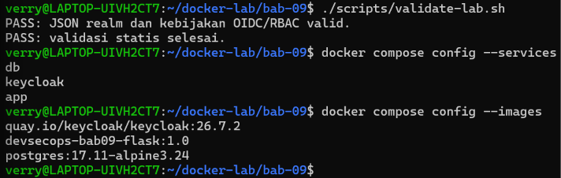

*Gambar 9.27 Validasi statis kebijakan realm OIDC/RBAC dan verifikasi konfigurasi layanan Docker Compose.*

#### Kotak Perintah D — Build dan Menjalankan Laboratorium

Dilakukan pengunduhan image eksternal menggunakan perintah `docker compose pull`. Pada saat perintah tersebut dijalankan, image `postgres:17.11-alpine3.24` dan `quay.io/keycloak/keycloak:26.7.2` berhasil diunduh (Pulled), sedangkan untuk `devsecops-bab09-flask` muncul pemberitahuan bahwa image tersebut harus dibangun dari kode sumber lokal. Selanjutnya, dijalankan perintah `docker compose build --pull app` yang mengeksekusi seluruh 18 langkah multi-stage Dockerfile hingga menghasilkan `Image devsecops-bab09-flask:1.0 Built` dalam waktu 27,4 detik.

Setelah image aplikasi selesai dibangun, seluruh layanan dijalankan di latar belakang menggunakan perintah `docker compose up -d` dan diperiksa statusnya melalui `docker compose ps` yang menunjukkan container aplikasi, database, Keycloak, dan reverse proxy lokal telah berjalan aktif dengan pemetaan port ke antarmuka loopback `127.0.0.1`. Pengujian kesehatan aplikasi dengan perintah `curl --fail http://localhost:5000/healthz` mengembalikan respons `{"status":"UP"}`, sedangkan pemeriksaan ke endpoint `http://keycloak.localhost:8080/realms/devsecops-lab/.well-known/openid-configuration | python3 -m json.tool | sed -n '1,30p'` berhasil menampilkan metadata discovery OpenID Connect untuk issuer `http://keycloak.localhost:8080/realms/devsecops-lab`.

```bash
docker compose pull
```

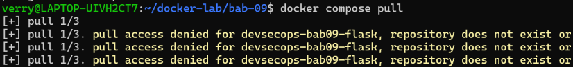

*Gambar 9.28 Pengunduhan image dependensi eksternal (PostgreSQL dan Keycloak).*

```bash
docker compose build --pull app
```

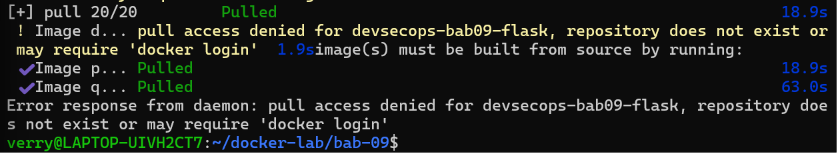

*Gambar 9.29 Proses build multi-stage Dockerfile aplikasi Flask (tahap builder).*

```bash
docker compose build --pull app
```

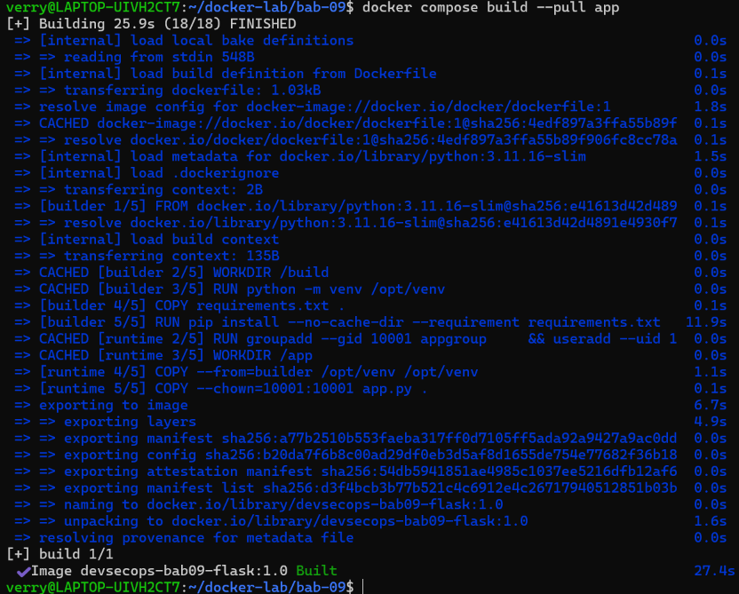

*Gambar 9.30 Penyelesaian build image devsecops-bab09-flask:1.0.*

```bash
docker compose up -d
```

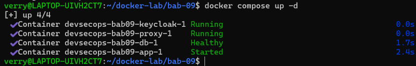

*Gambar 9.31 Menjalankan seluruh layanan laboratorium di latar belakang.*

```bash
docker compose ps
```

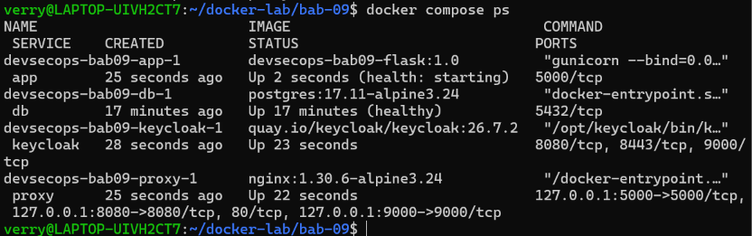

*Gambar 9.32 Pemeriksaan status aktif seluruh container pada stack devsecops-bab09.*

```bash
curl --fail http://localhost:5000/healthz
curl -s http://keycloak.localhost:8080/realms/devsecops-lab/.well-known/openid-configuration | python3 -m json.tool | sed -n '1,30p'
```

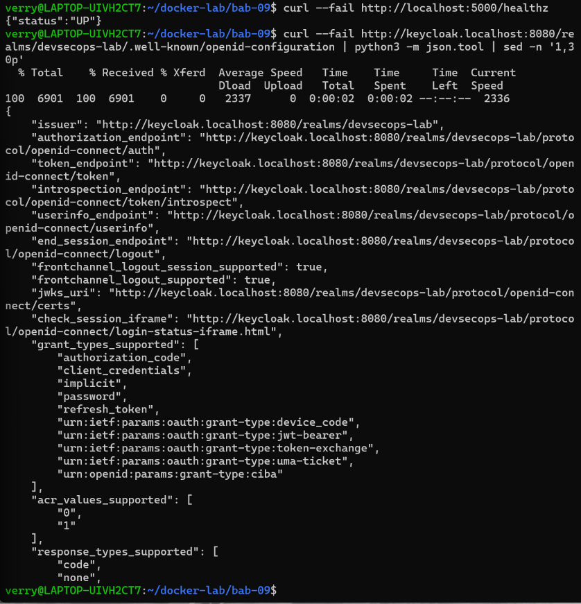

*Gambar 9.33 Pengujian health endpoint aplikasi dan verifikasi OIDC discovery metadata Keycloak.*

### 9.1.5 Pengujian Login OIDC, Otorisasi RBAC, Negative Test, Hardening, dan Pengumpulan Bukti

#### Kotak Perintah E — Menguji Login dan RBAC

Dilakukan pengujian alur autentikasi OpenID Connect dan pengendalian akses berbasis peran (RBAC) melalui peramban web pada alamat `http://localhost:5000`. Pada tampilan awal sebelum login, halaman Laboratorium IAM dan RBAC menampilkan keterangan bahwa belum terdapat sesi lokal. Ketika tautan Login dipilih, peramban diarahkan ke halaman autentikasi Keycloak (LABORATORIUM DEVSECOPS) dan dilakukan login pertama menggunakan akun mahasiswa1. Setelah berhasil login dan diarahkan kembali ke halaman utama aplikasi, bagian Identitas tervalidasi menampilkan klaim pengguna mahasiswa1 yang hanya memiliki role "viewer". Saat mengakses endpoint `http://localhost:5000/viewer`, sistem mengizinkan akses dengan respons JSON `{"message":"Role viewer diterima.","result":"PASS","user":"mahasiswa1"}` (HTTP 200), namun saat mengakses `http://localhost:5000/admin`, sistem menolak akses dengan respons `{"error":"forbidden","required_role":"admin"}` (HTTP 403).

Selanjutnya, dilakukan Logout SSO untuk mengakhiri sesi pada aplikasi sekaligus sesi Single Sign-On pada Keycloak, kemudian dilakukan login kembali menggunakan akun kedua yaitu adminlab. Halaman utama aplikasi menampilkan identitas tervalidasi untuk adminlab dengan daftar roles yang mencakup "admin" dan "viewer". Ketika akun adminlab mengakses endpoint `http://localhost:5000/viewer` maupun `http://localhost:5000/admin`, kedua endpoint tersebut berhasil diakses dan masing-masing mengembalikan respons JSON berstatus `"result":"PASS"` untuk pengguna `"adminlab"`. Pengujian ini membuktikan pemisahan yang tegas antara keberhasilan autentikasi dan keberhasilan otorisasi berdasarkan role.

```bash
# Mengakses antarmuka web Laboratorium IAM dan RBAC pada http://localhost:5000
```

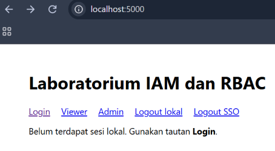

*Gambar 9.34 Tampilan awal aplikasi Flask sebelum autentikasi (belum ada sesi lokal).*

```bash
# Pengalihan ke halaman autentikasi Keycloak devsecops-lab realm
```

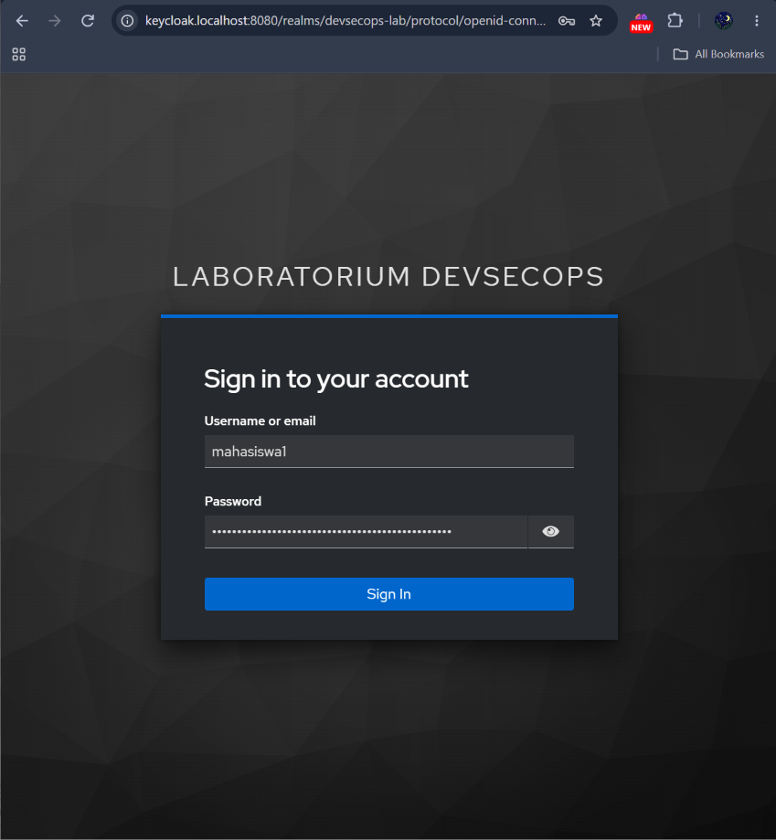

*Gambar 9.35 Formulir login Keycloak untuk autentikasi pengguna mahasiswa1.*

```bash
# Verifikasi klaim sesi pengguna mahasiswa1 pada antarmuka aplikasi
```

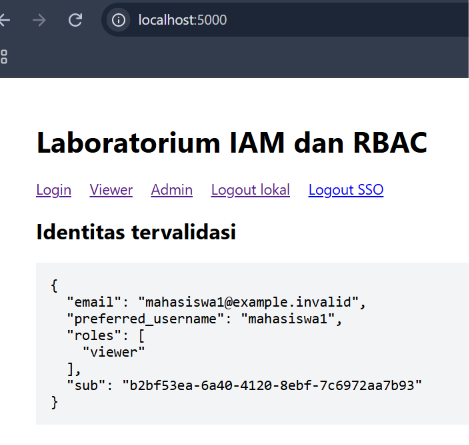

*Gambar 9.36 Identitas tervalidasi pengguna mahasiswa1 dengan role viewer.*

```bash
curl -b cookies.txt http://localhost:5000/viewer
```

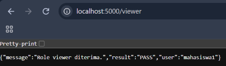

*Gambar 9.37 Akses endpoint /viewer berhasil dengan respons HTTP 200 untuk mahasiswa1.*

```bash
curl -b cookies.txt http://localhost:5000/admin
```

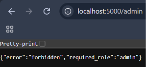

*Gambar 9.38 Akses endpoint /admin ditolak dengan HTTP 403 Forbidden untuk mahasiswa1.*

```bash
# Logout SSO dan pengalihan kembali ke formulir login Keycloak untuk akun adminlab
```

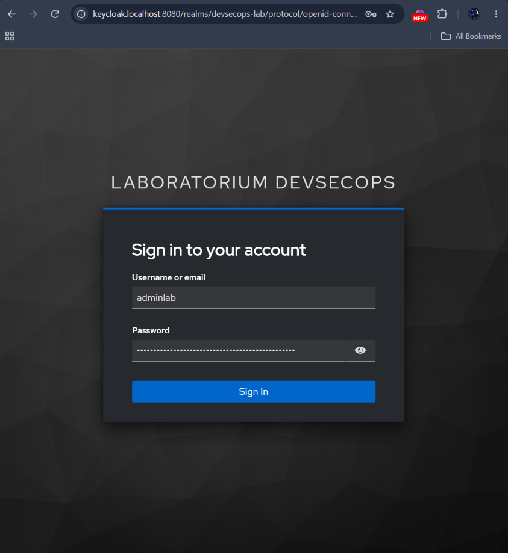

*Gambar 9.39 Formulir login Keycloak untuk autentikasi pengguna adminlab.*

```bash
# Verifikasi klaim sesi pengguna adminlab pada antarmuka aplikasi
```

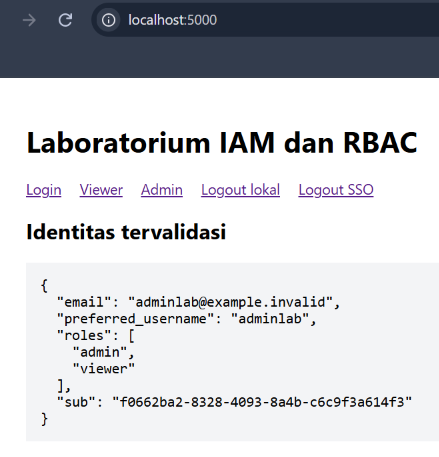

*Gambar 9.40 Identitas tervalidasi pengguna adminlab dengan peran admin dan viewer.*

```bash
curl -b cookies.txt http://localhost:5000/viewer
```

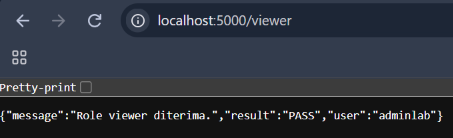

*Gambar 9.41 Akses endpoint /viewer berhasil dengan respons HTTP 200 untuk adminlab.*

```bash
curl -b cookies.txt http://localhost:5000/admin
```

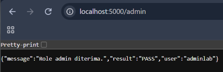

*Gambar 9.42 Akses endpoint /admin berhasil dengan respons HTTP 200 untuk adminlab.*

#### Kotak Perintah F — Menjalankan Negative Test Otomatis

Dilakukan pengujian negatif secara otomatis melalui terminal dengan menjalankan perintah `./scripts/negative-tests.sh | tee reports/negative-tests.txt`. Hasil keluaran memperlihatkan seluruh lima skenario pengujian lulus dengan status PASS, yaitu akses ke endpoint viewer tanpa sesi menghasilkan HTTP 302, akses ke endpoint admin tanpa sesi menghasilkan HTTP 302, penggunaan redirect URI yang tidak terdaftar ditolak dengan HTTP 400, permintaan otorisasi tanpa parameter PKCE ditolak melalui OAuth error redirect (HTTP 302), serta percobaan Direct Access Grant berhasil ditolak karena fiturnya telah dinonaktifkan, dengan total Jumlah kegagalan: 0.

```bash
./scripts/negative-tests.sh | tee reports/negative-tests.txt
```

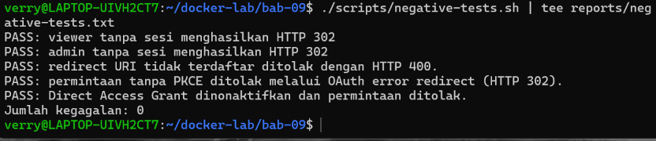

*Gambar 9.43 Hasil eksekusi 5 skenario negative testing otomatis keamanan OIDC dan RBAC.*

#### Kotak Perintah G — Memeriksa Hardening dan Persistensi

Dilakukan verifikasi konfigurasi hardening pada container aplikasi serta pengujian persistensi data realm pada PostgreSQL. Eksekusi perintah `docker compose exec app id` menampilkan `uid=10001(appuser) gid=10001(appgroup) groups=10001(appgroup)`, sedangkan perintah `docker inspect devsecops-bab09-app-1` mengonfirmasi pengaturan `ReadOnly=true`, `CapDrop=["ALL"]`, `Pids=100`, dan `Memory=268435456` (256 MB). Saat diuji menulis ke sistem berkas utama melalui `docker compose exec app sh -c 'touch /should-fail'`, perintah ditolak dengan pesan `Read-only file system`, sedangkan penulisan ke direktori sementara `/tmp/allowed` berhasil dilakukan.

Selanjutnya, pemeriksaan ke database PostgreSQL melalui perintah `docker compose exec db psql -U keycloak -d keycloak -c 'SELECT COUNT(*) AS realm_count FROM realm;'` menghasilkan nilai `realm_count` sebesar 2 (realm master dan devsecops-lab). Setelah container Keycloak dimulai ulang dengan perintah `docker compose restart keycloak`, pengujian kembali menggunakan `curl --fail http://keycloak.localhost:8080/realms/devsecops-lab/.well-known/openid-configuration >/dev/null` berhasil mengunduh 6901 byte metadata konfigurasi tanpa galat, yang membuktikan bahwa data realm tersimpan secara persisten di dalam volume PostgreSQL.

```bash
docker compose exec app id
```

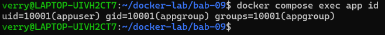

*Gambar 9.44 Pemeriksaan identitas non-root UID dan GID 10001 pada container aplikasi.*

```bash
docker inspect devsecops-bab09-app-1 --format 'ReadOnly={{.HostConfig.ReadonlyRootfs}} CapDrop={{json .HostConfig.CapDrop}} Pids={{.HostConfig.PidsLimit}} Memory={{.HostConfig.Memory}}'
```

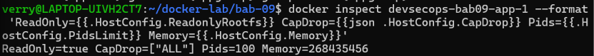

*Gambar 9.45 Verifikasi atribut hardening HostConfig container aplikasi.*

```bash
docker compose exec app sh -c 'touch /should-fail'
docker compose exec app sh -c 'touch /tmp/allowed && ls -la /tmp/allowed'
```

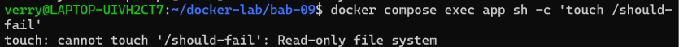

*Gambar 9.46 Pembuktian penolakan write pada rootfs dan keberhasilan write pada tmpfs /tmp.*

```bash
docker compose exec db psql -U keycloak -d keycloak -c 'SELECT COUNT(*) AS realm_count FROM realm;'
```

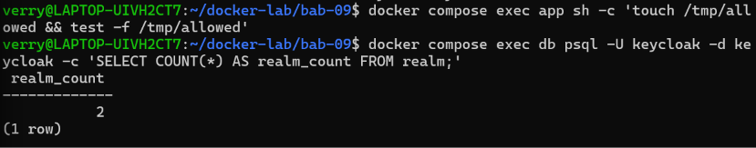

*Gambar 9.47 Kueri database PostgreSQL membuktikan persistensi 2 realm Keycloak.*

```bash
docker compose restart keycloak
```

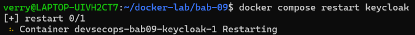

*Gambar 9.48 Restart container Keycloak untuk menguji integritas state persisten.*

```bash
curl --fail http://keycloak.localhost:8080/realms/devsecops-lab/.well-known/openid-configuration >/dev/null
```

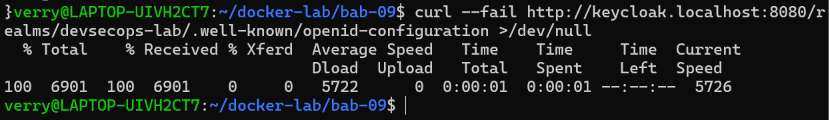

*Gambar 9.49 Pengujian kesiapan dan respons metadata OIDC Keycloak setelah restart.*

#### Kotak Perintah H — Mengumpulkan Evidence

Dilakukan pengumpulan seluruh bukti teknis praktikum dengan mengeksekusi script `./scripts/collect-evidence.sh` yang menampilkan pesan `PASS: evidence tersimpan pada reports/`. Pemeriksaan isi direktori menggunakan perintah `find reports -maxdepth 1 -type f -printf '%f\n' 2>/dev/null | sort` menampilkan 14 berkas bukti yang telah tersusun rapi (mulai dari `.gitkeep`, `app-health.json`, `compose-images.txt`, hingga `source-sha256.txt`) tanpa menyertakan nilai secret maupun token. Sebagai langkah penutup integritas bukti, dijalankan perintah `sha256sum reports/* > reports-manifest-sha256.txt` yang menghasilkan berkas manifes checksum berukuran 1223 byte.

```bash
./scripts/collect-evidence.sh
find reports -maxdepth 1 -type f -printf '%f\n' 2>/dev/null | sort
```

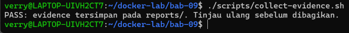

*Gambar 9.50 Eksekusi scripts/collect-evidence.sh dan inventarisasi 14 berkas bukti uji pada reports/.*

```bash
sha256sum reports/* > reports-manifest-sha256.txt
ls -l reports-manifest-sha256.txt
head -n 15 reports-manifest-sha256.txt
```


*Gambar 9.51 Pembangkitan berkas manifes checksum SHA-256 untuk seluruh artefak evidence.*

#### Kotak Perintah I — Cleanup

Setelah seluruh rangkaian pengujian dan pengumpulan bukti selesai dilaksanakan, dilakukan penghentian dan pembersihan layanan laboratorium menggunakan perintah `docker compose down --remove-orphans`. Keluaran terminal mengonfirmasi bahwa keempat container (`devsecops-bab09-proxy-1`, `devsecops-bab09-app-1`, `devsecops-bab09-keycloak-1`, dan `devsecops-bab09-db-1`) beserta kedua jaringan internal telah berhasil dihentikan dan dihapus (Removed) sambil tetap mempertahankan volume database.

```bash
docker compose down --remove-orphans
```


*Gambar 9.52 Penghentian dan penghapusan container laboratorium dengan docker compose down.*
